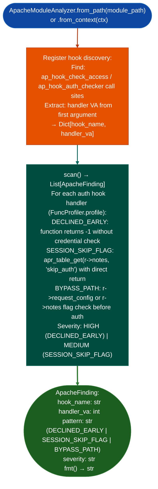

# Apache Module Analysis

Analyze Apache C module binaries (`.so` files built against APR/APRUTIL) for security vulnerabilities: finding authentication bypass patterns in `ap_hook_check_access` handlers, session skip flag logic, and direct `DECLINED` returns in authentication hooks: as demonstrated by the FortiAnalyzer `mod_extension.so` MFA bypass CVE-2026-22572 / FAZ-CVE22572.

---

## Why this exists

1. **FortiAnalyzer v7.6.3 ships a custom Apache module `mod_extension.so` that bypasses MFA via a session skip flag.** Manual disassembly FAZ-CVE22572 / CVE-2026-22572 was required to confirm the bypass surface because no Ablation tool could identify Apache APR hook registration patterns, find the authentication hook handler function, or locate the `DECLINED` return path. `ApacheModuleAnalyzer` closes this gap.

2. **Apache modules export hook registration functions `register_hooks`, `module_name_module` and register callbacks via `ap_hook_check_access`/`ap_hook_check_access_ex`/`ap_hook_auth_checker`.** `ApacheModuleAnalyzer.from_path()` identifies these registration sites and maps each hook to its handler function VA, enabling `FuncProfiler` to analyze exactly the handler function, not the full module.

3. `ApacheModuleAnalyzer.scan()` looks for authentication skip patterns in hook handlers: `DECLINED` returns (-1) before any credential validation, `r->notes` flag checks that bypass the authentication flow, and `apr_table_get(r->notes, "skip_auth")` patterns. These patterns are the structural signature of auth bypass vulnerabilities in Apache C modules.

---

## How it works



---

## Usage

```python
from ablation.analyzers.apache_module_analyzer import ApacheModuleAnalyzer
from ablation.analyzers.binary_context import BinaryContext

ctx = BinaryContext.load_or_build('/path/to/mod_extension.so')
analyzer = ApacheModuleAnalyzer.from_context(ctx)

# Discover hook registrations
hooks = analyzer.registered_hooks()
for hook_name, va in hooks.items():
    print(f"  {hook_name}: handler at {va:#x}")

# Scan for auth bypass patterns
findings = analyzer.scan()
if findings:
    print(ApacheModuleAnalyzer.report(findings))
else:
    print("No auth bypass patterns detected")
```

---

## Example output

The following illustrates the Apache module analysis output format. Actual addresses are module-specific.

```
ApacheModuleAnalyzer: mod_extension.so

Registered hooks:
  ap_hook_check_access   handler=<va>
  ap_hook_post_config    handler=<va>

scan() findings:
  [HIGH] SESSION_SKIP_FLAG  ap_hook_check_access  at <va>
    apr_table_get(r->notes, "skip_auth") → returns DECLINED without credential check
    FAZ-CVE22572 pattern confirmed
```

---

## False positives

**`DECLINED` return detection uses backward trace from return instruction**: a function that returns `DECLINED` (`-1`) for specific URI patterns for example to skip auth for public assets like `/favicon.ico` is architecturally valid. Verify that the `DECLINED` return path is conditional on the skip flag rather than unconditional.

**`ap_hook_*` function name matching uses PLT name lookup**: if the module uses a wrapper that calls `ap_hook_check_access` indirectly for example through a function pointer stored in a struct, the hook registration may not be detected. Inspect the module's `register_hooks` function manually if no hooks are detected in a known Apache module.

---

## Pipeline position

Run `ApacheModuleAnalyzer` on any Apache `.so` module found in firmware `/usr/lib/apache2/modules/`, FortiAnalyzer `/webroot/lib/` during initial attack surface enumeration. Pair with `PreAuthRouteAuditor` for web framework authentication bypass analysis on the same target.

---

## Reading findings

`ApacheModuleAnalyzer.scan()` returns a list of finding dicts:

| Field | Content |
|:---|:---|
| `severity` | `HIGH` / `MEDIUM` |
| `title` | Finding code for example `SESSION_SKIP_FLAG`, `ACCESS_CHECK_BYPASS` |
| `detail` | Hook name, handler VA, and bypass pattern description |
| `hook_name` | Apache hook name for example `ap_hook_check_access` |
| `handler_va` | VA of the hook handler function |

Hook registration details are embedded in the `detail` field of each `ApacheFinding` returned by `analyze()`. Each finding includes the `hook_name` and `handler_va` attributes alongside the security verdict.

---

## See also

- [Route Authentication Classification](route-authentication-classification.md): `PreAuthRouteAuditor` for flatui/web framework pre-auth routes
- [Single-Function Profiling](single-function-profiling.md): `FuncProfiler` for deep analysis of identified hook handler functions
- [Named Taint Sources and Bounds](named-taint-sources-and-bounds.md): `TaintTracker` for request data flow through auth hooks
