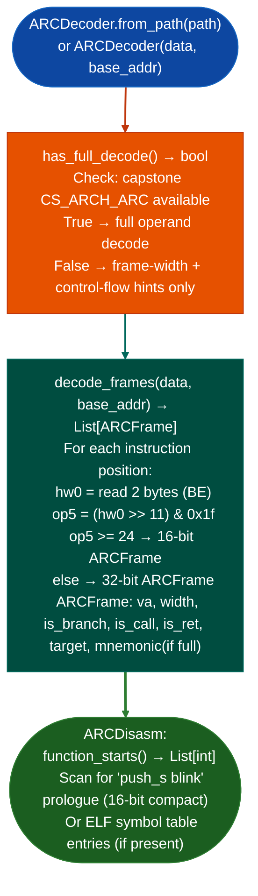

# ARC ISA Decoding

Decode Synopsys DesignWare ARC 700 / ARC HS variable-length firmware: discriminating 16-bit "compact" instructions from 32-bit instructions via the 5-bit `op5` field (`bits[15:11]` ≥ 24 → 16-bit; otherwise 32-bit): with function start heuristics via `push_s blink` prologue scan and graceful upgrade to full Capstone `CS_ARCH_ARC` disassembly when available.

---

## Why this exists

1. **Capstone 5.x does not support `CS_ARCH_ARC`.** The ARC architecture (Synopsys DesignWare ARC 700/HS) is used in embedded IoT devices, network processors, and automotive ECUs. Without `arc_decoder.py`, ARC firmware cannot be disassembled at all in the standard pipeline.

2. ARC uses a mixed 16/32-bit encoding: `op5 = hw0 >> 11 & 0x1f`; values ≥ 24 (0x18) indicate 16-bit "compact" instructions. This single-check width discriminant is O(1) per instruction, enabling fast sequential decode of large ARC firmware images. `ARCDecoder.decode_frames()` implements this discriminant along with control-flow hints for `BL`, `J`, and branch groups.

3. **`ARCDecoder.has_full_decode()` transparently upgrades to full Capstone decoding** when `capstone` with `CS_ARCH_ARC` is available capstone next branch, providing complete operand-level disassembly without requiring changes to calling code. This future-proofs the API: callers always call `decode_frames()`, and the level of detail improves automatically when the dependency becomes available.

---

## How it works



---

## Usage

```python
from ablation.analyzers.arc_decoder import ARCDecoder, ARCDisasm

decoder = ARCDecoder.from_path('/path/to/arc_firmware.bin')
print(f"Full decode available: {decoder.has_full_decode()}")

frames = decoder.decode_frames(decoder.data, base_addr=0x10000)
for f in frames:
    print(f"  {f.va:#x} ({f.width}B) {'CALL' if f.is_call else 'BRANCH' if f.is_branch else ''}")

# Function starts
disasm = ARCDisasm.from_path('/path/to/arc_firmware.bin')
starts = disasm.function_starts()
print(f"ARC functions: {len(starts)}")
```

---

## Example output

The following illustrates ARC decoding output format. Actual addresses are binary-specific.

```
ARCDecoder: arc_firmware.bin  (has_full_decode=False)

decode_frames(): <N> frames
  0x10000 (2B)  compact-16
  0x10002 (4B)
  0x10006 (4B)  CALL → <target>
  0x1000a (2B)  compact-16

ARCDisasm.function_starts(): <F> ARC functions (push_s blink prologue)
```

---

## False positives

**`op5 >= 24` width discrimination is reliable for well-formed ARC code**: data sections that contain bytes resembling ARC instructions will produce incorrect frame boundaries. Use `function_starts()` to anchor decode position to validated function entries.

**`push_s blink` prologue heuristic**: leaf functions that do not save the link register (`blink`) are not detected. The function start list from `function_starts()` is a lower bound; supplement with ELF symbol table entries if available.

---

## Pipeline position

Run `ARCDecoder` / `ARCDisasm` on any ARC 700/HS firmware after `EcuArchDetector` confirms ARC architecture or after manual confirmation from ELF header. Function starts feed taint analysis via ARC-specific `TaintTracker` (`taint_tracker_arc.py`).

---

## Reading output

`ARCDisasm.decode_framesva, size` returns a list of `ARCFrame` objects:

| Attribute | Content |
|:---|:---|
| `va` | Virtual address of the instruction |
| `width` | Frame width in bytes: `2` (16-bit) or `4` (32-bit) |
| `hw0` | First halfword bits 15:0 |
| `hw1` | Second halfword bits 31:16; `0` for 16-bit instructions |
| `mnemonic` | Decoded instruction mnemonic string |
| `op_str` | Operand string |
| `is_branch` | `True` if the instruction is a branch |
| `is_call` | `True` if the instruction is a call |
| `is_ret` | `True` if the instruction is a return |
| `target` | Resolved branch/call target VA 0 if not computed |

`ARCDisasm.function_starts()` returns `List[int]`: VA list of functions identified by `push_s blink` prologues.

---

## See also

- [Flat ROM Function Discovery](flat-rom-function-discovery.md): `EcuArchDetector` for initial architecture detection
- [Named Taint Sources and Bounds](named-taint-sources-and-bounds.md): `TaintTracker` ARC variant for full taint analysis
