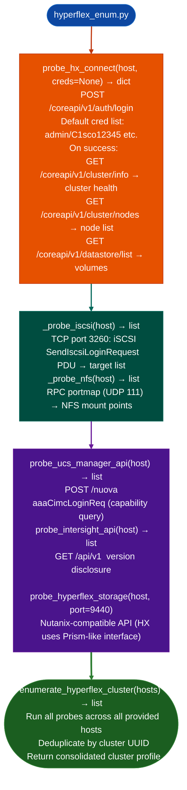

# HyperFlex/UCS/Intersight Enumeration

Probe Cisco HyperFlex Connect REST APIs, iSCSI/NFS storage interfaces, UCS Manager API, and Intersight management endpoints: extracting version information, cluster health, storage volume credentials, and replication configuration: via `modules/hyperflex_enum.py`.

---

## Why this exists

1. **HyperFlex Connect port 443 exposes cluster management without second-factor enforcement on default configurations.** `probe_hx_connect()` attempts authentication using default HyperFlex credentials and, on success, enumerates cluster nodes, health status, storage capacity, and active virtual machines. The `stCtlVM` Storage Controller VM is a privileged management interface that runs on every HyperFlex node and is accessible from the cluster management network.

2. `_probe_iscsi()` and `_probe_nfs()` enumerate storage interfaces: HyperFlex exposes iSCSI targets port 3260 and NFS exports port 2049 on the storage network. `_probe_iscsi()` sends a raw iSCSI `LoginRequest` PDU to enumerate available targets; `_probe_nfs()` uses the RPC portmapper to discover NFS mount points. Storage interface access on the cluster network may not require the same credentials as the management API.

3. **`probe_intersight_api()` and `probe_ucs_manager_api()`** enumerate the Intersight cloud management gateway and UCS Manager local API respectively: both using unauthenticated probe paths. `probe_intersight_api()` checks for version disclosure at the Intersight API base path; `probe_ucs_manager_api()` probes the UCS Manager XMLAPI for capability queries that return hardware inventory without authentication on older firmware versions.

---

## How it works



---

## Usage

```python
from modules.hyperflex_enum import (
    probe_hx_connect, probe_ucs_manager_api,
    enumerate_hyperflex_cluster
)

# Single HyperFlex host probe
results = probe_hx_connect('10.0.0.100')
if results.get('authenticated'):
    print(f"Cluster: {results.get('cluster_name')}")
    print(f"Nodes: {len(results.get('nodes', []))}")
    for ds in results.get('datastores', []):
        print(f"  Datastore: {ds['name']}  size={ds['capacity']}")

# Multi-host cluster enumeration
cluster = enumerate_hyperflex_cluster(['10.0.0.100', '10.0.0.101', '10.0.0.102'])
```

---

## Example output

The following illustrates HyperFlex enumeration output format.

```
probe_hx_connect: 10.0.0.100

Authentication: admin/C1sco12345 → SUCCESS

Cluster: hx-cluster-01
Nodes: <N>  |  Health: HEALTHY

Datastores:
  DS01  512 GiB
  DS02  1024 GiB

iSCSI (port 3260): <M> targets
NFS (port 2049): <K> mount points
```

---

## False positives

**`probe_hx_connect()` with default credentials**, not all HyperFlex deployments retain default credentials. The probe will return `authenticated: False` and fall back to unauthenticated probing. Do not assume default credentials are present.

**iSCSI target enumeration may trigger alerts**: sending iSCSI `LoginRequest` PDUs to the storage network is detectable by storage area network monitoring. Limit iSCSI probing to authorized assessments.

---

## Pipeline position

Run HyperFlex/UCS/Intersight probes after network discovery confirms HyperFlex management IPs port 443 open with Cisco TLS certificate. Results feed storage lateral movement NFS mount, iSCSI attach and management escalation cluster admin access.

---

## Reading findings

HyperFlex/UCS/Intersight probe functions return `List[{severity, title, detail, host, port, evidence}]`:

| Field | Content |
|:---|:---|
| `severity` | `CRITICAL` / `HIGH` / `MEDIUM` |
| `title` | Finding code for example `HX_DEFAULT_CRED`, `UCSM_UNAUTHENTICATED_API`, `INTERSIGHT_CLAIM_TOKEN_EXPOSED` |
| `detail` | Description of the misconfiguration |
| `host` | Target host IP or hostname |
| `port` | Service port |
| `evidence` | Response excerpt or credential confirming the finding |

---

## See also

- [Nexus Dashboard](nexus-dashboard.md): Nexus Dashboard management layer above HyperFlex in Cisco deployments
- [NX-OS/ACI/APIC Fabric Enumeration](nx-os-aci-apic-fabric-enumeration.md): fabric-level enumeration for the network underlay
