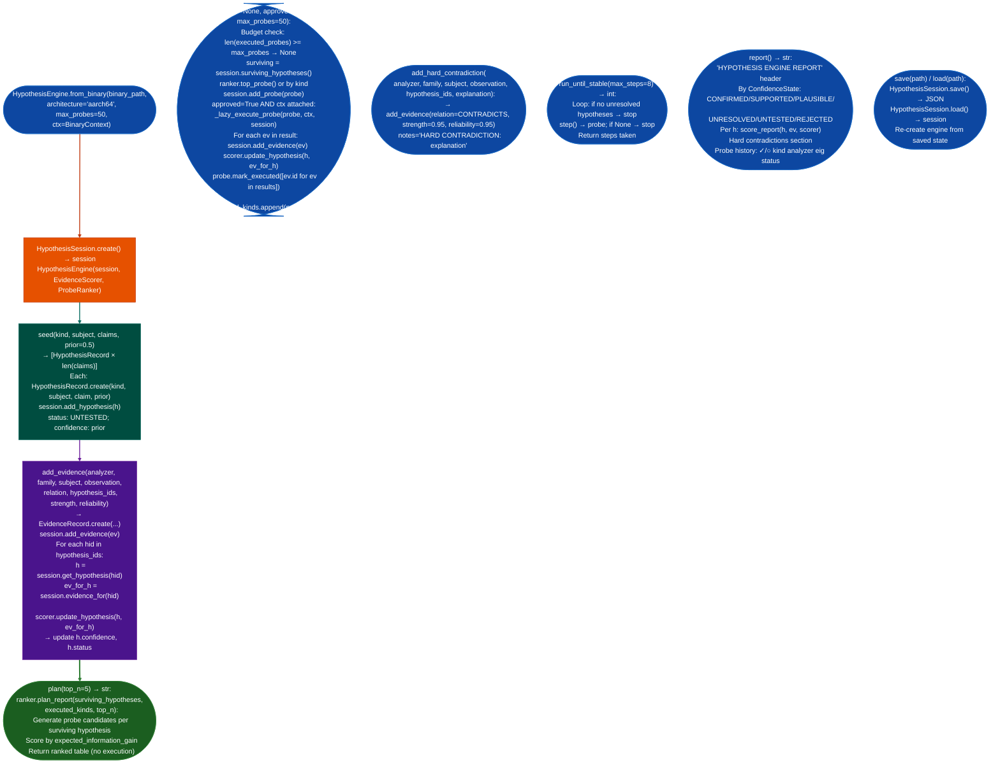

<a id="hypothesis-engine"></a>
# Vulnerability Hypothesis Tracking

Coordinate the analysis session lifecycle for a single binary: accepting typed hypotheses about call targets, taint flows, or vulnerability classes; recording evidence from Ablation analyzers with `EvidenceRelation` weights; ranking probes by expected information gain; updating confidence scores after each evidence addition; and persisting the full session to JSON for reproducibility.

---

## Why this exists <sup>[↑](#hypothesis-engine)</sup>

1. **Binary RE sessions on stripped firmware accumulate evidence from many analyzers, and without a structured way to associate evidence with competing hypotheses, analysts either over-rely on a single tool's output or lose track of which observations support or contradict each other.** `HypothesisEngine` models competing hypotheses as first-class objects with Bayesian confidence scores. Evidence from `ARM64TaintTracker`, `SemanticSearcher`, `CFGBuilder`, and `XRefGraph` all update the same hypothesis pool via `add_evidence()`, so the confidence scores reflect the full evidence base rather than any single analyzer's finding.

2. **The probe ranker reduces wasted analysis time by ranking which probe to run next based on expected information gain against surviving hypotheses.** For a binary with 15 competing hypotheses about indirect call targets, running all 15 probes sequentially ignores that some probes resolve multiple hypotheses simultaneously. `ProbeRanker.top_probe()` calculates which probe kind: `cfg`, `taint`, `semantic`, `lifter`: maximally reduces uncertainty across surviving non-CONFIRMED, non-REJECTED hypotheses. `plan()` returns a dry-run ranked list without executing anything.

3. **The three-milestone architecture separates plan-and-report Milestones 1/2 from auto-execution Milestone 3: allowing the engine to be used as a reasoning aid before probe execution is wired up.** In Milestones 1/2, `step(approved=False)` records the probe for analyst review; the analyst executes it manually and calls `add_evidence()`. With a `BinaryContext` attached, `step(approved=True)` executes the probe via `probe_adapters.execute_probe()` and feeds the result back into the confidence scorer automatically.

---

## How it works <sup>[↑](#hypothesis-engine)</sup>



### ConfidenceState transitions <sup>[↑](#hypothesis-engine)</sup>

| Status | Confidence threshold | Description |
|---|---|---|
| `UNTESTED` |: | No evidence yet |
| `UNRESOLVED` | Any evidence, no clear direction | Conflicting evidence |
| `PLAUSIBLE` | confidence > prior | Supported but not confirmed |
| `SUPPORTED` | confidence ≥ 0.70 | Strong supporting evidence |
| `CONFIRMED` | confidence ≥ 0.90 | Accepted |
| `REJECTED` | confidence ≤ 0.10 | Refuted by hard contradiction |

---

## Usage <sup>[↑](#hypothesis-engine)</sup>

```python
from ablation.analyzers.hypothesis_engine import HypothesisEngine
from ablation.analyzers.binary_context import BinaryContext

# Create a new session
engine = HypothesisEngine.from_binary(
    '/path/to/firmware.so',
    architecture='aarch64',
    max_probes=50,
)

# Seed competing hypotheses about an indirect call target
h1, h2, h3 = engine.seed(
    kind="indirect_call_target",
    subject={"call_site_va": "0x401920"},
    claims=[
        {"target_va": "0x4026c0", "description": "dispatch_auth"},
        {"target_va": "0x403110", "description": "dispatch_session"},
        {"target_va": "0x404500", "description": "dispatch_log"},
    ],
    prior=0.33,
)

# Add taint tracker evidence supporting h1
engine.add_evidence(
    analyzer="ARM64TaintTracker",
    family="data_flow",
    subject={"va": "0x4026c0"},
    observation={"source_to_sink": True, "path_length": 3},
    relation="supports",
    hypothesis_ids=[h1.id],
    strength=0.80,
    reliability=0.90,
)

# Add a hard contradiction against h3 (XRef shows no callers)
engine.add_hard_contradiction(
    analyzer="XRefGraph",
    family="control_flow",
    subject={"va": "0x404500"},
    observation={"caller_count": 0},
    hypothesis_ids=[h3.id],
    explanation="0x404500 has no callers in XRefGraph — cannot be a call target",
)

# Dry-run: rank next probes by information gain
print(engine.plan(top_n=3))

# Milestone 3: auto-execute with BinaryContext
ctx = BinaryContext.load_or_build('/path/to/firmware.so')
engine.with_context(ctx)
probe = engine.step(approved=True)
print(f"Executed: {probe.kind} → {len(probe.result_evidence_ids)} evidence items")

# Full report
print(engine.report())

# Run until all hypotheses reach terminal state
steps = engine.run_until_stable(max_steps=8)
print(f"Stable after {steps} steps")

# Persist
engine.save('/tmp/firmware_session.json')

# Resume
engine2 = HypothesisEngine.load('/tmp/firmware_session.json')
```

---

## Example output <sup>[↑](#hypothesis-engine)</sup>

```
plan() output:
  Ranked probes (3 of 50 remaining, 2 surviving):
  1. cfg         CFGBuilder          eig=0.482  targets: [h1, h2]
  2. taint       ARM64TaintTracker   eig=0.341  targets: [h1]
  3. semantic    SemanticSearcher    eig=0.198  targets: [h1, h2]

report() excerpt:
  ── CONFIRMED (1) ─────────────────────────────────────
  [indirect_call_target] 0x401920 → 0x4026c0 (dispatch_auth)
    confidence=0.917  evidence=2  probes=1

  ── REJECTED (1) ──────────────────────────────────────
  [indirect_call_target] 0x401920 → 0x404500 (dispatch_log)
    confidence=0.022  HARD CONTRADICTION: 0x404500 has no callers

  ── PROBE HISTORY ──────────────────────────────────────
  ✓ [cfg]     CFGBuilder       eig=0.482  executed
  ○ [taint]   ARM64TaintTracker eig=0.341  pending
```

---

## False positives <sup>[↑](#hypothesis-engine)</sup>

**`ConfidenceState.CONFIRMED` at `confidence ≥ 0.90` does not guarantee correctness, it reflects evidence quality, not ground truth.** A hypothesis reaches CONFIRMED when sufficient supporting evidence accumulates. If the supporting evidence comes from analyzers with high reliability scores but the underlying observation is wrong for example a semantic search returning a false positive, the hypothesis can be CONFIRMED incorrectly. Always byte-verify CONFIRMED indirect call targets with `data[off:off+n] == expected_bytes` before recording findings.

**`add_hard_contradiction()` sets `strength=0.95`, but does not block future supporting evidence from recovering the hypothesis.** A hard contradiction drives confidence toward 0.05 rejection floor but does not permanently lock the hypothesis as REJECTED. If subsequent evidence with `strength > 0.95` is added in `relation='supports'`, the confidence score can recover. Use `add_hard_contradiction()` for observations that are definitively contradictory XRef count = 0, invalid VA, wrong architecture, not for weak negative evidence.

**`step(approved=False)` records the probe in `session.probes` without executing it: `_executed_kinds` is only updated when `approved=True`.** If `step(approved=False)` is called repeatedly, the same probe kind may appear multiple times in the pending list because `executed_kinds` does not include it. The ranker de-duplicates by `executed_kinds`, which is only updated on approval. For planning-only sessions Milestones 1/2, call `plan()` for ranked probe lists rather than `step(approved=False)`.

---

## Pipeline position <sup>[↑](#hypothesis-engine)</sup>

**Before this module:** Run initial triage tools: `BinaryContext.summary()`, `SemanticSearcher.query()`: to form initial hypotheses. `HypothesisEngine.from_binary()` should be created before committing to a hypothesis direction; seeding early with multiple competing claims prevents confirmation bias in the subsequent probe selection.

**After this module:** For CONFIRMED hypotheses: call `ctx.set_name(va, name, source='confirmed')` and `PatternLibrary.record_hit(confirmed=True)`. For REJECTED hypotheses: document the hard contradiction reason in `re/<vendor>/SESSION_<target>.md`. Export the session with `save()` before ending any RE session so the hypothesis state survives across context windows.

---

## Reading findings <sup>[↑](#hypothesis-engine)</sup>

| Field | Content |
|:---|:---|
| `h.status` | `ConfidenceState` enum: CONFIRMED/SUPPORTED/PLAUSIBLE/UNRESOLVED/UNTESTED/REJECTED |
| `h.confidence` | 0.0–1.0 Bayesian posterior: updated by `scorer.update_hypothesis()` after each evidence |
| `h.kind` | Hypothesis type string `indirect_call_target`, `taint_flow`, `vuln_class` |
| `h.subject` | Dict identifying the binary artifact being analyzed for example `{"call_site_va": "0x401920"}` |
| `h.claim` | Dict stating the specific claim being tested for example `{"target_va": "0x4026c0"}` |
| `probe.expected_information_gain` | Expected reduction in hypothesis uncertainty: higher = run first |

---

## See also <sup>[↑](#hypothesis-engine)</sup>

- [Evidence Scoring & Validation](evidence-scoring-and-probe-ranking.md): probe selection, information-gain ranking, and approved adapters
- [Analyzer Probe Adapters](analyzer-probe-adapters.md): concrete adapters that execute probes against `BinaryContext`
