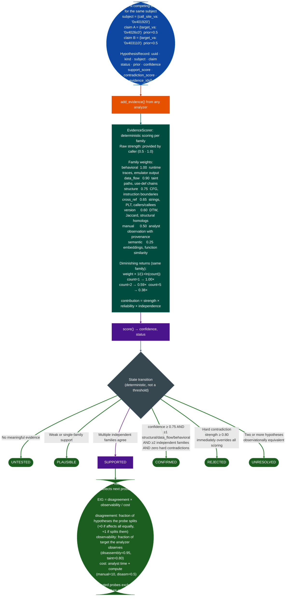

# Hypothesis Engine

Structured competing-hypothesis orchestration for binary reverse engineering. Seeds candidate explanations, scores evidence from every analyzer family, ranks probes by expected information gain, and transitions hypotheses to CONFIRMED or REJECTED via deterministic rules.

**Modules:**
- `ablation.analyzers.hypothesis_models`: data model + JSON persistence
- `ablation.analyzers.evidence_scorer`: confidence scoring + state transitions
- `ablation.analyzers.probe_ranker`: probe candidate generation + EIG ranking
- `ablation.analyzers.hypothesis_engine`: session lifecycle + orchestration

---

## Why this exists

One structural gap blocked systematic RE:

**Without a hypothesis record, every analysis session is amnesiac.**
A taint tracker returns a list of findings. A semantic searcher returns ranked VAs. Without a framework that asks "which of my competing explanations does this evidence support, and what should I run next?", the analyst replays the same investigations in every session and cannot quantify progress. `HypothesisEngine` is the connective tissue: it holds the hypotheses, receives evidence from any analyzer, scores confidence deterministically, and plans the next probe that maximally distinguishes remaining candidates.

---

## Architecture



---

## Quick start

```python
from ablation.analyzers.hypothesis_engine import HypothesisEngine

engine = HypothesisEngine.from_binary('/path/to/binary', architecture='arm64')

# Seed two competing indirect call targets
h_yes, h_no = engine.seed(
    kind='indirect_call_target',
    subject={'call_site_va': '0x401920'},
    claims=[
        {'target_va': '0x4026c0'},
        {'target_va': '0x403110'},
    ],
    prior=0.5,
)

# Record data_flow evidence from TaintTracker supporting h_yes
engine.add_evidence(
    analyzer='ARM64TaintTracker',
    family='data_flow',
    subject={'va': '0x4026c0'},
    observation={'source_to_sink': True, 'path_length': 3},
    relation='supports',
    hypothesis_ids=[h_yes.id],
    strength=0.80,
)

# Plan: rank remaining probes by EIG
print(engine.plan())

# Full report
print(engine.report())

# Persist session
engine.save()
```

---

## Evidence families and weights

| Family | Weight | Examples |
|---|---|---|
| `behavioral` | 1.00 | Runtime traces, emulator output (Phase 3) |
| `data_flow` | 0.90 | Taint paths, use-def chains from TaintTracker |
| `structure` | 0.75 | CFG edge counts, instruction boundaries |
| `cross_reference` | 0.65 | String xrefs, PLT callers, BinaryContext callees |
| `version` | 0.60 | Jaccard homolog, DTW score, anchor scan result |
| `manual` | 0.50 | Analyst observation with explicit provenance |
| `semantic` | 0.25 | BERT embedding similarity from SemanticSearcher |

Semantic evidence scores 0.25 because embedding similarity is useful for prioritization but insufficient for confirmation. Two disassembly-level structural items from different angles outweigh any number of embedding hits.

---

## Probe kinds and EIG parameters

| Kind | Analyzer | Cost | Observability | Notes |
|---|---|---|---|---|
| `disassembly` | Capstone | 0.5 | 0.95 | Fast; covers most structure questions |
| `xref` | XRefGraph | 0.8 | 0.85 | Answers "what calls this" |
| `cfg` | CFGBuilder | 1.0 | 0.90 | Block structure, loop presence |
| `lifter` | BinaryLifter | 1.5 | 0.80 | Pseudo-C IR with register types |
| `semantic` | SemanticSearcher | 2.0 | 0.60 | Embedding similarity sweep |
| `version` | DTWMatcher | 2.5 | 0.70 | Cross-version homolog check |
| `taint` | ARM64TaintTracker | 3.0 | 0.80 | Source-to-sink path confirmation |
| `manual` | analyst | 10.0 | 1.00 | Reserved for decisive ground truth |

A `disassembly` probe at cost=0.5 with high disagreement beats a `taint` probe at cost=3.0 unless the taint probe has dramatically higher observability for this specific question.

---

## Hypothesis kinds

```
code_region         : is this byte range code or data?
data_region         : is this struct/array?
function_entry      : is this VA a function start?
function_boundary   : where does this function end?
indirect_call_target: what does BLR/BLX at VA dispatch to?
memory_region       : what object does this address belong to?
input_source        : is this the network recv entry point?
security_sink       : is this a security-relevant sink?
source_to_sink_path : does taint reach from source to sink?
version_homolog     : is this the same function across two builds?
architecture_mode   : ARM (A32) or Thumb (T32) at this VA?
```

---

## CONFIRMED transition rules

`CONFIRMED` is a state, not a threshold crossing:

```
confidence >= 0.75
AND at least one item from {structure, data_flow, behavioral}
AND at least two independent evidence families
AND no hard contradiction (strength >= 0.80 on any contradicting item)
```

Hard contradictions are immediate: one contradicting item with strength ≥ 0.80 sets status to `REJECTED` regardless of any support evidence. This prevents accumulating weak supporting evidence that outweighs a decisive contradiction.

---

## API reference

```python
# Session construction
engine = HypothesisEngine.from_binary(binary_path, architecture='arm64')
engine = HypothesisEngine.load('~/.ablation/sessions/S-abc123.json')

# Seeding
hypotheses = engine.seed(kind, subject, claims=[...], prior=0.5)
hypothesis  = engine.seed_one(kind, subject, claim, prior=0.5)

# Evidence recording (confidence updated immediately on each add_evidence call)
ev = engine.add_evidence(
    analyzer, family, subject, observation,
    relation='supports'|'contradicts'|'neutral',
    hypothesis_ids=[...],
    strength=0.5,        # 0.5 = weak, 0.8 = strong, 0.95 = decisive
)
ev = engine.add_hard_contradiction(
    analyzer, family, subject, observation,
    hypothesis_ids, explanation
)

# Planning (dry-run: selects probe, does not execute it)
plan_str = engine.plan(top_n=5)
probe    = engine.next_probe()

# Stepping (Phase 3: execute probe via adapter, record evidence)
probe = engine.step(kind='cfg', approved=True)
steps = engine.run_until_stable(max_steps=8)

# Reporting and persistence
report_str = engine.report()
engine.save()                               # ~/.ablation/sessions/<id>.json
engine.export_report('/path/to/out.json')
```

---

## Session persistence

Sessions live at `~/.ablation/sessions/<session_id>.json`. They contain: binary SHA-256, all hypothesis records with full provenance, all evidence records with analyzer ID + parameters, and all executed probe records. Sessions are deterministic: given the same binary and the same probe sequence, the same hypotheses reach the same states.

---

## Scoring internals

`EvidenceScorer.score()` computes `confidence, status, contradiction_notes`:

```python
scorer = EvidenceScorer(configuration={'family_weights': {...}})
confidence, status, notes = scorer.score(hypothesis, evidence_items)
scorer.update_hypothesis(hypothesis, evidence_items)  # writes scores in place
print(score_report(hypothesis, evidence_items))
```

`ProbeRanker.plan_report()` prints EIG for every unexecuted probe kind across all active hypotheses:

```python
ranker = ProbeRanker()
probes = ranker.generate(hypotheses, executed_kinds=[], max_candidates=10)
probe  = ranker.top_probe(hypotheses)
print(ranker.plan_report(hypotheses, top_n=5))
```

---

## How it works

`HypothesisEngine.from_binary()` builds a `HypothesisSession` keyed to the binary's SHA-256. `seed()` creates `HypothesisRecord` objects with the caller-supplied prior. `add_evidence()` creates an `EvidenceRecord`, appends it to the session, and calls `EvidenceScorer.update_hypothesis()` immediately: confidence is recalculated on every evidence addition, not lazily. `EvidenceScorer.score()` sums per-family contribution strength × family_weight × independence_factor with a diminishing-returns multiplier of 1/(1 + ln(count)) for repeated evidence from the same family. State transitions are deterministic: `CONFIRMED` requires confidence ≥ 0.75 plus at least one structural/data-flow/behavioral item and at least two independent families with no hard contradiction; one contradiction item with strength ≥ 0.80 immediately sets `REJECTED`. `plan()` calls `ProbeRanker.generate()` which scores each un-executed probe kind by EIG = disagreement × observability / cost across all active hypotheses and returns the top-n ranked list.

---

## Usage

```python
from ablation.analyzers.hypothesis_engine import HypothesisEngine
from ablation.analyzers.binary_context import BinaryContext

ctx = BinaryContext.load_or_build('/path/to/target.elf')
engine = HypothesisEngine.from_binary('/path/to/target.elf', ctx=ctx)

probe = engine.seed(
    kind='command_injection',
    subject={'va': 0x12340, 'name': 'handle_request'},
    claims=[{'claim': 'user-controlled input reaches system()', 'confidence': 0.7}],
    prior=0.5,
)
for p in engine.session.executed_probes():
    print(f"[{p.kind}] {p.subject}  confirmed={p.confirmed}")
```

---

## Example output

```
HypothesisEngine  binary=fmc_server  session=S-7f3a1b2c
  Hypothesis 1  indirect_call_target  call_site_va=0x401920
    status=SUPPORTED  confidence=0.68
    evidence:
      [data_flow  0.80  supports]  ARM64TaintTracker  source_to_sink=True  path_length=3
      [structure  0.65  supports]  CFGBuilder         basic_blocks=4
    prior=0.50  support_score=0.58  contradiction_score=0.00

  Hypothesis 2  indirect_call_target  call_site_va=0x401920
    status=REJECTED  confidence=0.00
    evidence:
      [structure  0.85  contradicts]  Capstone  insn_type=data_not_code (hard contradiction)

  plan (top 3 by EIG):
    1.  disassembly  EIG=0.74  (cost=0.5  disagreement=0.80  observability=0.95)
    2.  taint        EIG=0.40  (cost=3.0  disagreement=0.82  observability=0.80)
    3.  xref         EIG=0.29  (cost=0.8  disagreement=0.40  observability=0.85)
```

---

## False positives

**`CONFIRMED` on an incorrect hypothesis**: the confidence threshold (0.75) can be reached with two well-chosen pieces of supporting evidence from structural and data-flow families. This is by design: accumulating enough evidence from independent families is the definition of CONFIRMED. If evidence turns out to be wrong for example the taint path was tracking a wrong variable, add a `contradicts` item with strength ≥ 0.80 to trigger `REJECTED`, or call `engine.add_hard_contradiction()` directly.

**Stale evidence from a prior session**: `EvidenceScorer` applies diminishing returns within a session but does not de-duplicate evidence across sessions when the same probe kind has been run on prior loads of the same session file. Load and continue an existing session with `HypothesisEngine.load(path)` rather than creating a new engine and re-adding evidence.

---

## Pipeline position

**Before this module:** `BinaryContext.load_or_build()` to obtain the binary SHA-256 and architecture. `SemanticSearcher` and `FuncProfiler` results can be fed as evidence items immediately after seeding.

**After this module:** When a hypothesis reaches `CONFIRMED`, its subject fields such as `call_site_va` and `target_va` are verified ground truth: register the finding with `FindingRegistry.register()` and write to `re/<vendor>/<target>_re.py`. Hypotheses reaching `UNRESOLVED` observationally equivalent competitors require a manual probe `kind='manual'` and `strength=0.95` to break the tie.

---

## Reading output

`HypothesisEngine.from_binary(path, ctx=ctx).session.hypotheses` returns `List[HypothesisRecord]`:

| Attribute | Content |
|:---|:---|
| `id` | Unique hypothesis identifier string |
| `kind` | Hypothesis kind such as `'buffer_overflow'`, `'use_after_free'`, and `'format_string'` |
| `subject` | `dict`: what the hypothesis is about such as `{"va": "0x401920"}` |
| `claim` | `dict`: the specific machine-readable claim |
| `status` | `ConfidenceState`: `'UNTESTED'` / `'PLAUSIBLE'` / `'SUPPORTED'` / `'CONFIRMED'` / `'UNRESOLVED'` / `'REJECTED'` |
| `prior` | Float: Bayesian prior probability default 0.5 |
| `confidence` | Float: posterior confidence after evidence scoring |
| `support_score` | Float: cumulative support evidence score |
| `contradiction_score` | Float: cumulative contradiction evidence score |
| `evidence_ids` | `List[str]`: IDs of `EvidenceRecord` objects supporting this hypothesis |
| `notes` | Free-text analyst notes |

---

## See also

- [BinaryContext](binary-context.md): session foundation for all analysis
- [SemanticSearch](semantic-search.md): function candidate identification
- [FindingRegistry](registry.md): persistent finding storage
