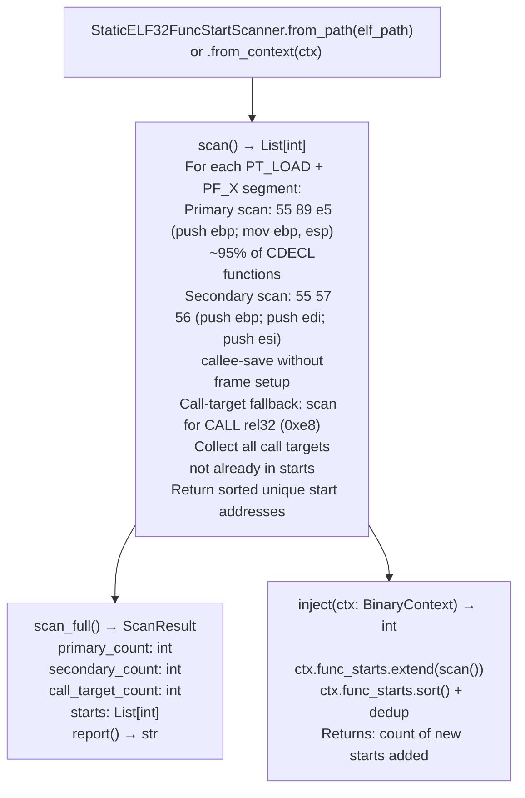

# i386 Stripped Static Binary Function Discovery

Discover function starts in stripped statically-linked i386 ELF binaries — where neither `.symtab` nor `.dynsym` are populated — using primary `push ebp; mov ebp, esp` prologue pattern scan and a `call`-target fallback for `-fomit-frame-pointer` compiled functions.

---

## Why this exists

1. **`lief` populates `BinaryContext.func_starts` only from `.symtab` / `.dynsym` symbol table entries.** Statically linked stripped i386 ELF binaries (common in legacy network firmware, VxWorks images, and old Linux daemons compiled with `strip --strip-all`) have neither table populated. Without `func_starts`, `SemanticSearcher`, `TaintTracker`, and `SinkArgClassifier` cannot run.

2. **The primary CDECL prologue (`55 89 e5`: `push ebp; mov ebp, esp`) is present in ~95% of GCC-compiled i386 functions** — it is the most reliable function start indicator in stripped i386 binaries. `StaticELF32FuncStartScanner.scan()` finds all occurrences of this byte sequence in executable segments (`PT_LOAD + PF_X`) as the primary method.

3. **`inject(ctx)` patches the discovered starts directly into `BinaryContext.func_starts`** — after injection, the full Ablation analysis pipeline runs normally on the previously unanalyzable stripped binary. `scan_full()` returns a `ScanResult` with primary/secondary/call-target counts for diagnostic purposes.

---

## How it works



---

## Usage

```python
from ablation.analyzers.static_elf32_func_start_scanner import StaticELF32FuncStartScanner
from ablation.analyzers.binary_context import BinaryContext

ctx = BinaryContext.load_or_build('/path/to/stripped_i386_binary')

if not ctx.func_starts:
    print("No function starts from ELF symbols — running prologue scan")
    scanner = StaticELF32FuncStartScanner.from_context(ctx)
    n_injected = scanner.inject(ctx)
    print(f"Injected {n_injected} function starts")

    # Diagnostic breakdown
    result = scanner.scan_full()
    print(result.report())

# Now SemanticSearcher and TaintTracker work normally
from ablation.analyzers.semantic_search import SemanticSearcher
searcher = SemanticSearcher.from_context(ctx)
searcher.build_corpus()
```

---

## Example output

The following illustrates the function start discovery output format. Actual counts are binary-specific.

```
StaticELF32FuncStartScanner: stripped_i386_binary  (i386, stripped, static)

func_starts before injection: 0  (no .symtab/.dynsym)

Scan results:
  Primary   (55 89 e5):   <A> functions
  Secondary (55 57 56):   <B> functions
  Call-target fallback:   <C> functions

Total injected: <N>  (deduplicated)

func_starts after injection: <N>
```

---

## False positives

**Prologue byte patterns in data sections** — the byte sequence `55 89 e5` can appear in data constants by coincidence. `StaticELF32FuncStartScanner` scans only `PT_LOAD + PF_X` (executable) segments, which reduces but does not eliminate data false positives. Functions starting at misidentified addresses will produce garbled `FuncProfiler` output — these are detectable because they decode as invalid instruction sequences.

**Call-target fallback may identify data pointers as function starts** — a `call` instruction with a 32-bit relative offset into a non-code region. Use `scan_full()` to check call-target counts; a suspiciously high count relative to primary+secondary counts suggests data-region pollution.

---

## Pipeline position

Run `StaticELF32FuncStartScanner.inject()` immediately after `BinaryContext.load_or_build()` when `ctx.func_starts` is empty on a known stripped static i386 binary. This step is a prerequisite for all subsequent analysis.

---

## Reading output

`StaticELF32FuncStartScanner.scan()` injects function starts into `BinaryContext` and returns a summary dict:

| Key | Content |
|:---|:---|
| `primary_count` | Functions found by primary prologue (`55 89 e5`) |
| `secondary_count` | Functions found by secondary prologue (`55 57 56`) |
| `calltarget_count` | Functions found by call-target fallback analysis |
| `total_injected` | Total deduplicated function starts added to `ctx` |

After `scan()`, `ctx.func_starts` contains the injected addresses.

---

## See also

- [Persistent Analysis Context](persistent-analysis-context.md) — `BinaryContext.func_starts` that this scanner populates
- [Debug Metadata Recovery](debug-metadata-recovery.md) — `I386AbsoluteXrefScanner` for ELF32 absolute cross-reference injection
- [Generic Vulnerability Profile Sweeps](generic-vulnerability-profile-sweeps.md) — `SemanticSearcher` that requires `func_starts`
