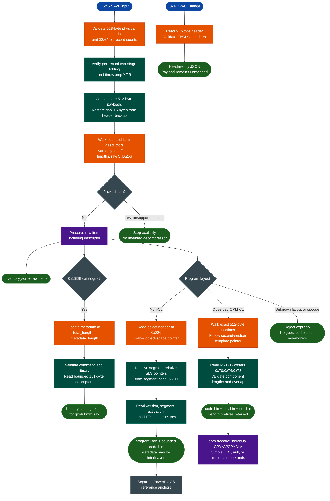

<a id="ibm-timi-save-file-analysis"></a>
# IBM i TIMI & Save-File Analysis

`ablation.ibm_timi` parses IBM i / OS/400 QSYS save files, verifies record checksums, recovers bounded saved-object items, decodes a verified legacy catalogue, and maps two non-CL plus two OPM CL `*PGM` layouts. For the OPM objects, it extracts bounded MI instruction, ODV, and OES components and decodes individual CPYNV and CPYBLA instructions. It also reads `QZRDPACK` licensed-program headers. The implementation is standard-library-only; it is not yet a complete TIMI disassembler or decompiler.

For the separate z/OS NETDATA, PDS/PDSE, IEWPLMH, and S/390 workflow, see [IBM z/OS Artifact Analysis](ibm-zos.md).

---

## Why this exists

1. **Saved objects are not ELF executables.** QSYS SAVF files wrap machine-interface objects in physical record trailers, a logical save stream, item descriptors, catalogues, and segments. Disassembling the file directly would confuse metadata with code.
2. **Integrity and boundaries must precede instruction recovery.** Ablation proves the physical records and item chain before decoding catalogue entries or following program-space pointers. Segment declarations are not silently treated as materialized pages.
3. **OPM and non-CL objects need different models.** The recovered non-CL layout resolves activation and PEP pointers in one segment. The CL objects instead carry an OPM program template in a second serialized section. IBM's MATPG template locates the instruction stream, object definition table directory vector (ODV), and ODT entry string (OES); these structures must not be forced through the non-CL pointer map.
4. **The analysis path is inspectable and offline.** The implementation uses only Python's standard library. It does not invoke jSAVF, Ghidra, Radare2, Capstone, or an IBM i host.
5. **The novelty is the joined native workflow.** Ablation does not claim to have invented SAVF parsing, OPM program templates, QPROCT, or TIMI. It links record verification, bounded item extraction, catalogue recovery, both program layouts, exact component extraction, and independently checked PowerPC AS and TIMI instruction evidence in one reproducible toolchain.

This is an analysis aid, not a trust or vulnerability verdict. Record checksums are deterministic consistency checks, not signatures or proof of provenance.

---

## How it works



The parser distinguishes three coordinate systems. `logical_offset` addresses the backup-restored 512-byte-payload stream, `physical_offset` includes the 16-byte record trailers, and program pointers use a 24-bit offset relative to their containing segment. In the recovered non-CL objects, the segment begins at item offset `0x200`; its object-space pointer selects program header `0x300`. The parser does not treat those pointers as absolute item offsets.

The OPM objects share the initial object-space model but not the following tables. Their program-header pointer at `+0x08` targets the next segment identifier at offset `0x20`. Ablation validates that relationship against three exact serialized sections and places the OPM template at the second section plus `0x20`. This is a verified two-object layout, not a general resolver for arbitrary cross-segment pointers.

---

## Supported variants and boundaries

| Input | Current support | Important boundary |
|---|---|---|
| QSYS SAVF | 528-byte records, 32/64-bit counts, header-length selection, checksum verification, logical-stream backup restoration, and bounded item walking | Global checksum is reported but not yet verified |
| Uncompressed saved items | `FFFFFFFF` marker, EBCDIC names, object type codes, raw offsets/lengths, hashes, and exclusive raw extraction | Raw item includes its descriptor; program sections are recovered only for the layouts below |
| Packed items | Detected from the packed-length field | Rejected until a verified decompressor exists |
| Legacy catalogue in `qzrdu0mm.sav` | `0x19DB` / `*SRDS`, save command `2`, target release byte `0x34`, library `QZRDPACK`, and eleven 151-byte descriptors at metadata offset `0x50` | Only this observed layout is corpus-verified; trailing metadata and alternate-release descriptor branches are not |
| Legacy non-CL `*PGM` | Object header, object-space pointer, version table, segment table, activation entry, PEP end, and bounded extraction | Verified for `QZRDPDSP` and `QZRDPEXT`; no general legacy-program claim |
| OPM CL `*PGM` | Three serialized sections, second-section OPM template, bounded instruction/ODV/OES components, and individual instruction decoding | Verified for `QZRDPDSPCL` and `QZRDPEXTCL`; other section layouts are rejected |
| OPM TIMI instructions | CPYNV `0x1042` and CPYBLA `0x10B2`, including opcode-entry normalization, with null, immediate, or simple ODT operands | No optional instruction forms, compound operands, linear sweep, ODT name resolution, or reachability claim |
| QZRDPACK at `0x70` | Program, library, context, `SAVLICPGM`, and release fields | Confirmed for `C05PGM` and `C05LNG24` |
| QZRDPACK at `0x60` | Program name, `SAVLICPGM`, and release fields | Confirmed for `a0700mm` and `b1000mm`; unknown library/context fields are null |
| PowerPC AS anchors | Three documented `addic` encodings retained as reference evidence | Separate from TIMI decoding; no claim that every word in a non-CL code range is an instruction |

For the observed catalogue, `total_length - metadata_length = 8704 - 7936 = 768`, so its metadata begins at item offset `0x300`. The descriptor's owner field is kept separate from the object name: `QPGMR` is an owner, not a renamed program. The catalogue includes the `QZRDPACK` library (`0x0401`) and a distinct `QZRDPACK` object (`0x0e03`).

The two QZRDPACK header offsets describe the location of the `SAVLICPGM` marker, not a version claim for every QZRDPACK image. `metadata_status=verified_offsets` means only that the observed marker and release fields validated. Payload mapping remains unperformed.

---

## Usage

Run from the Ablation repository root. No package installation or external RE tool is required.

```bash
python3 -m ablation.ibm_timi savf-info INPUT.savf --summary
python3 -m ablation.ibm_timi savf-extract INPUT.savf OUTPUT_DIR
python3 -m ablation.ibm_timi catalogue-info INPUT.savf
python3 -m ablation.ibm_timi program-info ITEM.bin
python3 -m ablation.ibm_timi program-extract ITEM.bin OUTPUT_DIR
python3 -m ablation.ibm_timi opm-decode ITEM.bin OFFSET
python3 -m ablation.ibm_timi qzrd-info INPUT.fil
```

`savf-info` emits the full item inventory by default. `--summary` replaces detailed item records with a compact object list. `savf-info`, `savf-extract`, and `catalogue-info` accept `--maximum`, defaulting to 512 MiB. `catalogue-info` selects the `0x19DB` item, validates the observed legacy header, and emits its catalogue entries without claiming to decode trailing metadata.

`program-info` reads at most 64 MiB and dispatches between the verified non-CL and OPM layouts. Non-CL output contains pointer and segment declarations. OPM output contains three serialized sections, the template pointer and size, and all three component maps. `program-extract` reads and validates the same input bytes once, then writes exclusive output files.

For example, `opm-decode QZRDPDSPCL.bin 0xf62` emits CPYNV with ODT reference 76 and immediate value 1. `OFFSET` is a raw-item offset parsed with Python's base-zero integer syntax, not an instruction number or virtual address. It must be two-byte aligned and inside the recovered instruction component. Unknown opcodes, optional forms, compound operands, non-OPM inputs, and out-of-range offsets fail explicitly; the command never searches for a plausible decoding.

SAVF extraction writes:

```text
OUTPUT_DIR/
├── inventory.json
└── items/
    ├── 00-QSRDSSPC.1.bin
    ├── 01-QZRDPDSP.bin
    └── ...
```

Non-CL program extraction writes `code.bin` and `program.json`. OPM extraction writes:

```text
OUTPUT_DIR/
├── code.bin       # length-prefixed OPM MI instruction-stream component
├── odv.bin        # length-prefixed ODT directory-vector component
├── oes.bin        # length-prefixed ODT entry-string component
└── program.json
```

Each raw item contains its descriptor and following bytes exactly as recovered from the backup-restored logical stream. `raw_sha256` identifies those bytes. Use `logical_to_physical()` when mapping item evidence back to the original file. In `program.json`, `code_region.start` and `code_region.end_inclusive` are raw-item offsets, not SAVF offsets or virtual addresses. `code_region.length` includes both endpoints.

For non-CL objects, that interval starts at the segment-relative activation entry and ends at the resolved PEP-end pointer; metadata may be interleaved. For OPM objects, it is the exact instruction-stream component located by MATPG field `0x70` and bounded by its own length prefix. The four-byte prefix is included in `code.bin`; the following entries are two bytes each. `components` separately records instruction, ODV, and OES offsets, lengths, and hashes.

Output files are created exclusively and are not silently overwritten. Output directories may not be symlinks, and unsafe existing output files are rejected.

---

## Verified corpus example

`qzrdu0mm.sav` has 352 physical records and a 180,224-byte logical stream. All 352 record checksums verify. Its item chain ends exactly at logical EOF and contains ten objects:

- Four `0x0201` / `*PGM` programs: `QZRDPDSP`, `QZRDPDSPCL`, `QZRDPEXT`, and `QZRDPEXTCL`.
- A `QZRDPACK` item and five other file/command-related objects.

The recovered catalogue has eleven entries: those ten objects plus the `QZRDPACK` library. The two supported non-CL programs produce these exact ranges:

| Program | Program header | Version / segment / activation tables | Code range, inclusive | Code SHA256 |
|---|---:|---|---:|---|
| `QZRDPDSP` | `0x300` | `0x400` / `0x4e0` / `0x580` | `1016..4191` (3,176 bytes) | `b6dc209e3c6773f74d8603e83e68addfdb0b59bcf8df444cc9b00ebb431abb8e` |
| `QZRDPEXT` | `0x300` | `0x400` / `0x4e0` / `0x580` | `1040..5759` (4,720 bytes) | `17ad5d676d357b7b746c9964897b8b282091b13488b82e5f2870f3264ad5cce0` |

Both segment tables declare program-object use `0x02` with 512 pages and static-storage use `0x01` with 256 pages. These are declared page counts, not claims that the raw item contains 512 or 256 materialized pages. Both version tables report target release `0x0230` and created-on release `0x0310` as raw BCD values.

### OPM CL program templates

Both CL objects have three exact sections: raw type `0x0181` at item offset `0x200` (six 512-byte units), type `0x0581` at `0xe00` (eleven units), and type `0x0281` at `0x2400` (four units for QZRDPDSPCL, three for QZRDPEXTCL). The section walk ends exactly at item EOF. Their OPM templates start at `0xe20`, with declared sizes 4,580 and 4,760 bytes respectively.

MATPG fields `0x70`, `0x74`, and `0x78` locate the instruction, ODV, and OES components. Every component begins with a four-byte length that includes the prefix itself. Extraction preserves those prefixes and produces these exact components:

| Program | Component | Inclusive raw-item range | Bytes | SHA256 |
|---|---|---:|---:|---|
| QZRDPDSPCL | Instruction | `3872..4425` | 554 | `5081592b2ea4d5b90cb9623b71523ef1fbc9fd6f53ca60a50cbd6a75fed49a32` |
| QZRDPDSPCL | ODV | `4428..4919` | 492 | `ea5b3efd42effabe145f024793d6d6ba4e5c92d5ddfad7f29c1f051bc06bc5ec` |
| QZRDPDSPCL | OES | `4924..5802` | 879 | `015c3c0afc726de3a2dc98e57e9f42c2fb3eb3f37c7b65acabecc527439086d6` |
| QZRDPEXTCL | Instruction | `3872..4227` | 356 | `9a7e59244b4821e92d924075e9d17020ce129a02db477bb69d4fe26a9c74adf4` |
| QZRDPEXTCL | ODV | `4228..4703` | 476 | `858e1b61af55a3e9cef85c01cf87ad41bd6810febde6e2ac795b67ef30a303c3` |
| QZRDPEXTCL | OES | `4708..5961` | 1254 | `6306fd46d0ca1ab39ed0d55bb9c30d7f2f2af763ed62b8bbe06bd698cdccad75` |

### Independent instruction evidence

The non-CL reference corpus is **PowerPC AS, not decoded TIMI bytecode**. An IBM PowerPC ISA reference independently defines D-form `addic`: primary opcode 12, destination register RT, source register RA, and a signed 16-bit immediate. Applying that definition to three raw-item words gives:

| Raw-item offset | Big-endian word | Manual decoding |
|---:|---|---|
| `0x1000` | `3007022e` | `addic r0, r7, 558` |
| `0x100c` | `3007cb03` | `addic r0, r7, -13565` |
| `0x1010` | `3138305e` | `addic r9, r24, 12382` |

Golden tests preserve those bytes; they do not represent a new PowerPC decoder. Other words, instruction boundaries, and reachability remain unclaimed because metadata can be interleaved in the non-CL range.

The separate OPM TIMI decoder supports two IBM-documented opcodes and simple operands. These real decoding examples were produced by `opm-decode`:

| Program | Raw-item offset | Encoding | Decoded operands |
|---|---:|---|---|
| QZRDPDSPCL | `0xf54` | `10b200690068` | CPYBLA ODT 105, ODT 104 |
| QZRDPDSPCL | `0xf62` | `3042004c2001` | CPYNV ODT 76, immediate 1 |
| QZRDPEXTCL | `0xf54` | `10b200660065` | CPYBLA ODT 102, ODT 101 |
| QZRDPEXTCL | `0xf62` | `304200492001` | CPYNV ODT 73, immediate 1 |

Opcode entry `0x3042` normalizes to CPYNV `0x1042` under the documented opcode-entry rules; it does not select an optional form. Immediate `0xbfc9` is covered independently as `-55`, and null operands remain distinct from null pointers. ODT indices are intentionally not presented as variable names: ODV/OES bytes are recovered, but name and type resolution is not implemented. The first stream opcode in both objects, `0x2132`, remains unsupported and is rejected rather than guessed. No whole-stream instruction numbering or linear disassembly is claimed.

`C05PGM.fil` identifies as `C05MMPGM`, `DNLDLIB`, `QTEMP`, `SAVLICPGM`, `V3R7M0`. `a0700mm.fil` and `navio/b1000mm.fil` validate the alternate header layout, with unknown library/context fields left null. These QZRDPACK results do not establish TIMI code locations.

---

## Validation and limitations

Run focused tests with:

```bash
python3 -m pytest -q tests/test_ibm_timi.py tests/test_ibm_timi_program.py tests/test_ibm_timi_opm.py
```

The suites cover SAVF checksums and malformed containers, QZRDPACK layouts, all catalogue entries, both non-CL code ranges, three PowerPC AS anchors, both OPM section/template maps, all six OPM component hashes, CPYNV/CPYBLA golden encodings, null and signed-immediate operands, unsupported opcodes/forms, malformed lengths, and CLI paths. Corpus tests skip when `IBM_RE` is unavailable; the default location is `/media/cowboy/research/IBM-RE`.

Before committing modified Python files, run FORGE on each one and a source audit on the package:

```bash
python3 -m ablation.analyzers.forge module ablation/ibm_timi/MODULE.py
python3 -m ablation.analyzers.forge source ablation/ibm_timi
```

Current boundaries:

- Global checksum verification, packed decompression, unobserved catalogue layouts, and trailing catalogue metadata remain unimplemented.
- Non-CL recovery is verified on two items only. It does not materialize declared pages, recover every section, infer function boundaries, or prove that every code-range byte is an instruction.
- OPM recovery requires the observed three-section layout and extracts three MATPG components. It does not recover every template component or prove support for other OPM variants.
- TIMI decoding is limited to individual CPYNV and CPYBLA instructions with null, immediate, or simple ODT operands. Optional forms, compound operands, other opcodes, linear disassembly, ODT name/type resolution, branch-target recovery, ABI modeling, and decompilation remain unimplemented.
- The three PowerPC AS anchors are separate from the TIMI decoder and must not be confused with it.
- QZRDPACK analysis is header-only. No payload, code region, or object boundary is inferred.
- No IBM i execution, restore test, dynamic validation, or vulnerability verdict is implied.

Primary references include IBM's [Materialize Program (MATPG)](https://www.ibm.com/docs/en/i/7.4.0?topic=m-materialize-program-matpg) template, whose fields `0x70`, `0x74`, and `0x78` locate the three recovered components; IBM's [Program Object Specification](https://www.ibm.com/docs/en/i/7.5.0?topic=concepts-program-object-specification) for ODT and operand concepts; and the [1993 AS/400 Machine Interface Functional Reference](http://bitsavers.informatik.uni-stuttgart.de/pdf//ibm/as400/SC41-8226-02_AS400_Machine_Interface_Functional_Reference_199311.pdf) for CPYNV `0x1042` and CPYBLA `0x10B2`. The scanned CPYBLA page confirms `10B2`; its OCR text incorrectly renders the letter B as `1082`. [Analyzing the MI Instruction Stream of an OPM Program](https://www.mcpressonline.com/programming/rpg/analyzing-the-mi-instruction-stream-of-an-opm-program) supplies the component-length model, opcode-entry rules, and independent worked operand examples.

Earlier references include the [SAVF format description](https://try-as400.pocnet.net/wiki/File_Formats:SAVF), [record/global checksum reconstruction](https://blog.silentsignal.eu/2026/10/06/512-bytes-at-a-time-reconstructing-IBM-i-save-file-checksums/), [`file(1)` OS/400 magic rules](https://raw.githubusercontent.com/file/file/master/magic/Magdir/os400), and the [community PGM format description](https://try-as400.pocnet.net/wiki/File_Formats:PGM). The community pages warn that content may be AI-generated or unreviewed, so their prose is not treated as proof. Ablation relies on exact item chains, MATPG offsets, independent opcode references, and two-object golden results. The PowerPC AS `addic` anchors were checked against a separately archived IBM ISA reference; research references and hashes are preserved in their run directories rather than bundled in Ablation.

---

## Related workflows

- [IBM z/OS Artifact Analysis](ibm-zos.md) covers the separate mainframe NETDATA/PDS/IEWPLMH/S/390 pipeline.
- [S/390 Disassembly, Decompilation & Variants](s390.md) documents that architecture's native instruction and decompiler support.
- [IBM AIX Binary Analysis](aix-xcoff32-64-analysis.md) covers the separate PowerPC/XCOFF IBM artifact path.

### Source map

| Module | Responsibility |
|---|---|
| `ablation/ibm_timi/savf.py` | Record checksums, logical streams, item inventory/extraction, and QZRDPACK headers |
| `ablation/ibm_timi/catalogue.py` | Bounded legacy catalogue location, validation, and descriptor recovery |
| `ablation/ibm_timi/program.py` | Object headers, layout dispatch, non-CL pointers, and bounded code extraction |
| `ablation/ibm_timi/opm.py` | OPM sections/templates, MI component extraction, and individual CPYNV/CPYBLA decoding |
| `ablation/ibm_timi/cli.py` | `savf-info`, `savf-extract`, `catalogue-info`, `program-info`, `program-extract`, `opm-decode`, and `qzrd-info` commands |
| `ablation/ibm_timi/io_utils.py` | Exclusive/no-follow output handling |
| `ablation/ibm_timi/errors.py` | Format, unsupported-format, and safety exceptions |
| `tests/test_ibm_timi.py` | SAVF/QZRDPACK synthetic, negative, CLI, and corpus-golden tests |
| `tests/test_ibm_timi_program.py` | Catalogue/non-CL golden tests, PowerPC AS anchors, malformed inputs, and CLI tests |
| `tests/test_ibm_timi_opm.py` | OPM component goldens, TIMI instruction vectors, negative cases, and CLI tests |
