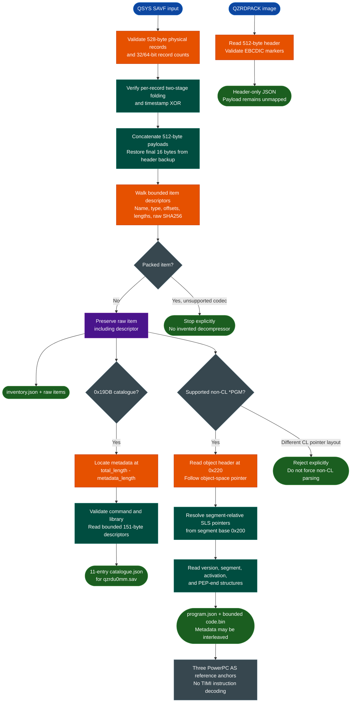

<a id="ibm-timi-save-file-analysis"></a>
# IBM i TIMI & Save-File Analysis

`ablation.ibm_timi` parses IBM i / OS/400 QSYS save files, verifies their record checksums, recovers bounded saved-object items with raw bytes and hashes, decodes a verified legacy catalogue layout, and maps two recovered non-CL `*PGM` program headers to bounded code ranges. It also reads `QZRDPACK` licensed-program headers. This is a standard-library-only foundation for TIMI object research, not yet a TIMI disassembler or decompiler.

For the separate z/OS NETDATA, PDS/PDSE, IEWPLMH, and S/390 workflow, see [IBM z/OS Artifact Analysis](ibm-zos.md).

---

## Why this exists

1. **Saved objects are not ELF executables.** QSYS SAVF files wrap machine-interface objects in physical record trailers, a logical save stream, item descriptors, catalogues, and segments. Disassembling the file directly would confuse metadata with code.
2. **Integrity and boundaries must precede instruction recovery.** Ablation proves the physical records and item chain before decoding catalogue entries or following program-space pointers. Segment declarations are not silently treated as materialized pages.
3. **The analysis path is inspectable and offline.** The implementation uses only Python's standard library. It does not invoke jSAVF, Ghidra, Radare2, Capstone, or an IBM i host.
4. **The novelty is the joined native workflow.** Ablation does not claim to have invented SAVF parsing, legacy program headers, or PowerPC. It links record verification, logical-to-physical offset mapping, bounded item extraction, legacy catalogue recovery, segment-relative program pointers, and independently checked instruction anchors in one reproducible toolchain.

This is an analysis aid, not a trust or vulnerability verdict. Record checksums are deterministic consistency checks, not signatures or proof of provenance.

---

## How it works



The parser distinguishes three coordinate systems. `logical_offset` addresses the backup-restored 512-byte-payload stream, `physical_offset` includes the 16-byte record trailers, and program pointers use a 24-bit offset relative to their containing segment. In the recovered non-CL objects, the segment begins at item offset `0x200`; its object-space pointer selects program header `0x300`. The parser does not treat those pointers as absolute item offsets.

---

## Supported variants and boundaries

| Input | Current support | Important boundary |
|---|---|---|
| QSYS SAVF | 528-byte records, 32/64-bit counts, header-length selection, checksum verification, logical-stream backup restoration, and bounded item walking | Global checksum is reported but not yet verified |
| Uncompressed saved items | `FFFFFFFF` marker, EBCDIC names, object type codes, raw offsets/lengths, hashes, and exclusive raw extraction | Raw item includes its descriptor; program sections are recovered only for the layouts below |
| Packed items | Detected from the packed-length field | Rejected until a verified decompressor exists |
| Legacy catalogue in `qzrdu0mm.sav` | `0x19DB` / `*SRDS`, save command `2`, target release byte `0x34`, library `QZRDPACK`, and eleven 151-byte descriptors at metadata offset `0x50` | Only this observed layout is corpus-verified; trailing metadata and alternate-release descriptor branches are not |
| Legacy non-CL `*PGM` | Object header, object-space pointer, version table, segment table, activation entry, PEP end, and bounded extraction | Verified for `QZRDPDSP` and `QZRDPEXT`; no general legacy-program claim |
| Legacy CL `*PGM` | None | `QZRDPDSPCL` and `QZRDPEXTCL` target a different segment and are explicitly rejected |
| QZRDPACK at `0x70` | Program, library, context, `SAVLICPGM`, and release fields | Confirmed for `C05PGM` and `C05LNG24` |
| QZRDPACK at `0x60` | Program name, `SAVLICPGM`, and release fields | Confirmed for `a0700mm` and `b1000mm`; unknown library/context fields are null |
| PowerPC AS anchors | Three documented `addic` encodings retained as reference evidence | Not a TIMI decoder; no claim that every word in a code range is an instruction |
| TIMI instructions | None in this milestone | No TIMI opcode map, procedure model, ABI, or decompiler is claimed |

For the observed catalogue, `total_length - metadata_length = 8704 - 7936 = 768`, so its metadata begins at item offset `0x300`. The descriptor's owner field is kept separate from the object name: `QPGMR` is an owner, not a renamed program. The catalogue includes the `QZRDPACK` library (`0x0401`) and a distinct `QZRDPACK` object (`0x0e03`).

The two QZRDPACK header offsets describe the location of the `SAVLICPGM` marker, not a version claim for every QZRDPACK image. `metadata_status=verified_offsets` means only that the observed marker and release fields validated. Payload mapping remains unperformed.

---

## Usage

Run from the Ablation repository root. No package installation or external RE tool is required.

```bash
python3 -m ablation.ibm_timi savf-info INPUT.savf --summary
python3 -m ablation.ibm_timi savf-extract INPUT.savf OUTPUT_DIR
python3 -m ablation.ibm_timi catalogue-info INPUT.savf
python3 -m ablation.ibm_timi program-info ITEM.bin
python3 -m ablation.ibm_timi program-extract ITEM.bin OUTPUT_DIR
python3 -m ablation.ibm_timi qzrd-info INPUT.fil
```

`savf-info` emits the full item inventory by default. `--summary` replaces detailed item records with a compact object list. `savf-info`, `savf-extract`, and `catalogue-info` accept `--maximum`, defaulting to 512 MiB. `catalogue-info` selects the `0x19DB` item, validates the observed legacy header, and emits its catalogue entries without claiming to decode trailing metadata.

`program-info` reads at most 64 MiB, validates the supported non-CL pointer layout, and reports object metadata, segment declarations, resolved pointers, and a code range. `program-extract` validates and reads the input once, then writes `code.bin` and `program.json`. It does not silently fall back to another layout when a pointer targets a different segment.

SAVF extraction writes:

```text
OUTPUT_DIR/
├── inventory.json
└── items/
    ├── 00-QSRDSSPC.1.bin
    ├── 01-QZRDPDSP.bin
    └── ...
```

Program extraction writes:

```text
OUTPUT_DIR/
├── code.bin
└── program.json
```

Each raw item contains its descriptor and following bytes exactly as recovered from the backup-restored logical stream. `raw_sha256` identifies those bytes. Use `logical_to_physical()` when mapping item evidence back to the original file. In `program.json`, `code_region.start` and `code_region.end_inclusive` are raw-item offsets, not SAVF offsets or virtual addresses. `code_region.length` includes both endpoints. The extracted interval starts at the segment-relative activation entry and ends at the resolved PEP-end pointer; it is a bounded recovery unit, not a claim of pure instructions or one procedure.

Output files are created exclusively and are not silently overwritten. Output directories may not be symlinks, and unsafe existing output files are rejected.

---

## Verified corpus example

`qzrdu0mm.sav` has 352 physical records and a 180,224-byte logical stream. All 352 record checksums verify. Its item chain ends exactly at logical EOF and contains ten objects:

- Four `0x0201` / `*PGM` programs: `QZRDPDSP`, `QZRDPDSPCL`, `QZRDPEXT`, and `QZRDPEXTCL`.
- A `QZRDPACK` item and five other file/command-related objects.

The recovered catalogue has eleven entries: those ten objects plus the `QZRDPACK` library. The two supported non-CL programs produce these exact ranges:

| Program | Program header | Version / segment / activation tables | Code range, inclusive | Code SHA256 |
|---|---:|---|---:|---|
| `QZRDPDSP` | `0x300` | `0x400` / `0x4e0` / `0x580` | `1016..4191` (3,176 bytes) | `b6dc209e3c6773f74d8603e83e68addfdb0b59bcf8df444cc9b00ebb431abb8e` |
| `QZRDPEXT` | `0x300` | `0x400` / `0x4e0` / `0x580` | `1040..5759` (4,720 bytes) | `17ad5d676d357b7b746c9964897b8b282091b13488b82e5f2870f3264ad5cce0` |

Both segment tables declare program-object use `0x02` with 512 pages and static-storage use `0x01` with 256 pages. These are declared page counts, not claims that the raw item contains 512 or 256 materialized pages. Both version tables report target release `0x0230` and created-on release `0x0310` as raw BCD values.

### Independent instruction evidence

The first instruction corpus is deliberately small and is **PowerPC AS, not decoded TIMI bytecode**. An IBM PowerPC ISA reference independently defines D-form `addic`: primary opcode 12, destination register RT, source register RA, and a signed 16-bit immediate. Applying that definition to three raw-item words gives:

| Raw-item offset | Big-endian word | Manual decoding |
|---:|---|---|
| `0x1000` | `3007022e` | `addic r0, r7, 558` |
| `0x100c` | `3007cb03` | `addic r0, r7, -13565` |
| `0x1010` | `3138305e` | `addic r9, r24, 12382` |

Golden tests preserve the input bytes at these offsets; they do not represent a new decoder. Other words, instruction boundaries, TIMI opcodes, and reachability remain unclaimed because metadata can be interleaved in the recovered range.

`C05PGM.fil` identifies as `C05MMPGM`, `DNLDLIB`, `QTEMP`, `SAVLICPGM`, `V3R7M0`. `a0700mm.fil` and `navio/b1000mm.fil` validate the alternate header layout, with unknown library/context fields left null. These QZRDPACK results do not establish TIMI code locations.

---

## Validation and limitations

Run focused tests with:

```bash
python3 -m pytest -q tests/test_ibm_timi.py tests/test_ibm_timi_program.py
```

The suites cover public checksum vectors, coordinate mapping, header-length selection, synthetic malformed inputs, packed-item rejection, exact corpus hashes, every real item and checksum, raw extraction, both QZRDPACK layouts, all eleven catalogue entries, two program-header layouts and code hashes, the three PowerPC AS byte anchors, explicit CL rejection, and CLI paths. Corpus tests skip when `IBM_RE` is unavailable; the default location is `/media/cowboy/research/IBM-RE`.

Before committing modified Python files, run FORGE on each one and a source audit on the package:

```bash
python3 -m ablation.analyzers.forge module ablation/ibm_timi/MODULE.py
python3 -m ablation.analyzers.forge source ablation/ibm_timi
```

Current boundaries:

- Global checksum verification is not implemented; its stored value and restored backup are explicit.
- Packed decompression, unobserved catalogue layouts, trailing catalogue metadata, and CL program-header recovery remain future work.
- Program recovery is verified on two items only. It does not materialize declared pages, recover every section, infer a function boundary, or prove that every code-range byte is an instruction.
- TIMI instruction decoding, procedure recovery, ABI modeling, and decompilation are not implemented. The three PowerPC AS anchors must not be mistaken for a TIMI decoder.
- QZRDPACK analysis is header-only. No payload, code region, or object boundary is inferred.
- No IBM i execution, restore test, dynamic validation, or vulnerability verdict is implied.

Reference material used during research includes the [SAVF format description](https://try-as400.pocnet.net/wiki/File_Formats:SAVF), [record/global checksum reconstruction](https://blog.silentsignal.eu/2026/10/06/512-bytes-at-a-time-reconstructing-IBM-i-save-file-checksums/), and [`file(1)` OS/400 magic rules](https://raw.githubusercontent.com/file/file/master/magic/Magdir/os400). The first source warns that parts are AI-generated or unreviewed, so Ablation relies on independently reproduced record checksums and exact item chains rather than treating the prose as proof. The `addic` anchors were independently checked against an archived IBM PowerPC ISA reference in the research run; the reference and its SHA256 values are not bundled in the Ablation repository.

---

## Related workflows

- [IBM z/OS Artifact Analysis](ibm-zos.md) covers the separate mainframe NETDATA/PDS/IEWPLMH/S/390 pipeline.
- [S/390 Disassembly, Decompilation & Variants](s390.md) documents that architecture's native instruction and decompiler support.
- [IBM AIX Binary Analysis](aix-xcoff32-64-analysis.md) covers the separate PowerPC/XCOFF IBM artifact path.

### Source map

| Module | Responsibility |
|---|---|
| `ablation/ibm_timi/savf.py` | Record checksums, logical streams, item inventory/extraction, and QZRDPACK headers |
| `ablation/ibm_timi/catalogue.py` | Bounded legacy catalogue location, validation, and descriptor recovery |
| `ablation/ibm_timi/program.py` | Non-CL object/program headers, segment-relative pointers, and bounded code extraction |
| `ablation/ibm_timi/cli.py` | `savf-info`, `savf-extract`, `catalogue-info`, `program-info`, `program-extract`, and `qzrd-info` commands |
| `ablation/ibm_timi/io_utils.py` | Exclusive/no-follow output handling |
| `ablation/ibm_timi/errors.py` | Format, unsupported-format, and safety exceptions |
| `tests/test_ibm_timi.py` | SAVF/QZRDPACK synthetic, negative, CLI, and corpus-golden tests |
| `tests/test_ibm_timi_program.py` | Catalogue/program golden tests, PowerPC AS anchors, malformed inputs, and CLI tests |
