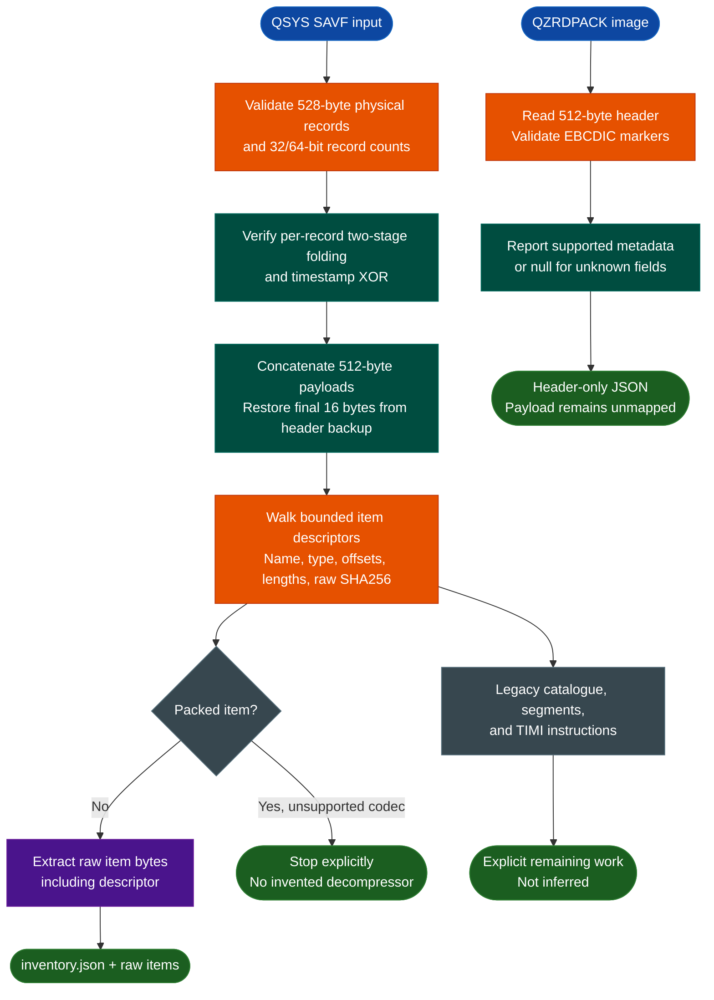

<a id="ibm-timi-save-file-analysis"></a>
# IBM i TIMI & Save-File Analysis

`ablation.ibm_timi` parses IBM i / OS/400 QSYS save files, verifies their record checksums, recovers bounded saved-object items with raw bytes and hashes, and reads `QZRDPACK` licensed-program headers. It is a standard-library-only foundation for TIMI object and instruction research, not yet a TIMI disassembler or decompiler.

For the separate z/OS NETDATA, PDS/PDSE, IEWPLMH, and S/390 workflow, see [IBM z/OS Artifact Analysis](ibm-zos.md).

---

## Why this exists

1. **Saved objects are not ELF executables.** QSYS SAVF files wrap machine-interface objects in physical record trailers, a logical save stream, item descriptors, catalogues, and segments. Disassembling the file directly would confuse metadata with code.
2. **Integrity and boundaries must precede instruction recovery.** Ablation first proves the physical records and item chain, then exposes raw objects for later segment and TIMI analysis. Unknown layouts are not assigned invented meanings.
3. **The analysis path is inspectable and offline.** The implementation uses only Python's standard library. It does not invoke jSAVF, Ghidra, Radare2, Capstone, or an IBM i host.
4. **The novelty is the joined native workflow.** Ablation does not claim to have invented SAVF parsing or QZRDPACK. The new capability links record verification, logical-to-physical offset mapping, bounded item extraction, and licensed-header identification in one reproducible toolchain.

This is an analysis aid, not a trust or vulnerability verdict. Record checksums are deterministic consistency checks, not signatures or proof of provenance.

---

## How it works



---

## Supported variants and boundaries

| Input | Current support | Important boundary |
|---|---|---|
| QSYS SAVF | 528-byte records, 32/64-bit counts, header-length selection, checksum verification, logical-stream backup restoration, and bounded item walking | Global checksum is reported but not yet verified |
| Uncompressed saved items | `FFFFFFFF` marker, EBCDIC names, object type codes, raw offsets/lengths, hashes, and exclusive raw extraction | Raw item includes its descriptor; section boundaries are not inferred |
| Packed items | Detected from the packed-length field | Rejected until a verified decompressor exists |
| Legacy catalogue | Catalogue item identified as `0x19DB` / `*SRDS` | Legacy catalogue structure is not decoded; item evidence is retained |
| QZRDPACK at `0x70` | Program, library, context, `SAVLICPGM`, and release fields | Confirmed for `C05PGM` and `C05LNG24` |
| QZRDPACK at `0x60` | Program name, `SAVLICPGM`, and release fields | Confirmed for `a0700mm` and `b1000mm`; unknown library/context fields are null |
| TIMI instructions | None in this milestone | No instruction set, procedure model, ABI, or decompiler is claimed |

The two header offsets describe the location of the `SAVLICPGM` marker, not a version claim for every QZRDPACK image. `metadata_status=verified_offsets` means only that the observed marker and release fields validated. Payload mapping remains unperformed.

---

## Usage

Run from the Ablation repository root. No package installation or external RE tool is required.

```bash
python3 -m ablation.ibm_timi savf-info INPUT.savf --summary
python3 -m ablation.ibm_timi savf-extract INPUT.savf OUTPUT_DIR
python3 -m ablation.ibm_timi qzrd-info INPUT.fil
```

`savf-info` emits the full item inventory by default. `--summary` replaces detailed item records with a compact object list. Both SAVF commands accept `--maximum`, defaulting to 512 MiB; exceeding it fails explicitly.

Extraction writes:

```text
OUTPUT_DIR/
├── inventory.json
└── items/
    ├── 00-QSRDSSPC.1.bin
    ├── 01-QZRDPDSP.bin
    └── ...
```

Each raw item contains its descriptor and following bytes exactly as recovered from the backup-restored logical stream. `raw_sha256` identifies those bytes. `logical_offset` addresses the concatenated payload stream; `physical_offset` includes the 16-byte trailers. Use `logical_to_physical()` when mapping evidence back to the original file.

Output files are created exclusively and are not silently overwritten. Output directories may not be symlinks, and unsafe existing output files are rejected.

---

## Verified corpus example

`qzrdu0mm.sav` has 352 physical records and a 180,224-byte logical stream. All 352 record checksums verify. Its item chain ends exactly at logical EOF and contains ten objects:

- Four `0x0201` / `*PGM` programs: `QZRDPDSP`, `QZRDPDSPCL`, `QZRDPEXT`, and `QZRDPEXTCL`.
- A `QZRDPACK` item and five other file/command-related objects.

`C05PGM.fil` identifies as `C05MMPGM`, `DNLDLIB`, `QTEMP`, `SAVLICPGM`, `V3R7M0`. `a0700mm.fil` and `navio/b1000mm.fil` validate the alternate header layout, with unknown library/context fields left null. These header results do not establish TIMI code locations.

---

## Validation and limitations

Run focused tests with:

```bash
python3 -m pytest -q tests/test_ibm_timi.py
```

The suite covers public checksum vectors, coordinate mapping, header-length selection, synthetic malformed inputs, packed-item rejection, exact corpus hashes, every real item and checksum, raw extraction, both QZRDPACK layouts, and CLI paths. Corpus tests skip when `IBM_RE` is unavailable.

Before committing modified Python files, run FORGE on each one:

```bash
python3 -m ablation.analyzers.forge module ablation/ibm_timi/MODULE.py
```

Current boundaries:

- Global checksum verification is not implemented; its stored value and restored backup are explicit.
- Packed decompression, legacy catalogue decoding, and saved-section recovery remain future work.
- TIMI instruction decoding, procedure recovery, ABI modeling, and decompilation are not implemented.
- QZRDPACK analysis is header-only. No payload, code region, or object boundary is inferred.
- No IBM i execution, restore test, dynamic validation, or vulnerability verdict is implied.

Reference material used during research includes the [SAVF format description](https://try-as400.pocnet.net/wiki/File_Formats:SAVF), [record/global checksum reconstruction](https://blog.silentsignal.eu/2026/10/06/512-bytes-at-a-time-reconstructing-IBM-i-save-file-checksums/), and [`file(1)` OS/400 magic rules](https://raw.githubusercontent.com/file/file/master/magic/Magdir/os400). The first source warns that parts are AI-generated or unreviewed, so Ablation relies on independently reproduced record checksums and exact item chains rather than treating the prose as proof.

---

## Related workflows

- [IBM z/OS Artifact Analysis](ibm-zos.md) covers the separate mainframe NETDATA/PDS/IEWPLMH/S/390 pipeline.
- [S/390 Disassembly, Decompilation & Variants](s390.md) documents that architecture's native instruction and decompiler support.
- [IBM AIX Binary Analysis](aix-xcoff32-64-analysis.md) covers the separate PowerPC/XCOFF IBM artifact path.

### Source map

| Module | Responsibility |
|---|---|
| `ablation/ibm_timi/savf.py` | Record checksums, logical streams, item inventory/extraction, and QZRDPACK headers |
| `ablation/ibm_timi/cli.py` | `savf-info`, `savf-extract`, and `qzrd-info` commands |
| `ablation/ibm_timi/io_utils.py` | Exclusive/no-follow output handling |
| `ablation/ibm_timi/errors.py` | Format, unsupported-format, and safety exceptions |
| `tests/test_ibm_timi.py` | Synthetic, negative, CLI, and corpus-golden tests |
