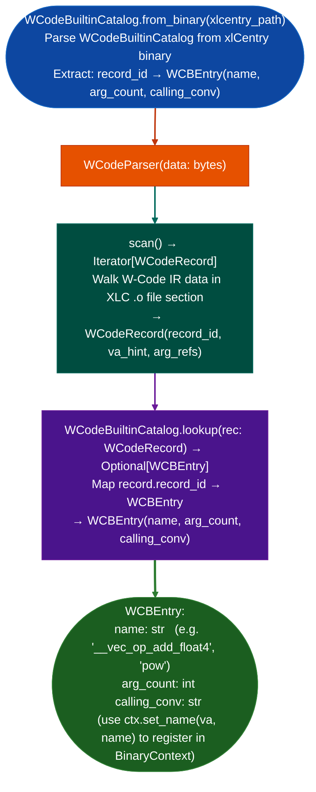

# IBM W-Code Parsing

Parse IBM XLC compiler W-Code internal IR binary records embedded in XLC-compiled POWER object files: extracting builtin descriptor tables from `xlCentry` to identify POWER-specific intrinsics, vector operations, MASS math library calls, and IBM-internal control flow nodes that appear as opaque call sites in stripped POWER binaries.

---

## Why this exists

1. **IBM XLC's W-Code IR records encode references to POWER-specific compiler builtins: `__vec_op`, `__maths_pow`, MASS library intrinsics, that appear in stripped object files as call sites to internal symbols that cannot be resolved from ELF symbol tables.** Without `WCodeParser`, these call sites appear as blank function calls in `BinaryContext.plt` and `FuncProfiler` output, making it impossible to determine whether a function uses vectorized operations or math library calls.

2. **`WCodeBuiltinCatalog.from_binaryxlcentry_path` extracts the builtin descriptor table from the `xlCentry` compiler binary**: `xlCentry` contains the canonical mapping from W-Code record IDs to builtin names, argument counts, and calling conventions. This makes the catalog authoritative rather than hand-maintained: updating `xlCentry` automatically updates the catalog.

3. **`WCodeBuiltinCatalog.lookup(rec)` returns the `WCBEntry` for a parsed `WCodeRecord`**: enabling downstream analysis to substitute meaningful names for opaque POWER intrinsic call sites in disassembly output. Combined with `BinaryContext.set_name()`, identified builtins appear in `FuncProfiler` and `WindowAnalyzer` output with their actual names.

---

## How it works



---

## Usage

```python
from ablation.analyzers.wcode_parser import WCodeBuiltinCatalog, WCodeParser
from ablation.analyzers.binary_context import BinaryContext

# Build catalog from XLC compiler binary
catalog = WCodeBuiltinCatalog.from_binary('/opt/ibm/xlC/13.1.3/exe/xlCentry')

ctx = BinaryContext.load_or_build('/path/to/power_binary.o')

# Scan W-Code IR section (if present)
with open('/path/to/power_binary.o', 'rb') as f:
    obj_data = f.read()

parser = WCodeParser(obj_data)
for rec in parser.scan():
    entry = catalog.lookup(rec)
    if entry:
        print(f"  record_id={rec.record_id:#x}  → {entry.name}  args={entry.arg_count}")
        if rec.va_hint:
            ctx.set_name(rec.va_hint, entry.name, source='wcode_builtin')
```

---

## Example output

The following illustrates the W-Code parsing output format. Actual record counts and names are object-specific.

```
WCodeBuiltinCatalog: xlCentry  (<N> builtin entries)

WCodeParser: power_binary.o  (W-Code section present)

Records parsed: <N>
  record_id=0x0042   → __vec_op_add_float4   args=2
  record_id=0x0103   → pow (MASS)            args=2
  record_id=0x0201   → __builtin_memcpy      args=3
```

---

## False positives

**`WCodeParser.scan()` operates on raw bytes of the W-Code IR section**: if the binary does not contain a W-Code IR section for example object files compiled with GCC or LLVM rather than XLC, `scan()` produces no records. This is not an error; it simply means the binary was not compiled with XLC.

**W-Code record IDs are XLC version-specific**: `WCodeBuiltinCatalog` built from XLC 13.1 may not correctly map record IDs from XLC 14.x or 16.x binaries. Always use a catalog built from the same XLC version used to compile the target binary.

---

## Pipeline position

Run `WCodeParser` on any IBM POWER object file compiled with XLC before building `BinaryContext`, to annotate call sites to W-Code builtins. Register identified builtin names with `ctx.set_name()` so they appear in `FuncProfiler`, `WindowAnalyzer`, and `TaintTracker` output with meaningful names.

---

## Reading output

`WCodeParser.parse()` returns a list of `WCodeRecord` objects:

| Attribute | Content |
|:---|:---|
| `type_field_0` | First type field (uint32 BE at offset `+0x00`) |
| `type_field_1` | Second type field (uint32 BE at offset `+0x04`) |
| `type_field_2` | Third type field (uint16 BE at offset `+0x08`) |
| `name` | Builtin name string leading underscores stripped |
| `raw` | `bytes`: original record bytes including the 10-byte header |
| `short_form` | `True` if record length ≤ 10 type fields not compared in matching |

`WCodeBuiltinCatalog.lookup(name)` returns a `WCBEntry` with `index`, `arch_mask`, and type fields for the named builtin, or `None` if not found.

---

## See also

- [PPC64 ELFv1 Resolution](ppc64-elfv1-resolution.md): PLT patching for POWER Linux binaries
- [PPC32/PPC476 Dedicated Lifting](ppc32-ppc476-dedicated-lifting.md): PPC32/PPC64 instruction analysis
- [Persistent Analysis Context](persistent-analysis-context.md): `BinaryContext.set_name()` for builtin name registration
