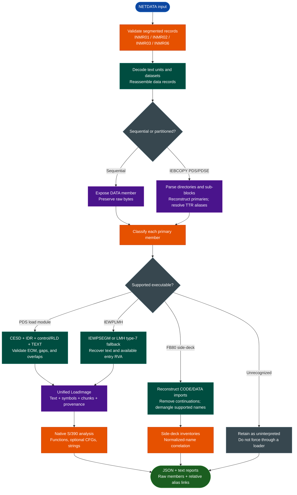

<a id="ibm-zos-artifact-analysis"></a>
# IBM z/OS Artifact Analysis

Extract and analyze IBM NETDATA transfers, IEBCOPY PDS/PDSE members, traditional PDS load modules, `IEWPLMH` program objects, and FB80 Binder definition side-decks with `ablation.ibm_zos`. Reconstruct executable images, preserve RVA/file mappings and hashes, recover native S/390 functions, normalize IBM C++ symbols, and correlate executable names with side-deck imports.

The toolchain is offline and Python-standard-library-only. It does not import or invoke Capstone, Ghidra, Radare2, `xmi`, or another extractor or disassembler.

For instruction formats, LE/C++ PPA, non-XPLINK/XPLINK variants, and CFG semantics, see the dedicated [S/390 Disassembly, Function Recovery & Variants](s390.md) guide.

---

## Why this exists

1. **z/OS artifacts are not ordinary ELF, PE, or flat binaries.** Correct analysis must cross NETDATA transport, IEBCOPY directories, executable records, EBCDIC data, big-endian instructions, and IBM linkage metadata without losing information at each boundary.

2. **The complete path should be available without a z/OS host or external RE stack.** Native parsers make the behavior inspectable and keep the workflow available even if a third-party tool, hosted adapter, or platform utility disappears.

3. **Evidence matters more than plausible output.** Raw members, source hashes, container records, aliases, unresolved symbols, text gaps, unknown instructions, and incomplete CFGs remain visible. The tool does not silently repair uncertainty or turn every entry field into a function.

4. **Mainframe research benefits from repeatable offline triage.** The same pipeline supports IOC and malware research, incident response, provenance review, historical preservation, and cross-version inventory comparison without executing the artifact.

5. **The novelty is the integrated path.** Ablation does not claim to have invented NETDATA, S/390, PPA, or IBM demangling. The new capability is the dependency-free connection of transport, container, image, instruction, function, and side-deck evidence in one reproducible workflow.

This is an analysis aid, not an automated trust or vulnerability verdict. Native implementation alone is not proof of correctness; bounds checks, negative tests, golden corpus comparisons, and conservative output provide the supporting evidence.

---

## How it works



---

## Supported artifact variants

| Input or variant | Supported form | Important boundary |
|---|---|---|
| NETDATA transfer | Segmented INMR01/02/03/06 streams with text units and reassembled data records | INMR06 termination is required; encrypted `AMSCIPHR` is rejected |
| Sequential dataset | Dataset content exposed as a `DATA` member | No executable structure is inferred unless a supported loader recognizes it |
| IEBCOPY PDS/PDSE | Directory entries, primary-member reconstruction, TTR aliases, and raw member extraction | Directory and member blocks are bounds-checked; aliases need one primary target |
| Traditional PDS load module | CESD, IDR, control/RLD, TEXT, EOM, symbols, and text mappings | RLD information is retained but relocation is not applied |
| `IEWPLMH` program object | `IEWPSEGM` text and entry metadata, or LMH type-7 text fallback | Fallback entry RVA is `null`; symbol coverage is narrower than the PDS loader |
| FB80 definition side-deck | CP1140 records, CODE/DATA imports, two import syntaxes, and continued symbols | Input must be nonempty complete 80-byte records with at least one import |
| IBM C++ symbols | Selected constructors, destructors, operators, nested names, qualifiers, references, pointers, and basic types | Unsupported encodings remain `unparsed`; virtual tables are not functions |
| EBCDIC strings | CP500 printable string candidates with RVAs | String candidates are triage data, not proof of references or declarations |

Non-NETDATA tape formats, raw core dumps, and running z/OS systems are outside the module's current input scope.

---

## Usage

Run from the Ablation repository root. No package installation or external RE tool is required.

### Choose an entry point

| Goal | Command |
|---|---|
| Inspect an envelope without extracting members | `python3 -m ablation.ibm_zos netdata-list INPUT.xmit` |
| Extract every dataset and message | `python3 -m ablation.ibm_zos netdata-extract INPUT.xmit OUTPUT_DIR` |
| Extract one exact dataset name | `python3 -m ablation.ibm_zos netdata-extract INPUT.xmit OUTPUT_DIR --dataset NAME` |
| Reconstruct and inspect an executable | `python3 -m ablation.ibm_zos image-info PROGRAM.bin --output IMAGE_DIR` |
| Decode an RVA range | `python3 -m ablation.ibm_zos disasm PROGRAM.bin --start 0x0 --length 0x100` |
| Recover functions and optional CFGs | `python3 -m ablation.ibm_zos functions PROGRAM.bin FUNCTIONS_DIR --cfg` |
| Parse a side-deck | `python3 -m ablation.ibm_zos sid SID.bin SID_OUTPUT_PREFIX` |
| Correlate names with one or more side-decks | `python3 -m ablation.ibm_zos correlate PROGRAM.bin MATCHES.json SID1.bin SID2.bin` |
| Run extraction and analysis together | `python3 -m ablation.ibm_zos pipeline INPUT.xmit OUTPUT_DIR --deep --cfg` |

Use `python3 -m ablation.ibm_zos COMMAND --help` for the authoritative options. Executable commands accept an extracted member or standalone load image—not the enclosing `.xmit` file.

### End-to-end pipeline

```bash
python3 -m ablation.ibm_zos pipeline INPUT.xmit OUTPUT_DIR --deep --cfg
```

The pipeline extracts every dataset, skips aliases during analysis, classifies primary members, and writes `pipeline.json`. `--deep` writes load images, strings, symbols, and function inventories. `--cfg` adds instruction-level CFG data. `--maximum` defaults to 20,000 instructions per function.

Members that are neither supported executables nor recognized side-decks are labeled `uninterpreted`. Their raw bytes are retained.

### NETDATA extraction

```bash
python3 -m ablation.ibm_zos netdata-list iocchk.xmit > inventory.json
python3 -m ablation.ibm_zos netdata-extract iocchk.xmit extracted
python3 -m ablation.ibm_zos netdata-extract iocchk.xmit one-dataset \
  --dataset 'USER.IOC.LOAD'
```

`netdata-list` prints source and member SHA256 values, INMR control data, dataset attributes, TTRs, and alias targets. `netdata-extract` writes:

```text
extracted/
├── netdata.json
├── message-1.bin              # when messages are present
└── DATASET.NAME/
    ├── dataset.json
    ├── PRIMARY.bin
    └── ALIAS.bin -> PRIMARY.bin
```

Alias links contain relative filenames, so moving the extracted directory does not preserve an absolute analysis-host path.

### Side-deck analysis and correlation

```bash
python3 -m ablation.ibm_zos sid CLB3D003.txt analysis/CLB3D003
python3 -m ablation.ibm_zos correlate PRIMARY.bin analysis/matches.json \
  CLB3D003.txt CLBECOLL.txt
```

The `sid` command writes `OUTPUT_PREFIX.json` and `OUTPUT_PREFIX.txt`. Records include original and demangled symbols, DLL, CODE/DATA kind, and source record range. Demangling status is `demangled`, `virtual_table`, or `unparsed`.

Continuation markers are removed from reconstructed names. Blank records inside imports, missing continuation markers, unterminated quotes, non-FB80 input, and decks without imports are rejected.

Correlation compares whitespace-normalized recovered names against original and demangled side-deck symbols. It is **name correlation only**: it does not resolve Binder linkage, prove DLL ownership, or infer an address for an unmatched symbol.

### Python API

```python
from ablation.ibm_zos.functions import recover_functions
from ablation.ibm_zos.loadmodule import read_load_image
from ablation.ibm_zos.sid import compare_inventories, read_side_deck

image = read_load_image("PRIMARY.bin")
recovery = recover_functions(image, include_cfg=True)

left = read_side_deck("CLB3D003.txt")
right = read_side_deck("CLBECOLL.txt")
print(compare_inventories(left, right))
```

`compare_inventories` reports unique-symbol counts, intersection and set differences, and Jaccard similarity. Inventory similarity does not establish binary identity.

---

## Output and interpretation

### Load-image artifacts

`image-info --output IMAGE_DIR` and `pipeline --deep` write:

| File | Contents |
|---|---|
| `text.bin` | Reconstructed big-endian executable bytes used by the S/390 decoder |
| `image.json` | Format, source and text hashes, entry RVA, records, chunks, and format-specific metadata |
| `symbols.json` | Available CESD names, addresses, kinds, lengths, ESDIDs, attributes, and sources |
| `strings.json` | CP500 string candidates and RVAs |
| `strings.txt` | Compact address-and-text string report |

### Function artifacts

The function writer produces `functions.json`, `functions.txt`, and `disassembly.txt`. With `--cfg`, structured functions also contain instructions, direct calls and branches, `complete`, `instruction_count`, and `unknown_instruction_count`.

Function evidence kinds are `PPA_LE`, `PPA_CPP`, `SAVE_STORE_PROLOG`, and `XPLINK_SAVE_STORE`. PPA records are high-confidence function evidence; prolog-only candidates are medium-confidence. None of these labels proves complete function boundaries or complete program coverage.

See [S/390 function evidence and CFG behavior](s390.md#supported-variants-and-evidence-layers) for the full variant and confidence model.

### Address and mapping model

Reported RVAs are offsets into reconstructed `text.bin`, not offsets into the original member file. `image.json` maps the two through chunks:

- `address`: RVA in reconstructed text.
- `file_offset`: byte offset in the extracted member.
- `length`: bytes covered by the mapping.

For PDS load modules, uncovered gaps are zero-filled and quantified by `text_gap_bytes`; conflicting overlapping TEXT is rejected. For `IEWPLMH`, `IEWPSEGM` supplies text and entry metadata. Without it, the LMH type-7 fallback sets text RVA to zero and entry RVA to `null`.

To disassemble at a raw member offset, translate it through the containing chunk first. The `disasm --start` argument is an RVA.

### Output safety and repeatability

- Dataset and member names are validated before extraction.
- Source envelopes and primary bytes are not modified.
- Existing files are not silently overwritten.
- Alias creation rejects unsafe existing links and verifies the resulting relative link.
- Malformed records, truncation, inconsistent lengths, and unresolved aliases fail explicitly.

Use a fresh output directory for repeatable runs. `--overwrite` exists only on `netdata-extract` and `pipeline`; it applies to raw extraction and top-level metadata, not every nested analysis report. Other writers still refuse to replace existing files.

Whole-image reconstruction and JSON materialization occur in memory. Large objects, `--deep`, and `--cfg` can require substantial memory and disk space.

---

## Validation and limitations

Run the focused tests with:

```bash
python3 -m pytest -q tests/test_ibm_zos.py
```

The suite covers synthetic formats, malformed and truncated inputs, CLI behavior, alias safety, and IOC corpus golden tests. Corpus tests skip when `IBM_RE` is unavailable:

```bash
IBM_RE=/path/to/IBM-RE python3 -m pytest -q tests/test_ibm_zos.py
```

Before committing modified Python files, run FORGE on each one:

```bash
python3 -m ablation.analyzers.forge module ablation/ibm_zos/MODULE.py
```

Current boundaries:

- S/390 and selected z/Architecture instruction coverage is partial; unknown instructions remain explicit.
- There is no pseudo-C decompiler, high-level type recovery, general stack-variable reconstruction, or indirect-call resolver.
- Function candidates do not establish complete boundaries or complete coverage.
- RLD data is retained but load-time relocation is not applied.
- IBM C++ demangling is partial; templates and unfamiliar encodings can remain `unparsed`.
- Name correlation does not resolve Binder calls or prove DLL ownership.
- No dynamic z/OS validation or vulnerability verdict is implied.
- Encrypted `AMSCIPHR` and non-NETDATA tape formats are unsupported.

---

## Related workflows

- [S/390 Disassembly, Function Recovery & Variants](s390.md) documents instruction formats, PPA and linkage variants, CFG construction, and function-confidence semantics.
- [IBM AIX Binary Analysis](aix-xcoff32-64-analysis.md) covers the separate PowerPC/XCOFF IBM artifact path.

### Source map

| Module | Responsibility |
|---|---|
| `ablation/ibm_zos/netdata.py` | NETDATA, IEBCOPY, PDS/PDSE, aliases, and safe extraction |
| `ablation/ibm_zos/loadmodule.py` | PDS load-module and `IEWPLMH` loaders |
| `ablation/ibm_zos/image.py` | Load-image model, mappings, hashes, output, and strings |
| `ablation/ibm_zos/s390.py` | Native S/390 instruction and flow decoding |
| `ablation/ibm_zos/functions.py` | PPA/prolog recovery and bounded CFGs |
| `ablation/ibm_zos/sid.py` | Side-decks, IBM C++ demangling, comparison, and correlation |
| `ablation/ibm_zos/io_utils.py` | Exclusive/no-follow output handling |
| `ablation/ibm_zos/cli.py` | Command-line commands and pipeline |
| `ablation/ibm_zos/errors.py` | Format and output-safety exceptions |
| `tests/test_ibm_zos.py` | Synthetic, negative, CLI, safety, and corpus-golden tests |
