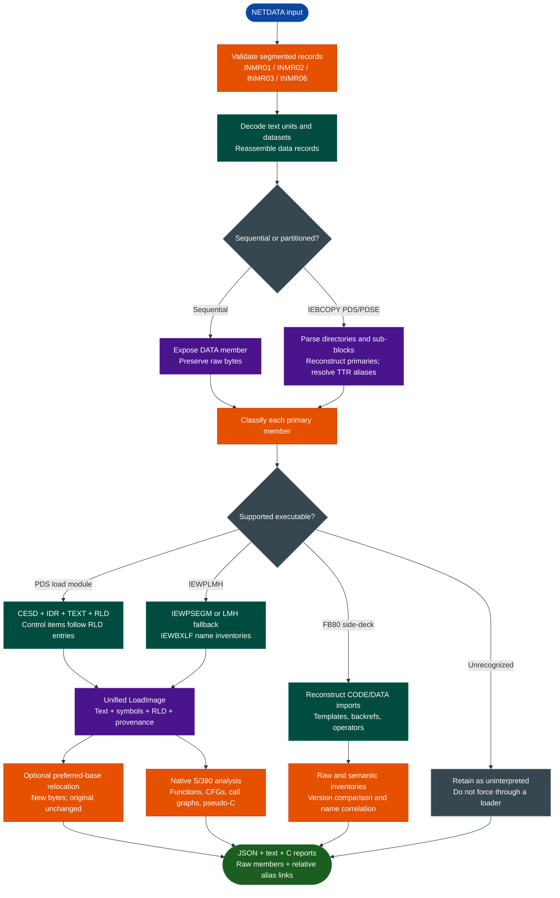

<a id="ibm-zos-artifact-analysis"></a>
# IBM z/OS Artifact Analysis

Extract and analyze IBM NETDATA transfers, IEBCOPY PDS/PDSE members, traditional PDS load modules, `IEWPLMH` program objects, and FB80 Binder definition side-decks with `ablation.ibm_zos`. Reconstruct executable images, parse and apply RLD relocations, recover native S/390 functions and call graphs, emit pseudo-C, normalize IBM C++ symbols, and compare builds without external RE tools.

The toolchain is offline and Python-standard-library-only. It does not import or invoke Capstone, Ghidra, Radare2, `xmi`, or another extractor, disassembler, or decompiler.

For instruction formats, linkage variants, call graphs, decompilation, and opcode inventory, see the dedicated [S/390 Disassembly, Decompilation & Variants](s390.md) guide.

---

## Why this exists

1. **z/OS artifacts are not ordinary ELF, PE, or flat binaries.** Correct analysis must cross NETDATA transport, IEBCOPY directories, executable records, EBCDIC data, big-endian instructions, relocation dictionaries, and IBM linkage metadata without losing information at each boundary.

2. **The complete path should work without a z/OS host or external RE stack.** Native parsers and analyzers keep behavior inspectable and available even if a third-party tool, hosted adapter, or platform utility disappears.

3. **Evidence matters more than plausible output.** Raw members, source hashes, container records, aliases, unresolved relocations, text gaps, unknown instructions, and unresolved calls remain visible. The tool does not silently repair uncertainty or invent addresses.

4. **Mainframe research needs repeatable offline triage.** The pipeline supports IOC and malware research, incident response, provenance review, historical preservation, and cross-version comparison without executing the artifact.

5. **The novelty is the integrated path.** Ablation does not claim to have invented NETDATA, S/390, PPA, RLD, or IBM demangling. The capability connects transport, container, image, relocation, instruction, function, decompilation, and side-deck evidence in one reproducible workflow.

This is an analysis aid, not an automated trust or vulnerability verdict. Bounds checks, negative tests, golden corpus comparisons, and conservative output support correctness; native implementation alone does not prove it.

---

## How it works



---

## Supported artifact variants

| Input or variant | Supported form | Important boundary |
|---|---|---|
| NETDATA transfer | Segmented INMR01/02/03/06 streams with text units and reassembled records | INMR06 is required; encrypted `AMSCIPHR` is rejected |
| Sequential dataset | Dataset content exposed as a `DATA` member | No executable structure is inferred without a supported loader |
| IEBCOPY PDS/PDSE | Directories, primary reconstruction, TTR aliases, and raw extraction | Bounds are checked; aliases need one primary target |
| Traditional PDS load module | CESD, IDR, TEXT, control/RLD records, EOM, symbols, and mappings | Text is preserved; RLD application is a separate optional operation |
| RLD entries | Full eight-byte and repeated-pointer four-byte entries, including continuation across records | External targets and invalid ranges remain explicit |
| `IEWPLMH` program object | `IEWPSEGM`, LMH type-7 fallback, and `IEWBXLF NAME` inventories | Fallback entry is `null`; name records do not imply addresses |
| FB80 definition side-deck | CP1140 CODE/DATA imports, two syntaxes, and continuations | Input must be nonempty complete 80-byte records with imports |
| IBM C++ symbols | Constructors, destructors, operators, nested names, `XT` templates, `T` back-references, qualifiers, pointers, and references | Unfamiliar encodings remain `unparsed`; tables are not functions |
| EBCDIC strings | CP500 printable string candidates with RVAs | Triage data, not proof of references or declarations |

Non-NETDATA tape formats, raw core dumps, and running z/OS systems are outside the module's input scope.

---

## Usage

Run from the Ablation repository root. No package installation or external RE tool is required.

### Choose an entry point

| Goal | Command |
|---|---|
| Inspect an envelope | `python3 -m ablation.ibm_zos netdata-list INPUT.xmit` |
| Extract datasets and messages | `python3 -m ablation.ibm_zos netdata-extract INPUT.xmit OUTPUT_DIR` |
| Extract one exact dataset | `python3 -m ablation.ibm_zos netdata-extract INPUT.xmit OUTPUT_DIR --dataset NAME` |
| Reconstruct and inspect an executable | `python3 -m ablation.ibm_zos image-info PROGRAM.bin --output IMAGE_DIR` |
| Decode an RVA range | `python3 -m ablation.ibm_zos disasm PROGRAM.bin --start 0x0 --length 0x100` |
| Recover functions and CFGs | `python3 -m ablation.ibm_zos functions PROGRAM.bin FUNCTIONS_DIR --cfg` |
| Resolve a call graph | `python3 -m ablation.ibm_zos callgraph PROGRAM.bin CALLGRAPH_DIR` |
| Decompile functions | `python3 -m ablation.ibm_zos decompile PROGRAM.bin OUTPUT_DIR` |
| Apply a preferred base | `python3 -m ablation.ibm_zos relocate PROGRAM.bin OUTPUT_DIR --base 0x100000` |
| Compare executable images | `python3 -m ablation.ibm_zos compare LEFT.bin RIGHT.bin REPORT.json` |
| Parse a side-deck | `python3 -m ablation.ibm_zos sid SID.bin SID_OUTPUT_PREFIX` |
| Compare side-decks | `python3 -m ablation.ibm_zos sid-compare LEFT.bin RIGHT.bin REPORT.json` |
| Correlate names with side-decks | `python3 -m ablation.ibm_zos correlate PROGRAM.bin MATCHES.json SID1.bin SID2.bin` |
| Inventory opcode coverage | `python3 -m ablation.ibm_zos opcode-inventory PROGRAM.bin REPORT.json` |
| Run extraction and analysis together | `python3 -m ablation.ibm_zos pipeline INPUT.xmit OUTPUT_DIR --deep --cfg` |

Use `python3 -m ablation.ibm_zos COMMAND --help` for authoritative options. Executable commands accept an extracted member or standalone load image—not the enclosing `.xmit` file. Analysis commands that decode functions accept `--maximum`, defaulting to 20,000 instructions per function.

### End-to-end pipeline

```bash
python3 -m ablation.ibm_zos pipeline INPUT.xmit OUTPUT_DIR --deep --cfg
```

The pipeline extracts every dataset, skips aliases during analysis, classifies primary members, and writes `pipeline.json`. `--deep` writes images, strings, symbols, and function inventories. `--cfg` adds instruction-level CFGs and call-graph artifacts. Unrecognized members remain `uninterpreted` with raw bytes retained.

### NETDATA extraction

```bash
python3 -m ablation.ibm_zos netdata-list iocchk.xmit > inventory.json
python3 -m ablation.ibm_zos netdata-extract iocchk.xmit extracted
python3 -m ablation.ibm_zos netdata-extract iocchk.xmit one-dataset \
  --dataset 'USER.IOC.LOAD'
```

`netdata-list` prints source/member hashes, INMR controls, attributes, TTRs, and aliases. `netdata-extract` writes:

```text
extracted/
├── netdata.json
├── message-1.bin              # when messages are present
└── DATASET.NAME/
    ├── dataset.json
    ├── PRIMARY.bin
    └── ALIAS.bin -> PRIMARY.bin
```

Alias links contain relative filenames, so moving the extracted directory does not preserve an absolute analysis-host path.

---

## Relocation and program-object metadata

### RLD parsing and application

Combined control/RLD records store **RLD entries first and control items after the last RLD address field**. The parser preserves this layout rather than treating the leading bytes as control data.

Each relocation records RVA, adcon length, A/V kind, direction, R/P ESDIDs, source record, repeated-pointer status, target and resident names, target address, and resolution status. Full entries are eight bytes; entries that repeat R/P pointers are four bytes. Continuation state is preserved across record boundaries.

```bash
python3 -m ablation.ibm_zos relocate PROGRAM.bin RELOCATED_DIR --base 0x100000
```

The command writes:

- `relocated-text.bin`: a new byte image; the original member and `LoadImage.text` are unchanged.
- `relocations.json`: base, applied/unchanged/unresolved counts, and every entry's original and relocated value.

Only resolved relocations are adjusted. Positive and negative directions apply the base with the corresponding sign. Signed adcon addends are handled with explicit field-width checks and two's-complement encoding. External unresolved entries remain unchanged and are counted separately. Base zero is an identity transformation.

### IEWPLMH names

`IEWBXLF NAME` entries contain a one-byte attribute, a two-byte name length, and name bytes. Printable names are exposed as `NAME` symbols with address `-1`; metadata reports their address as `null`. Binary identifiers are retained separately in `program_object_binary_names` with hexadecimal bytes. Neither form is assigned an inferred RVA.

`image.json` also includes `program_object_name_errors` for malformed records instead of silently accepting them.

---

## Side-deck analysis and correlation

```bash
python3 -m ablation.ibm_zos sid CLB3D003.txt analysis/CLB3D003
python3 -m ablation.ibm_zos correlate PRIMARY.bin analysis/matches.json \
  CLB3D003.txt CLBECOLL.txt
```

The `sid` command writes `OUTPUT_PREFIX.json` and `OUTPUT_PREFIX.txt`. Records include original and demangled symbols, DLL, CODE/DATA kind, and source record range.

Supported demangling includes constructors, destructors, arithmetic/comparison/conversion operators, nested names, repeated pointers/references, `XT` template arguments, and `T1`/`T2`-style type back-references. Statuses are:

- `demangled`: the complete encoding was consumed and converted.
- `virtual_table`: a recognized virtual-table record, not a function.
- `typeinfo`: a recognized typeinfo record.
- `static_table`: a recognized static table, not a function.
- `unparsed`: unsupported or unrecognized encoding; the original symbol is retained.

Blank records inside imports, missing continuation markers, unterminated quotes, non-FB80 input, and decks without imports are rejected. Correlation uses normalized original and demangled names; it does not prove DLL ownership, resolve Binder linkage, or infer addresses for unmatched symbols.

---

## Cross-version comparison

```bash
python3 -m ablation.ibm_zos compare OLD.bin NEW.bin comparison.json --maximum 20000
python3 -m ablation.ibm_zos sid-compare OLD_SID.bin NEW_SID.bin sid-comparison.json
```

Executable comparison reports:

- Source and text hashes and whether text is byte-identical.
- Function counts and exact normalized-function matches.
- Left-only, right-only, and changed functions with RVAs and unknown-instruction counts.

Normalized instruction hashes preserve opcodes and operand structure while normalizing immediate and direct-target values. Names are whitespace-normalized for matching; unnamed prolog candidates remain grouped by evidence kind. Exact matches do not establish complete binary equivalence, and unmatched functions require review rather than being labeled added or removed solely by address.

Side-deck comparison reports both raw unique-symbol and semantic demangled-name intersections, set differences, and Jaccard similarity.

---

## Output and interpretation

### Load-image artifacts

`image-info --output IMAGE_DIR` and `pipeline --deep` write `text.bin`, `image.json`, `symbols.json`, `strings.json`, and `strings.txt`. Image metadata includes source/text hashes, format, entry RVA, records, chunks, RLD entries, and program-object name inventories where available.

### Function, call-graph, and decompiler artifacts

Function output contains `functions.json`, `functions.txt`, and `disassembly.txt`. CFG output adds instructions, direct calls/branches, completeness, and unknown counts.

Call-graph output contains `callgraph.json` and `callgraph.txt`, including unresolved sites and per-edge evidence. Decompilation writes per-function `.c` and `.json` files plus `decompilation.json`. See [S/390 call graphs and native decompilation](s390.md#call-graphs) for evidence and confidence rules.

### Address and mapping model

Reported RVAs are offsets into reconstructed `text.bin`, not original member offsets. `image.json` maps the two through chunks containing `address`, `file_offset`, and `length`.

For PDS load modules, uncovered gaps are zero-filled and quantified by `text_gap_bytes`; conflicting overlapping TEXT is rejected. For `IEWPLMH`, `IEWPSEGM` supplies text and entry metadata. Without it, the LMH fallback sets text RVA to zero and entry RVA to `null`. Translate raw member offsets through a chunk before using `disasm --start`.

### Output safety and repeatability

- Dataset and member names are validated before extraction.
- Source envelopes and primary bytes are not modified.
- Existing files are not silently overwritten.
- Alias creation rejects unsafe links and verifies the resulting relative link.
- Malformed records, truncation, inconsistent lengths, and unresolved aliases fail explicitly.

Use a fresh output directory for repeatable runs. `--overwrite` exists only on `netdata-extract` and `pipeline`; it applies to raw extraction and top-level metadata, not every nested analysis report. Other writers refuse to replace existing files.

Whole-image reconstruction, relocation reports, and JSON materialization occur in memory. Large objects and full decompilation can require substantial memory and disk space.

---

## Validation and limitations

Run focused tests with:

```bash
python3 -m pytest -q tests/test_ibm_zos.py
```

The suite covers synthetic formats, malformed/truncated inputs, RLD continuation and signed adcons, IEWPLMH names, call graphs, decompiler expressions and loops, demangling, comparison, every CLI command, output safety, and IOC corpus golden tests. Corpus tests skip when `IBM_RE` is unavailable:

```bash
IBM_RE=/path/to/IBM-RE python3 -m pytest -q tests/test_ibm_zos.py
```

Before committing modified Python files, run FORGE on each one:

```bash
python3 -m ablation.analyzers.forge module ablation/ibm_zos/MODULE.py
```

Current boundaries:

- S/390 and selected z/Architecture coverage remains partial; unknown instructions and inline data stay explicit.
- Function candidates do not establish complete boundaries or complete coverage.
- Relocation applies only resolved entries; external targets remain unresolved.
- Call graphs retain unresolved indirect calls rather than guessing destinations.
- Pseudo-C prototypes, types, stack variables, and complex CFG structure are estimates, not source recovery.
- IBM C++ demangling remains partial; function pointers and unfamiliar encodings can remain `unparsed`.
- Name correlation does not prove DLL ownership or complete Binder linkage.
- No z/OS execution or vulnerability verdict is implied. Dynamic validation requires a separate host or emulator.
- Encrypted `AMSCIPHR` and non-NETDATA tape formats are unsupported.

---

## Related workflows

- [S/390 Disassembly, Decompilation & Variants](s390.md) documents instruction formats, linkage variants, call graphs, decompilation, and opcode inventory.
- [IBM AIX Binary Analysis](aix-xcoff32-64-analysis.md) covers the separate PowerPC/XCOFF IBM artifact path.

### Source map

| Module | Responsibility |
|---|---|
| `ablation/ibm_zos/netdata.py` | NETDATA, IEBCOPY, PDS/PDSE, aliases, and safe extraction |
| `ablation/ibm_zos/loadmodule.py` | PDS and IEWPLMH loaders, RLD layout, and name inventories |
| `ablation/ibm_zos/relocation.py` | RLD entries and preferred-base relocation |
| `ablation/ibm_zos/image.py` | Load-image model, mappings, hashes, output, and strings |
| `ablation/ibm_zos/s390.py` | Native instruction and linkage-flow decoding |
| `ablation/ibm_zos/functions.py` | PPA/prolog recovery and bounded CFGs |
| `ablation/ibm_zos/callgraph.py` | Constant propagation and evidence-backed call graphs |
| `ablation/ibm_zos/decompiler.py` | Native IR, expressions, stack shapes, and pseudo-C |
| `ablation/ibm_zos/sid.py` | Side-decks, templates, demangling, comparison, and correlation |
| `ablation/ibm_zos/compare.py` | Function and raw/semantic side-deck comparison |
| `ablation/ibm_zos/inventory.py` | Opcode and CFG inventory |
| `ablation/ibm_zos/io_utils.py` | Exclusive/no-follow output handling |
| `ablation/ibm_zos/cli.py` | All analysis commands and the pipeline |
| `ablation/ibm_zos/errors.py` | Format and output-safety exceptions |
| `tests/test_ibm_zos.py` | Synthetic, negative, CLI, safety, and corpus-golden tests |
