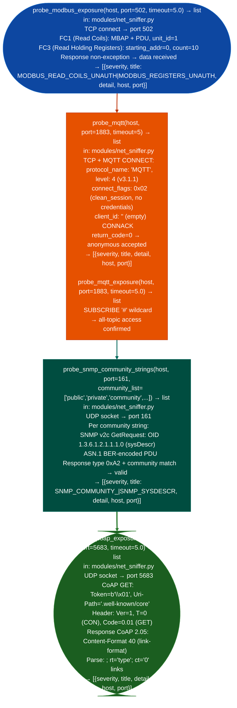

# Industrial/IoT Probes

Probe Modbus TCP for unauthenticated coil/register read access, test MQTT brokers for anonymous connection acceptance and topic wildcard subscription, probe CoAP servers for resource enumeration without DTLS, and test SNMP for default community strings `public`, `private`, `community`: providing ICS/OT and IoT device exposure assessment: via `modules/net_sniffer.py`.

---

## Why this exists

1. **`probe_modbus_exposure()` reads Modbus coils and holding registers without authentication**: Modbus TCP port 502 has no authentication mechanism in the base protocol. `probe_modbus_exposure()` sends a Function Code 1 Read Coils and Function Code 3 Read Holding Registers request and checks whether the device responds with register data. A response to FC1 or FC3 confirms that any host on the network can read sensor values, setpoints, and device status, and can write to coils (FC5) or registers (FC6) to alter industrial process state. Findings: `MODBUS_PORT_OPEN` (LOW), `MODBUS_READ_COILS_UNAUTH` CRITICAL, `MODBUS_REGISTERS_UNAUTH` CRITICAL, `MODBUS_EXCEPTION_RESPONSE` (MEDIUM).

2. **`probe_mqtt()` and `probe_mqtt_exposure()` test MQTT broker authentication**: `probe_mqtt()` sends a MQTT CONNECT packet with an empty client ID, empty username, and empty password. CONNACK return code 0x00 Connection Accepted confirms anonymous clients can publish and subscribe to all topics. `probe_mqtt_exposure()` follows up with a SUBSCRIBE to `#` all topics wildcard to confirm unrestricted topic access. Unauthenticated MQTT in industrial environments allows reading telemetry from all devices and injecting commands to any actuator subscribed to a control topic.

3. **`probe_snmp_community_strings()` tests SNMP v1/v2c for default community strings**, it sends SNMP GetRequest PDUs with community strings `public`, `private`, `community`, `admin`, `snmpd`, and a configurable wordlist using raw UDP socket construction (no `pysnmp` required). A valid GetResponse (SNMP version + community + PDU type 0xA2) confirms community string access. Finding titles use the pattern `SNMP_COMMUNITY_<COMMUNITY_UPPER>` and a secondary `SNMP_SYSDESCR` finding carries the system description string. `probe_coap_exposure()` sends a CoAP GET to `.well-known/core` to enumerate available resources without DTLS.

---

## How it works



---

## Usage

```python
from modules.net_sniffer import (
    probe_modbus_exposure,
    probe_mqtt,
    probe_mqtt_exposure,
    probe_snmp_community_strings,
    probe_coap_exposure
)

for host in discovered_hosts:
    # ICS/OT exposure
    modbus = probe_modbus_exposure(host)
    for f in modbus:
        print(f"  [{f['severity']}] {f['title']}: {f['detail'][:80]}")

    # IoT messaging
    mqtt = probe_mqtt(host)
    for f in mqtt:
        print(f"  [{f['severity']}] {f['title']}: {f['detail'][:80]}")

    # SNMP default community strings
    snmp = probe_snmp_community_strings(host, port=161,
                                        community_list=['public', 'private', 'community'])
    for f in snmp:
        print(f"  [{f['severity']}] {f['title']}: {f['detail'][:80]}")
```

---

## Example output

The following is a schematic example showing output structure and field names. Values are illustrative.

```
probe_modbus_exposure: <target-ip>:502

  [LOW]      MODBUS_PORT_OPEN
               detail: TCP/502 open; Modbus service responding

  [CRITICAL] MODBUS_READ_COILS_UNAUTH
               detail: FC1 response received; coil data readable without authentication

  [CRITICAL] MODBUS_REGISTERS_UNAUTH
               detail: FC3 response received; holding register data readable without auth

probe_mqtt: <target-ip>:1883

  [CRITICAL] MQTT_ANON_ACCESS
               detail: CONNACK return_code=0; anonymous MQTT client accepted

probe_snmp_community_strings: <target-ip>:161

  [HIGH] SNMP_COMMUNITY_PUBLIC
           detail: SNMPv1 community string 'public' accepted

  [MEDIUM] SNMP_SYSDESCR
             detail: <system description string from OID 1.3.6.1.2.1.1.1.0>
```

---

## False positives

**`probe_modbus_exposure()` exception codes**: a Modbus device that responds with exception code 0x01 Illegal Function or 0x02 Illegal Data Address produces a `MODBUS_EXCEPTION_RESPONSE` finding (MEDIUM), not an unauthenticated data access finding. Only `MODBUS_READ_COILS_UNAUTH` and `MODBUS_REGISTERS_UNAUTH` indicate actual data disclosure.

**`probe_snmp_community_strings()` SNMP v3 only hosts**: devices configured to reject SNMPv1/v2c entirely will not respond to any UDP GetRequest, regardless of community string. A timeout produces no findings. Confirm port reachability with a TCP probe to 161 if supported before concluding that SNMP is absent.

---

## Pipeline position

Run industrial/IoT probes when network discovery reveals ports 502 (Modbus), 1883/8883 (MQTT), 5683 (CoAP), or 161/162 (SNMP). These probes apply to OT network segments, smart building systems, and IoT gateway devices. Run `probe_modbus_exposure()` first; a confirmed MODBUS_REGISTERS_UNAUTH finding is an immediate critical impact regardless of other surface.

---

## Reading findings

Industrial IoT probe functions return `List[{severity, title, detail, host, port}]`:

| Field | Content |
|:---|:---|
| `severity` | `CRITICAL` unauthenticated read/write, `HIGH`, `MEDIUM`, or `LOW` port open |
| `title` | Finding code for example `MODBUS_READ_COILS_UNAUTH`, `MODBUS_REGISTERS_UNAUTH`, `MODBUS_PORT_OPEN` |
| `detail` | Function code used, response type, or condition |
| `host` | Target IP address |
| `port` | Protocol port for example `502` for Modbus |

---

## See also

- [Host/Service Discovery](host-service-discovery.md): ICMP discovery and banner grabbing to identify IoT device presence
- [Local Network Inventory](local-network-inventory.md): interface and routing table analysis to identify OT network segments
