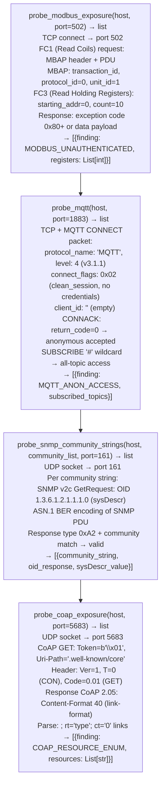

# Industrial/IoT Probes

Probe Modbus TCP for unauthenticated coil/register read access, test MQTT brokers for anonymous connection acceptance and topic wildcard subscription, probe CoAP servers for resource enumeration without DTLS, and test SNMP for default community strings (`public`, `private`, `community`) — providing ICS/OT and IoT device exposure assessment — via `modules/network_analyze.py`.

---

## Why this exists

1. **`probe_modbus_exposure()` reads Modbus coils and holding registers without authentication** — Modbus TCP (port 502) has no authentication mechanism in the base protocol. `probe_modbus_exposure()` sends a Function Code 1 (Read Coils) and Function Code 3 (Read Holding Registers) request and checks whether the device responds with register data. A response confirms that any host on the network can read sensor values, setpoints, and device status — and can write to coils (FC5) or registers (FC6) to alter industrial process state.

2. **`probe_mqtt()` and `probe_mqtt_exposure()` test MQTT broker authentication** — MQTT CONNECT with an empty client ID, empty username, and empty password is sent to the broker. CONNACK return code 0x00 (Connection Accepted) means anonymous clients can publish and subscribe to all topics. A follow-up SUBSCRIBE to `#` (all topics wildcard) confirms unrestricted topic access. Unauthenticated MQTT in industrial environments allows reading telemetry from all devices and injecting commands to any actuator subscribed to a control topic.

3. **`probe_snmp_community_strings()` tests SNMP v1/v2c for default community strings** — it sends SNMP GetRequest PDUs with community strings `public`, `private`, `community`, `admin`, `snmpd`, and a configurable wordlist, using raw UDP socket construction (no `pysnmp` required). A valid GetResponse (SNMP version + community + PDU type 0xA2) confirms community string access. `probe_coap_exposure()` sends a CoAP GET to `coap://host/.well-known/core` to enumerate available resources without DTLS.

---

## How it works



---

## Usage

```python
from modules.network_analyze import (
    probe_modbus_exposure,
    probe_mqtt,
    probe_snmp_community_strings,
    probe_coap_exposure
)

for host in discovered_hosts:
    # ICS/OT exposure
    modbus = probe_modbus_exposure(host)
    for f in modbus:
        print(f"  [Modbus] {f['finding']} @ {host}:{f.get('port',502)}")

    # IoT messaging
    mqtt = probe_mqtt(host)
    for f in mqtt:
        print(f"  [MQTT] {f['finding']} @ {host}")

    # SNMP
    snmp = probe_snmp_community_strings(host, ['public', 'private', 'community'])
    for f in snmp:
        print(f"  [SNMP] community='{f['community_string']}' sysDescr={f.get('sysDescr_value','')[:40]}")
```

---

## Example output

The following illustrates industrial and IoT probe output format.

```
probe_modbus_exposure: 10.0.20.5:502

  [CRITICAL] MODBUS_UNAUTHENTICATED: FC3 response received
    Holding registers [0-9]: [1200, 850, 4095, 0, 0, 1, 1, 0, 255, 128]

probe_mqtt: 10.0.20.10:1883

  [CRITICAL] MQTT_ANON_ACCESS: CONNACK return_code=0 (anonymous accepted)
    SUBSCRIBE '#' → subscribed to all topics

probe_snmp_community_strings: 10.0.20.1:161

  [HIGH] SNMP_DEFAULT_COMMUNITY: 'public' accepted
    sysDescr: Cisco IOS Software, Version 15.2...
```

---

## False positives

**`probe_modbus_exposure()` exception codes** — a Modbus device that responds with exception code 0x01 (Illegal Function) or 0x02 (Illegal Data Address) is reachable but the specific function code or address range is not available. This is not the same as unauthenticated access to valid data. Only flag when a non-exception data response is received.

**`probe_snmp_community_strings()` SNMP v3 only hosts** — devices configured to reject SNMPv1/v2c entirely will not respond to any UDP GetRequest, regardless of community string. A timeout response means either SNMP is disabled, the port is filtered, or the device requires v3. Confirm port reachability before concluding that SNMP is absent.

---

## Pipeline position

Run industrial/IoT probes when network discovery reveals ports 502 (Modbus), 1883/8883 (MQTT), 5683 (CoAP), or 161/162 (SNMP). These probes are applicable to OT network segments, smart building systems, and IoT gateway devices.

---

## See also

- [Host/Service Discovery](host-service-discovery.md) — ICMP discovery and banner grabbing to identify IoT device presence
- [Local Network Inventory](local-network-inventory.md) — interface and routing table analysis to identify OT network segments
