# Inference Endpoint Enumeration

Enumerate unauthenticated LLM inference platform surfaces: Ollama, LM Studio, LocalAI, HuggingFace Text Generation Inference (TGI), and OpenAI-compatible APIs: alongside extended server-level management surfaces for vLLM, NVIDIA Triton Inference Server, TorchServe, MLflow model registry, and vector store administrative interfaces including Qdrant, Weaviate, Chroma, Pinecone local, and pgvector via PostgREST, identifying unprotected model listings, unauthenticated inference execution, operational metrics exposure, snapshot creation, and training artifact disclosure without credentials.

---

## Why this exists

1. **LLM inference platforms do not enforce authentication by default: Ollama binds to `0.0.0.0` without any API key, vLLM serves on port 8000 unless `--api-key` is explicitly set, Triton's model repository namespace has no auth gate separate from the inference endpoint, and Chroma has no authentication layer at all.** When these services are deployed on internal networks and exposed via a misconfigured ingress controller, load balancer rule, or cloud security group, the attack surface is open to the internet without authentication. `LLMEnumerator` and `probe_llm_inference_server_metadata()` cover each platform's canonical discovery paths so the analyst does not need to know which platform is running before the scan begins: the module fingerprints the platform from response structure.

2. **Vector store administrative interfaces are a higher-severity risk than the inference endpoints they serve: a snapshot of a Qdrant collection or a Weaviate backup listing hands an adversary the complete RAG corpus in a single HTTP request, regardless of the collection size.** Individual endpoint enumeration via the inference layer requires per-query retrieval bounded by the model's context window; a snapshot bypasses all of that. `probe_vector_store_admin_api()` covers five vector store platforms across their administrative namespaces: `/cluster`, `/collections/{name}/snapshots`, `/v1/schema`, `/v1/backups`, `/api/v1/collections/{id}/get`, `/indexes`, `/vectors/fetch`, and `/rpc/match_documents`; to assess whether the full corpus is extractable before the inference layer is even reached.

3. **MLflow model registries and Triton repository indexes disclose the organization's complete ML pipeline: model lineage, fine-tune identifiers, artifact storage URIs, training hyperparameters, and filesystem paths: before any inference has been attempted.** `probe_llm_inference_server_metadata()` targets the registry and management namespaces of each platform separately from the inference endpoints, because in production deployments these surfaces are often on different ports: Triton on 8000/8001/8500, TorchServe on management 8080 and inference 8081, and MLflow on 5000; they expose structural metadata that the inference API does not.

---

## How it works

```mermaid
flowchart TD
    A(["LLMEnumerator(host, port, https, timeout)\nenumerate_all() → dict"]):::input --> B["probe_openai_compatible_api():\n  OPENAI_COMPAT_PATHS (8 paths)\n  GET /v1/models (or variant) + 200 + 'data'/'models'/'object' in JSON\n  → HIGH: unauth model enumeration; ids=first 5 model IDs\n  POST /v1/chat/completions + 200 + 'choices'/'message' in JSON\n  → CRITICAL: unauth inference\n  POST returns 400/422 (reachable but bad payload)\n  → MEDIUM: endpoint accessible without auth"]:::primary
    B:::primary --> C["probe_ollama_api():\n  GET /api/tags → 200 + 'models' in JSON\n  → CRITICAL: model list (name, size, digest[:12])\n  POST /api/generate {model, prompt, stream:false} → 200\n  → CRITICAL: unauth inference\n  POST /api/chat {model, messages, stream:false} → 200 + 'message'\n  → CRITICAL: unauth multi-turn chat (system-role injection vector)\n  GET /api/ps → 200 + 'models' in JSON (non-empty)\n  → HIGH: running model process list (VRAM, expiry)\n  GET /api/version → 200 + 'version' in JSON\n  → LOW: version disclosure"]:::tertiary
    C:::tertiary --> D["probe_lmstudio_api():\n  LMSTUDIO_PATHS: /v1/models, /api/v0/models...\n  GET model path → 200 + 'data'/'object' in JSON\n  → HIGH: model IDs disclosed (reveal local filesystem GGUF paths)\n  POST /v1/chat/completions with first discovered model ID\n  → CRITICAL: unauth inference on locally loaded model"]:::tertiary
    D:::tertiary --> E["probe_localai_api():\n  GET /v1/models or /models → 200 + JSON data object\n  → HIGH: model enumeration\n  POST /v1/completions with model_id → 200 + 'choices'\n  → CRITICAL: unauth text completion (LLM01/LLM02)\n  GET /metrics → 200 + 'go_' in body → MEDIUM: Prometheus metrics\n  GET /readyz or /healthz → 200 → LOW: liveness confirmed"]:::tertiary
    E:::tertiary --> F(["probe_huggingface_inference_api():\n  GET /info → 200 + 'model_id' in JSON\n  → HIGH: model_id, dtype, quantization, max_input_length, max_total_tokens\n  POST /generate {inputs, parameters.max_new_tokens} → 200\n  → CRITICAL: unauth inference\n  POST /generate_stream → 200 (SSE)\n  → HIGH: streaming inference (harder to filter for exfil)\n  GET /health → 200 → LOW: liveness"]):::output
    G(["probe_llm_inference_server_metadata(host, port, timeout)\nvLLM / Triton / TorchServe / Ollama / MLflow\nAll platforms probed from their canonical ports"]):::input --> H["vLLM (ports 8000, 8080):\n  GET /v1/models → 200 + 'data'/'model'\n  → HIGH: VLLM_MODELS_UNAUTH (stack/version/context length)\n  GET /metrics → 200 + '# HELP'/'vllm'/'gpu'\n  → MEDIUM: VLLM_METRICS_UNAUTH (GPU util, queue depth,\n     token throughput, KV-cache occupancy, latency histograms)"]:::secondary
    H:::secondary --> I["Triton (ports 8000, 8001, 8500):\n  GET /v2 → 200 + 'name'/'version'\n  → MEDIUM: TRITON_SERVER_META_UNAUTH (version, extensions)\n  GET /v2/models → 200 + JSON\n  → HIGH: TRITON_MODELS_UNAUTH\n  GET /v2/repository/index → 200 + JSON\n  → CRITICAL: TRITON_REPO_INDEX_UNAUTH (all stored models,\n     paths, READY/UNAVAILABLE/LOADING states, version dirs)\n  Enables POST /v2/repository/models/{name}/load to hot-load without auth"]:::tertiary
    I:::tertiary --> J["TorchServe (ports 8080, 8081):\n  GET /models → 200 + 'models'\n  → CRITICAL: TORCHSERVE_MODELS_UNAUTH\n     (handler class filesystem paths → path traversal pivot)\n  GET /metrics → 200 + '# HELP'/'torchserve'/'ts_'\n  → HIGH: TORCHSERVE_METRICS_UNAUTH\n     (request count, latency p50/p90/p99, worker util, GPU)"]:::tertiary
    J:::tertiary --> K["Ollama (port 11434):\n  GET /api/tags → HIGH: OLLAMA_TAGS_UNAUTH\n  GET /api/ps → MEDIUM: OLLAMA_PS_UNAUTH (VRAM, session expiry)\n  POST /api/generate → CRITICAL: OLLAMA_UNAUTH_GENERATE\n     (no rate limit, no usage metering, no audit log by default)"]:::tertiary
    K:::tertiary --> L(["MLflow (ports 5000, 8080):\n  GET /api/2.0/mlflow/registered-models/list → HIGH: MLFLOW_MODELS_UNAUTH\n     (name, versions, artifact URIs → S3 bucket keys or filesystem paths)\n  GET /api/2.0/mlflow/experiments/list → HIGH: MLFLOW_EXPERIMENTS_UNAUTH\n     (run IDs, hyperparameters, metric histories, dataset versions)"]):::output
    M(["probe_vector_store_admin_api(host, port, timeout)\nQdrant / Weaviate / Chroma / Pinecone / pgvector"]):::input --> N["Qdrant (canonical port 6333 + supplied port):\n  GET /cluster → CRITICAL: QDRANT_CLUSTER_UNAUTH\n     (node identities, gRPC peer addresses, shard distribution,\n      consensus state, leader election metadata)\n  GET /collections → enumerate collection names\n  POST /collections/{name}/snapshots → HIGH: QDRANT_SNAPSHOT_CREATE\n     (full collection export in one request, bypasses rate limits)"]:::tertiary
    N:::tertiary --> O["Weaviate (canonical port 8080 + supplied port):\n  GET /v1/schema → HIGH: WEAVIATE_SCHEMA_UNAUTH\n     (all classes, property names+types, vectorizer module config,\n      text2vec model IDs, cross-reference relationships)\n  GET /v1/backups → HIGH: WEAVIATE_BACKUP_UNAUTH\n     (S3 bucket/GCS path/filesystem location, per-class status)\n  POST /v1/objects/validate → MEDIUM: WEAVIATE_OBJECT_INJECT\n     (schema enforcement gap probe, confirms write surface exists)"]:::tertiary
    O:::tertiary --> P["Chroma (canonical port 8000 + supplied port):\n  GET /api/v1/heartbeat → INFO: CHROMA_HEARTBEAT_EXPOSED\n  GET /api/v1/collections → enumerate collection IDs\n  GET /api/v1/collections/{id}/get → CRITICAL: CHROMA_BULK_READ\n     (all embeddings, source documents, metadata in plaintext)"]:::tertiary
    P:::tertiary --> Q["Pinecone local (canonical port 5001 + supplied port):\n  GET /indexes → HIGH: PINECONE_INDEX_LIST_UNAUTH\n     (index names, dimensions, metric type, pod config, replica count)\n  GET /vectors/fetch?ids=* → CRITICAL: PINECONE_VECTOR_FETCH\n     (raw embedding vectors + metadata; inversion attack surface)"]:::tertiary
    Q:::tertiary --> R(["pgvector via PostgREST (canonical port 3000 + supplied port):\n  GET /rpc/match_documents?query_embedding=[0.0×8]&match_count=5\n  → CRITICAL: PGVECTOR_SEMANTIC_SEARCH_UNAUTH\n     (anon role, full corpus extractable via nearest-neighbor traversal;\n      PostgREST anon access requires explicit REVOKE to close)"]):::output
    classDef input     fill:#0d47a1,stroke:#1565c0,color:#fff
    classDef primary   fill:#e65100,stroke:#bf360c,color:#fff
    classDef secondary fill:#004d40,stroke:#00695c,color:#fff
    classDef tertiary  fill:#4a148c,stroke:#6a1b9a,color:#fff
    classDef neutral   fill:#37474f,stroke:#546e7a,color:#fff
    classDef output    fill:#1b5e20,stroke:#2e7d32,color:#fff
    linkStyle 0 stroke:#bf360c,stroke-width:2px
    linkStyle 1 stroke:#6a1b9a,stroke-width:2px
    linkStyle 2 stroke:#6a1b9a,stroke-width:2px
    linkStyle 3 stroke:#6a1b9a,stroke-width:2px
    linkStyle 4 stroke:#2e7d32,stroke-width:3px
    linkStyle 5 stroke:#00695c,stroke-width:2px
    linkStyle 6 stroke:#6a1b9a,stroke-width:2px
    linkStyle 7 stroke:#6a1b9a,stroke-width:2px
    linkStyle 8 stroke:#6a1b9a,stroke-width:2px
    linkStyle 9 stroke:#2e7d32,stroke-width:3px
    linkStyle 10 stroke:#6a1b9a,stroke-width:2px
    linkStyle 11 stroke:#6a1b9a,stroke-width:2px
    linkStyle 12 stroke:#6a1b9a,stroke-width:2px
    linkStyle 13 stroke:#6a1b9a,stroke-width:2px
    linkStyle 14 stroke:#2e7d32,stroke-width:3px
```



### Platform-to-finding severity matrix

| Platform | Finding | Severity | Trigger |
|---|---|---|---|
| Ollama | Unauth model list | CRITICAL | `/api/tags` returns `models` array |
| Ollama | Unauth inference | CRITICAL | `/api/generate` returns `response` |
| Ollama | Unauth chat | CRITICAL | `/api/chat` returns `message` |
| Ollama | Running processes | HIGH | `/api/ps` non-empty `models` |
| Ollama | Version disclosure | LOW | `/api/version` returns `version` |
| OpenAI-compat | Unauth inference | CRITICAL | `/v1/chat/completions` returns `choices` |
| OpenAI-compat | Model enumeration | HIGH | `/v1/models` returns model list |
| OpenAI-compat | Endpoint accessible | MEDIUM | `/v1/chat/completions` returns 400/422 without auth |
| LM Studio | Unauth inference | CRITICAL | `/v1/chat/completions` returns `choices` |
| LM Studio | Model enumeration | HIGH | `/v1/models` returns `data` |
| LocalAI | Unauth inference | CRITICAL | `/v1/completions` returns `choices` |
| LocalAI | Model enumeration | HIGH | `/v1/models` returns model list |
| LocalAI | Prometheus metrics | MEDIUM | `/metrics` returns `go_` metric families |
| HuggingFace TGI | Unauth inference | CRITICAL | `/generate` returns 200 |
| HuggingFace TGI | Streaming inference | HIGH | `/generate_stream` returns 200 |
| HuggingFace TGI | Server info | HIGH | `/info` returns `model_id` |
| vLLM | Model inventory | HIGH | `/v1/models` returns model data |
| vLLM | Prometheus metrics | MEDIUM | `/metrics` returns vLLM metric families |
| Triton | Repository index | CRITICAL | `/v2/repository/index` returns JSON |
| Triton | Model list | HIGH | `/v2/models` returns JSON |
| Triton | Server metadata | MEDIUM | `/v2` returns `name`/`version` |
| TorchServe | Model inventory | CRITICAL | `/models` returns management API data |
| TorchServe | Prometheus metrics | HIGH | `/metrics` returns TorchServe families |
| MLflow | Model registry | HIGH | `/api/2.0/mlflow/registered-models/list` |
| MLflow | Experiments | HIGH | `/api/2.0/mlflow/experiments/list` |
| Qdrant | Cluster topology | CRITICAL | `/cluster` returns JSON |
| Qdrant | Snapshot creation | HIGH | POST `/collections/{name}/snapshots` returns 200/201 |
| Weaviate | Schema disclosure | HIGH | `/v1/schema` returns JSON |
| Weaviate | Backup listing | HIGH | `/v1/backups` returns 200 |
| Weaviate | Object injection surface | MEDIUM | POST `/v1/objects/validate` returns 200/204 |
| Chroma | Bulk data read | CRITICAL | `/api/v1/collections/{id}/get` returns JSON |
| Chroma | Service confirmation | INFO | `/api/v1/heartbeat` returns 200 |
| Pinecone | Vector fetch | CRITICAL | `/vectors/fetch?ids=*` returns JSON |
| Pinecone | Index list | HIGH | `/indexes` returns JSON |
| pgvector | Semantic search | CRITICAL | `/rpc/match_documents` returns JSON array |

---

## Usage

```python
from modules.llm_enum import (
    LLMEnumerator,
    probe_llm_inference_server_metadata,
    probe_vector_store_admin_api,
)

# ── LLMEnumerator — full platform probe ──────────────────────────────────────

# Full scan: all platforms, all probes
enum = LLMEnumerator('192.168.1.100', port=11434, https=False, timeout=10)
result = enum.enumerate_all()
for f in result['findings']:
    print(f"[{f['severity']}] {f['title']}")
    print(f"  {f['evidence'][:120]}")

# Targeted platform probes (call methods individually)
enum2 = LLMEnumerator('10.0.1.50', port=443, https=True, timeout=10)
ollama = enum2.probe_ollama_api()
lmstudio = enum2.probe_lmstudio_api()
localai = enum2.probe_localai_api()
hf_tgi = enum2.probe_huggingface_inference_api()
openai_compat = enum2.probe_openai_compatible_api()

for findings in [ollama, lmstudio, localai, hf_tgi, openai_compat]:
    for f in findings:
        if f['severity'] in ('CRITICAL', 'HIGH'):
            print(f"[{f['severity']}] {f['title']}: {f['evidence'][:100]}")

# ── Extended server metadata ──────────────────────────────────────────────────

# vLLM, Triton, TorchServe, Ollama, MLflow — all ports probed per service
server_findings = probe_llm_inference_server_metadata(
    '192.168.1.100', port=8000, timeout=10
)
for f in server_findings:
    print(f"[{f['severity']}] {f['title']} (port {f['port']})")
    print(f"  {f['detail'][:120]}")

# ── Vector store admin surfaces ────────────────────────────────────────────────

# Qdrant, Weaviate, Chroma, Pinecone, pgvector — canonical + supplied port
vs_findings = probe_vector_store_admin_api(
    '192.168.1.100', port=6333, timeout=10
)
critical = [f for f in vs_findings if f['severity'] == 'CRITICAL']
print(f"Critical vector store findings: {len(critical)}")
for f in critical:
    print(f"  [{f['severity']}] {f['title']}")
    print(f"  Evidence: {f['evidence'][:120]}")

# ── Common patterns ──────────────────────────────────────────────────────────

# Ollama target (default port 11434, no TLS)
ollama_enum = LLMEnumerator('192.168.1.100', port=11434, https=False)
ollama_findings = ollama_enum.probe_ollama_api()
for f in ollama_findings:
    if f['severity'] == 'CRITICAL':
        print(f"CRITICAL: {f['title']}")
        print(f"  {f['evidence']}")

# vLLM with non-standard port
vllm_findings = probe_llm_inference_server_metadata('10.10.1.50', port=8081)
for f in vllm_findings:
    print(f"[{f['severity']}] {f['title']} port={f['port']}: {f['evidence'][:80]}")

# Qdrant cluster exposed on default port
qdrant_findings = probe_vector_store_admin_api('10.10.1.100', port=6333)
for f in qdrant_findings:
    print(f"[{f['severity']}] {f['title']}: {f['evidence'][:80]}")

# CLI
# python -m modules.llm_enum 192.168.1.100 11434 --platform ollama
# python -m modules.llm_enum 10.10.1.50 8000 --platform vllm
# python -m modules.llm_enum 10.10.1.100 6333 --platform qdrant
```

---

## Example output

The following illustrates the `evidence` field format for representative findings. Actual values: model names, digest hashes, peer addresses, collection names, artifact URIs: will reflect the specific target.

```
[CRITICAL] Ollama unauth model list
  HTTP 200 /api/tags models=[{'name': '<model>:<tag>', 'size': <bytes>, 'digest': 'sha256:<hash>...'}]

[CRITICAL] Ollama unauth inference
  HTTP 200 /api/generate model=<model>:<tag> response=PONG

[HIGH] Ollama running model processes exposed
  HTTP 200 /api/ps body={"models":[{"name":"<model>","size_vram":<bytes>,"expires_at":"<timestamp>"}]}

[HIGH] HuggingFace TGI server info exposed
  HTTP 200 /info model_id=<hf-org>/<model-name>
  body={"model_id":"...","dtype":"float16","max_input_length":<n>,"max_total_tokens":<n>,"version":"<ver>"}

[CRITICAL] HuggingFace TGI unauthenticated inference
  HTTP 200 /generate body={"generated_text":"PONG","details":{"finish_reason":"length",...}}

[CRITICAL] TRITON_REPO_INDEX_UNAUTH
  HTTP 200 GET /v2/repository/index
  body=[{"name":"<model-a>","version":"1","state":"READY"},{"name":"<model-b>","state":"UNAVAILABLE"},...]

[CRITICAL] QDRANT_CLUSTER_UNAUTH
  HTTP 200 GET /cluster
  body={"status":"ok","result":{"status":"enabled","peer_id":<id>,"peers":{<id>:{"uri":"http://<peer>:6335"}}}}

[HIGH] QDRANT_SNAPSHOT_CREATE
  HTTP 201 POST /collections/<collection>/snapshots
  body={"status":"ok","result":{"name":"<collection>-<id>-<date>.snapshot"}}

[CRITICAL] CHROMA_BULK_READ
  HTTP 200 GET /api/v1/collections/<collection>/get
  body={"ids":["<id>",...],"documents":["<chunk text>",...],"metadatas":[{"source":"<filename>"},...],...}

[HIGH] MLFLOW_MODELS_UNAUTH
  HTTP 200 GET /api/2.0/mlflow/registered-models/list
  body={"registered_models":[{"name":"<model>","latest_versions":[{"run_id":"<id>","artifact_uri":"s3://<bucket>/..."}]}]}
```

---

## False positives

**`probe_openai_compatible_api()` flags `MEDIUM: LLM API endpoint accessible without authentication` when a gateway returns 400/422 for a missing or invalid `model` parameter, not because auth failed.** The probe sends `_TEST_PAYLOAD_TEMPLATE` which uses `model: gpt-3.5-turbo` as a placeholder. A correctly configured API that rejects unknown model IDs returns 400/422 and triggers the MEDIUM finding even when authentication is enforced. Verify by sending an `Authorization: Bearer invalid_key` header and observing whether the response changes to 401/403; if it remains 400/422, auth is not the issue.

**`probe_llm_inference_server_metadata()` probes each platform's canonical port(s) in addition to the supplied `port` argument: a scan against port 80 will also probe Triton ports 8000/8001/8500, TorchServe 8080/8081, and Ollama 11434.** For targets where those canonical ports are not intended to be assessed, pass the specific port and filter findings by `f['port']`. Each finding records the actual port in the `port` field so findings from unintended ports are identifiable.

**Qdrant `QDRANT_SNAPSHOT_CREATE` is a HIGH-severity finding even if snapshot download is subsequently blocked at the network layer.** The probe only confirms that the snapshot creation request was accepted HTTP 200/201. Whether the resulting snapshot file is downloadable via `GET /collections/{name}/snapshots/{filename}` depends on network controls that this probe does not verify. Escalate to CRITICAL only after confirming the snapshot is downloadable; treat HIGH as indicating a misconfigured admin API regardless.

---

## Pipeline position

**Before this module:** Run `tiptoe` to identify which LLM-relevant ports are open: 11434, 8000, 8080, 8001, 6333, 5001, 3000, and 5000. Confirm whether the target is on a private VLAN or externally reachable: unauthenticated Ollama on a public IP is a CRITICAL finding; on a properly isolated internal segment it is MEDIUM network control partially mitigates. The `https` parameter on `LLMEnumerator` must be set correctly: connecting with TLS to a plain-HTTP port returns no data.

**After this module:** For `OLLAMA_UNAUTH_GENERATE`: run `probe_system_prompt_disclosure()` and `probe_prompt_injection_chain()` to assess behavioral attack surface. For `TRITON_REPO_INDEX_UNAUTH` or `TORCHSERVE_MODELS_UNAUTH`: extract handler class paths and attempt `GET /v2/models/{name}/config` for Triton or `GET /models/{name}` for TorchServe to get full configuration. For `QDRANT_SNAPSHOT_CREATE`: attempt `GET /collections/{name}/snapshots` to enumerate downloadable snapshot names and confirm extractability. For `MLFLOW_MODELS_UNAUTH`: extract artifact URIs and attempt direct S3/GCS path access. Write confirmed findings to `~/VDT/VULNERABILITIES-<ip>.md`.

---

## Reading findings

| Field | Content |
|:---|:---|
| `f['severity']` | CRITICAL / HIGH / MEDIUM / LOW / INFO |
| `f['title']` | Short finding identifier: for example `Ollama unauth inference` or `TRITON_REPO_INDEX_UNAUTH` |
| `f['detail']` | Full explanation including OWASP LLM category, attack vector, and impact |
| `f['evidence']` | HTTP status + path + body excerpt first 150-300 bytes confirming the finding |
| `f['host']` / `f['port']` | Target host and the actual port where the finding was observed |

---

## See also

- [LLM Behavior Security Probes](llm-behavior-security-probes.md): system prompt disclosure, prompt injection chains, OWASP LLM control verification, MITRE ATLAS techniques, CoSAI baseline controls
- [Model Data Pipeline Exposure](model-data-pipeline-exposure.md): RAG pipeline, MCP server, A2A trust boundaries, multi-agent orchestration, memory poisoning, supply chain artifact exposure
- [Unknown HTTP API Mapping](unknown-http-api-mapping.md): general API discovery for non-LLM HTTP endpoints on the same host
