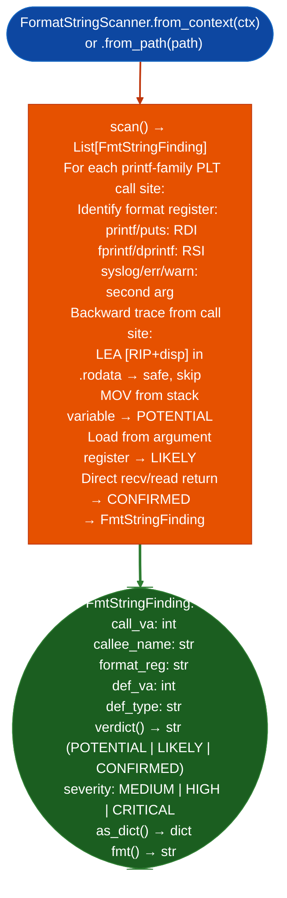

# Format String Vulnerability Detection

Detect format string vulnerabilities in x86-64 ELF binaries: finding `printf`/`fprintf`/`syslog` and family call sites where the format argument is not a string literal in `.rodata` but instead a function argument, stack variable, or register sourced from `recv`/`read`/network input: following the detection algorithm from TAOSSA Chapter 8.

---

## Why this exists

1. **Format string vulnerabilities arise when user-controlled data reaches the format argument of `printf` and similar functions.** The format argument is safe only when it is a string literal: a `RIP`-relative load from `.rodata`. Any other provenance function argument, stack variable, tainted register is a potential `%n` write or information disclosure. `FormatStringScanner` automates detection of unsafe format argument provenance across the entire binary.

2. Format argument provenance is determined by backward tracing from the call site: `FormatStringScanner` identifies the format register for each callee `RDI` for `printf`, `RSI` for `fprintf`, third argument for `syslog`, then walks backward from the call site to find the last instruction that defined that register. An `LEA` from `.rodata` → string literal → safe. All other definitions → finding.

3. `FmtStringFinding.verdict()` classifies findings as `POTENTIAL`, `LIKELY`, or `CONFIRMED`: `POTENTIAL` register defined by argument load, `LIKELY` register defined by stack variable from network recv, `CONFIRMED` (register defined by direct `recv`/`read` return value). This three-tier classification maps to `MEDIUM`, `HIGH`, and `CRITICAL` severity respectively.

---

## How it works



---

## Usage

```python
from ablation.analyzers.format_string_scanner import FormatStringScanner
from ablation.analyzers.binary_context import BinaryContext

ctx = BinaryContext.load_or_build('/path/to/httpd')
scanner = FormatStringScanner.from_context(ctx)

findings = scanner.scan()
for f in findings:
    if f.verdict() in ('LIKELY', 'CONFIRMED'):
        print(f.fmt())
```

---

## Example output

The following illustrates format string detection output format. Actual addresses and registers are binary-specific.

```
FormatStringScanner: httpd

[CRITICAL] CONFIRMED: printf at <va>
  format_reg=RDI  def_va=<va>  def_type=recv_return
  callee=printf

[HIGH] LIKELY: syslog at <va>
  format_reg=RSI  def_va=<va>  def_type=stack_from_arg
  callee=syslog
```

---

## False positives

**`POTENTIAL` verdict may include safely validated strings**: a format register defined by a function argument does not confirm the argument is user-controlled; it may be an internal format constant. Filter to `LIKELY` and `CONFIRMED` verdicts for initial triage and reserve `POTENTIAL` for secondary review.

**Backward trace stops at function entry**: if the format register is defined in a calling function (passed as an argument to a helper that calls `printf`), the scanner reports `POTENTIAL` rather than the actual provenance. Use `TaintTracker` to extend the trace backward across function boundaries for full provenance analysis.

---

## Pipeline position

Run `FormatStringScanner` as part of initial binary triage alongside `SinkArgClassifier`. `CONFIRMED` findings go directly to `TaintTracker` for full path analysis. `LIKELY` findings are prioritized after `CONFIRMED`. `POTENTIAL` findings are deferred until higher-priority classes are exhausted.

---

## Reading findings

`FormatStringScanner.scan()` returns a list of finding dicts:

| Field | Content |
|:---|:---|
| `severity` | `CRITICAL` confirmed: network-sourced format arg / `HIGH` likely: stack-propagated |
| `title` | Finding code: `FORMAT_STRING_CONFIRMED` or `FORMAT_STRING_LIKELY` |
| `detail` | Callee name, format register, def VA, and def type |
| `format_reg` | Register holding the format string argument |
| `def_va` | VA where the format register was last defined |
| `def_type` | `recv_return`, `stack_from_arg`, or `unknown` |

---

## See also

- [Named Taint Sources and Bounds](named-taint-sources-and-bounds.md): `TaintTracker` for confirmed format string dataflow tracing
- [Allowlist Sanitizer Detection](exploitability-context-checks.md): `SanitizerDetector` to check for sanitizer coverage on format arg paths
