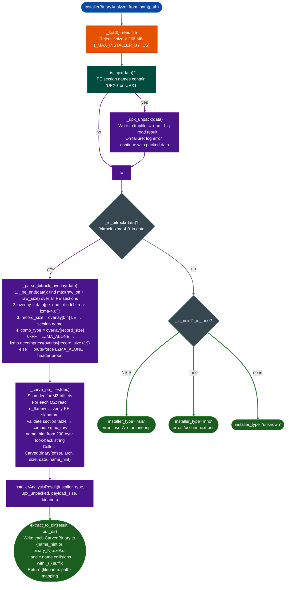

# Installer Payload Analysis

Detect self-extracting installer format BitRock LZMA-4.0, NSIS, Inno Setup, decompress the embedded payload, carve all valid PE binaries from the decompressed data, and extract them to a directory for downstream binary analysis: with UPX pre-unpacking when the BitRock stub is UPX-packed.

---

## Why this exists

1. **Firmware and SDK installers for embedded targets ship multiple binaries in a single self-extracting executable.** TI CC3xxx RadioTool, RTI SDK, and a range of industrial IoT installers use BitRock InstallBuilder now Bitnami as their Windows installer wrapper. The installed binaries: drivers, update utilities, diagnostic tools: are the actual analysis targets, but they are embedded as an LZMA-compressed catalog inside the installer PE's overlay section. Without extraction, static analysis sees only the BitRock stub, not the target binaries.

2. **UPX wrapping on the outer installer stub prevents both format detection and extraction.** RTI SDK packages the BitRock PE itself with UPX before distribution. A raw `file` or `binwalk` pass identifies the outer file as "UPX compressed data" and stops: the BitRock marker and LZMA payload are invisible until UPX is decompressed. `InstallerBinaryAnalyzer` detects UPX by PE section names (`UPX0`/`UPX1`), calls `upx -d` on a temporary copy, and then applies BitRock extraction to the decompressed result.

3. **Carving PE files from a raw decompressed payload requires section-table validation.** BitRock's file catalog does not use a well-defined binary format with an index of offsets: embedded files are concatenated as raw bytes with string metadata preceding each file. Carving by `MZ` magic alone produces false positives from PE header fragments and alignment padding. The carver validates the full section table for each candidate: it checks `PE\x00\x00` at `e_lfanew`, validates section count, rejects `num_sec > 96`, and confirms all section table reads fit within the buffer before accepting a carved binary.

---

## How it works



### Architecture map ARCH_MAP

| Machine value | Architecture |
|---|---|
| `0x14c` | `i386` |
| `0x8664` | `x64` |
| `0x1c0` | `ARM` |
| `0xaa64` | `ARM64` |
| `0x1f0` | `PPC32` |
| Other | `0x{machine:x}` |

### BitRock overlay layout

```
[PE sections]         ← _pe_end() computes boundary here
[4 bytes LE]          record_size  (e.g., 0x0e = 14)
[record_size-4 bytes] section name: b'.eh_frame\x00'
[1 byte]              compression type: 0xFF = LZMA_ALONE
[LZMA_ALONE stream]   lzma.decompress(FORMAT_ALONE)
[bitrock-lzma-4.0]    marker (rfind anchor for overlay end)
[PKCS7 signature]     digital signature (variable length)
```

---

## Usage

```python
from modules.installer_binary_analyzer import InstallerBinaryAnalyzer

# Analyze and extract
analyzer = InstallerBinaryAnalyzer.from_path('/fw/ti/RadioTool_v1.0.3.19.exe')
result = analyzer.analyze()

print(InstallerBinaryAnalyzer.report(result))
# InstallerBinaryAnalyzer: RadioTool_v1.0.3.19.exe
#   type:         bitrock-lzma-4.0
#   upx_unpacked: True
#   payload:      14,221,440 bytes decompressed
#   pe_binaries:  6

# Extract to directory for ablation sweep
paths = InstallerBinaryAnalyzer.extract_to_dir(result, '/tmp/ti_extracted/')
for name, path in paths.items():
    print(f"  {name}: {path}")

# Inspect each carved binary before feeding to BinaryContext
for binary in result.binaries:
    print(f"  [0x{binary.offset:x}] arch={binary.arch} size={binary.size:,}"
          + (f"  hint={binary.name_hint!r}" if binary.name_hint else ''))

# Check for extraction errors
if result.errors:
    for err in result.errors:
        print(f"  WARNING: {err}")

# Access decompressed payload directly for manual inspection
if hasattr(result, '_dec'):
    payload = result._dec
    print(f"Raw payload: {len(payload):,} bytes")
    # e.g., scan for embedded config files or certificates
    idx = payload.find(b'-----BEGIN CERTIFICATE-----')
    if idx >= 0:
        print(f"Certificate at payload offset 0x{idx:x}")
```

---

## Example output

```
InstallerBinaryAnalyzer: RTI_SDK_v2.00.01.15_setup.exe
  type:         bitrock-lzma-4.0
  upx_unpacked: True
  payload:      22,118,912 bytes decompressed
  pe_binaries:  8
    [0x1a4000] arch=x64 size=3,145,728  hint='rtiapp.exe'
    [0x4a4000] arch=x64 size=1,048,576  hint='rtidaemon.exe'
    [0x5a4000] arch=i386 size=524,288   hint='RTI_DiagAgent_32.dll'
    [0x624000] arch=x64 size=2,097,152  hint='RTI_DiagAgent_64.dll'
    [0x824000] arch=i386 size=65,536    hint='vc_redist_x86.dll'
    [0x834000] arch=x64 size=65,536     hint='vc_redist_x64.dll'
    [0x844000] arch=i386 size=196,608   hint='uninst.exe'
    [0x874000] arch=x64 size=131,072    hint=''

Extracted to /tmp/rti_extracted/:
  rtiapp.exe              → /tmp/rti_extracted/rtiapp.exe
  rtidaemon.exe           → /tmp/rti_extracted/rtidaemon.exe
  RTI_DiagAgent_32.dll    → /tmp/rti_extracted/RTI_DiagAgent_32.dll
  RTI_DiagAgent_64.dll    → /tmp/rti_extracted/RTI_DiagAgent_64.dll
  binary_7                → /tmp/rti_extracted/binary_7.exe
```

---

## False positives

**MZ scan produces alignment fragment matches.** PE files embedded in a catalog may share alignment padding with the preceding file, causing the carver to find valid-looking `MZ` offsets at offsets inside the previous binary's raw data. These produce `CarvedBinary` entries where `size` is anomalously small < 512 bytes or where the `arch` field decodes to an unexpected machine value. Filter by `binary.size > 4096` to discard fragment hits before feeding to `BinaryContext`.

**UPX detection fires on non-installer PE files.** `_is_upx()` checks only for section names starting with `UPX`, it does not verify that the sections contain valid UPX compressed data. A PE file that happens to have a section named `UPX_HEADER` for unrelated reasons triggers the UPX branch. If `upx -d` fails, the analyzer logs `'UPX detected but upx binary not found on PATH'` or the error is silently swallowed and analysis proceeds on the packed data: in that case BitRock detection may fail.

**NSIS and Inno Setup formats are not extracted.** When the format is detected as `nsis` or `inno`, `analyze()` sets the `installer_type` field and populates `result.errors` with a tool recommendation but does not extract any binaries. `result.binaries` is empty. These formats require external tools (`7z e` for NSIS or `innoextract` for Inno Setup). Run the recommended tool manually and then load the extracted binaries directly via `BinaryContext.load_or_build()`.

---

## Pipeline position

**Before this module:** Confirm the installer format. Run `file setup.exe` to detect UPX packing or known installer signatures. Check the Download Status table in `README.md` for the target collection: do not analyze an incomplete download (`.aria2` present alongside the file).

**After this module:** Feed each extracted PE path from `extract_to_dir()` to `BinaryContext.load_or_build()` for full function table construction and ablation sweep. Pay particular attention to unhinged binaries name hint empty, small size, these may be update utilities or loader stubs with their own interesting attack surface.

---

## Reading findings

| Field | Content |
|:---|:---|
| `installer_type` | `bitrock-lzma-4.0` / `nsis` / `inno` / `unknown` |
| `upx_unpacked` | `True` if UPX was detected and successfully decompressed before extraction |
| `payload_size` | Decompressed payload size in bytes 0 for NSIS/Inno/unknown |
| `binaries` | List of `CarvedBinary`: each with `offset`, `arch`, `size`, `data`, `name_hint` |
| `extracted_paths` | `{filename: path}` map written by `extract_to_dir()`: empty until that method is called |
| `errors` | List of error strings: UPX failures, overlay parse failures, format-specific tool recommendations |

---

## See also

- [Binary Format and Platform Identification](binary-format-and-platform-identification.md): identify architecture and format of carved binaries before sweep
- [Semantic Binary Sweep](semantic-binary-sweep.md): run vulnerability class sweep on extracted PE binaries
- [Corpus Builder](signature-based-auto-naming.md): build function identity corpus from extracted binaries for cross-version matching
