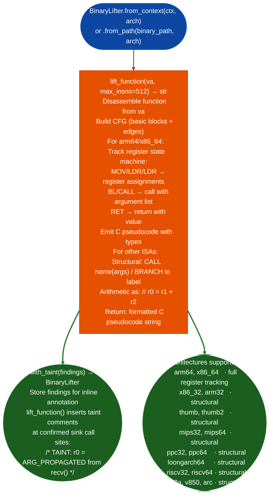

# Binary Lifting to Pseudocode

Lift native binary functions to annotated C pseudocode across 18 ISA variants: providing full register-tracking state machines for ARM64 and x86-64, and structural pseudocode call/return/branch resolved, arithmetic as comments for all other supported architectures: enabling human-readable function analysis without a decompiler.

---

## Why this exists

1. ARM64 and x86-64 are supported with register-tracking state machines: `BinaryLifter.lift_function()` on an ARM64 or x86-64 target produces C pseudocode with named registers, argument propagation, and calling convention annotations. This is the output consumed by `FuncProfiler.profile()` when generating human-readable function summaries for session documentation.

2. **Structural pseudocode for the remaining 16 ISAs** resolves calls, returns, and branches with correct target names from `BinaryContext.name()`, and emits arithmetic as comments. This provides navigable pseudocode for PPC32/64, MIPS32/64, ARM32, Thumb, x86-32, and others without requiring a full decompiler: sufficient for confirming a taint path or verifying a sink call argument.

3. `BinaryLifter.with_taintfindings` annotates the lifted pseudocode with taint findings: inserting inline comments at the exact lines where `TaintTracker` findings were confirmed, combining the human-readable pseudocode with machine-generated taint evidence into a single artifact for finding documentation.

---

## How it works



---

## Usage

```python
from ablation.analyzers.binary_lifter import BinaryLifter
from ablation.analyzers.binary_context import BinaryContext
from ablation.analyzers.taint_tracker import TaintTracker

ctx = BinaryContext.load_or_build('/path/to/httpd')
tt = TaintTracker.from_context(ctx)
findings = tt.run()

lifter = BinaryLifter.from_context(ctx, arch='arm64')
lifter = lifter.with_taint(findings)

# Lift a specific function
pseudocode = lifter.lift_function(0x12340)
print(pseudocode)

# Quick one-shot lift
BinaryLifter.report('/path/to/httpd', va=0x12340, arch='arm64')
```

---

## Example output

The following illustrates lifted pseudocode output format. Actual code is function-specific.

```
// BinaryLifter: httpd  func at <va>

void sub_<va>(char *param_0, int param_1) {
  char *r20 = param_0;
  int   r21 = param_1;
  r0 = strlen(r20);           // call strlen
  if (r0 > 0xff) {
    return;
  }
  // TAINT: r0 = ARG_PROPAGATED from param_0 via recv()
  system(r20);                // *** SINK ***
}
```

---

## False positives

**Structural pseudocode for non-ARM64/x86-64 targets does not track register state**: register names appear verbatim for example `r3`, `r4` rather than as typed variables. Argument identification relies on calling convention conventions, not tracked values. This is sufficient for confirming a call sequence but not for detailed argument analysis.

**`max_insns=512` truncates very large functions**: functions with more than 512 instructions are truncated with a `// [truncated]` marker. Increase `max_insns` for large functions, but be aware that very large lifts have longer runtime.

---

## Pipeline position

Run `BinaryLifter.lift_function()` after `TaintTracker` confirms a finding to produce the human-readable pseudocode for finding documentation. Use `with_taint()` to annotate the lifted output with confirmed taint paths. The combined artifact is the primary content for the finding's `byte_proof` section.

---

## Reading output

`BinaryLifter.lift_functionva, max_insns=512` returns a `str`: the lifted annotated C pseudocode for the function at `va`. Taint annotations appear inline in the string when `with_taintfindings` was called before lifting. There is no structured return object.

---

## See also

- [Structured CFG Reconstruction](assisted-structure-reconstruction.md): `Structurizer` for structured control flow from the same CFG
- [Single-Function Profiling](single-function-profiling.md): `FuncProfiler` that calls `BinaryLifter` internally for function summaries
