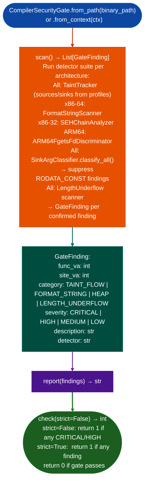

# Post-Linker Compiler Security Gate

Run Ablation's vulnerability detector suite on a freshly compiled binary before it ships: catching post-optimization vulnerabilities that sanitizers ASan, UBSan miss because they run before optimization passes complete: documenting each taint finding as a `SemanticBlock` in the DAG Adapter's producer-consumer model for machine-readable dataflow evidence at build time.

---

## Why this exists

1. **Sanitizers ASan, UBSan, MSan run before the optimizer completes**: they instrument the IR before inlining, vectorization, and loop transforms. Post-optimization code can introduce vulnerabilities that are invisible at instrumentation time: an inline that merges a bounds check with a length computation may remove the check entirely. `CompilerSecurityGate` runs on the linker's output: after all optimization passes, and catches these post-optimization findings.

2. **`CompilerSecurityGate.check(strict=False)` returns a non-zero exit code when findings exceed threshold**: integrating directly into CI/CD linker steps. `strict=True` fails on any finding; `strict=False` fails only on `CRITICAL` or `HIGH` findings. This is the gating mechanism for preventing vulnerable binaries from reaching the firmware image build.

3. **Each finding is documented as a `SemanticBlock`** using the DAG Adapter's producer-consumer model: making the exact dataflow path traversable and machine-readable at build time. This enables automated triage: the CI system can route a failing build to the owning team with a structured finding that includes the source VA, sink VA, and dataflow path.

---

## How it works



---

## Usage

```python
# Programmatic usage
from ablation.analyzers.compiler_security_gate import CompilerSecurityGate

gate = CompilerSecurityGate.from_path('/build/output/httpd')
findings = gate.scan()
print(gate.report(findings))

exit_code = gate.check(strict=False)
if exit_code != 0:
    print("GATE FAILED — binary blocked from release")
    sys.exit(exit_code)
```

In a Makefile post-link step:
```makefile
$(BINARY): $(OBJS)
    $(LD) -o $@ $^ $(LDFLAGS)
    python3 -c "from ablation.analyzers.compiler_security_gate import CompilerSecurityGate; \
                import sys; sys.exit(CompilerSecurityGate.from_path('$@').check())"
```

---

## Example output

The following illustrates compiler security gate output format. Actual findings are binary-specific.

```
CompilerSecurityGate: httpd  (arm64)

Findings: <N>

  [CRITICAL] taint  va=<va>
    system() ARG_PROPAGATED from recv() via inline merge
    SemanticBlock: recv[<va>] → strncpy[<va>] → system[<va>]

  [MEDIUM] format_string  va=<va>
    syslog() format arg = function argument at <va>

check(strict=False): 1  (gate FAILED — 1 CRITICAL finding)
```

---

## False positives

**Post-optimization inlining may merge functions in ways that produce unreachable taint paths**: a path that looks like `recv → strcpy → system` may be infeasible at runtime because an inlined guard prevents the tainted value from reaching the sink. `check()` returns the gate verdict; manual review of `CRITICAL` findings is always required before blocking a release.

**`GateFinding.severity` inherits from the underlying detector**: a `MEDIUM` format string finding from `FormatStringScanner` with verdict `POTENTIAL` will not fail `check(strict=False)`. These findings are still reported but do not block the build.

---

## Pipeline position

`CompilerSecurityGate` runs at linker time as a post-link step, not as part of the interactive RE workflow. It is the automated enforcement layer for the RE methodology: findings that reach production were not caught by the gate.

---

## Reading findings

`CompilerSecurityGate.from_context(ctx).scan()` returns `List[GateFinding]`. See [compiler-security-gate](compiler_security_gate.md) for the full field reference.

| Attribute | Content |
|:---|:---|
| `func_va` | VA of the containing function |
| `site_va` | VA of the specific instruction |
| `severity` | `'CRITICAL'` / `'HIGH'` / `'MEDIUM'` / `'LOW'` |
| `category` | `'TAINT_FLOW'` / `'FORMAT_STRING'` / `'HEAP'` / `'LENGTH_UNDERFLOW'` |
| `description` | Sink name, taint source, and propagation path description |
| `detector` | Name of the detector that identified this pattern |

---

## See also

- [Named Taint Sources and Bounds](named-taint-sources-and-bounds.md): `TaintTracker` that `CompilerSecurityGate` runs internally
- [Format String Vulnerability Detection](injection-and-persistence-indicators.md): `FormatStringScanner` component of the gate
