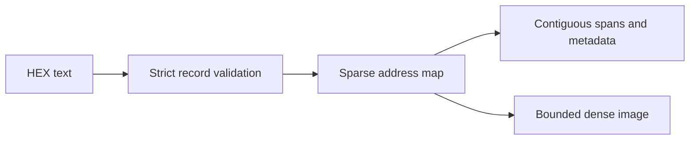

# Strict Intel HEX Parser

`IntelHexImage` validates Intel HEX records and exposes sparse and dense firmware images. It preserves addresses, gaps, spans, record counts, and optional entry points without third-party dependencies.

---

## Why this exists

1. Intel HEX ingestion was tied to the 8051 decoder and silently skipped malformed input.
2. Dense conversion ignored the requested gap-fill value and offered no explicit absolute base.
3. C166 boot applications need extended segment records, start-address records, non-power-of-two images, and strict overlap checks in addition to extended linear addressing.

The shared parser now provides one strict implementation. `modules.isa_8051.IntelHexLoader` remains as a compatibility wrapper.

---

## How it works

The parser validates every record before accepting the image. It checks the record marker, hexadecimal encoding, declared byte count, record-specific payload size, checksum, address field, EOF, trailing content, and conflicting overlaps. Identical duplicate bytes are accepted; conflicting duplicate addresses are rejected.



Supported record types are data (`00`), EOF (`01`), extended segment address (`02`), start segment address (`03`), extended linear address (`04`), and start linear address (`05`).

Dense output uses the first data address as its default base. Pass `base=0` for an absolute-address image. Both input size and dense allocation have limits.

---

## IntelHexImage

```python
from ablation.parsers.intel_hex import IntelHexImage

image = IntelHexImage.from_path('/path/to/application.hex')
print(image.address_range())
print(image.spans)
absolute = image.to_bytes(fill=0xFF, base=0)
```

Use `from_bytes()` for in-memory text. `to_sparse()` returns a copy of the address-to-byte map. `metadata()` returns JSON-compatible spans, record counts, and start-address information.

The default input and dense-output limits are 64 MiB each. The 8051 compatibility wrapper retains its separate 4 MiB input and 512 KiB dense-output limits.

---

## Usage

```python
text = ':020000040001F9\n:01000000AA55\n:00000001FF\n'
image = IntelHexImage.from_bytes(text)
assert image.to_sparse() == {0x10000: 0xAA}
assert image.metadata()['record_types'] == {'0': 1, '1': 1, '4': 1}
```

Example metadata shape:

```python
{
    'data_bytes': 1,
    'spans': [['0x10000', '0x10001', 1]],
    'record_types': {'0': 1, '1': 1, '4': 1},
    'start_address': None,
}
```

---

## False positives

A valid Intel HEX container does not establish the processor architecture, load address, or entry point actually used by a bootloader. Treat spans and start records as container evidence and verify them against the target memory map.

The parser rejects invalid input rather than guessing a recovery. Files with unsupported record types need an explicit extension and tests before acceptance.

---

## Pipeline position

**Before this module:** Obtain the original HEX artifact and preserve its hash.

**After this module:** Pass a suitable base-relative image to an architecture decoder, or inspect sparse spans without allocating the gaps. Use `EcuC166Decoder` for C166 applications.

---

## Reading findings

| Field | Content |
|:---|:---|
| `data` | Sparse physical-address to byte mapping |
| `spans` | Half-open contiguous address ranges |
| `record_types` | Count of accepted records by type |
| `start_address` | Optional `segment` or `linear` entry-point value |
| `metadata()` | JSON-compatible representation of the image structure |

---

## See also

- [C166 / C167 ROM Decoding](c166-c167-decoding.md)
- [Intel MCS-51 / CC254x Decoding](isa-8051.md)
