# Internal Network Reconnaissance

Parse ARP tables and routing tables, discover adjacent subnets, harvest credentials from the local filesystem, probe cloud metadata services AWS/GCP/Azure/OCI, enumerate SSH keys and known_hosts, and detect API tokens in environment variables and configuration files: providing lateral movement material from a compromised Linux/macOS host: via `modules/lateral_movement.py`.

---

## Why this exists

1. **`NetworkDiscovery` parses ARP and routing tables in pure Python**: reading `/proc/net/arp` and `/proc/net/route` directly, it produces a list of reachable subnets and known hosts without running `ip route` or `arp -a`. The subnet list seeds parallel TCP connect scanning via `NetworkDiscovery.scan_subnets()`, which uses Python threads to scan all 254 hosts in a /24 within seconds.

2. **`CredentialHarvester` extracts credentials from well-known filesystem locations**: `/etc/passwd`, `/etc/shadow`, `/home/*/.netrc`, `/home/*/.ssh/`, `/var/lib/git/.git/config`, and application configuration files in `/etc/` and `/opt/`. `SSHKeyEnumerator` enumerates all RSA/ECDSA/ED25519 private keys and `known_hosts` files found in user home directories, providing direct lateral movement material for SSH-accessible hosts.

3. **`CloudMetadataProber` queries IMDS endpoints**: AWS (`169.254.169.254/latest/meta-data/iam/security-credentials/`), GCP (`169.254.169.254/computeMetadata/v1/instance/service-accounts/`), Azure (`169.254.169.254/metadata/instance/`), and OCI. Successful queries return temporary access credentials IAM role credentials, service account tokens that provide cloud API access from the compromised instance.

---

## How it works

```mermaid
flowchart TD
    A(["modules/lateral_movement.py"]):::input --> B["NetworkDiscovery:\n  parse_arp_table() → [(ip, mac)]\n  parse_route_table() → populates nd.routes [{iface,dest,gw,mask,flags}]\n  scan_subnets([cidr_list], ports=[22,80,443,3306,5432]) → populates nd.live_hosts\n    nd.live_hosts: {ip: {port: banner}}\n    Threaded TCP connect scan"]:::primary
    B:::primary --> C["CredentialHarvester:\n  harvest_netrc() → List[dict]  /home/*/.netrc\n  harvest_git_credentials() → List[dict]  .git/config, .gitconfig\n  harvest_ssh_keys() → via SSHKeyEnumerator\n  harvest_env_tokens() → APITokenDetector (env vars)"]:::secondary
    C:::secondary --> D["CloudMetadataProber:\n  probe_all() → self.results dict\n    aws_imdsv1: {status, keys}\n    aws_imdsv2: {status, token}\n    aws_iam_creds: {role, credentials_json}\n    gcp_metadata: {status, project_id, service_accounts, ...}\n    azure_imds: {status, subscription_id, ...}\n    oci_imds: {status, ...}\n  Note: probe_aws/gcp/azure/oci are private · call probe_all() only"]:::tertiary
    D:::tertiary --> E(["APITokenDetector:\n  scan_env_variables() → List[dict]\n    os.environ: match API_KEY, TOKEN, SECRET, AWS_*, GITHUB_TOKEN\n  scan_config_files(paths) → List[dict]\n    Regex for token-like strings in /etc/, /opt/, ~/.config/"]):::output
    classDef input     fill:#0d47a1,stroke:#1565c0,color:#fff
    classDef primary   fill:#e65100,stroke:#bf360c,color:#fff
    classDef secondary fill:#004d40,stroke:#00695c,color:#fff
    classDef tertiary  fill:#4a148c,stroke:#6a1b9a,color:#fff
    classDef neutral   fill:#37474f,stroke:#546e7a,color:#fff
    classDef output    fill:#1b5e20,stroke:#2e7d32,color:#fff
    linkStyle 0 stroke:#bf360c,stroke-width:2px
    linkStyle 1 stroke:#00695c,stroke-width:2px
    linkStyle 2 stroke:#6a1b9a,stroke-width:2px
    linkStyle 3 stroke:#2e7d32,stroke-width:3px
```



---

## Usage

```python
from modules.lateral_movement import (
    NetworkDiscovery, CredentialHarvester,
    CloudMetadataProber, SSHKeyEnumerator
)

# ARP + routing recon
nd = NetworkDiscovery()
nd.parse_route_table()   # populates nd.routes: [{iface, dest, gw, mask, flags}]
nd.parse_arp_table()     # populates nd.arp_table: [{ip, mac}]

# scan_subnets(subnets: list, ports=None) populates nd.live_hosts: {ip: {port: banner}}
subnets = [r['dest'] + '/' + r.get('mask', '24') for r in nd.routes if r['dest'] != '0.0.0.0']
nd.scan_subnets(subnets[:3])
for ip, ports in nd.live_hosts.items():
    print(f"  {ip}  open_ports={sorted(ports.keys())}")

# Cloud metadata — probe_all() not probe_aws(); returns self.results dict
cloud = CloudMetadataProber()
results = cloud.probe_all()
# keys: aws_imdsv1, aws_imdsv2, aws_iam_creds, gcp_metadata, azure_imds, etc.
aws = results.get('aws_iam_creds', {})
if aws:
    # credentials_json is the raw JSON string from IMDS
    print(f"AWS IAM: role={aws.get('role')}  creds_json={aws.get('credentials_json', '')[:80]}")
```

---

## Example output

The following is a schematic example showing output structure and field names. Values are illustrative.

```
NetworkDiscovery: routing table

Subnets: [<subnet-a>, <subnet-b>]

Scan <subnet-a>:
  <host-1>  ports=[22, 443]
  <host-2>  ports=[22, 80, 5432]

CloudMetadataProber:
  AWS IAM role: <iam-role>
  AccessKeyId: <access-key-id>  SecretAccessKey: <secret>  Token: <session-token>

SSHKeyEnumerator:
  /home/user/.ssh/id_rsa  → RSA 2048 (unencrypted)
  /home/user/.ssh/known_hosts  → 5 entries
```

---

## False positives

**`scan_subnets()` TCP connect scanning**: TCP SYN to all hosts in a subnet is highly detectable by IDS/IPS systems and will generate alerts in monitored environments. Limit to targeted scanning of specific IPs identified from ARP/routing tables.

**`APITokenDetector.scan_env_variables()`**: environment variables that contain the word `TOKEN`, `KEY`, or `SECRET` in their name but do not hold actual credentials for example `MAX_RETRY_COUNT` will not produce false matches because the detector checks value format length ≥ 20, entropy ≥ 3.5 bits/char, not just key name.

---

## Pipeline position

Run internal network reconnaissance after gaining shell access. ARP/routing parsing is passive and safe; TCP scanning is active and detectable. Run cloud metadata probing before credential harvesting: cloud credentials are the highest-value lateral movement material.

---

## Reading findings

Network recon functions return `List[{severity, title, detail, host, port}]`:

| Field | Content |
|:---|:---|
| `severity` | `CRITICAL` credential exposed / `HIGH` sensitive service / `MEDIUM` / `LOW` |
| `title` | Finding code for example `CLOUD_IAM_CREDENTIAL_EXPOSED`, `OPEN_PORT_DB`, `SCAN_RESULT` |
| `detail` | Host, open ports, or credential/token excerpt |
| `host` | Target host IP or hostname |
| `port` | Port number or `None` for subnet-level findings |

`CloudMetadataProber` findings additionally include `iam_role`, `access_key_id`, and `session_token` in `detail`.

---

## See also

- [Local Network Inventory](local-network-inventory.md): `NetworkAnalyzer` for interface and firewall state
- [Host/Service Discovery](host-service-discovery.md): ICMP discovery and banner grabbing for confirmed live hosts
