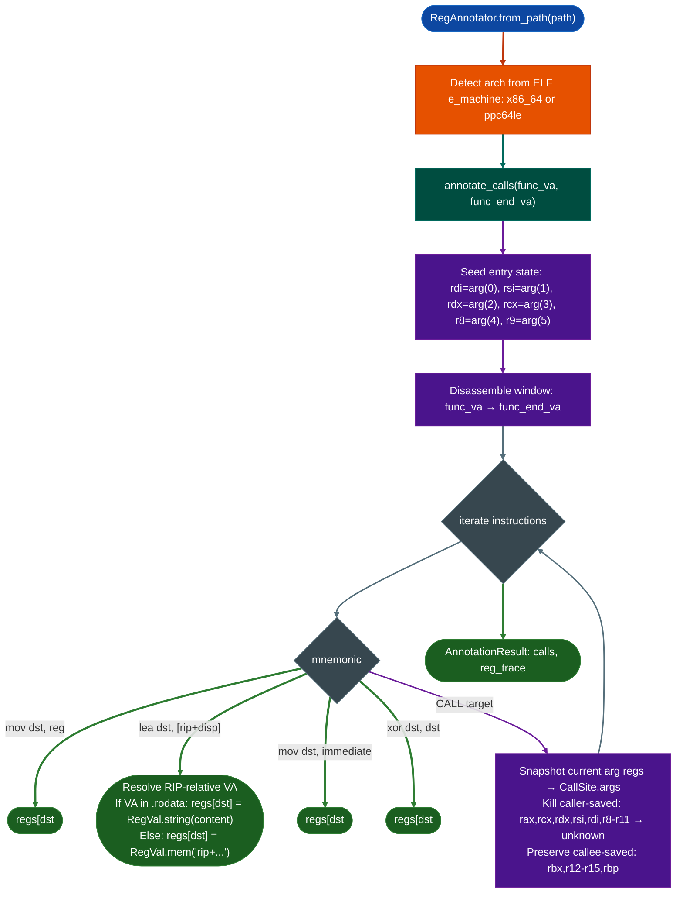
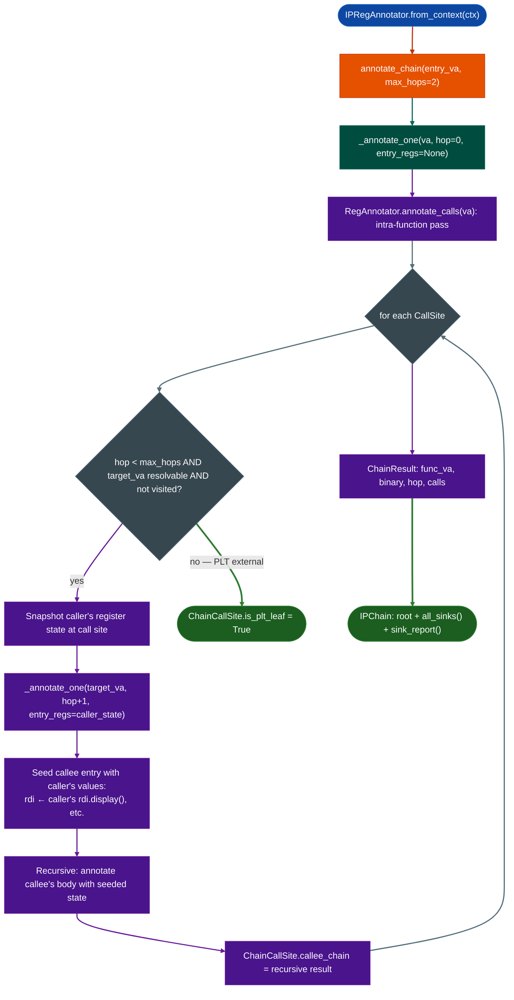

# Interprocedural Argument Provenance

Trace argument values forward through function boundaries: annotating every call site in a function with the actual values passed to each argument register, then optionally following call chains N hops deep so that attacker-controlled data entering at a root function can be tracked to a distant sink.

---

## Why this exists

1. **Intra-function argument tracing misses multi-hop attack chains.** `TaintTracker` traces within a single function body and stops at every `CALL`. When an attacker-controlled argument propagates from a network entry point through two intermediate dispatch functions before reaching `system()`, single-function analysis sees only unknowns at each intermediate boundary, it never makes the connection. `IPRegAnnotator` follows the actual register state across those boundaries, carrying the `arg0_entry` tag from the root function all the way to the terminal sink.

2. **Register annotation reveals argument provenance without disassembly tools.** When `FuncProfiler` shows `system(rdi=arg2_entry)`, that one line tells the analyst the command string came from the third entry argument. Without register annotation, reading that same information from raw disassembly takes 5–10 minutes per call site. The annotator recovers approximately 85% of argument values in firmware dispatch functions using a linear forward pass, no SMT solver, no symbolic execution, no branch enumeration.

3. **Cross-binary call chains require carrying register state across library boundaries.** Enterprise firmware often dispatches execution across multiple shared libraries: `httpsd` calls into `libauth.so`, which calls into `libexec.so`. A call chain that starts in `httpsd` and ends with `Tcl_Eval` in `libexec.so` spans three binaries. `IPRegAnnotator` loads `RegAnnotator` instances on demand for each callee binary and seeds their entry state from the caller's register state at the call site, producing a complete argument trace across the full chain.

---

## How it works

### RegAnnotator: intra-function pass



### IPRegAnnotator: N-hop interprocedural pass



### RegVal kinds

| Kind | Display | Source |
|---|---|---|
| `arg` | `arg0_entry rdi@entry` | Entry argument register seed |
| `const` | `0x4a` | Immediate operand in `mov dst, imm` |
| `string` | `'/bin/ls'` | RIP-relative LEA resolving to `.rodata` content |
| `copy` | `arg0_entry (via r13)` | `mov r13, rdi` then `mov rdi, r13` |
| `ret` | `ret(strlen)` | `rax` after a `CALL strlen` |
| `zero` | `0` | `xor dst, dst` idiom |
| `mem` | `[rbp-0x20]` | Load from a stack or memory slot |
| `unknown` | `?` | Clobbered, not tracked, or unresolved |

---

## Usage

```python
from ablation.analyzers.reg_annotator import RegAnnotator

ra = RegAnnotator.from_path('/fw/fortigate/httpsd')

# Annotate a single function
result = ra.annotate_calls(func_va=0x22ccc0, func_end_va=0x22d200)
print(result.fmt())

# Inspect individual call sites
for cs in result.calls:
    print(f"0x{cs.site_va:x}  {cs.target_name}")
    for reg, val in cs.args.items():
        if val.kind != 'unknown':
            print(f"  {reg} = {val.display()}")

# Access a specific call site
site = result.call_at(0x22cd90)
if site:
    rdi_val = site.args.get('rdi')
    print(f"  rdi = {rdi_val.display() if rdi_val else '?'}")
```

---

## IPRegAnnotator

```python
from ablation.analyzers.ipreg_annotator import IPRegAnnotator
from ablation.analyzers.binary_context import BinaryContext

ctx = BinaryContext.load_or_build('/fw/fortigate/httpsd')
ira = IPRegAnnotator.from_context(ctx)

# Trace 2 hops from entry function
chain = ira.annotate_chain(entry_va=0x22ccc0, max_hops=2)
print(chain.fmt())

# Find all calls to exec-class sinks anywhere in the chain
sink_names = {'system', 'popen', 'fadcsystem', 'exec_handler', 'Tcl_Eval'}
print(chain.sink_report(sink_names))

# Iterate sink hits programmatically
for func_va, binary, cs in chain.all_sinks(sink_names):
    print(f"SINK: {cs.target_name} at 0x{cs.site_va:x} in function 0x{func_va:x}")
    for reg in ['rdi', 'rsi', 'rdx']:
        v = cs.args.get(reg)
        if v and v.kind != 'unknown':
            print(f"  {reg} = {v.display()}")
```

---

## Example output

```
RegAnnotator: 0x22ccc0..0x22d200  (6 calls)
  0x22ccf0: call malloc
    rdi = ret(strlen)  (via rax)
  0x22cd10: call memcpy
    rdi = [rbp-0x40]
    rsi = arg0_entry (rdi@entry)
    rdx = ret(strlen)  (via rax)
  0x22cd90: call fadcsystem
    rsi = arg1_entry (rsi@entry)

CHAIN 0x22ccc0  httpsd  [max_hops=2]

[0x22ccc0..0x22d200]  httpsd  hop 0
  0x22cd90  fadcsystem(rdi=?, rsi=arg1_entry)  [PLT/external]

SINK CALLS in chain from 0x22ccc0:
  httpsd:0x22ccc0 -> fadcsystem(0x22cd90)  [rsi=arg1_entry (rsi@entry)]
```

---

## False positives

**Argument value merging across branches.** `RegAnnotator` follows the fall-through path only, it does not enumerate both sides of a conditional branch. When a register receives different values on two paths for example `rdi = '/bin/ls'` on one path and `rdi = arg0_entry` on the other, the annotator records whichever write it encounters last in linear order. This can display the wrong value for argument registers at call sites that follow a conditional assignment.

**Callee-saved value stale reads.** When the function loads a callee-saved register `rbx`, `r12`–`r15` from a stack slot that was previously written by a different function call sequence, the annotator tracks it as `mem[rbp-0x18]`. It cannot determine the actual value stored there without tracing the function that wrote the stack slot. These appear as `mem` kind in the output: always verify manually.

**Cross-binary chain size.** With `max_hops=3` and `max_callees_per_hop=10`, a cross-binary chain can produce very large result trees (up to 10^3 = 1000 call sites across all hops). Use `max_callees_per_hop=3` for initial exploration and only increase it for chains where a specific callee path needs tracing.

---

## Pipeline position

**Before this module:** `BinaryContext.load_or_build()`: provides `func_starts` for `_estimate_end()`. `FuncProfiler.sinks_in_region()` identifies the root entry function worth tracing.

**After this module:** Use `sink_report()` to identify the specific arg register carrying attacker-controlled data to the sink. Pass that function VA and the tainted argument registers to `TaintTracker.trace_function()` for path-sensitive confirmation.

---

## Reading the output

| Field | Content |
|:---|:---|
| `AnnotationResult.calls` | `List[CallSite]`: all call sites in the function |
| `CallSite.site_va` | VA of the `CALL` instruction |
| `CallSite.target_va` | VA of the called function |
| `CallSite.target_name` | PLT symbol name or hex fallback |
| `CallSite.args` | `Dict[str, RegVal]`: argument register → value at the call site |
| `IPChain.root` | `ChainResult` for the root function |
| `ChainCallSite.is_plt_leaf` | `True` when the callee is a PLT stub not followed further |
| `IPChain.all_sinks(names)` | `List[Tuple[func_va, binary, ChainCallSite]]`: all sink hits |

---

## See also

- [Taint Analysis](taint-analysis.md): path-sensitive confirmation after provenance trace
- [Function Profiler](function-profiler.md): integrates `RegAnnotator` with sink detection
- [Sink Arg Classifier](sink-arg-classifier.md): backward-trace variant: classifies arguments at sink call sites
- [Binary Context](binary-context.md): provides `func_starts` for call boundary resolution
