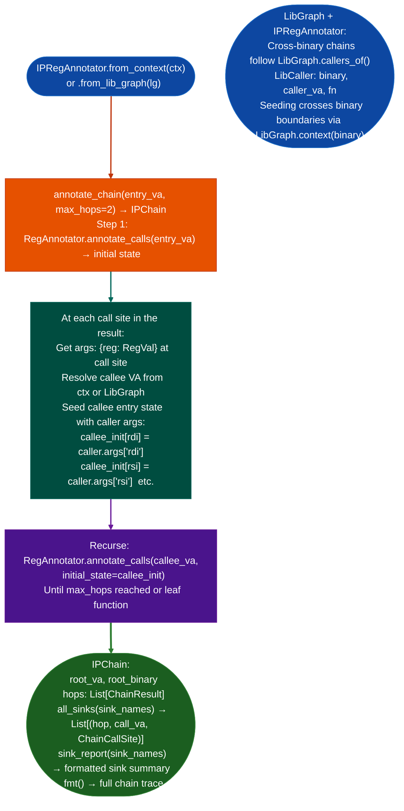

# Interprocedural Field Writer Discovery

N-hop forward symbolic register pass across function call chains: extending `RegAnnotator` to follow call edges across function boundaries, seeding each callee's entry registers with actual `RegVal` objects from the caller's state, so argument provenance traces back to the root function's entry arguments through multi-hop call chains.

---

## Why this exists

1. **Single-function `RegAnnotator` loses provenance at call boundaries: if function A calls function B which calls the dangerous sink, the tainted value's origin appears as `Ret(B)` rather than `Arg(0)` of A.** `IPRegAnnotator` eliminates this gap by following the call chain: it annotates A, then annotates B with A's register state at the B call site as B's entry state, propagating `RegVal` identity across the boundary. A tainted argument that propagates A→B→sink appears as `Arg(0)` throughout the chain.

2. **`IPRegAnnotator` is designed for the step 8 use case in the RE workflow: cross-library call chains.** When a function in `libservice.so` calls a function in `libapi.so` that ultimately calls `Tcl_Eval` or `system`, the cross-library chain requires following call edges across binary boundaries via `LibGraph`. `IPRegAnnotator.annotate_chain()` handles both intra-binary and cross-binary chains using `BinaryContext` (intra) or `LibGraph` cross-binary.

3. `IPChain.sink_report()` produces a targeted summary of all call chains that reach a specific sink: given a set of sink names for example `{'system', 'execve', 'Tcl_Eval'}`, it filters the full chain to only paths that reach those sinks, making the report immediately actionable for CVE documentation.

---

## How it works



---

## Usage

```python
from ablation.analyzers.ipreg_annotator import IPRegAnnotator
from ablation.analyzers.binary_context import BinaryContext
from ablation.analyzers.lib_graph import LibGraph

ctx = BinaryContext.load_or_build('/path/to/binary')
ira = IPRegAnnotator.from_context(ctx)

# Annotate a 2-hop call chain from an entry function
chain = ira.annotate_chain(entry_va=0x4000, max_hops=2)
print(chain.fmt())

# Find all chains reaching dangerous sinks
sinks = {'system', 'execve', 'popen', 'Tcl_Eval'}
print(chain.sink_report(sinks))

# Cross-library chains (step 8 in RE workflow)
lg = LibGraph.from_dir('/path/to/firmware/lib/')
ira_lg = IPRegAnnotator.from_lib_graph(lg)

# Find call chain from libservice.so init to system()
chain_cross = ira_lg.annotate_chain(
    entry_va=0x4000,
    entry_binary='libservice.so',
    max_hops=3
)
print(chain_cross.sink_report({'system'}))
```

---

## Example output

The following illustrates the chain annotation output format. Actual addresses and names are binary-specific.

```
CHAIN 0x4000  libservice.so:init_handler  [hops=2]

HOP 0: 0x4000 init_handler
  0x401c: call init_subsystem
    rdi = Arg(0)   ; socket fd propagated from entry
    rsi = Const(0x100)

HOP 1: 0x5000 init_subsystem
  0x5034: call system  [SINK]
    rdi = Arg(0)   ; still traces to init_handler's Arg(0)
    (Arg(0) of init_handler is user-controlled if caller passes network fd)
```

---

## False positives

**`max_hops` limits chain depth**: the default is 2 hops. Set `max_hops=3` or higher for deeply-nested call chains in protocol stacks. Each additional hop increases analysis time quadratically in the worst case due to exponential call-tree expansion.

**Cross-library chain accuracy depends on `LibGraph` completeness**: if a library is missing from the `LibGraph` for example not present in the firmware extraction, chains through that library will not be followed. Check `LibGraph.all_binaries()` to confirm all relevant libraries are loaded.

---

## Pipeline position

Step 8 in the RE workflow CLAUDE.md: `IPRegAnnotator` for cross-library call chains. Run after `TaintTracker` identifies a sink that is reached across library boundaries: `IPRegAnnotator` provides the argument provenance trace that `TaintTracker`'s intraprocedural analysis cannot follow.

---

## Reading output

`IPRegAnnotator.annotate_chain(root_va)` returns an `IPChain` object:

| Attribute | Content |
|:---|:---|
| `root_va` | VA of the root entry function |
| `root_binary` | Path of the binary containing the root function |
| `max_hops` | Maximum call depth configured for this trace |
| `root` | `ChainResult`: root function result with nested callee chains via `.calls` |

Each `ChainResult` in the chain:

| Attribute | Content |
|:---|:---|
| `func_va` | VA of this function |
| `func_end_va` | End VA of this function |
| `binary` | Path of the binary containing this function |
| `hop` | Hop depth 0 = root, 1 = callee, 2 = callee's callee, … |
| `calls` | `List[ChainCallSite]`: each call site with its argument register annotations |

Call `chain.all_sinkssink_names` to get `func_va, binary, ChainCallSite` tuples for any named sink in the full chain.

---

## See also

- [Call Argument Annotation](call-argument-annotation.md): single-function `RegAnnotator` that `IPRegAnnotator` extends
- [Cross-Library Analysis](cross-library-analysis.md): `CrossBinaryTaintTracker` BFS over `LibGraph`
- [Persistent Analysis Context](persistent-analysis-context.md): `BinaryContext` input; `LibGraph` for cross-binary chains
