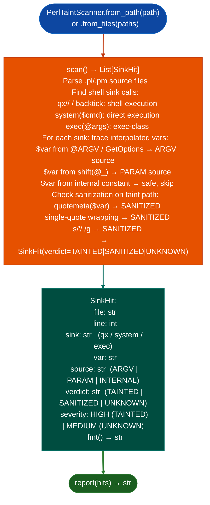

# Perl Shell Injection Detection

Detect shell injection vulnerabilities in Perl source code: finding `qx//`, `system()`, and `exec()` call sites where variables are interpolated without sanitization, recognizing Perl-specific sanitization idioms: `quotemeta()`, single-quote wrapping, and `s/'/ /g`, and resolving cross-file caller chains for function-parameter taint sources: covering the `.pm`/`.pl` layers that wrap root-privileged setuid ELFs in RSCT, IBM HMC, and embedded Linux targets.

---

## Why this exists

1. **`TaintTracker` is ELF-only, it never sees the Perl script layer above a setuid ELF.** RSCT, IBM HMC, and many embedded Linux targets ship thick `.pm`/`.pl` layers that wrap root-privileged binaries. `PerlTaintScanner` closes this gap: it finds shell sinks with interpolated variables and traces those variables to their origin CLI args, function parameters, or internal state.

2. **Perl codebases use sanitization idioms that a generic grep cannot recognize.** `quotemeta()` escapes all shell metacharacters; single-quote wrapping `"'" . join("' '", @args . "'"`) ensures no word splitting; `s/'/ /g` removes single quotes before interpolation. `PerlTaintScanner` recognizes all three and reports `SANITIZED` rather than false-positiving on them.

3. **Cross-file caller resolution for `PARAM` sources**: when a sink variable comes from `shift(@_)` a function parameter, the scanner identifies the calling function across files to determine whether the parameter receives user-controlled input or a trusted internal value, avoiding the false-positive class where internal helpers are flagged as injection points.

---

## How it works



---

## Usage

```python
from ablation.analyzers.perl_taint_scanner import PerlTaintScanner

scanner = PerlTaintScanner.from_path('/path/to/rsct_scripts/')
hits = scanner.scan()
print(scanner.report(hits))

# TAINTED sinks only
tainted = [h for h in hits if h.verdict == 'TAINTED']
for h in tainted:
    print(f"  {h.file}:{h.line}  {h.sink}  var={h.var}  source={h.source}")
```

---

## Example output

The following illustrates Perl taint scan output format. Actual paths and variables are codebase-specific.

```
PerlTaintScanner: rsct_scripts/

Files: <F>  Sinks found: <N>

  [HIGH] TAINTED  rsct_agent.pm:<line>
    qx/$ARGV[0] --config $config_file/
    var=$ARGV[0]  source=ARGV  verdict=TAINTED

  [MEDIUM] UNKNOWN  hmc_util.pm:<line>
    system("fetch_data --host $hostname")
    var=$hostname  source=PARAM  cross-file caller unresolved

  SANITIZED  safe_runner.pm:<line>
    system("cmd " . quotemeta($user_arg))
    quotemeta() sanitizer detected — not a finding
```

---

## False positives

**Single-quote wrapping detection requires the canonical pattern**: `"'" . $var . "'"` is detected as sanitized. Partial wrapping for example only the left side is quoted passes through as `UNKNOWN`. Review `UNKNOWN` verdict sites for partial-sanitization patterns.

**Cross-file `PARAM` source resolution uses file-level function index**: if the calling function is in a dynamically loaded module (`require` or `use` of a non-static path), the resolver may not find it, producing `UNKNOWN` instead of `ARGV`. These are not false positives; they require manual inspection of the calling convention.

---

## Pipeline position

Run `PerlTaintScanner` on any Perl codebase found in firmware RSCT `.pm` layers, IBM HMC management scripts, embedded Linux `/usr/lib/perl/`. Pair with `ELF` taint analysis on the setuid binary the Perl wraps: a Perl injection finding confirmed by both layers is a chain finding.

---

## Reading findings

`PerlTaintScanner.scan()` returns a list of finding dicts:

| Field | Content |
|:---|:---|
| `severity` | `HIGH` (TAINTED) / `MEDIUM` (UNKNOWN) |
| `verdict` | `TAINTED`, `UNKNOWN`, or `SANITIZED` sanitized findings are not returned |
| `file` | Source file path and line number |
| `snippet` | Code snippet showing the sink and tainted variable |
| `var` | Tainted variable name |
| `source` | Taint source type `ARGV`, `PARAM`, `ENV`, or `UNKNOWN` |

---

## See also

- [Source Dangerous Sink Detection](source-code-auditing.md): `SourceSinkScanner` for Python/JS/TS equivalent
- [Source Code Analysis Pipeline](bare-integration.md): `SourceContext` for full repository context
