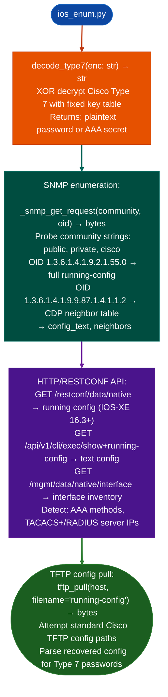

<a id="iosios-xe-appliance-enumeration"></a>
# Cisco Infrastructure Assessment

Enumerate Cisco IOS and IOS-XE appliances via HTTP/RESTCONF API, SNMP CDP neighbor table, running-config OID, Telnet banner, TFTP configuration pull, and Type 7 password decoding: detecting AAA configuration, enabled services, and management interface exposure: via `modules/ios_enum.py`.

---

## Why this exists

1. **IOS Type 7 password encoding is not encryption**, it is a deterministic XOR obfuscation with a fixed key. `decode_type7()` recovers the plaintext password from any Type 7-encoded string in the running configuration. SNMP community strings and AAA shared secrets stored as Type 7 in the config are trivially recoverable from any config file obtained via TFTP pull, SNMPv2 `sysDescr` response, or REST API.

2. **SNMP OID `1.3.6.1.4.1.9.2.1.55.0` (Cisco `cisco-show-run`) returns the full running configuration on IOS devices that have SNMPv2 public community enabled.** `ios_enum.py` includes a pure-Python SNMP GET request builder using BER/DER encoding `_ber_oid`, `_ber_int`, `_ber_str`, `_ber_seq`, `_snmp_get_request`: no `pysnmp` dependency required.

3. **`probe_apic_unauthenticated()`** (from `nxos_enum.py`): the APIC REST API exposes `aaaListDomains.json` without authentication, returning the list of configured authentication domains and the APIC cluster's configured software version. This unauthenticated disclosure is combined with the IOS enumeration results to provide a unified Cisco management surface view.

---

## How it works



---

## Usage

```python
from modules.ios_enum import IOSEnumerator, decode_type7

# Decode a Type 7 password already present in an authorized config export
enc = '070C285F4D06'
print(f"Type 7 decode: {decode_type7(enc)}")

# Enumerate an authorized lab appliance with a test account
enumerator = IOSEnumerator(
    host='192.0.2.10',
    username='audit',
    password='test-password',
)
results = enumerator.run()
print(enumerator.report())

# NX-OS/ACI enumeration uses the corresponding target inventory.
from modules.nxos_enum import NXOSEnumerator
fabric = NXOSEnumerator(['192.0.2.20'])
fabric_results = fabric.run()
print(fabric.report())
```

Use read-only test accounts and lab appliances for API, SNMP, TFTP, Telnet, and fabric enumeration. Do not run community or credential brute-force helpers against production systems. Treat decoded Type 7 strings and SNMP communities as secrets, and store configuration exports with restricted access.

---

## Example output

The following illustrates IOS/IOS-XE enumeration output format.

```
probe_ios: 192.168.1.1

SNMP public community: found
  CDP neighbors: 3 (spine-1, spine-2, access-sw-1)
  running-config via OID: <N> lines

RESTCONF API (IOS-XE 16.3+): accessible
  Interfaces: <M>  |  AAA: TACACS+ (10.0.1.5)

Type 7 decoded from config:
  enable secret: <plaintext>
  TACACS key:    <plaintext>
```

---

## False positives

**SNMP running-config retrieval requires SNMPv2 `public` community to have read-write access**: read-only community access returns `sysDescr` and CDP neighbor data but not the full configuration. The attempt to pull `running-config` via the Cisco private MIB OID will be rejected on hardened configurations.

**TFTP config pull attempts may trigger IOS access-list logging**: TFTP is blocked by default on IOS-XE 16.x and later. Expect failed TFTP pulls on modern IOS-XE unless the device has an explicit `tftp-server` configuration.

---

## Pipeline position

Run IOS/IOS-XE enumeration as part of initial network appliance triage. Recovered configurations feed AAA/credential analysis and inform lateral movement via CDP neighbor map. Type 7 passwords recovered here may enable access to adjacent devices.

---

## Reading findings

IOS/IOS-XE probe functions return `List[{severity, title, detail, host, port}]`:

| Field | Content |
|:---|:---|
| `severity` | `CRITICAL` plaintext credential / `HIGH` unauth access / `MEDIUM` / `LOW` |
| `title` | Finding code for example `IOS_SNMP_PUBLIC_COMMUNITY`, `IOS_TYPE7_PASSWORD`, `IOS_RESTCONF_UNAUTH` |
| `detail` | Plaintext password, neighbor list, or OID response |
| `host` | Target IP |
| `port` | Protocol port for example `161` for SNMP, `443` for RESTCONF |

---

## See also

- [NX-OS/ACI/APIC Fabric Enumeration](nx-os-aci-apic-fabric-enumeration.md): `nxos_enum.py` for NX-OS and ACI APIC fabric
- [TLS Certificate and Protocol Probing](tls-certificate-and-protocol-probing.md): TLS posture of management interfaces
