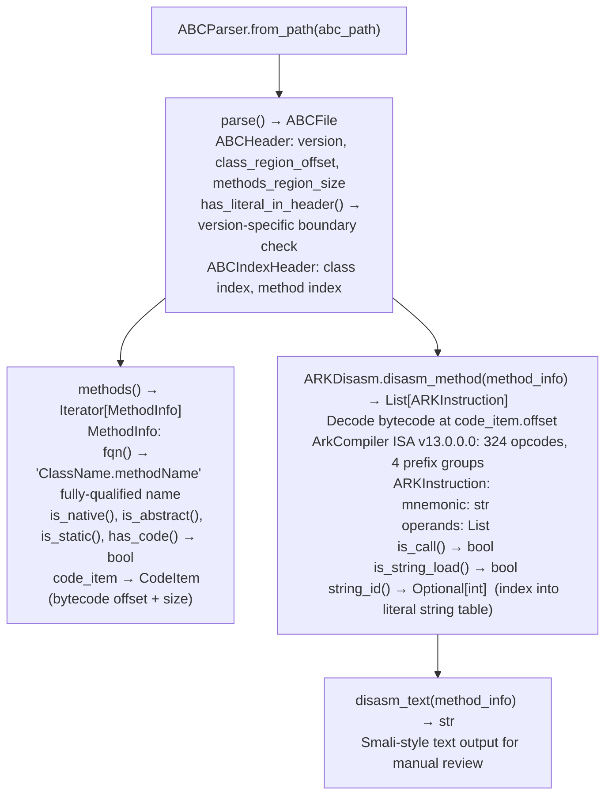

# HarmonyOS/ArkTS Bytecode Analysis

Parse and disassemble HarmonyOS/ArkTS `.abc` (Ark Bytecode) files — covering both DYNAMIC (ECMAScript/ArkTS runtime) and STATIC (typed ArkTS) dialects — producing structured method inventories and smali-style instruction output for security analysis of HAP application packages and embedded ArkTS modules.

---

## Why this exists

1. **HarmonyOS applications (HAP packages) ship compiled `.abc` bytecode, not `.py` or `.js` source files.** `ABCParser` provides the only programmatic access to method names, class hierarchies, and literal string tables in these binaries. Without it, analyzing a FortiClient HarmonyOS HAP or a WeChat `.abc` module requires reverse-engineering the ArkCompiler binary format from scratch for each engagement.

2. **Two ABC dialects exist in the wild with different `access_flags` encodings** — DYNAMIC (ECMAScript/ArkTS runtime, `access_flags` as ULEB128) and STATIC (typed ArkTS, `access_flags` as `u32`). `ABCParser.from_path()` auto-detects the dialect from the ABC header version. Using the wrong decoder silently produces wrong method metadata — `ABCParser` handles this transparently.

3. **`ARKDisasm` decodes the full ArkCompiler ISA (v13.0.0.0, 324 opcodes across 4 prefix groups)** — producing both structured `ARKInstruction` objects and smali-style text output for manual review. `ARKInstruction.is_call()`, `is_string_load()`, `string_id()`, and `func_entity_id()` enable automated security pattern scanning (dangerous function calls, string argument extraction) without full decompilation.

---

## How it works



---

## Usage

```python
from ablation.analyzers.abc_parser import ABCParser
from ablation.analyzers.abc_disasm import ARKDisasm

with ABCParser.from_path('/path/to/modules.abc') as parser:
    abc_file = parser.parse()

    print(f"ABC version: {abc_file.header.version_tuple()}")
    print(f"Dialect: {'DYNAMIC' if abc_file.header.has_literal_in_header() else 'STATIC'}")

    # Inventory all methods
    for method in abc_file.methods():
        if method.has_code():
            print(f"  {method.fqn()}  native={method.is_native()}")

    # Disassemble a specific method
    disasm = ARKDisasm(abc_file)
    for method in abc_file.methods():
        if 'processPacket' in method.fqn():
            insns = disasm.disasm_method(method)
            for insn in insns:
                print(f"  {insn.mnemonic} {insn.operands}")
                if insn.is_string_load():
                    str_val = abc_file.string_at(insn.string_id())
                    print(f"    → string: {str_val!r}")
            print(disasm.disasm_text(method))
```

---

## Example output

The following illustrates the ABC analysis output format. Actual method names are HAP-specific.

```
ABCParser: modules.abc  (v12.0.6.0, DYNAMIC dialect)

Methods: <N> total  (<M> with code)

Selected methods:
  com.example.app.NetworkHandler.processPacket  has_code=True  native=False
  com.example.app.Config.load                  has_code=True  native=False

Disassembly of processPacket:
  ldai    0x0
  sta     v0
  ldobj.v v1, 0x1234  → string: "recv"
  call.virt.short v2, v3
```

---

## False positives

**`ABCParser` covers ABC versions 9–13** — version 14+ (if released) may use a different header layout. `ABCHeader.version_tuple()` returns the version; check against the supported range before relying on parse output.

**`is_call()` identifies method invocation opcodes** — it does not distinguish between safe internal calls and security-sensitive calls to network or filesystem APIs. Use `string_id()` and `func_entity_id()` to extract the actual callee name from the literal string table before treating a call as security-relevant.

---

## Pipeline position

Run `ABCParser.from_path()` on any extracted HarmonyOS `.abc` file before security analysis. Use `ARKDisasm.disasm_text()` for manual review of suspicious methods. Feed `is_call()` patterns to automated sink detection by matching `func_entity_id()` against known dangerous method names.

---

## Reading output

`ABCParser.parse()` returns an `ABCModule` object:

| Attribute | Content |
|:---|:---|
| `version` | ABC format version string |
| `dialect` | `STATIC` or `DYNAMIC` |
| `methods` | `List[ABCMethod]` — all method records |

Each `ABCMethod`: `{name, has_code, native, instructions: List[ABCInstruction]}`.

`ABCParser.disassemble(method_name)` returns `List[str]` — textual disassembly of the method body.

---

## See also

- [DEX Disassembly and Lifting](dex-disassembly-and-lifting.md) — Android DEX equivalent parser and lifter
- [Source Dangerous Sink Detection](source-dangerous-sink-detection.md) — `SourceSinkScanner` for source-level JavaScript (before compilation to ABC)
- [Electron Application Auditing](electron-application-auditing.md) — JavaScript-layer security scanning for Electron-based apps
