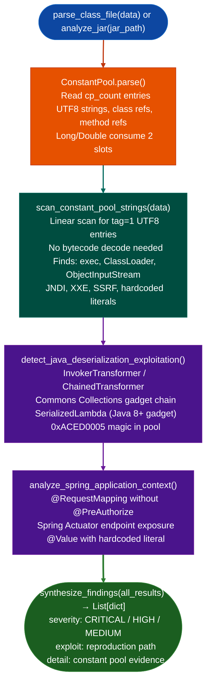

# Java .class and JAR Analysis

Parse Java `.class` files and JAR archives, scan the JVM constant pool for security-relevant patterns, and detect deserialization gadget chains, ClassLoader abuse, Spring endpoint exposure, and hardcoded credentials without bytecode decompilation.

---

## Why this exists <sup>[↑](#java-class-and-jar-analysis)</sup>

1. **Java `.class` files store every method name, class reference, and string literal in an unobfuscated constant pool.** `parse_class_file()` reads the pool directly so dangerous patterns like `Runtime.exec`, `ObjectInputStream`, and `InvokerTransformer` are visible without decompiling any bytecode. This works on any Java version because the pool format has been stable since JDK 1.0.

2. **JAR files are ZIP archives containing dozens or hundreds of `.class` files.** `analyze_jar()` and `scan_jar_for_vulnerabilities()` open the ZIP, iterate every entry, and apply the constant pool scanner to each class in one pass. Scanning a JAR individually per class would require the caller to manage ZIP iteration.

3. **Spring Framework security gaps require cross-class analysis.** A controller class with `@RequestMapping` is a live HTTP endpoint. If it lacks `@PreAuthorize` or `@Secured`, the endpoint is unauthenticated. `analyze_spring_application_context()` detects this pattern across all classes in a JAR so unprotected endpoints are reported before manual review begins.

---

## How it works <sup>[↑](#java-class-and-jar-analysis)</sup>



---

## Usage <sup>[↑](#java-class-and-jar-analysis)</sup>

```python
from modules.java_re import parse_class_file, analyze_jar, scan_java_artifacts, synthesize_findings

# Single .class file
with open('Target.class', 'rb') as f:
    result = parse_class_file(f.read())
print(result['findings'])

# JAR file
result = analyze_jar('/path/to/app.jar')
for finding in synthesize_findings([result]):
    print(f"[{finding['severity']}] {finding['title']}")
    print(f"  {finding['detail']}")

# Filesystem scan
results = scan_java_artifacts(roots=['/opt/tomcat/webapps'])
for finding in synthesize_findings(results):
    print(finding)
```

```python
from modules.java_decompiler import scan_jar_for_vulnerabilities, report_java_findings

findings = scan_jar_for_vulnerabilities('/path/to/app.jar')
print(report_java_findings(findings))
```

---

## Example output <sup>[↑](#java-class-and-jar-analysis)</sup>

```
[CRITICAL] Deserialization gadget chain
  detail: InvokerTransformer in constant pool — Commons Collections gadget chain
  class: com.example.PayloadHandler
  exploit: Pass gadget payload to any ObjectInputStream.readObject() endpoint

[HIGH] Unprotected Spring endpoint
  detail: @RequestMapping present, no @PreAuthorize or @Secured annotation found
  class: com.example.AdminController
  exploit: Enumerate endpoints via /actuator/mappings or path brute-force

[HIGH] URLClassLoader reference
  detail: java/net/URLClassLoader in constant pool — remote class loading possible
  class: com.example.PluginLoader

[MEDIUM] Hardcoded Spring @Value literal
  detail: Spring @Value with hardcoded literal (not a placeholder): "secret-key-abc123"
  exploit: Extract literal from constant pool at build time
```

---

## False positives <sup>[↑](#java-class-and-jar-analysis)</sup>

**`InvokerTransformer` in test or utility JARs is not always exploitable.** The constant pool scanner flags any class that references the gadget symbol. Confirm that the class is reachable from a deserialization entry point before reporting CRITICAL.

**Spring `@RequestMapping` on internal classes is not always an HTTP surface.** Some Spring classes use the annotation for internal routing. Confirm the class is registered as a `@Controller` or `@RestController` before reporting the endpoint as unauthenticated.

---

## Pipeline position <sup>[↑](#java-class-and-jar-analysis)</sup>

**Before this module:** no prerequisites for `.class` files. For JAR files, confirm the archive is not encrypted or nested inside another container format.

**After this module:** pass `CRITICAL` deserialization findings to `detect_java_deserialization_exploitation()` for gadget chain confirmation. Pass Spring endpoint findings to manual HTTP surface review.

---

## Reading findings <sup>[↑](#java-class-and-jar-analysis)</sup>

`synthesize_findings()` returns `List[dict]`:

| Key | Content |
|:---|:---|
| `severity` | `CRITICAL` / `HIGH` / `MEDIUM` / `LOW` |
| `title` | Short description of the finding |
| `detail` | Constant pool evidence string |
| `class` | Qualified class name where found |
| `exploit` | Reproduction path or attack vector |

---

## See also <sup>[↑](#java-class-and-jar-analysis)</sup>

- [DEX](dex.md): Android Dalvik bytecode analysis
- [ARK](harmonyos.md): HarmonyOS ArkTS bytecode analysis
- [Python .pyc](python-pyc-scanning.md): compiled Python bytecode scanning
