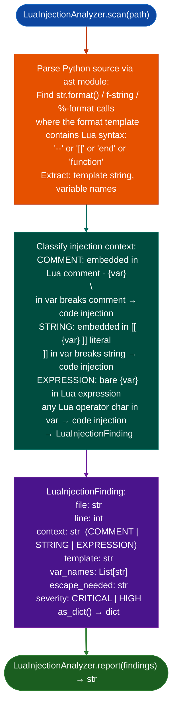

# Lua Code Injection Detection

Detect Python-to-Lua code injection vulnerabilities: finding `str.format()`, f-string, and `%`-formatting operations that embed unsanitized user-supplied strings into Lua source code before execution via `lupa.LuaRuntime.execute()` or subprocess Lua interpreter calls: closing the gap that allowed FAZ-SIEM-001 to go undetected.

---

## Why this exists

1. **No Ablation module detected FAZ-SIEM-001 CRITICAL: an unsanitized `description` field embedded in a Lua comment via `.format()`, where `\n` in the description breaks the comment and injects arbitrary Lua code, achieving RCE via `LuaRuntime.execute()`.** Manual source code review was required. `LuaInjectionAnalyzer` automates detection of this pattern class.

2. Python format operations `str.format()`, f-strings, and `%-formatting` that embed a string in Lua source have no equivalent to HTML escaping or SQL parameterization: a `--` comment delimiter is broken by a newline in the embedded string, and a closing `]]` breaks a `[[ ]]` Lua string literal. `LuaInjectionAnalyzer` detects all three embedding contexts: comment (`-- {field}`), string literal (`[[ {field} ]]`), and bare expression (`{field}`).

3. `LuaInjectionFinding.as_dict()` provides the full Python function scope, the format operation line, and the Lua template string: giving analysts everything needed to reproduce the injection without navigating the source manually. The `escape_needed` field documents what sanitization would fix the finding.

---

## How it works



---

## Usage

```python
from ablation.analyzers.lua_injection_analyzer import LuaInjectionAnalyzer

# Scan a single file
findings = LuaInjectionAnalyzer.scan('/path/to/siem_processor.py')
print(LuaInjectionAnalyzer.report(findings))

# Scan a directory
from pathlib import Path
all_findings = []
for py_file in Path('/path/to/fortianalyzer_siem/').rglob('*.py'):
    all_findings.extend(LuaInjectionAnalyzer.scan(str(py_file)))

critical = [f for f in all_findings if f.severity == 'CRITICAL']
print(f"Critical Lua injection candidates: {len(critical)}")
for f in critical:
    print(f"  {f.file}:{f.line}  {f.context}")
```

---

## Example output

The following illustrates Lua injection detection output format. Actual paths and templates are codebase-specific.

```
LuaInjectionAnalyzer: siem_processor.py

Findings: <N>

  [CRITICAL] COMMENT  siem_processor.py:<line>
    template: "-- description: {desc}\nreturn func()"
    var: desc  (newline breaks Lua comment)
    escape_needed: replace('\n', ' ') before embedding

  [HIGH] STRING  template_engine.py:<line>
    template: "local s = [[ {value} ]]"
    var: value  (]] in value breaks Lua string literal)
```

---

## False positives

**Python format templates that contain Lua-like keywords**: a template that includes `-- ` Python tuple comment or `[[` shell heredoc may be flagged as a Lua injection context. Verify that the format call result is actually passed to a Lua execution context.

**AST analysis parses the template string statically**: a template built from string concatenation for example `lua_code = prefix + user_field + suffix` without a format call will not be detected. Use `SourceTaintTracker` for dataflow tracing from template construction to execution.

---

## Pipeline position

Run `LuaInjectionAnalyzer` on any Python codebase that interacts with Lua via `lupa`, `moonscript`, or subprocess `lua`. Run alongside `SourceSinkScanner` as part of the initial source audit, before `SourceTaintTracker`.

---

## Reading findings

`LuaInjectionAnalyzer.scan()` returns a list of finding dicts:

| Field | Content |
|:---|:---|
| `severity` | `CRITICAL` newline injection breaks Lua comment / `HIGH` long bracket injection |
| `title` | Finding code: `LUA_COMMENT_INJECTION` or `LUA_LONGBRACKET_INJECTION` |
| `file` | Source file path |
| `line` | Line number of the template |
| `var` | Variable name embedded in the template |
| `detail` | Template excerpt and required escape |
| `escape_needed` | Recommended escaping approach |

---

## See also

- [Source Dangerous Sink Detection](source-code-auditing.md): `SourceSinkScanner` for complementary source-level dangerous sink scanning
- [Source Code Analysis Pipeline](bare-integration.md): `SourceContext` for full repository scanning context
