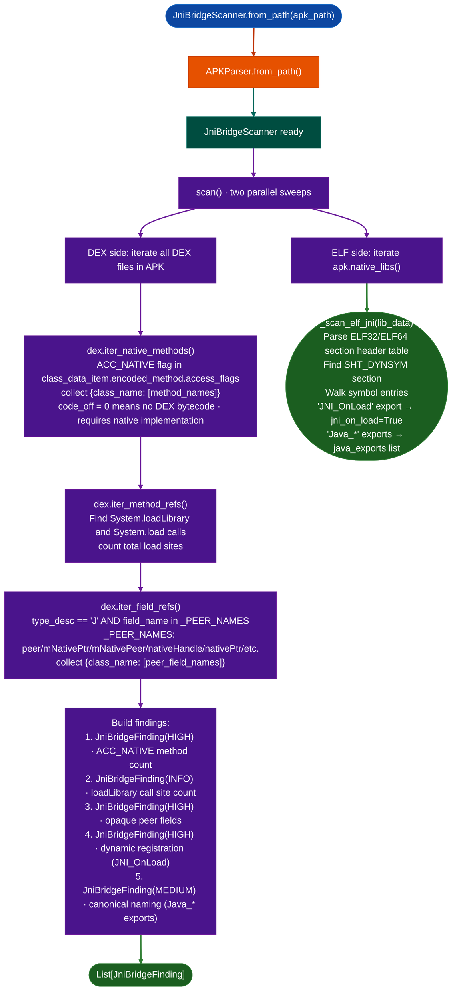

# JNI Bridge Reconstruction

Recover the Java-to-native method mapping in an Android APK by scanning the DEX layer for `ACC_NATIVE` method declarations, `System.loadLibrary` call sites, and opaque peer pointer fields: then cross-referencing the ELF `.so` dynsym tables for `JNI_OnLoad` and canonical `Java_*` exports, so every native bridge entry point in the application is classified before any native binary is opened.

---

## Why this exists

1. **The JNI bridge is the widest attack surface in Android native code.** Every `ACC_NATIVE` method declaration in the DEX is a callable entry point from Java that jumps into native code without ART's type system. Developers frequently pass unsanitized user data across this boundary: the performance-focused Java layer doesn't validate; the C/C++ layer doesn't sanitize. Finding every JNI bridge entry point is the first step before any native binary analysis; the `JniBridgeScanner` produces the complete map in a single call.

2. **There are two registration styles and the attacker surface differs between them.** Libraries that export `JNI_OnLoad` register methods with `env->RegisterNatives()` at runtime: function pointers go into a `JNINativeMethod[]` array, and canonical `Java_*` symbol names do not appear in the dynsym. Libraries that export `Java_*` symbols use static registration: the class and method names are directly readable from the symbol table even in stripped binaries. The scanner surfaces which style each library uses so the analyst routes to the appropriate RE technique: `RegisterNatives` traversal for dynamic, direct disassembly for canonical.

3. **Opaque peer pointer fields mark unsafe native memory handles.** A Java class that holds a `long` field named `mNativePtr`, `peer`, or `nativeHandle` is following the opaque peer idiom: native code writes a raw C++ object pointer into the Java long field via `SetLongField`, and subsequent method calls pass that pointer back to native code. Missing bounds checks or lifetime validation in the native accessor creates use-after-free and type confusion vulnerabilities. The scanner detects every `type='J'` field with a peer-like name and flags the class for manual review.

---

## How it works



### Finding categories

| Category | Severity | Signal | RE action |
|---|---|---|---|
| `jni/dex_native_methods` | HIGH | `ACC_NATIVE` in `class_data_item` | Cross-ref each method with ELF dynsym |
| `jni/load_sites` | INFO | `System.loadLibrary()` calls | Identify which library each native class loads |
| `jni/opaque_peer` | HIGH | `long` field with peer-like name | Trace `GetFieldID`/`SetLongField` in JNI_OnLoad; check bounds validation |
| `jni/dynamic_registration` | HIGH | `JNI_OnLoad` export in `.so` | Trace `RegisterNatives` to recover `JNINativeMethod[]` mapping |
| `jni/canonical_naming` | MEDIUM | `Java_*` exports in `.so` | Directly disassemble; class and method names in symbol |

---

## Usage

```python
from ablation.analyzers.jni_bridge_scanner import JniBridgeScanner

scanner = JniBridgeScanner.from_path('/fw/android/com.vendor.vpn.apk')
findings = scanner.scan()
print(JniBridgeScanner.report(findings))

# Filter by severity
high = [f for f in findings if f.severity == 'HIGH']
for f in high:
    print(f"\n[{f.category}] {f.title}")
    print(f"  {f.detail}")
    print(f"  Evidence: {f.evidence}")

# Count native methods
native_finding = next((f for f in findings if f.category == 'jni/dex_native_methods'), None)
if native_finding:
    print(f"Total native bridge entries: {native_finding.title}")

# Identify dynamic vs canonical registration
for f in findings:
    if f.category == 'jni/dynamic_registration':
        print(f"Dynamic registration (JNI_OnLoad): {f.evidence}")
        print("  Next step: find JNI_OnLoad, trace RegisterNatives call,")
        print("  parse JNINativeMethod[] array for {method_name -> func_ptr}")
    elif f.category == 'jni/canonical_naming':
        print(f"Canonical (Java_*): {f.evidence}")
        print("  Direct disassembly from symbol names")
```

---

## Example output

```
[HIGH]  jni/dex_native_methods
  14 ACC_NATIVE method(s) across 3 class(es)
  Top classes: VpnNative(8), CryptoEngine(4), TunnelManager(2)
  Detail: Methods flagged ACC_NATIVE in class_data_item. These MUST be backed
  by a JNI implementation at runtime or the app crashes. Cross-reference with
  ELF dynsym findings below.

[INFO]  jni/load_sites
  System.loadLibrary called 3 time(s) across VpnNative, CryptoEngine, TunnelManager

[HIGH]  jni/opaque_peer
  Opaque native peer in Lcom/vendor/vpn/VpnNative;
  Fields: mNativePtr, nativeHandle
  Detail: type='J' (long) with peer-like names. Native side writes via SetLongField().
  RE target: find GetFieldID('J') in JNI_OnLoad, trace what native memory the
  pointer addresses. Missing bounds check in native accessor = use-after-free surface.

[HIGH]  jni/dynamic_registration
  2 lib(s) use RegisterNatives (JNI_OnLoad present)
  Evidence: libvpn.so, libcrypto_jni.so
  Detail: Function pointers in JNINativeMethod[] can have any symbol name or none.
  RE approach: find JNI_OnLoad in the .so, trace RegisterNatives call, parse array.

[MEDIUM]  jni/canonical_naming
  libhelper.so: 6 canonical Java_* export(s)
  Evidence: Java_com_vendor_vpn_CryptoEngine_init,
  Java_com_vendor_vpn_CryptoEngine_encrypt, Java_com_vendor_vpn_CryptoEngine_decrypt (+3 more)
```

---

## False positives

**`ACC_NATIVE` count vs. reachable count.** The `jni/dex_native_methods` finding counts every `ACC_NATIVE` method in the APK. Many of these may be in library classes never instantiated in the main application flow. Trace the call graph from Android entry points `onCreate`, `onStartCommand`, `handleMessage` to find which native methods are actually reachable from user input.

**Peer field naming conventions.** The `_PEER_NAMES` set contains common names but does not cover all vendor-specific naming conventions. A peer field named `mEngineId` or `nativeBuf` does not match and goes unreported. Run `ctx.grep(r'type_desc.*J.*field_name', lang='dex')` to find all `long` fields in the APK for a broader sweep.

**Canonical naming not equal to safe.** `jni/canonical_naming` carries MEDIUM rather than HIGH not because canonical binding is safer, but because the attack surface is easier to enumerate: the class and method names are already visible. The actual native code at `Java_*` can still be attacker-controlled. Always taint-trace canonical exports the same way as dynamic ones.

---

## Pipeline position

**Before this module:** `APKParser.from_path()`: supplies DEX iteration and native library access.

**After this module:** For `jni/dynamic_registration` libraries: load the `.so` in `BinaryContext`, find `JNI_OnLoad` by VA, trace `RegisterNatives` with `TaintTracker` to recover the `JNINativeMethod[]` array. For `jni/canonical_naming` libraries: directly disassemble each `Java_*` export. For `jni/opaque_peer` classes: find the `GetFieldID` call in `JNI_OnLoad`, trace all usages of the returned field ID with `RegAnnotator`.

---

## Reading findings

| Field | Content |
|:---|:---|
| `severity` | `HIGH` requires immediate RE / `MEDIUM` enumerate and triage / `INFO` (context) |
| `category` | One of the five `jni/*` categories above |
| `title` | One-line summary with counts |
| `detail` | Explanation of the attack surface and RE approach |
| `source` | `dex/class_data_item`, `dex`, `native`, or the `.so` filename |
| `evidence` | Specific class names, symbol names, or field names that triggered the finding |

---

## See also

- [Android APK Analysis](android-apk-analysis.md): `APKParser` and full APK surface map
- [Android Binder Surface](android-binder-surface.md): binder IPC analysis complementing JNI bridge
- [Binary Context](binary-context.md): load the `.so` after identifying the bridge entry
- [Taint Analysis](taint-analysis.md): trace data from JNI arguments to sinks in native code
