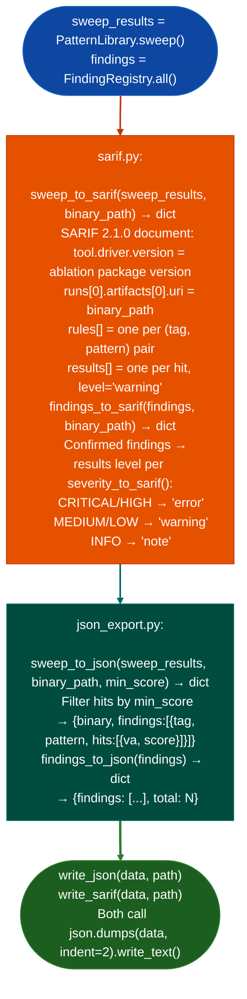

# JSON and SARIF Export

Export Ablation sweep results and confirmed findings to structured JSON or SARIF 2.1.0: enabling consumption by GitHub Code Scanning, VS Code, IDE integrations, and any OASIS-compliant SAST platform: via `ablation/export/sarif.py` and `ablation/export/json_export.py`.

---

## Why this exists

1. **SARIF 2.1.0 is the OASIS standard format consumed by GitHub Code Scanning, VS Code Problems, and most modern SAST platforms.** Without `sarif.py`, Ablation findings cannot be uploaded to GitHub Code Scanning via `gh api repos/.../code-scanning/sarifs` or viewed inline in VS Code. `sweep_to_sarif()` maps each semantic hit to a SARIF `result` with a `ruleId` derived from the finding's tag and query text, and an `artifactLocation` URI pointing to the analyzed binary.

2. **`findings_to_sarif()`** converts `FindingRegistry`-confirmed findings, which carry a `severity` field: to SARIF `level` (`error`/`warning`/`note`). Confirmed findings differ from sweep hits: they have been byte-verified, path-solved, and written to the RE module. This distinction is preserved in the SARIF output: sweep results use `level: warning`; confirmed findings use their verified severity.

3. **`sweep_to_json()` and `findings_to_json()`** produce a flat JSON schema for programmatic downstream use: CI/CD pipelines, custom dashboards, LLM-driven triage tools. The schema is `{"binary": str, "findings": [{"tag": str, "pattern": str, "hits": [{"va": str, "score": float}]}]}`. `write_json()` and `write_sarif()` handle the file-write step.

---

## How it works



---

## Usage

```python
from ablation.export.sarif import sweep_to_sarif, findings_to_sarif
from ablation.export.json_export import sweep_to_json, write_json, write_sarif
import json
from pathlib import Path

# Sweep → SARIF (for GitHub Code Scanning)
sarif = sweep_to_sarif(sweep_results, binary_path='/path/to/firmware.so')
Path('results.sarif').write_text(json.dumps(sarif, indent=2))

# Upload to GitHub Code Scanning
# gh api repos/<owner>/<repo>/code-scanning/sarifs \
#     -f commit_sha=$(git rev-parse HEAD) \
#     -f ref=refs/heads/main \
#     -f sarif=$(gzip -c results.sarif | base64 -w0) \
#     -f tool_name=ablation

# Confirmed findings → JSON
data = findings_to_json(findings, binary_path='/path/to/firmware.so')
write_json(data, 'confirmed_findings.json')
```

---

## Example output

The following illustrates SARIF and JSON export output format.

```json
// SARIF 2.1.0 (abbreviated)
{
  "$schema": "https://json.schemastore.org/sarif-2.1.0.json",
  "version": "2.1.0",
  "runs": [{
    "tool": {"driver": {"name": "ablation", "version": "<version>"}},
    "artifacts": [{"location": {"uri": "file:///path/to/firmware.so"}}],
    "results": [
      {"ruleId": "ABL-<tag>", "level": "warning", "message": {"text": "<pattern>"}}
    ]
  }]
}

// Flat JSON
{"binary": "/path/to/firmware.so", "findings": [
  {"tag": "memory-safety", "pattern": "...", "hits": [{"va": "0x1234", "score": 0.87}]}
]}
```

---

## False positives

**SARIF `ruleId` collision**: if two different queries have the same tag, `_rule_id()` generates the same `ruleId`. The SARIF spec requires unique `ruleId` values per rule; downstream tools may merge or deduplicate results. Use distinct tags per query to avoid collisions.

**`min_score` in `sweep_to_json()`**: the default `min_score=0.0` includes all hits including low-confidence matches. Pass `min_score=0.75` the standard sweep threshold to match the semantic sweep's own reporting threshold.

---

## Pipeline position

Export runs at the end of a sweep or confirmation session, never during triage. The canonical order: sweep → confirm findings → `findings_to_sarif()` / `findings_to_json()` → upload or archive. Do not export unconfirmed sweep hits as confirmed findings.

---

## Reading output

`sweep_to_sarifsweep_results, binary_path, min_score=0.0` returns a SARIF 2.1.0 `dict`:

| Key path | Content |
|:---|:---|
| `runs[0].tool.driver.name` | `'ablation'` |
| `runs[0].tool.driver.rules[*].id` | Rule ID derived from finding tag and query |
| `runs[0].results[*].ruleId` | Matching rule ID |
| `runs[0].results[*].level` | `'error'` / `'warning'` / `'note'` |
| `runs[0].results[*].message.text` | Finding detail string |
| `runs[0].results[*].locations[*].uri` | File URI of the analyzed binary |

`findings_to_sariffindings, binary_path`: same SARIF format, input is a flat finding list.

`sweep_to_jsonsweep_results` and `findings_to_jsonfindings` return plain `dict` representations of the same data, suitable for `write_jsondata, path`.

---

## See also

- [Markdown Research Reports](markdown-research-reports.md): `generate_report()` for human-readable markdown from sweep results
- [Semantic Pattern Sweep](semantic-pattern-sweep.md): `PatternLibrary.sweep()` that produces sweep results for export
