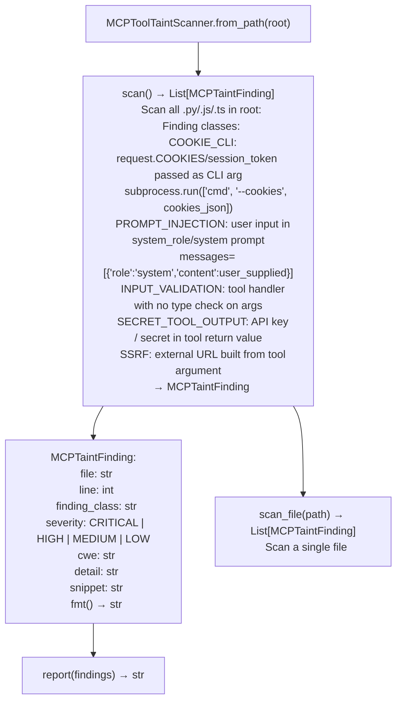

# MCP Server Security Scanning

Scan AI/MCP server source code (Python, JavaScript, TypeScript) for security vulnerabilities — detecting session token exposure via CLI arguments, prompt injection into LLM trust contexts, tool call input validation gaps, secret leakage through tool output, and SSRF-prone external URL construction — closing the gap that allowed FortiManager v8.0.0 AI stack findings to require manual source review.

---

## Why this exists

1. **FortiManager v8.0.0 ships an AI/MCP stack in `ai/agent/agent_framework/` with two confirmed findings that required manual source read** — no automated scanner existed for MCP server security analysis. `MCPToolTaintScanner` closes TG-FMGMCP-1 and prevents these finding classes from recurring in future MCP targets.

2. **FMG-AI-1 (CWE-214, MEDIUM): `mcp.py` serializes `request.COOKIES` to JSON and passes it as `--cookies` CLI argument to `/usr/bin/webmcpserver`.** The session token is visible in `/proc/<pid>/cmdline` for the subprocess lifetime — world-readable on Linux. `MCPToolTaintScanner` detects any pattern where session credentials or authentication tokens are passed as subprocess CLI arguments rather than via environment variable, stdin, or IPC.

3. **FMG-AI-2 (CWE-77, MEDIUM): `agent_views.py` passes a user-supplied FortiGate CLI script as the system-role content to an LLM security analyzer**, enabling prompt injection into the AI's trust context. The AI treats the user's injected instructions as system-level directives. `MCPToolTaintScanner` detects user-supplied content routed to LLM system-role or system-prompt positions.

---

## How it works



---

## Usage

```python
from ablation.analyzers.mcp_tool_taint_scanner import MCPToolTaintScanner

scanner = MCPToolTaintScanner.from_path('/path/to/fortimanager_ai_stack/')
findings = scanner.scan()
print(MCPToolTaintScanner.report(findings))

# Critical and high findings
for f in findings:
    if f.severity in ('CRITICAL', 'HIGH'):
        print(f"  [{f.severity}] {f.finding_class}  {f.file}:{f.line}  CWE-{f.cwe}")
        print(f"  {f.snippet}")
```

---

## Example output

The following illustrates MCP server security scan output format. Actual paths and snippets are codebase-specific.

```
MCPToolTaintScanner: fortimanager_ai_stack/

Findings: <N>

  [MEDIUM] COOKIE_CLI  mcp.py:<line>  CWE-214
    subprocess.run(['webmcpserver', '--cookies', json.dumps(request.COOKIES)])
    Session token exposed in /proc/<pid>/cmdline

  [MEDIUM] PROMPT_INJECTION  agent_views.py:<line>  CWE-77
    messages=[{'role': 'system', 'content': cli_script}]
    User-supplied content in LLM system role
```

---

## False positives

**`COOKIE_CLI` detection uses pattern matching on subprocess argument construction** — a call that passes `--cookies` with a non-sensitive value (e.g., `--cookies '{}'`) will be flagged. Verify that the argument contains session credentials before treating as a security finding.

**`PROMPT_INJECTION` fires on legitimate system prompts** — a system prompt constructed from a static template with a user field embedded only in a data position (not as instructions) may still be flagged. Verify that the user-supplied content is in a position where an LLM would interpret it as instructions, not just data.

---

## Pipeline position

Run `MCPToolTaintScanner` on any AI/MCP server codebase as the first scan, alongside `SourceSinkScanner`. MCP stacks often combine sensitive token handling with subprocess invocation and LLM routing in ways that generic scanners do not cover.

---

## See also

- [Source Dangerous Sink Detection](source-code-auditing.md) — `SourceSinkScanner` for complementary source-level sink detection
- [Source Code Analysis Pipeline](bare-integration.md) — `SourceContext` for full repository scanning context
