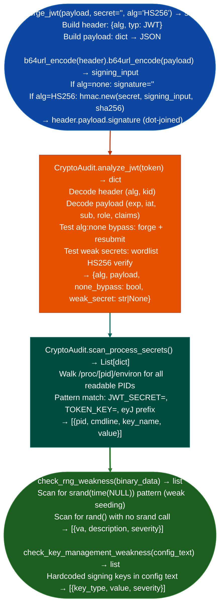

# JWT Analysis and Weak Secret Testing

Decode and verify JSON Web Tokens, detect `alg: none` acceptance, brute-force weak HS256 secrets against a wordlist, forge replacement tokens, and scan process environments for secrets embedded in JWT payloads or signing keys: via `modules/crypto_audit.py` `CryptoAudit` and `forge_jwt()`.

---

## Why this exists

1. **`forge_jwt()` produces valid-looking JWTs with attacker-controlled claims**, it generates HS256-signed tokens with an arbitrary payload claims dict and a known or empty secret. This is used to test whether a server enforces algorithm verification (`alg: none` bypass) and whether a JWT-based authorization system will accept a token whose claims have been modified. `forge_jwt(payload={"role":"admin"}, secret="", alg="none")` produces the classic `alg:none` bypass token.

2. **`CryptoAudit.analyze_jwt()` tests live JWT endpoints**, it decodes a captured JWT, attempts `alg: none` replacement, and tests the provided token against the original endpoint to confirm whether the server accepts it. It also scans for weak secrets by attempting HS256 verification with entries from a configurable wordlist `secret`, `password`, `jwt_secret`, `changeme`, and common variations.

3. **`CryptoAudit.scan_process_secrets()` extracts JWTs and signing keys from running process environments**, it reads `/proc/<pid>/environ` for all readable processes and extracts `JWT_SECRET`, `AUTH_SECRET`, `TOKEN_SIGNING_KEY`, and base64-encoded strings that look like JWT header prefixes (`eyJ`). This is the primary method for discovering signing keys from a compromised host.

---

## How it works



---

## Usage

```python
from modules.crypto_audit import forge_jwt, CryptoAudit

# Forge alg:none token
none_token = forge_jwt({"sub": "1234", "role": "admin"}, secret="", alg="none")
print(f"alg:none token: {none_token}")

# Analyze a captured JWT — method is analyze_jwt(), not audit_jwt()
audit = CryptoAudit()
result = audit.analyze_jwt("<captured_token>")
# Return keys: raw, header, payload, alg, vulns, forged_token
print(f"alg: {result['alg']}")
print(f"vulnerabilities: {result['vulns']}")
if result['forged_token']:
    print(f"forged: {result['forged_token'][:60]}...")

# Scan filesystem paths for JWT secrets
# scan_for_jwts scans files for embedded JWT strings
tokens_found = audit.scan_for_jwts(paths=['/etc', '/home', '/opt'])
for t in tokens_found:
    print(f"  {t.get('source')}: {t.get('token', '')[:40]}...")
```

---

## Example output

The following illustrates JWT analysis output format.

```
CryptoAudit.analyze_jwt:

alg: HS256
none_bypass: True  (server accepted unsigned token)
weak_secret: 'secret'  (matched wordlist entry)

scan_process_secrets:
  PID 1042 (node /app/server.js): JWT_SECRET=mysecretkey123
```

---

## False positives

**`alg: none` bypass test requires a live endpoint**: `analyze_jwt()` cannot confirm bypass without a target URL. When called without an endpoint, `none_bypass` is marked `unknown` (not `True`) to avoid misrepresenting the result as a confirmed finding. Confirm bypass only against the actual token verification endpoint.

**Wordlist weak-secret detection**: HS256 HMAC verification with a matching entry proves the secret was used. However, a token may use a strong secret that simply does not appear in the wordlist. A `weak_secret: null` result does not mean the secret is strong; it means the wordlist was exhausted without a match.

---

## Pipeline position

Run JWT analysis after capturing a token from HTTP traffic (via `PCAPAnalyzer`) or from a response header. Weak secret discovery and `alg: none` bypass confirm token forgery is possible; `scan_process_secrets()` provides the key directly from the application process.

---

## Reading findings

`CryptoAudit.analyze_jwt(token)` returns a dict:

| Key | Content |
|:---|:---|
| `header` | Decoded JWT header dict |
| `payload` | Decoded JWT payload dict |
| `alg` | Algorithm claim string for example `'HS256'`, `'none'` |
| `vulns` | `List[str]`: one entry per detected weakness for example `'CRITICAL:WEAK_SECRET: secret is ...'`, `'MEDIUM:HS256: symmetric; secret may be weak'` |
| `forged_token` | A forged JWT string when a weakness allows forgery, or `None` |

`CryptoAudit.scan_for_jwts(paths)` scans a list of file paths and returns a list of `path, token_string` tuples for all JWT strings found.

---

## See also

- [SAML and Key Material Review](saml-and-key-material-review.md): SAML assertion wrapping and key extraction from XML signing structures
- [RSA/ECDSA and Randomness Checks](rsa-ecdsa-and-randomness-checks.md): cryptographic weakness detection in asymmetric key material
