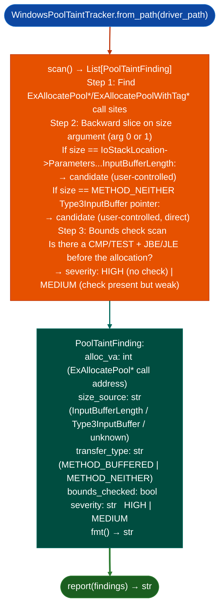

# Windows Kernel Pool Overflow Detection

Detect Windows kernel pool buffer overflow candidates in driver PE binaries: tracing `ExAllocatePool*` / `ExAllocatePoolWithTag*` size arguments back to `IoStackLocation->Parameters.DeviceIoControl.InputBufferLength` or METHOD_NEITHER transfer buffers, identifying cases where user-controlled input reaches the allocation size without bounds checking.

---

## Why this exists

1. Windows kernel pool overflows via IOCTL size parameters are a well-known privilege escalation vector: an attacker passes an oversized `InputBufferLength` to trigger an under-allocated pool buffer, then overflows it with subsequent data. `WindowsPoolTaintTracker` automates the detection that was previously done by manually tracing every `ExAllocatePool*` call site to its size argument origin.

2. `PoolTaintFinding.severity` reflects the quality of bounds checking before the allocation: a size argument that reaches `ExAllocatePool*` with no comparison or mask operation is `HIGH`; a size with a single bounds check that may be bypassable for example `if (size > MAX size = MAX` without type coercion check) is `MEDIUM`. This saves triage time by pre-scoring findings.

3. `WindowsPoolTaintTracker` handles both `METHOD_BUFFERED` and `METHOD_NEITHER` IOCTL transfer types: `METHOD_NEITHER` provides direct userspace buffer pointers (`Type3InputBuffer`) that bypass the kernel's I/O manager input validation, making them a higher-priority taint source. Findings from `METHOD_NEITHER` IOCTLs are annotated in the `PoolTaintFinding` output.

---

## How it works



---

## Usage

```python
from ablation.analyzers.windows_pool_taint_tracker import WindowsPoolTaintTracker

tracker = WindowsPoolTaintTracker.from_path('/path/to/driver.sys')
findings = tracker.scan()
print(WindowsPoolTaintTracker.report(findings))

high = [f for f in findings if f.severity == 'HIGH']
print(f"HIGH severity pool overflow candidates: {len(high)}")
for f in high:
    print(f.fmt())
    print(f"  Transfer type: {f.transfer_type}")
    print(f"  Size source: {f.size_source}")
```

---

## Example output

The following illustrates the pool overflow detection output format. Actual addresses are driver-specific.

```
WindowsPoolTaintTracker: driver.sys

Pool allocation call sites: <N>

Findings (<M> total):
  [HIGH] ExAllocatePoolWithTag  at <va>
    size_source: InputBufferLength  transfer=METHOD_BUFFERED
    bounds_checked: False
    Path: IOCTL_DISPATCH → alloc_size = irpStack->Parameters.DeviceIoControl.InputBufferLength

  [MEDIUM] ExAllocatePool  at <va>
    size_source: InputBufferLength  transfer=METHOD_NEITHER
    bounds_checked: True (weak — no unsigned check)
```

---

## False positives

**Bounds check detection uses static analysis**: a bounds check that is applied before the function entry point for example in the IOCTL dispatch wrapper that filters `InputBufferLength` before calling the allocation function may not be detected, producing a `HIGH` finding for an allocation that is actually bounded. Validate `HIGH` findings by checking the IOCTL dispatch call chain above the allocation site.

**`METHOD_NEITHER` transfer type annotation requires IOCTL code analysis**: if the IOCTL code is not statically determinable for example loaded from a data structure, `transfer_type` is reported as `'unknown'` and the finding severity is not elevated for METHOD_NEITHER.

---

## Pipeline position

Run `WindowsPoolTaintTracker` on any Windows kernel driver PE alongside `CFGBypassDetector` and `RPCServerAnalyzer` as part of initial driver attack surface assessment. `HIGH` severity findings are direct candidates for PoC development; `MEDIUM` findings require manual bounds-check bypass analysis.

---

## Reading findings

`WindowsPoolTaintTracker.scan()` returns a list of finding dicts:

| Field | Content |
|:---|:---|
| `severity` | `HIGH` unbounded user-controlled size / `MEDIUM` unchecked with indirect source |
| `title` | `POOL_OVERFLOW` |
| `detail` | Allocation function, size source, IOCTL transfer type, and call path |
| `alloc_va` | VA of the `ExAllocatePool*` call |
| `size_source` | Name of the size source for example `InputBufferLength` |
| `bounds_checked` | `False` if no bounds check was found on the size source |

---

## See also

- [BYOVD Capability Detection](byovd-capability-detection.md): dangerous import detection for the same driver targets
- [Control Flow Guard Review](control-flow-guard-review.md): CFG/XFG bypass analysis on Windows kernel drivers
- [Named Taint Sources and Bounds](named-taint-sources-and-bounds.md): binary TaintTracker for user-mode taint analysis
