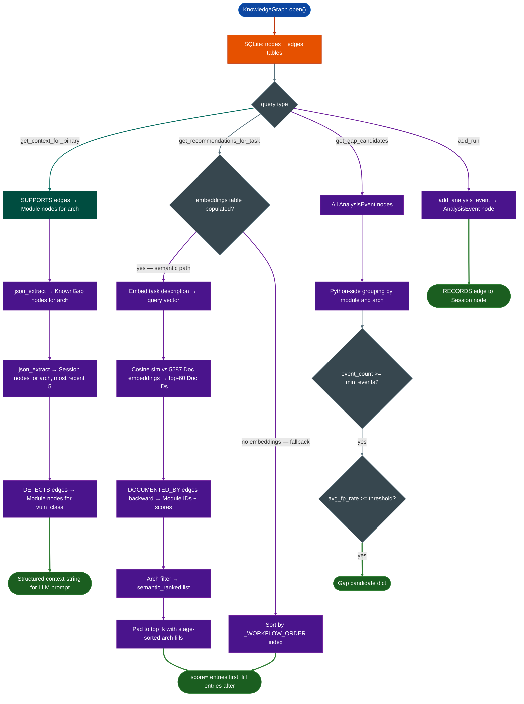

# Knowledge Graph

Query the full Ablation capability set, known analysis gaps, and prior RE session history by architecture and format in one call, before reading any individual reference document.

---

## Why this exists

1. **Tool selection at session start required reading 3 to 5 reference files before picking the first tool.** `BinaryContext` tells you what the binary is. It says nothing about which Ablation tool to run next, which tools fail on that architecture, or whether a similar target has been analyzed before. The analyst had to reconstruct this context from memory or from a grep across the docs directory every session.

2. **High fp_rate tool runs on specific architectures were not recorded.** When `SinkArgClassifier` returned 100% false positives on a stripped PPC32 XCOFF binary because there was no C stack frame, that result was noted in a SESSION markdown file and forgotten. The next session on a similar target ran the same tool and reached the same dead end. `AnalysisEvent` nodes record every run outcome so `get_gap_candidates()` can surface the pattern before the tool runs again.

3. **Prior work on similar targets was invisible at session start.** Thirty-two IBM PReP sessions existed across `re/ibm/`. Knowing which arch variant produced confirmed findings and which tool sequence reached them required grepping `*_re.py` files manually. `Session` and `Finding` nodes make this retrievable in one call.

4. **The 334 capability records in `capabilities.json` had no graph structure.** Each record listed `workflow_stage` and `scope` as flat strings. There was no machine-readable ordering between tools, no SUPPORTS edges from modules to architectures, and no way to ask "which of the 67 vulnerability scanners cover PPC32" without reading each one. The bootstrap script converts those strings into graph edges once and answers the question in a SQL join.

---

## How it works



### Node schema

| Type | ID pattern | Key props |
|---|---|---|
| `Module` | `module://BinaryContext` | name, category, workflow_stage, entry_point, scope, limitations, reference_docs |
| `Architecture` | `arch://ppc32` | name |
| `BinaryFormat` | `format://elf32_no_sections` | name |
| `VulnClass` | `vuln://stack_overflow` | name |
| `KnownGap` | `gap://PPC32_PLT_resolution` | description, arch, blocks_module, workaround, module_needed |
| `Binary` | `binary://sha256[:8]` | path, sha256, arch, vendor, format |
| `Session` | `session://ibm-iplrom` | date, arch, vendor, verdict, tool_sequence, source_file |
| `Finding` | `finding://IBM-IPLROM-001` | cwe, va, status, byte_verified, disclosure_status, access_level |
| `AnalysisEvent` | `event://uuid12` | session_id, module, arch, candidates, confirmed, fp_rate, root_cause |
| `Doc` | `doc://binary-context.md#usage` | module_id, section, text, source_file |

### Edge schema

| Edge | Meaning |
|---|---|
| `Module SUPPORTS Architecture` | This module supports that architecture |
| `Module HANDLES BinaryFormat` | This module handles that binary format |
| `Module DETECTS VulnClass` | This module detects that vulnerability class |
| `Module REQUIRES Module` | Workflow ordering between pipeline stages |
| `Module HAS_GAP KnownGap` | This module fails on this known gap |
| `KnownGap WORKAROUND_IS Module` | This module is the workaround for the gap |
| `Module DOCUMENTED_BY Doc` | This module is documented in this Doc chunk |
| `Binary HAS_ARCH Architecture` | This binary runs on that architecture |
| `Binary HAS_FORMAT BinaryFormat` | This binary has that file format |
| `Session ANALYZED Binary` | This session analyzed that binary |
| `Session USED Module` | This session ran that module |
| `Finding FOUND_IN Session` | This finding came from that session |
| `Finding EXPLOITS VulnClass` | This finding is an instance of that vuln class |
| `AnalysisEvent RECORDS Session` | This event belongs to that session |

### Workflow stage ordering

`get_recommendations_for_task()` sorts fill entries (and the fallback path) by this sequence:

```
triage → sweep → corpus → profile → classify → taint → confirm → analysis
```

Modules with unknown `workflow_stage` sort last.

### Semantic recommendation pipeline

When Doc node embeddings exist, `get_recommendations_for_task()` runs the following pipeline:

```
task_description
      │
      ▼
BAAI/bge-small-en-v1.5     384-dim L2-normalised vectors, cached in _EMBED_MODEL_CACHE
      │
      ▼  query vector (384 floats)
      │
matrix @ query_vec          5,587 Doc embeddings (8.6 MB) loaded from embeddings table;
                             one matrix-vector multiply on CPU, ~1-2 ms
      │
      ▼  5,587 cosine scores  (dot product = cosine sim because BGE is L2-normalised)
      │
top 60 Doc IDs              argsort descending, take top_k * 4
      │
DOCUMENTED_BY edges (backward)
      │                      edge direction: src=Module dst=Doc
      ▼                      query: SELECT src FROM edges WHERE dst=? AND type='DOCUMENTED_BY'
module_score dict            best score per Module across its Doc chunks
      │
arch filter                 keep only modules with a SUPPORTS edge to arch://<arch>
      │
      ▼  semantic_ranked     sorted by score descending, up to top_k
      │
stage-sorted fill           if len(semantic_ranked) < top_k, pad with arch modules
                             ordered by workflow_stage that aren't already ranked
      │
      ▼
[RECOMMENDED TOOL SEQUENCE — <task_description>]
  1. SetuidAuthOracleScanner  [analysis]  score=0.760   ← semantically matched
  2. X86_32TaintTracker       [analysis]  score=0.731   ← semantically matched
  3. ShellcodeUtils           [triage]                  ← stage-sorted fill
  4. base_sweep               [triage]                  ← stage-sorted fill
  ...
```

`score=` is present only on semantically matched entries. Fill entries have no score. The two tiers are visually distinct so the analyst knows which tools the graph has textual evidence for versus which are present on workflow-position grounds.

**DOCUMENTED_BY coverage.** The `sync --embed` run wires DOCUMENTED_BY edges from Module nodes to H2-chunked Doc nodes using two-pass matching:

1. LIKE query on `Module.props.reference_docs` — matches modules that explicitly list their doc file
2. Normalized stem match — strips all non-alphanumeric characters and lowercases both the md filename stem and the module name; catches e.g. `x86-32-taint-tracker.md` → `X86_32TaintTracker`

381 of 540 reference docs are concept guides, multi-module overviews, or platform analysis docs that don't map to a single module. These remain unlinked intentionally — they still influence cosine ranking but don't resolve to a specific module recommendation.

### Pre-disclosure security

`record_finding()` accepts a `disclosure_status` field. Findings with `disclosure_status='pre-disclosure'` are stored in the graph but are not returned by `get_context_for_binary()` when `access_level='public'` (the default). Pass `access_level='internal'` to retrieve pre-disclosure findings.

---

## KnowledgeGraph

```python
from ablation.analyzers.knowledge_graph import KnowledgeGraph

g = KnowledgeGraph.open()                     # default: ~/.ablation/knowledge_graph.db
g = KnowledgeGraph.open('/custom/path.db')    # explicit path
```

### Write API

```python
g.add_node(node_type, node_id, props)         # INSERT OR REPLACE on id
g.add_edge(src, dst, edge_type, props=None)   # INSERT OR REPLACE on (src, dst, type)
g.add_analysis_event(session_id, module, arch, candidates, confirmed, fp_rate, root_cause)
g.record_finding(finding_id, cwe, va, status, byte_verified, disclosure_status, session_id)
g.add_run(module_name, binary_path, arch, results)   # preferred write path in sessions
```

### Query API

```python
ctx  = g.get_context_for_binary(arch, fmt, vuln_class=None, access_level='public', intent='sweep')
ctx, cov = g.get_context_with_coverage(arch, fmt, vuln_class=None, access_level='public', intent='sweep')
rec  = g.get_recommendations_for_task(task_description, arch=None)
gaps = g.get_gap_candidates(fp_threshold=0.3, min_events=5)
```

`intent` controls which sections appear in the context string. Three values are accepted: `'sweep'` is the default and includes all sections; `'confirm'` filters sessions to those with a non-empty verdict; `'version_diff'` omits gaps and sessions. Any other value raises ValueError.

`get_context_with_coverage()` returns a `(context_str, ContextCoverage)` pair. `ContextCoverage` carries `coverage_score` (0.0-1.0), `arch_family_used`, `intent`, and raw counts. Call `cov.sufficient()` to gate graph-informed decisions.

`get_recommendations_for_task()` returns up to `top_k=15` modules in two tiers. When Doc embeddings exist: semantically matched modules first (with `score=X.XXX`), then stage-sorted fills to reach `top_k`. Without embeddings: pure stage-sort fallback. See **Semantic recommendation pipeline** above for the full retrieval flow.

### Phase 3: GraphSession

```python
gs = g.session(session_id, arch, binary_path='')  # -> GraphSession
```

Returns a `GraphSession` that pre-fills `session_id`, `arch`, and `binary_path` for every `record()` call. Use at RE session start so each tool run only passes the results dict:

```python
g  = KnowledgeGraph.open()
gs = g.session('session://ibm-target', arch='ppc32', binary_path='/path/fw.bin')
ctx = gs.context('xcoff32')                      # get_context_for_binary shortcut

# After each tool runs:
gs.record('SinkArgClassifier', {'candidates': 5, 'confirmed': 1, 'fp_rate': 0.8})
gs.record('TaintTracker',      {'candidates': 2, 'confirmed': 2, 'fp_rate': 0.0})

# After confirming a finding:
gs.record_finding('finding://IBM-001', 'CWE-78', 0x1234, 'CONFIRMED', True, 'pre-disclosure')
```

`GraphSession` is also a context manager: `with g.session(...) as gs: ...`.

### Phase 4: Vector retrieval

```python
count = g.embed_doc_nodes(model_name='BAAI/bge-small-en-v1.5')  # one-time; or via --embed
```

Embeds all Doc nodes and stores float32 vectors in the `embeddings` table. Requires `fastembed` (already a SemanticSearcher dependency). Run once after bootstrap; re-run after `--sync` to pick up new Doc nodes. `get_recommendations_for_task()` detects the table automatically and switches to the semantic path.

```bash
python3 -I sweeps/build_ablation_graph.py --bootstrap --embed
python3 -I sweeps/build_ablation_graph.py --sync --embed
```

**Embedding details.** Model: `BAAI/bge-small-en-v1.5` (384 dimensions, L2-normalised at output). Storage: one 1,536-byte float32 BLOB per Doc node in the `embeddings` table (~8.6 MB total for 5,587 nodes). Cosine similarity is computed as a matrix-vector dot product (`matrix @ query_vec`) because BGE vectors are unit-length, making dot product equal cosine similarity with no division. Total inference pass: ~11 seconds on CPU for 5,587 chunks; model weights cached in fastembed's local directory after first run.

The `embeddings` table is gated — `get_recommendations_for_task()` checks `SELECT 1 FROM embeddings LIMIT 1` before switching paths. Existing sessions without `fastembed` installed see no behavior change until `--embed` is run.

### Self-evolution loop

AnalysisEvent nodes accumulate across sessions. `get_gap_candidates()` aggregates them to surface patterns that warrant a new ablation module:

```
Session 1:  gs.record('SinkArgClassifier', {fp_rate: 0.92, root_cause: 'xcoff_no_plt'})
Session 2:  gs.record('SinkArgClassifier', {fp_rate: 0.87, root_cause: 'xcoff_no_plt'})
Session 3:  gs.record('SinkArgClassifier', {fp_rate: 0.91, root_cause: 'xcoff_no_plt'})
Session 4:  gs.record('SinkArgClassifier', {fp_rate: 0.89, root_cause: 'xcoff_no_plt'})
Session 5:  gs.record('SinkArgClassifier', {fp_rate: 0.88, root_cause: 'xcoff_no_plt'})
```

```python
gaps = g.get_gap_candidates(fp_threshold=0.3, min_events=5)
# → [{'module': 'SinkArgClassifier', 'arch': 'ppc32',
#     'avg_fp_rate': 0.894, 'root_causes': ['xcoff_no_plt']}]
```

The analyst documents the gap and suppresses the events:

```python
g.add_gap_node(
    'gap://ppc32/xcoff_no_plt',
    arch='ppc32',
    description='XCOFF32 has no .rel.plt; SinkArgClassifier misidentifies rodata calls as sinks',
    root_cause='xcoff_no_plt',
    module_needed='SinkArgClassifierXCOFF',
    supersedes_event_ids=[event_id_1, event_id_2, event_id_3, event_id_4, event_id_5],
)
```

Session 6's `get_context_for_binary(arch='ppc32', ...)` now includes:

```
[KNOWN GAPS for arch=ppc32]
  XCOFF32 has no .rel.plt; SinkArgClassifier misidentifies rodata calls as sinks
    module_needed: SinkArgClassifierXCOFF
```

The analyst sees the gap before running the tool and skips it or reaches for the workaround.

**Suppression has two independent mechanisms:**

1. **SUPERSEDES edges** — explicit event IDs passed to `add_gap_node()`. Those events are excluded from all future `get_gap_candidates()` scoring regardless of root_cause.
2. **root_cause string match** — any future AnalysisEvent with a `root_cause` matching a documented KnownGap for the same arch is also excluded. Covers future sessions automatically without needing per-event SUPERSEDES edges.

**Recency weighting.** `get_gap_candidates()` applies time-decay to events before averaging fp_rate: events older than 30 days get 50% weight; older than 90 days get 10%. A module that was broken six months ago but has been running cleanly on recent targets does not stay flagged as a gap candidate.

### Gap documentation API

```python
g.add_gap_node(gap_id, arch, description, root_cause='', workaround='',
               module_needed='', supersedes_event_ids=None)
```

Creates a KnownGap node and optionally adds SUPERSEDES edges from the gap to specific AnalysisEvent IDs. Events that are superseded, or whose `root_cause` matches a documented KnownGap for the same arch, are excluded from `get_gap_candidates()` scoring. Use this when you have documented a gap and want prior failing events to stop appearing as candidates.

### Stats

```python
g.node_count()                    # total nodes
g.node_count('Module')            # nodes of specific type
g.edge_count('SUPPORTS')          # edges of specific type
```

---

## Usage

```python
from ablation.analyzers.knowledge_graph import KnowledgeGraph

# Session start: get arch context before picking the first tool
g = KnowledgeGraph.open()
ctx = g.get_context_for_binary(arch='ppc32', fmt='xcoff32')
print(ctx)

# Session start: get ordered tool list for a specific task
rec = g.get_recommendations_for_task('find stack overflows', arch='ppc32')
print(rec)

# After each tool run: record the outcome
event_id = g.add_run(
    'SinkArgClassifier',
    '/media/cowboy/research/IBM-RE/IPLROM.image',
    arch='ppc32',
    results={
        'session_id': 'session://ibm-iplrom',
        'candidates': 53,
        'confirmed': 4,
        'fp_rate': 0.92,
        'root_cause': 'XCOFF_no_plt_49_rodata_const',
    },
)

# Record a confirmed finding
g.record_finding(
    finding_id='finding://IBM-IPLROM-NET-001',
    cwe='CWE-121',
    va=0x3208c,
    status='CONFIRMED',
    byte_verified=True,
    disclosure_status='public',
    session_id='session://ibm-iplrom',
)

# Check for gap candidates after several sessions
gaps = g.get_gap_candidates(fp_threshold=0.3, min_events=5)
for g_entry in gaps:
    print(g_entry['module'], g_entry['arch'], g_entry['avg_fp_rate'])
```

Bootstrap before the first session:

```bash
python3 -I sweeps/build_ablation_graph.py --bootstrap
# Adds new modules and sessions without wiping existing data:
python3 -I sweeps/build_ablation_graph.py --sync
# Bootstrap + embed Doc nodes for semantic recommendations:
python3 -I sweeps/build_ablation_graph.py --bootstrap --embed
```

---

## Example output

```
>>> ctx = g.get_context_for_binary(arch='ppc32', fmt='xcoff32')
>>> print(ctx)
[MODULES for arch=ppc32]
  BinaryContext  [triage]
    entry: BinaryContext.load_or_build(path)
  PPC32TaintTracker  [taint]
    entry: PPC32TaintTracker.from_context(ctx).run()
    limits: No PLT on stripped XCOFF32; external calls unresolved
  SinkArgClassifier (PPC32BE)  [classify]
    entry: SinkArgClassifier.from_context(ctx).classify_all()
  ...

[KNOWN GAPS for arch=ppc32]
  PPC32 binaries without PLT — external call targets unresolvable via PLT scan
    workaround: BinaryContext exports (714 named) + WindowAnalyzer manual disasm
    module_needed: PPC32ExternalCallResolver

[PRIOR SESSIONS for arch=ppc32]
  session://ibm-iplrom  date=2026-10-15  verdict=COMPLETE  tools=[]
```

```
>>> gaps = g.get_gap_candidates(fp_threshold=0.3, min_events=5)
>>> gaps
[{'module': 'SinkArgClassifier', 'arch': 'ppc32',
  'event_count': 7, 'avg_fp_rate': 0.88,
  'root_causes': ['XCOFF_no_plt', 'FCode_not_C_stack']}]
```

```
>>> rec = g.get_recommendations_for_task('find command injection in setuid binaries', arch='x86_32')
>>> print(rec)
[RECOMMENDED TOOL SEQUENCE — find command injection in setuid binaries]
  1. SetuidAuthOracleScanner  [analysis]  score=0.760
     SetuidAuthOracleScanner.from_context(ctx)|from_path(path); .scan() -> List[OracleHit]
  2. X86_32TaintTracker  [analysis]  score=0.731
     X86_32TaintTracker.from_path(path)|from_context(ctx)
  3. ShellcodeUtils  [triage]
     shellcode utility functions
  4. base_sweep  [triage]
     python3 sweeps/base_sweep.py <binary>
  ...
  15. CommandTableScanner  [analysis]
     CommandTableScanner.from_context(ctx); .scan()
```

Entries 1–2 carry `score=` — they were ranked by cosine similarity of their documentation chunks against the task description. Entries 3–15 have no score — they are stage-sorted fills drawn from the x86_32 arch module set to pad the list to `top_k=15`.

---

## False positives

**`get_context_for_binary` returns no modules for a valid arch.** This happens when the bootstrap has not been run or when the arch identifier passed by the caller does not match the canonical form in the graph. The canonical forms are: `ppc32`, `ppc64`, `arm64`, `arm32`, `x86_64`, `x86_32`, `mips32`, `mips64`, `riscv32`, `riscv64`, `m88k`, `m68k`, `sh2a`, `sh4`, `loongarch64`. Run `--bootstrap` first, then confirm the arch string matches one of these.

**`get_recommendations_for_task` returns only fill entries with no `score=`.** This means no Doc nodes for the given arch's modules ranked in the top-60 cosine hits. The most common cause is that those modules' reference docs are not yet linked with DOCUMENTED_BY edges (run `--sync --embed` to repair). A task description that is very arch-neutral (e.g. "parse binary") will also produce few semantic hits since most reference docs are tool-specific rather than platform-specific.

**`get_gap_candidates` returns no results despite known failures.** Results only appear after `add_run()` has been called enough times to cross `min_events`. The default is 5 events per module-arch pair. If you have 4 failing runs and want to surface the pattern earlier, pass `min_events=3`. Events whose `root_cause` matches a documented KnownGap for that arch are also excluded, as are events with SUPERSEDES edges from a KnownGap. If the gap is already documented but events keep disappearing, check that the KnownGap node's `root_cause` field matches the event's `root_cause` string exactly.

**Session nodes show `verdict=''` for sessions that completed.** The session parser reads `**Status:**` from SESSION markdown files. Sessions that record status on a line without that exact prefix will not parse the verdict field. Edit the SESSION file to match the format or call `add_node` directly to set the verdict.

---

## Pipeline position

**Before this module:** Run `build_ablation_graph.py --bootstrap` once to seed the graph from `capabilities.json`. Requires `docs/capability-audit/capabilities.json` and `docs/reference-modules/*.md` in the repo.

**After this module:** All analysis tools. Call `get_context_for_binary()` at session start, before `BinaryContext.load_or_build()`, to select the correct tool sequence. Call `add_run()` after each tool finishes. Call `get_gap_candidates()` at session end to identify modules that need KnownGap entries.

The canonical session start sequence with the graph:

```python
from ablation.analyzers.knowledge_graph import KnowledgeGraph
from ablation.analyzers.binary_context import BinaryContext

g = KnowledgeGraph.open()
ctx_str = g.get_context_for_binary(arch='ppc32', fmt='xcoff32')
# prepend ctx_str to the session prompt

ctx = BinaryContext.load_or_build('/path/to/target')
print(ctx.summary())
```

---

## Reading output

`get_context_for_binary()` returns a plain string. `get_recommendations_for_task()` returns a plain string. `get_gap_candidates()` returns a list of dicts:

| Field | Content |
|:---|:---|
| `module` | Module name as it appears in `capabilities.json` |
| `arch` | Canonical architecture string |
| `event_count` | Number of `AnalysisEvent` records that contributed |
| `avg_fp_rate` | Average false positive rate across those events |
| `root_causes` | Sorted list of distinct root_cause strings recorded |

`record_finding()` stores these fields on a Finding node:

| Field | Content |
|:---|:---|
| `cwe` | CWE identifier, e.g. `CWE-121` |
| `va` | Virtual address of the finding in the binary |
| `status` | `CONFIRMED`, `PLAUSIBLE`, `ELIMINATED` |
| `byte_verified` | `True` if bytes at va were checked against expected encoding |
| `disclosure_status` | `public` or `pre-disclosure` |
| `access_level` | `public` by default; set to `internal` to restrict visibility |

---

## See also

- [Binary Context](binary-context.md): session foundation that KnowledgeGraph context feeds into
- [Semantic Code Search](semantic-search.md): run after KnowledgeGraph selects candidates
- [SinkArgClassifier](sink-arg-classifier.md): classify before TaintTracker; record result with `add_run()`
- [Taint Analysis](taint-analysis.md): run on ARG_PROPAGATED / UNKNOWN sinks surfaced by the graph
- [FindingRegistry](registry.md): persistent finding storage that complements Finding nodes
