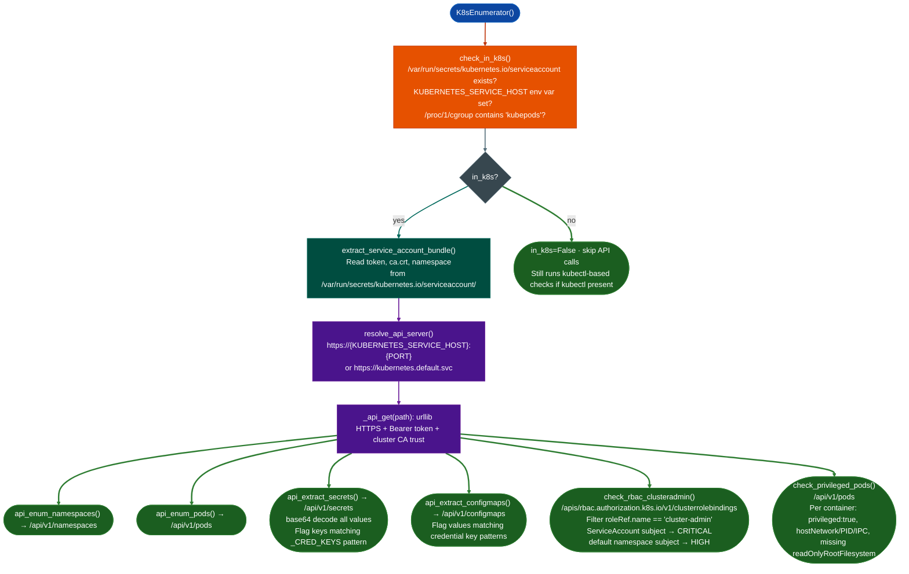

# Kubernetes Identity and RBAC

Determine whether a process runs inside a Kubernetes pod, extract the service account JWT and cluster CA certificate from the default mount, enumerate RBAC cluster-admin bindings, identify privileged pods and host-escape primitives, and detect secret and ConfigMap credential exposure: all via direct Kubernetes API calls using the pod's own service account token, with no kubectl dependency.

---

## Why this exists

1. **Most containerized RE targets run inside Kubernetes, and most don't restrict their service account.** The default Kubernetes service account in the `default` namespace has no roles attached, but in practice many deployments bind `cluster-admin` or broad `ClusterRole` permissions to service accounts to simplify deployment. When a pod runs with excessive RBAC permissions, any code execution inside that pod gains API access equivalent to a cluster administrator. `check_rbac_clusteradmin()` enumerates every binding to `cluster-admin` in under a second via a single API call.

2. **Service account tokens provide direct API access without any external tools.** Every Kubernetes pod receives a JWT bearer token mounted at `/var/run/secrets/kubernetes.io/serviceaccount/token`, the cluster CA certificate at `ca.crt`, and the current namespace at `namespace`. This triple grants authenticated access to the Kubernetes API server at `https://kubernetes.default.svc`: the in-cluster service endpoint: without installing kubectl, helm, or any other tool. `K8sEnumerator` reads these files directly and builds its own HTTPS requests.

3. **Privileged pods and host-mounted paths expose the underlying node.** A container with `privileged: true` in its `securityContext` has full access to every host device, including the node's disk (`/dev/sda`), kernel modules, and host network namespace. `hostPath` volume mounts expose node filesystem paths directly inside the container. Detecting these configurations from inside a pod identifies the escalation path from container compromise to full node compromise.

---

## How it works



---

## Usage

```python
from modules.k8s_enum import K8sEnumerator

k = K8sEnumerator()
k.enumerate_all()

# Check if running in a cluster
if not k.in_k8s:
    print("Not inside a Kubernetes pod")
else:
    print(f"SA: {k.service_account}  namespace: {k.namespace}")
    print(f"API: {k.api_server}")

# RBAC: any cluster-admin bindings?
ca_findings = k.check_rbac_clusteradmin()
for f in ca_findings:
    print(f"[{f['severity']:8}] {f['name']}: {f['subject_kind']} {f['subject_namespace']}/{f['subject_name']}")

# List escape vectors
for v in k.escape_vectors:
    print(f"[{v['severity']:8}] {v['type']}: {v['description']}")
    print(f"           EXPLOIT: {v['exploit']}")

# Check for privileged pods
priv_pods = k.check_privileged_pods()
for p in priv_pods:
    print(f"[{p['severity']:8}] {p['namespace']}/{p['pod']}:{p['container']} — {p['issue']}")

# Extract secrets with decoded values
k.api_extract_secrets()
for s in k.secret_data:
    print(f"Secret: {s['namespace']}/{s['name']}")
    for key, val in s.get('decoded', {}).items():
        if _looks_like_cred_key(key):
            print(f"  CREDENTIAL: {key} = {val[:40]}...")

# ConfigMap credential hunting
k.api_extract_configmaps()
for hit in k.configmap_creds:
    print(f"ConfigMap credential: {hit['namespace']}/{hit['name']}/{hit['key']} = {hit['value'][:60]}")
```

---

## Example output

```
SA: app-service  namespace: production
API: https://10.96.0.1:443

RBAC cluster-admin bindings:
[CRITICAL] billing-svc-admin: ServiceAccount production/billing-worker
           EXPLOIT: Extract SA token, use against API server:
                    kubectl --token=<tok> get secrets -A
[HIGH    ] legacy-binding: User default/jenkins-runner
           Verify binding is intentional.

Escape vectors:
[CRITICAL] CLUSTERADMIN_BINDING: ClusterRoleBinding 'billing-svc-admin' binds
           ServiceAccount production/billing-worker to cluster-admin

Privileged pods:
[CRITICAL] production/gpu-operator-5f9bc:driver-installer — privileged:true (host device access)
[HIGH    ] monitoring/node-exporter-xk2tf:exporter — hostPath /proc (host filesystem read)
[HIGH    ] logging/fluentd-98xvq:fluentd — hostPath /var/lib/docker (container layer access)
[MEDIUM  ] production/api-server-abc:api — readOnlyRootFilesystem not set

ConfigMap credentials found:
  production/app-config/DB_PASSWORD = 'S3cr3tProd!'
  production/app-config/REDIS_URL = 'redis://:r3dispass@redis.prod:6379/0'
```

---

## False positives

**`cluster-admin` bindings for legitimate operators.** Some namespaces genuinely require cluster-admin binding: cert-manager, Kubernetes operators, monitoring agents. `check_rbac_clusteradmin()` reports all bindings regardless of intent. Verify each finding against the deployment documentation before treating it as a privilege escalation path. The `severity=CRITICAL` classification for `ServiceAccount` subjects is accurate from a security surface perspective but not every ServiceAccount binding is exploitable from within the current pod.

**`hostPath` mounts for logging and monitoring infrastructure.** Node exporters and log forwarders legitimately mount `/proc`, `/sys`, and `/var/log`. These appear as `HIGH` severity findings in `check_privileged_pods()`. Assess each mount against the pod's purpose: a node exporter that mounts `/proc` is expected; an application pod that mounts `/var/lib/docker` is not.

**API errors when service account lacks permissions.** `_api_get()` returns `None` on any HTTP error. `check_rbac_clusteradmin()` returns an empty list when the SA lacks permission to list `clusterrolebindings`, this produces no output, not an error. An empty findings list means either no cluster-admin bindings exist OR the SA cannot read them. Confirm by attempting `_api_get('/apis/rbac.authorization.k8s.io/v1/clusterrolebindings')` directly and checking the response status code.

---

## Pipeline position

**Before this module:** Run `check_in_k8s()` before any other enumeration. If `in_k8s=False`, the module skips all API calls automatically. Use from within a compromised container or from a node with access to the cluster API.

**After this module:** For `CRITICAL` CLUSTERADMIN_BINDING findings: extract the service account token (`k.token`) and call any restricted API endpoint to confirm access. For `privileged:true` pods: check whether the host disk is mounted (look for `/dev/sda` in `/dev`) and whether the host's root filesystem is accessible. Document findings in the target RE module.

---

## Reading findings

| Field | Content |
|:---|:---|
| `severity` | `CRITICAL` SA cluster-admin, privileged:true / `HIGH` default-ns user, hostPath / `MEDIUM` (missing readOnlyRootFilesystem) |
| RBAC `name` | ClusterRoleBinding resource name |
| RBAC `subject_kind` | `ServiceAccount` / `User` / `Group` |
| RBAC `subject_namespace` | Namespace of the subject (blank for `User` and `Group`) |
| `escape_vectors` | List of `{type, severity, description, exploit}` entries for escalation paths |
| Pod `issue` | Short description: `privileged:true`, `hostNetwork:true`, `hostPath: /proc`, etc. |

---

## See also

- [Docker Enum](docker-enum.md): container escape detection and Docker socket exposure
- [Cloud Metadata](agent-protocol-exposure.md): cloud IMDS credential extraction from within a pod
- [Architectural Risk Detection](architectural-risk-detection.md): source RE complement for K8s API surface mapping
