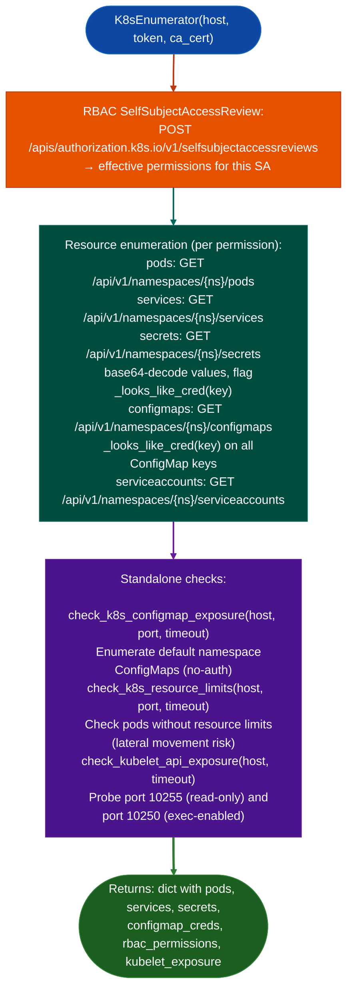

# Kubernetes Inventory

Enumerate Kubernetes pods, services, secrets, RBAC bindings, service accounts, and ConfigMap credential candidates: using the in-cluster service account token directly (no `kubectl` dependency): via `modules/k8s_enum.py`.

---

## Why this exists

1. **`kubectl` is not available inside most compromised containers.** `K8sEnumerator` calls the Kubernetes API server directly using the service account token at `/var/run/secrets/kubernetes.io/serviceaccount/token` and the CA certificate at `/var/run/secrets/kubernetes.io/serviceaccount/ca.crt`. This provides full API access from within any pod that has a mounted service account, without installing any tools.

2. **RBAC `SelfSubjectAccessReview`**: `K8sEnumerator` calls `POST /apis/authorization.k8s.io/v1/selfsubjectaccessreviews` to enumerate which API resources the current service account can access. This establishes the effective permission boundary before attempting resource listing, avoiding 403 errors that would otherwise require blind enumeration of all API paths.

3. **`check_k8s_configmap_exposure()` and `check_kubelet_api_exposure()`** enumerate two distinct exposure classes: ConfigMaps that contain credential-pattern keys `password`, `secret`, `token`, `api_key`, and the kubelet read-only API (`port 10255`) and read-write API (`port 10250`) that are often exposed within the cluster network without authentication. Both functions operate over raw HTTPS without `kubectl`.

---

## How it works



---

## Usage

```python
from modules.k8s_enum import K8sEnumerator, check_kubelet_api_exposure
from pathlib import Path

# Read service account token (from inside a compromised pod)
token = Path('/var/run/secrets/kubernetes.io/serviceaccount/token').read_text()
ca = Path('/var/run/secrets/kubernetes.io/serviceaccount/ca.crt').read_text()

enumerator = K8sEnumerator('https://kubernetes.default.svc', token=token, ca_cert=ca)
results = enumerator.enumerate_all()

print(f"Pods:     {len(results['pods'])}")
print(f"Secrets:  {len(results['secrets'])}")
print(f"Cred ConfigMaps: {len(results.get('configmap_creds', []))}")

# Check kubelet API exposure from within cluster
kubelet_results = check_kubelet_api_exposure('10.0.1.5')
if kubelet_results.get('exec_enabled'):
    print("CRITICAL: kubelet exec API accessible without auth")
```

---

## Example output

The following illustrates Kubernetes enumeration output format.

```
K8sEnumerator: https://kubernetes.default.svc

RBAC SelfSubjectAccessReview:
  GET pods: allowed  |  GET secrets: allowed  |  LIST configmaps: allowed

Pods: <N>  |  Services: <M>  |  Secrets: <K>

ConfigMap credential candidates:
  default/app-config  →  db_password, redis_secret_key

Kubelet API (10.0.1.5):
  Port 10255 (read-only): OPEN
  Port 10250 (exec): OPEN  ← exec-enabled without auth
```

---

## False positives

**`_looks_like_cred(key)` is a keyword-match heuristic**: keys like `secret_sauce` or `token_bucket_size` will match. Review the associated ConfigMap or Secret values to confirm credential presence.

**RBAC `SelfSubjectAccessReview` returns permissions for the current service account only**: other service accounts in the cluster may have broader or narrower permissions. Use `check_k8s_resource_limits()` to identify pods running with high-privilege service accounts.

---

## Pipeline position

Run `K8sEnumerator` from within a compromised container after establishing shell access. Results feed lateral movement decisions: high-privilege service accounts → escalate to cluster-admin; credential ConfigMaps → extract and use; kubelet exec → run as root on node.

---

## Reading findings

`K8sEnumerator.enumerate_all()` returns a dict with the following keys among others:

| Key | Content |
|:---|:---|
| `rbac` | RBAC self-subject access review result dict |
| `configmap_creds` | `List`: ConfigMaps with credential-looking keys |
| `kubelet_findings` | `List[{severity, title, detail, host, port}]`: unauthenticated kubelet endpoints |
| `secrets` | `List`: accessible Secret objects |
| `pods` | `List`: enumerated pods |
| `escape_vectors` | `List`: container escape vectors found |
| `etcd_findings` | `List`: etcd exposure findings |

---

## See also

- [Kubernetes Policy Posture](kubernetes-policy-posture.md): RBAC, network policy, and admission controller gap analysis
- [Docker Inventory and Posture](docker-inventory-and-posture.md): `DockerEnumerator` for container-level enumeration before cluster enumeration
