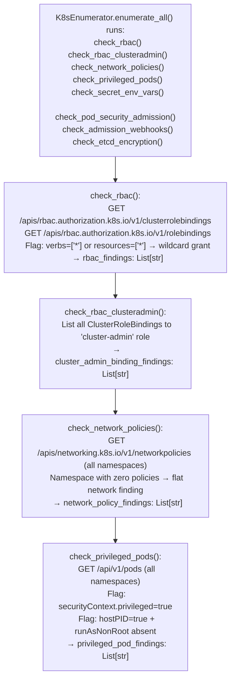

# Kubernetes Policy Posture

Enumerate Kubernetes RBAC wildcard bindings, cluster-admin grants, privileged pod specifications, missing network policies, Pod Security Admission configuration gaps, admission webhook bypass conditions, and etcd encryption status: via `modules/k8s_enum.py` `K8sEnumerator.check_rbac()` and related policy checks.

---

## Why this exists

1. **RBAC misconfiguration is the primary lateral movement vector in Kubernetes clusters.** `check_rbac_clusteradmin()` lists all `ClusterRoleBinding` and `RoleBinding` entries that grant `cluster-admin` or use wildcard verbs/resources (`"*"`). Wildcard grants are frequently introduced by Helm charts or operators that use convenience RBAC for deployment and are never tightened after installation.

2. **`check_network_policies()` identifies namespaces with no `NetworkPolicy` objects**: the default Kubernetes behavior with no network policy is to allow all pod-to-pod traffic across all namespaces. This means a compromised pod in a namespace without network policies can reach any other pod in the cluster. A namespace with zero `NetworkPolicy` objects is a flat network.

3. **`check_pod_security_admission()` and `check_privileged_pods()`** identify the two privilege escalation paths that survive RBAC hardening: pods that run as root (`runAsNonRoot: false` or absent), pods with `privileged: true` in their `securityContext`, and namespaces configured with `pod-security.kubernetes.io/enforce: privileged`. A privileged pod with `hostPID: true` provides root on the underlying node.

---

## How it works



---

## Usage

```python
from modules.k8s_enum import K8sEnumerator

enumerator = K8sEnumerator(
    host='https://kubernetes.default.svc',
    token=sa_token,
    ca_cert=ca_cert,
)
results = enumerator.enumerate_all()

for finding in results.get('rbac_findings', []):
    print(f"  [RBAC] {finding}")

for finding in results.get('network_policy_findings', []):
    print(f"  [NET]  {finding}")

for finding in results.get('privileged_pod_findings', []):
    print(f"  [PRIV] {finding}")
```

---

## Example output

The following illustrates Kubernetes policy posture output format.

```
K8sEnumerator policy checks:

RBAC findings:
  ClusterRoleBinding 'prometheus-operator' → verbs=['*'] resources=['*'] (wildcard)
  ClusterRoleBinding 'helm-service-account' → cluster-admin

Network policy findings:
  Namespace 'default': NO NetworkPolicy (flat network)
  Namespace 'staging': NO NetworkPolicy (flat network)

Privileged pod findings:
  pod/prometheus-0 (monitoring): securityContext.privileged=true + hostPID=true
```

---

## False positives

**`check_etcd_encryption()` requires access to the API server's encryption config**: the etcd encryption configuration is stored as a file on the control plane node, not exposed via the Kubernetes API. The check infers encryption status from the `EncryptionConfiguration` admission controller presence in the API server flags, which requires access to `/proc/$pgrep kube-apiserver/cmdline` or equivalent.

**Wildcard RBAC grants are not always exploitable**: a wildcard grant scoped to a single namespace with no sensitive resources may not provide lateral movement. Combine RBAC findings with `check_k8s_configmap_exposure()` and `check_kubelet_api_exposure()` to prioritize which grants are actionable.

---

## Pipeline position

Run Kubernetes policy posture checks after initial `K8sEnumerator.enumerate_all()` confirms cluster access. Policy findings direct privilege escalation: cluster-admin binding → escalate; privileged pods → node escape; flat namespace → lateral move to other pods.

---

## Reading findings

Kubernetes policy probe functions return `List[{severity, title, detail, host, port}]`:

| Field | Content |
|:---|:---|
| `severity` | `CRITICAL` / `HIGH` / `MEDIUM` |
| `title` | Finding code (e.g., `K8S_CLUSTERROLEBINDING_WILDCARD`, `K8S_NO_NETWORKPOLICY`, `K8S_PRIVILEGED_POD`) |
| `detail` | Namespace, resource name, or permission details |
| `host` | Kubernetes API server host |
| `port` | API server port (typically `6443`) |

---

## See also

- [Kubernetes Inventory](kubernetes-inventory.md): `K8sEnumerator` resource enumeration that runs before policy checks
- [Docker Inventory and Posture](docker-inventory-and-posture.md): `DockerEnumerator` for container-level security posture
