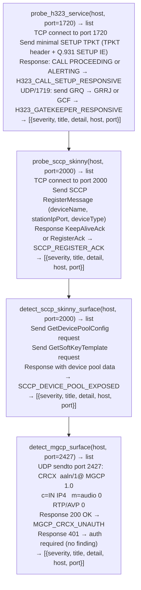

# Legacy Voice Protocols

Probe H.323, SCCP/Skinny, and MGCP telephony infrastructure for unauthenticated call signaling access, registration without certificate-based authentication, and media-gateway misconfigurations that expose internal PBX topology — via `modules/sip_enum.py`.

---

## Why this exists

1. **H.323 deployments frequently lack TLS on the Q.931 signaling channel** — H.323 Q.931 (TCP/1720) carries call setup, teardown, and capability negotiation in cleartext by default. `probe_h323_service()` sends a minimal SETUP TPKT to confirm that the gatekeeper accepts call setup without TLS or authentication, exposing the internal dial plan to any network-adjacent attacker. The H.323 RAS (UDP/1719) Gatekeeper Request (GRQ) path is equally unprotected in default deployments.

2. **SCCP/Skinny phone registration has an optional certificate-based authentication layer (CAPF) that is widely skipped** — Cisco Unified Communications Manager (CUCM) supports CAPF (Certificate Authority Proxy Function) for encrypted SCCP phone registration. When CAPF is not enforced, `probe_sccp_skinny()` receives a `RegisterAck` in response to a spoofed REGISTER message, confirming that an attacker on the same VLAN can impersonate a phone and receive calls. `detect_sccp_skinny_surface()` probes deeper: it requests the device pool and soft-key template lists, which expose PBX topology without authentication.

3. **MGCP media gateways accept call control without IPsec in most enterprise deployments** — RFC 3435 §5 specifies IPsec for MGCP call agent to media gateway authentication, but IPsec is absent in the majority of enterprise deployments. `detect_mgcp_surface()` sends a CRCX (Create Connection) command via UDP/2427; an `200 OK` response from the media gateway confirms unauthenticated call creation, allowing an attacker to redirect media streams or create unauthorized calls.

---

## How it works



---

## Usage

```python
from modules.sip_enum import (
    probe_h323_service,
    probe_sccp_skinny,
    detect_sccp_skinny_surface,
    detect_mgcp_surface,
    probe_asa_sip_fixup_legacy,
)

host = '<target-host>'

# All probes return [{severity, title, detail, host, port}]
for finding in (probe_h323_service(host)
                + probe_sccp_skinny(host)
                + detect_sccp_skinny_surface(host)
                + detect_mgcp_surface(host)):
    print(f"  [{finding['severity']}] {finding['title']}: {finding['detail'][:80]}")
```

---

## Example output

The following is a schematic example showing output structure and field names. Values are illustrative.

```
probe_h323_service: <target-host>:1720

  [HIGH] H323_CALL_SETUP_RESPONSIVE
         SETUP TPKT accepted — H.323 Q.931 call signaling accessible without TLS

probe_sccp_skinny: <target-host>:2000

  [HIGH] SCCP_REGISTER_ACK
         RegisterAck received for spoofed device registration — CAPF not enforced

detect_mgcp_surface: <target-host>:2427

  [CRITICAL] MGCP_CRCX_UNAUTH
             CRCX accepted without IPsec authentication — media gateway allows
             unauthenticated call creation
```

---

## False positives

**`H323_CALL_SETUP_RESPONSIVE` on H.323 proxies with TLS termination upstream** — some enterprise deployments use a TLS-terminating session border controller (SBC) in front of H.323 gateways. The probe reaches the internal gateway through the SBC without TLS, but the external signaling path is protected. Confirm whether port 1720 is reachable from external networks before treating this as an external-facing finding.

**`SCCP_REGISTER_ACK` on test or development CUCM instances** — development CUCM deployments commonly disable CAPF for operational simplicity. Confirm whether the target is a production CUCM cluster (serving real phones) before escalating to CRITICAL.

---

## Pipeline position

Run legacy voice protocol probes after host/service discovery identifies TCP/1720 (H.323), TCP/2000 (SCCP), or UDP/2427 (MGCP) open. Combine with `probe_sip_authentication_weaknesses()` and `detect_sip_eavesdropping_surface()` for full VoIP posture coverage.

---

## See also

- [SIP Service and Extension Discovery](sip-service-and-extension-discovery.md) — SIP OPTIONS/REGISTER/INVITE probes, extension enumeration
- [SIP Attack Surface Detection](sip-attack-surface-detection.md) — TDoS/flood susceptibility, eavesdropping surfaces, header injection
- [VoIP Protocol Inspection and Covert Channels](voip-protocol-and-covert-channels.md) — DTMF extraction, RTP covert channels, WebRTC signaling
