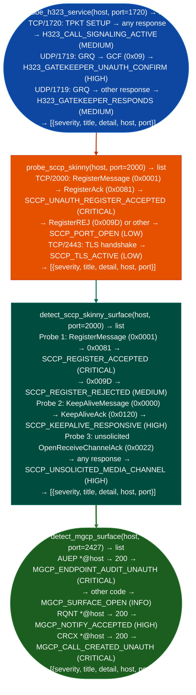

# Legacy Voice Protocols

Probe H.323 Q.931/RAS, SCCP/Skinny, and MGCP telephony infrastructure for unauthenticated call-signaling response, gatekeeper registration without authentication, phone registration without CAPF, and unauthenticated call creation or endpoint audit on media gateways: via `modules/sip_enum.py`.

---

## Why this exists

1. **H.323 Q.931 TCP/1720 and RAS UDP/1719 are cleartext by default**: `probe_h323_service()` sends a minimal SETUP TPKT to TCP/1720 to confirm the port accepts H.323 call setup without TLS, and sends a GatekeeperRequest (GRQ) to UDP/1719 to test whether the gatekeeper issues a GatekeeperConfirm (GCF) without H.235 authentication. A GCF without authentication (`H323_GATEKEEPER_UNAUTH_CONFIRM`) means an attacker can register, enumerate the dial plan, and bypass admission control.

2. **SCCP/Skinny registration has an optional CAPF certificate layer that is widely not enforced**: `probe_sccp_skinny()` sends a RegisterMessage (0x0001) to TCP/2000; a RegisterAck (0x0081) in response means CUCM/CME accepted registration from an unknown device without credentials (`SCCP_UNAUTH_REGISTER_ACCEPTED`). `detect_sccp_skinny_surface()` extends this: it probes the KeepAlive path (0x0000 → 0x0120 KeepAliveAck) and sends an unsolicited OpenReceiveChannelAck (0x0022) to test whether the call agent accepts an attacker-controlled RTP endpoint description without a preceding OpenReceiveChannel.

3. **MGCP media gateways accept call control commands without IPsec in most enterprise deployments**: RFC 3435 §5 specifies IPsec for call agent authentication, but it is absent in most deployments. `detect_mgcp_surface()` sends three MGCP commands AUEP, RQNT, CRCX to UDP/2427; a 200-class response to any of them without authentication represents a direct path to endpoint enumeration, event subscription hijack, or unauthenticated call creation.

---

## How it works



---

## Usage

```python
from modules.sip_enum import (
    probe_h323_service,
    probe_sccp_skinny,
    detect_sccp_skinny_surface,
    detect_mgcp_surface,
)

host = '<target-host>'

# All probes return [{severity, title, detail, host, port}]
all_findings = (
    probe_h323_service(host)
    + probe_sccp_skinny(host)
    + detect_sccp_skinny_surface(host)
    + detect_mgcp_surface(host)
)

for finding in sorted(all_findings, key=lambda f: {'CRITICAL': 0, 'HIGH': 1, 'MEDIUM': 2, 'LOW': 3, 'INFO': 4}.get(f['severity'], 5)):
    print(f"  [{finding['severity']}] {finding['title']}: {finding['detail'][:80]}")
```

---

## Example output

The following is a schematic example showing output structure and field names. Values are illustrative.

```
probe_h323_service: <target-host>:1720

  [MEDIUM] H323_CALL_SIGNALING_ACTIVE
           TCP <target-host>:1720 responded to H.323 Setup TPKT frame
           (<N> bytes). Active H.323 call-signaling port confirmed.

  [HIGH]   H323_GATEKEEPER_UNAUTH_CONFIRM
           UDP <target-host>:1719 returned GatekeeperConfirm (GCF) to
           unauthenticated GRQ. Gatekeeper accepted endpoint without H.235.

probe_sccp_skinny: <target-host>:2000

  [CRITICAL] SCCP_UNAUTH_REGISTER_ACCEPTED
             TCP <target-host>:2000 returned RegisterACK (0x0081) to
             unauthenticated SCCP RegisterMessage.

detect_mgcp_surface: <target-host>:2427

  [CRITICAL] MGCP_ENDPOINT_AUDIT_UNAUTH
             UDP <target-host>:2427 returned MGCP 200 to AUEP *@<host>
             without CallAgent authentication.

  [CRITICAL] MGCP_CALL_CREATED_UNAUTH
             UDP <target-host>:2427 returned MGCP 200 to CRCX without
             CallAgent authentication — call leg allocated.
```

---

## False positives

**`H323_CALL_SIGNALING_ACTIVE` (MEDIUM) on H.323 proxies with upstream TLS termination**: some enterprise deployments terminate TLS at a session border controller (SBC) that forwards cleartext to internal H.323 gateways. Confirm whether TCP/1720 is reachable from the external network boundary before treating this as an externally exploitable finding. The `H323_GATEKEEPER_UNAUTH_CONFIRM` (HIGH) finding from UDP/1719 is more directly actionable since it confirms admission control bypass regardless of network position.

**`SCCP_KEEPALIVE_RESPONSIVE` on lab or development CUCM clusters**: development CUCM deployments commonly disable CAPF and accept any keepalive traffic for operational simplicity. Confirm whether the probed CUCM cluster serves production phones before escalating `SCCP_KEEPALIVE_RESPONSIVE` or `SCCP_REGISTER_ACCEPTED`.

---

## Pipeline position

Run legacy voice protocol probes after host/service discovery confirms open ports: TCP/1720 H.323 Q.931, UDP/1719 H.323 RAS, TCP/2000 (SCCP), TCP/2443 SCCP-TLS, UDP/2427 (MGCP). Combine with `probe_sip_authentication_weaknesses()` and `detect_voip_eavesdrop_surface()` for complete VoIP posture coverage across SIP, SCCP, and H.323.

---

## Reading findings

H.323/SCCP probe functions return `List[{severity, title, detail, host, port}]`:

| Field | Content |
|:---|:---|
| `severity` | `HIGH` unauthenticated gatekeeper confirm / `MEDIUM` active signaling port |
| `title` | Finding code for example `H323_CALL_SIGNALING_ACTIVE`, `H323_GATEKEEPER_UNAUTH_CONFIRM`, `SCCP_UNAUTH` |
| `detail` | Protocol, response type, and response size |
| `host` | Target host IP |
| `port` | Protocol port for example `1720` for H.323 call signaling, `1719` for gatekeeper, `2000` for SCCP |

---

## See also

- [SIP Service and Extension Discovery](sip-service-and-extension-discovery.md): SIP OPTIONS/REGISTER/INVITE probes, extension enumeration
- [SIP Attack Surface Detection](sip-attack-surface-detection.md): TDoS/flood susceptibility, eavesdropping surfaces, header injection
- [VoIP Protocol Inspection and Covert Channels](voip-protocol-and-covert-channels.md): DTMF extraction, RTP covert channels, WebRTC signaling
