# LengthUnderflowScanner

  - [What is header-subtraction integer underflow?](#what-is-header-subtraction-integer-underflow)
  - [Why this exists](#why-this-exists)
  - [How it works](#how-it-works)
  - [LengthUnderflowScanner](#lengthunderflowscanner-1)
  - [Usage](#usage)
  - [Example output](#example-output)
  - [False positives](#false-positives)
  - [Pipeline position](#pipeline-position)
  - [Reading findings](#reading-findings)
  - [See also](#see-also)

**File:** `ablation/analyzers/length_underflow.py`

---

## What is header-subtraction integer underflow? <sup>[↑](#lengthunderflowscanner)</sup>

Protocol parsers compute the payload length by subtracting a fixed header size from a total length field received from the network: `payload_len = total_len - sizeof(header)`. When `total_len` is user-controlled and smaller than `sizeof(header)`, the subtraction produces a large positive number after unsigned integer truncation. For example, `(uint16_t)(5 - 20)` produces `0xFFF1` (65521), not a negative value. If that wrapped length is then passed to `malloc`, the allocator returns a 65 KB buffer instead of the intended small one; if it is passed to `memcpy` as a count, the copy reads 65 KB from a network buffer into a small stack or heap allocation.

This class of vulnerability (CWE-191: Integer Underflow, CWE-131: Incorrect Calculation of Buffer Size) is endemic in network protocol parsers written in C. The pattern appears in TLV (Type-Length-Value) parsers, fixed-header binary protocols, and any code path that receives a framed message and must extract the payload after stripping the header. The C standard defines unsigned subtraction as wrapping modulo 2^N, so the resulting value is always a valid (but unexpected) large positive integer from the runtime's perspective, meaning no fault is raised and the large allocation or copy proceeds silently.

`LengthUnderflowScanner` looks for exactly this pattern statically: a `SUB` instruction or equivalent that has one operand from an immediate (the header size constant) and one from a register loaded from network input, followed by a truncating `MOVZX` to a 16-bit or 8-bit destination, followed by a `CALL` to an allocation or copy function. The scanner uses backward dataflow to trace where the `SUB` result goes; it applies a "bounds-check filter" that suppresses findings where a `CMP` or `TEST` on the result precedes the allocation or copy call, since an adequate bounds check prevents the underflow from reaching the sink.

## Why this exists <sup>[↑](#lengthunderflowscanner)</sup>

1. **Integer underflow in protocol parsers is a systematic vulnerability class across firmware.** The pattern is not specific to one protocol or one vendor: DNS, GRE, PPTP, SCTP, Diameter, and many proprietary protocols all parse variable-length fields by subtracting a fixed header size from a user-supplied total length to compute the payload size. When the user supplies a length smaller than the header size, the subtraction underflows, and the resulting negative value wraps to a large positive integer when truncated to uint16 or uint8. A scanner that looks for this pattern across an entire binary body identifies every instance systematically.

2. **The pattern is invisible to import-list auditing.** The subtraction and truncation are ordinary arithmetic instructions, not calls to flagged library functions. There is no `DANGEROUS_SUBTRACT` import to search for. The vulnerability is entirely in the operand sequence: subtract → truncate → call, without a bounds guard in between. Only a pattern-matching disassembly scan can detect it at scale.

3. **Guarded vs. unguarded instances must be distinguished to avoid overwhelming the analyst.** Many codebases subtract header sizes from lengths but correctly bounds-check the result before the truncation. A scanner that flags everything: guarded and unguarded: produces too much noise. This scanner includes a 25-instruction backwards guard scan: if a `CMP` or `TEST` involving the subtraction result register appears before the truncation, the finding is marked `guarded=True` and filtered from triage by default. Only `guarded=False` findings require immediate analyst attention.

---

## How it works <sup>[↑](#lengthunderflowscanner)</sup>

The scanner operates in three phases per function: **subtraction detection**, **guard lookback**, and **truncation + call lookahead**.

```mermaid
flowchart TD
    A(["LengthUnderflowScanner.from_context(ctx)"]):::input --> B["scan(): load .text, disassemble with Capstone"]:::primary
    B:::primary --> C["iterate instructions"]:::secondary
    C:::secondary --> D{"mnemonic == lea -N or sub $N?"}:::neutral
    D:::neutral -->|N in 4..256 and dest not stack-relative| E["record: sub_va, sub_const, sub_reg"]:::tertiary
    D:::neutral -->|no, or stack-relative| C:::secondary
    E:::tertiary --> F["Guard lookback: scan up to 25 insns before sub_va\nLook for CMP/TEST involving sub_reg family"]:::tertiary
    F:::tertiary --> G{"guard found?"}:::neutral
    G:::neutral -->|yes| H["guarded = True"]:::tertiary
    G:::neutral -->|no| I(["guarded = False"]):::output
    H:::tertiary --> J["Truncation lookahead: scan up to 10 insns after sub_va\nLook for movzwl/movzbl on sub_reg family (register-to-register only)"]:::tertiary
    J:::tertiary --> K{"truncation found?"}:::neutral
    K:::neutral -->|no| C:::secondary
    K:::neutral -->|yes| L["record: truncate_va"]:::tertiary
    L:::tertiary --> M["Call lookahead: scan up to 10 insns after truncate_va\nLook for CALL with direct target"]:::tertiary
    M:::tertiary --> N{"call found?"}:::neutral
    N:::neutral -->|no| C:::secondary
    N:::neutral -->|yes| O["record: call_va, call_target\nresolve PLT name if available\nEmit UnderflowFinding"]:::tertiary
    O:::tertiary --> C:::secondary
    classDef input     fill:#0d47a1,stroke:#1565c0,color:#fff
    classDef primary   fill:#e65100,stroke:#bf360c,color:#fff
    classDef secondary fill:#004d40,stroke:#00695c,color:#fff
    classDef tertiary  fill:#4a148c,stroke:#6a1b9a,color:#fff
    classDef neutral   fill:#37474f,stroke:#546e7a,color:#fff
    classDef output    fill:#1b5e20,stroke:#2e7d32,color:#fff
    linkStyle 0 stroke:#bf360c,stroke-width:2px
    linkStyle 1 stroke:#00695c,stroke-width:2px
    linkStyle 2 stroke:#546e7a,stroke-width:2px
    linkStyle 3 stroke:#6a1b9a,stroke-width:2px
    linkStyle 4 stroke:#00695c,stroke-width:2px
    linkStyle 5 stroke:#6a1b9a,stroke-width:2px
    linkStyle 6 stroke:#546e7a,stroke-width:2px
    linkStyle 7 stroke:#6a1b9a,stroke-width:2px
    linkStyle 8 stroke:#2e7d32,stroke-width:3px
    linkStyle 9 stroke:#6a1b9a,stroke-width:2px
    linkStyle 10 stroke:#546e7a,stroke-width:2px
    linkStyle 11 stroke:#00695c,stroke-width:2px
    linkStyle 12 stroke:#6a1b9a,stroke-width:2px
    linkStyle 13 stroke:#6a1b9a,stroke-width:2px
    linkStyle 14 stroke:#546e7a,stroke-width:2px
    linkStyle 15 stroke:#00695c,stroke-width:2px
    linkStyle 16 stroke:#6a1b9a,stroke-width:2px
    linkStyle 17 stroke:#00695c,stroke-width:2px
```



### Subtraction detection <sup>[↑](#lengthunderflowscanner)</sup>

Accepts two instruction forms:
- `LEA dest, [base - N]` where `N` is in `[4, 256]` and `base` is not `rbp`/`rsp` excluding stack frame accesses
- `SUB dest, N` where `N` is in `[4, 256]`

The constant range `[4, 256]` covers typical protocol header sizes: IPv4 (20), TCP (20), UDP (8), GRE (4), SCTP (12), PPTP (8), and custom protocol headers up to 256 bytes.

### Guard lookback <sup>[↑](#lengthunderflowscanner)</sup>

Scans the 25 instructions preceding the subtraction for any `CMP` or `TEST` instruction that uses the same register family as the subtraction destination. Register aliases are canonicalized for example `edx` and `rdx` are the same family, so a `CMP r9d, 0x10` is recognized as a guard for a `LEA edx, [r9 - 0x10]`.

### Truncation detection <sup>[↑](#lengthunderflowscanner)</sup>

Looks for register-to-register `MOVZX`/`MOVZWL`/`MOVZBL` within 10 instructions after the subtraction, where the source register is in the same family as the subtraction destination. Memory-to-register `MOVZX` forms for example `movzx edx, byte ptr [rdx+6]` are excluded: those load a new value from memory, not the arithmetic result.

---

## LengthUnderflowScanner <sup>[↑](#lengthunderflowscanner)</sup>

```python
from ablation.analyzers.length_underflow import LengthUnderflowScanner
from ablation.analyzers.binary_context import BinaryContext

ctx = BinaryContext.load_or_build('/fw/fortigate/httpsd')
scanner = LengthUnderflowScanner.from_context(ctx)
findings = scanner.scan()

# Filter to unguarded (immediately actionable)
for f in findings:
    if not f.guarded:
        print(f.fmt())

# All findings including guarded
print(f"Total: {len(findings)}  Unguarded: {sum(1 for f in findings if not f.guarded)}")
```

---

## Usage <sup>[↑](#lengthunderflowscanner)</sup>

```python
from ablation.analyzers.length_underflow import LengthUnderflowScanner
from ablation.analyzers.binary_context import BinaryContext

# Full scan
ctx = BinaryContext.load_or_build('/fw/cisco/lina')
scanner = LengthUnderflowScanner.from_context(ctx)
findings = scanner.scan()

# Triage: unguarded first
unguarded = [f for f in findings if not f.guarded]
guarded = [f for f in findings if f.guarded]

print(f"[length_underflow] {len(findings)} findings: {len(unguarded)} UNGUARDED, {len(guarded)} GUARDED")
for f in unguarded:
    print(f.fmt())

# Confirm with taint analysis: trace from network input to the subtraction site
from ablation.analyzers.taint_tracker import TaintTracker
tt = TaintTracker(ctx.path)
for f in unguarded:
    sinks = tt.trace_function(f.func_va, tainted_args=['rdi', 'rsi', 'rdx'])
    alloc_or_copy = [s for s in sinks if s.sink_type in ('alloc_size', 'copy_len')]
    if alloc_or_copy:
        print(f"CONFIRMED: 0x{f.func_va:x} — tainted length reaches sink")
```

---

## Example output <sup>[↑](#lengthunderflowscanner)</sup>

```
UnderflowFinding [UNGUARDED]
  func    : 0x403200
  sub     : 0x403218  rdx -= 0x10 (16)
  truncate: 0x403228  movzwl/movzbl
  call    : 0x403230  -> 0x401040 (proto_parse_field)

UnderflowFinding [UNGUARDED]
  func    : 0x40a100
  sub     : 0x40a140  r9 -= 0x8 (8)
  truncate: 0x40a150  movzwl/movzbl
  call    : 0x40a158  -> 0x401060 (parse_gre_options)

[length_underflow] 12 findings: 3 UNGUARDED, 9 GUARDED
```

---

## False positives <sup>[↑](#lengthunderflowscanner)</sup>

**Fixed-size structure offset arithmetic.** Code that computes an index into a fixed-size struct member for example `lea rdi, [rbx - 8]` to access a struct field 8 bytes before a pointer will match the subtraction check. The register destination then passed through a `MOVZX` for a different purpose could complete the pattern spuriously. Verify by examining the context: does the subtracted register actually hold a user-supplied length field?

**Guarded instances that fail the lookback window.** A bounds check more than 25 instructions before the subtraction for example the check is at the function entry and the arithmetic is deep in a loop will not be seen by the guard lookback. The finding is marked `guarded=False` even though a real guard exists. These produce false positives in the unguarded set.

**Stack frame accesses excluded by design.** `lea reg, [rbp - N]` and `lea reg, [rsp - N]` are deliberately excluded even when N is in the header size range. These are function frame slot accesses, not length subtraction. If firmware uses an unusual convention where the frame base pointer holds a data pointer rather than the stack frame base, this exclusion would produce false negatives, but this is extremely rare.

---

## Pipeline position <sup>[↑](#lengthunderflowscanner)</sup>

**Before this module:** `BinaryContext.load_or_build()` to supply the PLT symbol map for call-target resolution.

**After this module:** Unguarded findings should be confirmed with `TaintTracker.trace_function()` to verify that the length field originates from attacker-controlled input. The canonical confirmation sequence: `func_va` → taint trace with all network-facing entry args → look for `alloc_size` or `copy_len` sinks near `sub_va`.

---

## Reading findings <sup>[↑](#lengthunderflowscanner)</sup>

| Field | Content |
|:---|:---|
| `func_va` | Virtual address of the containing function |
| `sub_va` | VA of the subtraction instruction (`lea -N` or `sub $N`) |
| `sub_const` | The constant N subtracted header size |
| `sub_reg` | Destination register family of the subtraction |
| `truncate_va` | VA of the `movzwl`/`movzbl` truncation instruction |
| `call_va` | VA of the `CALL` instruction that receives the truncated value |
| `call_target` | VA of the called function |
| `call_label` | PLT symbol name of the callee, if resolved |
| `guarded` | `True` if a `CMP`/`TEST` on `sub_reg` was found within 25 instructions before the subtraction |

---

## See also <sup>[↑](#lengthunderflowscanner)</sup>

- [Taint Analysis](taint-analysis.md): confirm that the length field originates from user-controlled input
- [Heap Vulnerability Scanner](heap-vulnerability-scanner.md): detects integer overflows before allocation multiplicative overflow class
- [Binary Context](binary-context.md): provides `func_starts` and PLT; run first
- [Path Solver](path-solver.md): feasibility analysis for confirmed unguarded findings
