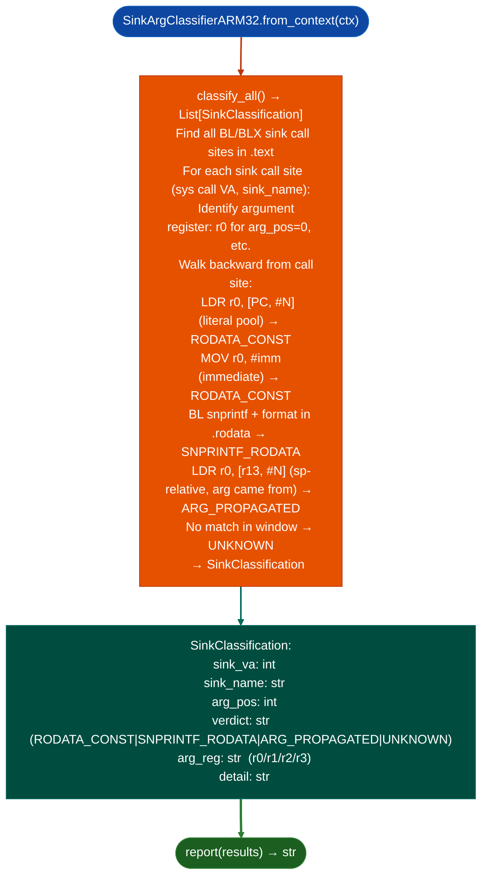

# ARM32 Sink Argument Classification

Classify exec-class sink argument provenance in ARM32 ELF binaries: producing the four-verdict model `RODATA_CONST`, `SNPRINTF_RODATA`, `ARG_PROPAGATED`, `UNKNOWN` for `r0`–`r3` AAPCS argument registers: filling the gap left by `SinkArgClassifier` which hardcodes x86-64 registers.

---

## Why this exists

1. **`SinkArgClassifier` hardcodes x86-64 registers `rdi`, `rsi`, `rdx`.** ARM32 AAPCS passes the first four arguments in `r0`–`r3`. The gap was documented as `ARM-SNMP-GAP-001`: running `SinkArgClassifier` on ARM32 targets produced `UNKNOWN` for all sinks because the classification logic looked for `rdi` assignments and found none. `SinkArgClassifierARM32` resolves this.

2. **AAPCS `r0`–`r3` follow the same four-verdict model**: `RODATA_CONST` argument is a PC-relative literal pool load or immediate, `SNPRINTF_RODATA` (argument is a stack buffer written by `snprintf` with RODATA format string), `ARG_PROPAGATED` (traces back to the function's own `r0`–`r3` entry), `UNKNOWN` provenance not resolved within look-back window. This matches the x86-64 verdict semantics exactly.

3. **`SinkArgClassifierARM32.classify_all()` returns one `SinkClassification` per exec-class sink call site**: enabling `TaintTracker` to skip `RODATA_CONST` findings before running the full taint analysis. This is the mandatory pre-filtering step for ARM32 firmware: running `TaintTracker` without pre-filtering wastes analysis time on confirmed-safe sinks.

---

## How it works



---

## Usage

```python
from ablation.analyzers.sink_arg_classifier_arm32 import SinkArgClassifierARM32
from ablation.analyzers.binary_context import BinaryContext

ctx = BinaryContext.load_or_build('/path/to/arm32_target.so')
classifier = SinkArgClassifierARM32.from_context(ctx)

results = classifier.classify_all()
print(classifier.report(results))

# TaintTracker targets: ARG_PROPAGATED and UNKNOWN only
taint_targets = [r for r in results if r.verdict in ('ARG_PROPAGATED', 'UNKNOWN')]
print(f"TaintTracker targets: {len(taint_targets)}")
```

---

## Example output

The following illustrates ARM32 sink arg classification output format. Actual addresses are binary-specific.

```
SinkArgClassifierARM32: arm32_target.so

[RODATA_CONST]  system at <va>  r0=LDR [PC,#N] → .rodata  (not a finding)
[ARG_PROPAGATED] system at <va>  r0=LDR [sp,#N] → function arg  (→ TaintTracker)
[UNKNOWN]        execv at <va>   r0=provenance unclear in look-back window

Pre-filter: <R> RODATA_CONST eliminated  <T> sent to TaintTracker
```

---

## False positives

**`UNKNOWN` verdict for look-back window exhaustion**: a look-back window that does not reach the register definition site produces `UNKNOWN` even for a `RODATA_CONST` source. Increase the look-back depth for large functions if the `UNKNOWN` rate is high.

**`SNPRINTF_RODATA` requires the `snprintf` call to appear between the stack allocation and the sink call**: if `snprintf` is called in a different basic block for example before a conditional branch, the detection may miss it and produce `UNKNOWN` instead.

---

## Pipeline position

Run `SinkArgClassifierARM32.classify_all()` on every ARM32 ELF binary before running `TaintTracker`. Feed only `ARG_PROPAGATED` and `UNKNOWN` sink VAs to `TaintTracker`. This pre-filtering step typically eliminates 60–80% of potential sinks before taint analysis.

---

## Reading output

`SinkArgClassifierARM32.classify_all()` returns a list of `SinkClassification` objects:

| Attribute | Content |
|:---|:---|
| `sink_name` | Sink function name for example `'system'`, `'execv'` |
| `arg_pos` | 0-indexed argument position being classified |
| `func_va` | VA of the calling function |
| `call_va` | VA of the call instruction |
| `verdict` | `'RODATA_CONST'`, `'ARG_PROPAGATED'`, or `'UNKNOWN'` |
| `detail` | Human-readable trace description of the argument provenance |
| `severity` | `'HIGH'` ARG_PROPAGATED, `'MEDIUM'` (UNKNOWN), or `'LOW'` RODATA_CONST |

---

## See also

- [Exec-Class Sink Argument Classification](exec-class-sink-argument-classification.md): `SinkArgClassifier` x86-64 equivalent
- [Named Taint Sources and Bounds](named-taint-sources-and-bounds.md): `TaintTracker` that consumes ARM32 pre-filtered sinks
- [ARM32 Integer Overflow Detection](unnamed-arm64-library-call-classification.md): `ARM32IntOverflowScanner` complementary scan
