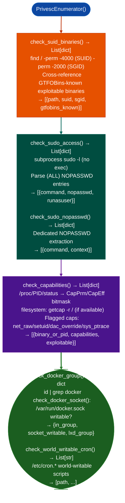

# Linux Privilege Escalation Triage

Enumerate SUID/SGID binaries, `sudo` rules, Linux capabilities `cap_net_raw`, `cap_setuid`, world-writable cron jobs, Docker/LXD group membership, accessible Docker sockets, kernel module exposure, and namespace escape surfaces: providing a ranked set of privilege escalation candidates from a low-privilege shell: via `modules/privesc_enum.py` `PrivescEnumerator`.

---

## Why this exists

1. **`PrivescEnumerator.enumerate_all()` provides a single-call survey of every common Linux privilege escalation vector**: SUID binary enumeration, `sudo -l` access checks, Linux capabilities (`getcap -r /` equivalent), and writable paths in `$PATH`. Running this once establishes which category of escalation is likely to succeed before spending time on individual techniques.

2. **`check_capabilities()` finds granular privilege abuse surfaces**: capabilities like `cap_net_raw` raw socket abuse, `cap_setuid` UID switching, `cap_dac_override` file permission bypass, and `cap_sys_ptrace` ptrace arbitrary process injection are misunderstood mitigations: administrators add them to avoid running processes as root but the capabilities are exploitable just as root access is. `PrivescEnumerator` reads `/proc/<pid>/status` for per-process capabilities and runs `getcap` on filesystem binaries.

3. **`check_wtmp_utmp_anomalies()` and `check_adversary_tool_indicators()`** detect prior compromise indicators: `wtmp`/`utmp` log gaps sessions with no login record, `check_adversary_tool_indicators()` scans for known post-exploitation tool artifacts `linpeas.sh`, `pspy64`, `mimikatz`, exploit binary patterns in `/tmp/` and `/dev/shm/`. This is the forensic counterpart to the live exploitation surface checks.

---

## How it works



---

## Usage

```python
from modules.privesc_enum import PrivescEnumerator

enumerator = PrivescEnumerator()
# enumerate_all() returns self.findings — a flat list of finding dicts
# Each finding: {category: str, severity: str, description: str, exploit: str, items: list, count: int}
findings = enumerator.enumerate_all()

# All findings sorted by severity
for f in sorted(findings, key=lambda x: {'CRITICAL': 0, 'HIGH': 1, 'MEDIUM': 2, 'LOW': 3}.get(x['severity'], 4)):
    print(f"  [{f['severity']}] {f['category']}: {f['description']}")
    if f.get('exploit'):
        print(f"    exploit: {f['exploit']}")

# Filter by category
suid = [f for f in findings if 'SUID' in f.get('category', '')]
docker = [f for f in findings if 'Docker' in f.get('category', '')]
sudo = [f for f in findings if 'sudo' in f.get('category', '').lower()]

# Docker socket check (separate method with own return)
socket_result = enumerator.check_docker_socket()
# returns {'docker_socket_accessible': bool, 'path': str}
if socket_result['docker_socket_accessible']:
    print(f"  Docker socket accessible at {socket_result['path']}")
```

---

## Example output

The following illustrates privilege escalation triage output format.

```
PrivescEnumerator:

SUID binaries: 4 found
  EXPLOITABLE: /usr/bin/python3.10  (GTFOBins: python)
  /usr/bin/passwd  (standard)

Sudo NOPASSWD: ['/usr/bin/vim']

Capabilities:
  /usr/bin/python3.10: cap_net_raw+eip

Docker group: in_group=True  socket_writable=True

World-writable cron: /etc/cron.daily/backup.sh
```

---

## False positives

**GTFOBins cross-reference is a static list**: `check_suid_binaries()` flags binaries whose names appear in the embedded GTFOBins list. Verify that the binary on the target is the standard version and has not been replaced with a non-exploitable wrapper. A path like `/usr/local/bin/python3` may be a restricted version without the `os.system()` entrypoint.

**`check_capabilities()` per-process scanning requires /proc access**: processes not visible to the current user (root-owned processes with restricted `/proc/<pid>/` permissions) will not be enumerated. The filesystem `getcap` check is complementary but only covers file-backed capabilities, not runtime process capabilities.

---

## Pipeline position

Run `PrivescEnumerator` immediately after establishing low-privilege shell access. The ranked output of SUID, sudo, capability, and group-based escalation paths determines which single technique is most likely to succeed: attempt in that order to minimize detection risk.

---

## Reading findings

`PrivescEnumerator.enumerate_all()` runs all enumeration checks and returns a list of finding dicts:

| Field | Content |
|:---|:---|
| `severity` | `CRITICAL` GTFOBins SUID / `HIGH` sudo NOPASSWD / `MEDIUM` capability |
| `title` | Finding code for example `SUID_GTFOBINS`, `SUDO_NOPASSWD`, `CAPABILITY_NET_RAW` |
| `detail` | Binary path, GTFOBins technique, or capability flag |
| `path` | Filesystem path of the affected binary |
| `gtfobins_technique` | GTFOBins technique name (for `SUID_GTFOBINS` findings) |

---

## See also

- [Process and Memory Map Inventory](process-and-memory-map-inventory.md): DLL hijacking and anonymous RWX for injection-based escalation
- [Host Platform Inventory](host-platform-inventory.md): ASLR/NX/seccomp baseline determining which exploit primitives apply
