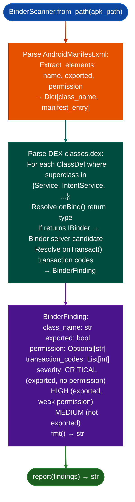

# Android Binder IPC Attack Surface Scanning

Enumerate exported Binder service interfaces from Android APK DEX class definitions and the Android manifest: identifying `Service`/`IntentService` subclasses that export a Binder interface, resolving their AIDL transaction codes, and mapping the full IPC attack surface for privilege escalation and authentication bypass analysis.

---

## Why this exists

1. **Binder is Android's primary IPC mechanism: exported services are the first-hop attack surface for privilege escalation.** An app or system service that exports a `Stub` class via `onBind()` exposes its AIDL interface to any caller with the matching permission or no permission at all, if `android:exported="true"` without `android:permission`. `BinderScanner` maps the complete surface systematically.

2. DEX class hierarchy traversal is required to identify Binder servers: a class becomes a Binder server by extending `Binder` (or `IInterface.Stub`) and overriding `onTransact()`. `BinderScanner.scan()` traverses DEX `ClassDef` superclass chains to find all `Service`/`IntentService` subclasses, then resolves their `IBinder` return type in `onBind()` to identify which ones export a Binder interface.

3. `BinderFinding` includes the service class name, the declared permission (if any), the `android:exported` flag, and the list of AIDL transaction codes: providing the exact permission requirements and the transaction surface in a single structured result. A `BinderFinding` with `permission=None` and `exported=True` is an unauthenticated IPC endpoint reachable by any installed app.

---

## How it works



---

## Usage

```python
from ablation.analyzers.binder_scanner import BinderScanner

scanner = BinderScanner.from_path('/path/to/FortiClient.apk')
findings = scanner.scan()
print(BinderScanner.report(findings))

# Unauthenticated IPC endpoints only
critical = [f for f in findings if f.severity == 'CRITICAL']
for f in critical:
    print(f"Unauthenticated Binder: {f.class_name}")
    print(f"  Transaction codes: {f.transaction_codes}")
```

---

## Example output

The following illustrates Binder IPC scan output format. Actual class names and transaction codes are APK-specific.

```
BinderScanner: FortiClient.apk

Services found: <N>

  [CRITICAL] com.fortinet.forticlient.service.VpnService
    exported=True  permission=None
    transaction_codes: [<T1>, <T2>, <T3>]
    AIDL: no permission required — any installed app can bind

  [HIGH] com.fortinet.forticlient.service.UpdateService
    exported=True  permission=android.permission.INTERNET
    transaction_codes: [<T4>]
```

---

## False positives

**`android:exported` defaults differ by Android API level**: on Android < 12, a `<service>` with no explicit `android:exported` attribute defaults to `exported=true` if the service has an `<intent-filter>`. On Android 12+, the default is `exported=false` if no explicit attribute is set. `BinderScanner` checks the `android:exported` attribute value directly; verify the APK's `minSdkVersion` when interpreting implicit defaults.

**`onBind()` return type resolution via DEX class hierarchy is incomplete for obfuscated code**: class names and method signatures may be renamed by ProGuard/R8. A `BinderFinding` where `class_name` looks like `a.b.c` (a ProGuard artifact) should be treated as low-confidence pending confirmation of the actual service class.

---

## Pipeline position

Run `BinderScanner` on any Android APK system app, security agent, MDM client as the first step of Android attack surface enumeration. `CRITICAL` findings exported, no permission are the highest-priority triage targets. Follow with `BinderFinding.transaction_codes` analysis to enumerate the full AIDL method surface.

---

## Reading findings

`BinderScanner.scan()` returns a list of `BinderFinding` objects:

| Attribute | Content |
|:---|:---|
| `severity` | `'CRITICAL'` exported, no permission / `'HIGH'` exported, weak permission / `'MEDIUM'` / `'LOW'` / `'INFO'` |
| `category` | Finding category for example `'exported_service'`, `'weak_permission'` |
| `title` | Short finding title |
| `detail` | Exploitation description and supporting context |
| `source` | Source location identifier for example service class name or manifest entry |
| `evidence` | Evidence excerpt from the APK permission declaration, AIDL interface, etc. |

---

## See also

- [COM Attack Surface Mapping](com-attack-surface-mapping.md): Windows equivalent for COM interface enumeration
- [Browser Extension Auditing](browser-extension-auditing.md): Chrome extension equivalent for web-facing IPC surfaces
