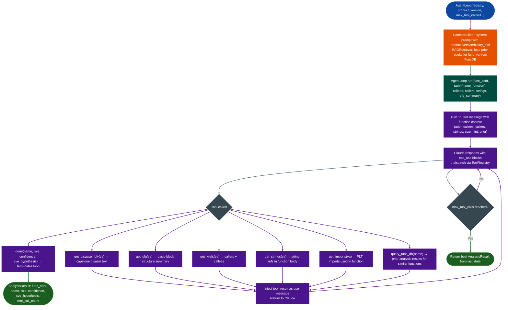

# LLM Analyst Loop

ReAct Reason + Act agent loop that drives Claude through a tool-calling conversation to analyze a stripped binary function: recovering function names, roles, confidence scores, and vulnerability hypotheses without symbols or source code.

---

## Why this exists <sup>[↑](#llm-analyst-loop)</sup>

1. **Semantic search identifies function candidates by embedding similarity, but for functions whose role cannot be inferred from adjacent strings or callees alone, reasoning over the actual disassembly is required.** `AgentLoop.run()` gives Claude a set of RE tools: disassembly, CFG, cross-references, string lookup, import lookup, and function DB query; and a task ("name this function" or "find vulnerabilities") and lets it reason through the analysis in a bounded multi-turn loop. The result is a structured `AnalysisResult` with a proposed name, role, and confidence score.

2. **The `RAGRetriever` injects prior analysis results as context before the first tool call: if the same function VA has been analyzed before on any binary with the same SHA-256, the prior result is loaded.** This means the analyst loop does not re-analyze functions it has already confirmed, and can use prior naming to resolve callees. `persist_result()` saves results to the function database so they are available in future sessions.

3. **A budget governor `max_tool_calls`, default 10 and a loop detector identical tool+args terminates with a warning prevent unbounded token consumption.** Without these guards, an unconstrained agentic loop over a complex function would run until context is exhausted. The budget governor ensures that even if Claude does not call `done()` within budget, `run()` returns the best available `AnalysisResult` from the last tool call.

---

## How it works <sup>[↑](#llm-analyst-loop)</sup>



### AnalysisResult fields <sup>[↑](#llm-analyst-loop)</sup>

| Field | Type | Description |
|:---|:---|:---|
| `func_addr` | `int` | VA of the analyzed function |
| `name` | `str` | Proposed function name snake_case |
| `role` | `str` | Role description for example "network input handler" |
| `confidence` | `float` | 0.0–1.0 confidence in the naming/role |
| `cve_hypothesis` | `str` | Optional vulnerability hypothesis (populated by `run_patch()`) |

---

## Usage <sup>[↑](#llm-analyst-loop)</sup>

```python
from ablation.analyzers.llm_analyst.agent_loop import AgentLoop
from ablation.analyzers.llm_analyst.tool_registry import ToolRegistry
from ablation.analyzers.binary_context import BinaryContext

ctx = BinaryContext.load_or_build('/path/to/target.elf')

# Build registry (provides tools to Claude)
registry = ToolRegistry('/path/to/target.elf', func_db=ctx._func_db)

# Create analyst loop
loop = AgentLoop(
    registry,
    func_db=ctx._func_db,
    product='my-appliance',
    version='1.x',
    binary_hint='FortiOS 7.4 management daemon',
    max_tool_calls=10,
)

# Name a single function
result = loop.run(
    func_addr=0x1fa00,
    task='name_function',
    callees=['recv', 'malloc', 'memcpy'],
    callers=['http_dispatch'],
    cfg_summary='12 blocks, 1 loop, 3 exits',
)
print(f"{result.func_addr:#x}: {result.name}  ({result.role})  conf={result.confidence:.2f}")

# Patch analysis — find what changed between two function versions
result_patch = loop.run_patch(
    old_func_addr=0x1fa00,
    new_func_addr=0x1fc80,
    task='find_vulnerability',
)
print(result_patch.cve_hypothesis)

# Persist to function DB for future sessions
loop.persist_result(result, binary_sha256='<sha256>')
```

---

## Example output <sup>[↑](#llm-analyst-loop)</sup>

The following illustrates the `AnalysisResult` output format. Actual names and addresses are binary-specific.

```
<func-va>: parse_http_request  (HTTP request body parser — reads Content-Length then memcpy)
  role: network input handler
  confidence: 0.87
  tool_calls: 6

run_patch() cve_hypothesis:
  "Missing bounds check on Content-Length before memcpy at <va>: attacker-controlled
   length from recv() copied to fixed-size stack buffer without size validation."
```

---

## False positives <sup>[↑](#llm-analyst-loop)</sup>

**`max_tool_calls=10` is a hard budget: functions that require more tool calls to analyze will have lower-confidence results.** Increase `max_tool_calls` for complex functions large CFGs, indirect dispatch, heavily-inlined code at the cost of more API tokens per function. The default of 10 is appropriate for 90% of handler-class functions.

**`query_func_db(name)` searches for prior results by name similarity: a query for "parse" may return unrelated functions that were named with "parse" in their description.** The RAG retriever uses embedding similarity, not exact match. Prior results are hints, not ground truth: Claude's `confidence` score accounts for prior result relevance.

---

## Pipeline position <sup>[↑](#llm-analyst-loop)</sup>

Run `AgentLoop` as a targeted tool on `SemanticSearcher` top candidates that need human-quality naming and role analysis, not as a bulk pass over all functions token cost is per-function. Use `run()` for naming and `run_patch()` for diff-based vulnerability hypothesis generation after `VersionTracker.find_homolog()` identifies a changed function.

---

## Reading output <sup>[↑](#llm-analyst-loop)</sup>

`AgentLoopctx, task.runfunc_addr` returns an `AnalysisResult`:

| Attribute | Content |
|:---|:---|
| `func_addr` | VA of the analyzed function |
| `name` | Inferred function name |
| `role` | Role tag for example `'network input handler'`, `'parser'` |
| `confidence` | Float 0.0–1.0 |
| `rationale` | Plain-language explanation of the naming/role evidence |
| `vuln_notes` | Vulnerability hypothesis notes, if requested |
| `tool_calls` | Count of tool calls made during the loop |
| `finished` | `True` if `done()` was called; `False` if the tool-call budget was exhausted |
| `model` | Claude model ID used |
| `task` | Task name for example `'name_function'`, `'vulnerability_hypothesis'` |

`AgentLoop.run_patchfunc_addr_v1, func_addr_v2` returns an `AnalysisResult` for patch diff analysis.

---

## See also <sup>[↑](#llm-analyst-loop)</sup>

- [Assisted Function Naming](assisted-function-naming.md): higher-level interface wrapping `AgentLoop` for batch function naming
- [Assisted Vulnerability Hypotheses](assisted-vulnerability-hypotheses.md): `run_patch()` usage for patch-based CVE hypothesis
- [Semantic Search](semantic-search.md): identifies top candidates for `AgentLoop` deeper analysis
- [FuncProfiler](func-profiler.md): generates `callees`, `callers`, `cfg_summary` for the `run()` call
