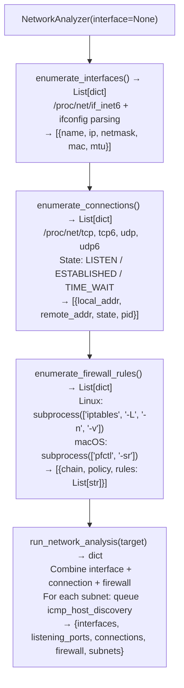

# Local Network Inventory

Enumerate network interfaces, active connections, listening ports, firewall rules, routing tables, and ARP observations on a compromised host — providing the complete local network topology needed to plan lateral movement — via `modules/network_analyze.py` `NetworkAnalyzer`.

---

## Why this exists

1. **`NetworkAnalyzer` enumerates the host network state without any external tools** — it reads `/proc/net/tcp`, `/proc/net/tcp6`, `/proc/net/udp`, `/proc/net/if_inet6`, and `/proc/net/arp` directly, and on macOS uses `ifconfig`/`netstat` subprocess calls. This provides interface addresses, listening ports, established connections, and the ARP table without requiring `netstat`, `ss`, `ip`, or `nmap` to be installed.

2. **`run_network_analysis()` produces a combined analysis result** — interfaces with IPs and subnets, all listening TCP/UDP ports with PIDs (if readable from `/proc/<pid>/`), established outbound connections with remote IPs, and `iptables`/`pfctl` firewall rule summary. The subnet list from interface enumeration seeds `icmp_host_discovery()` in `net_sniffer.py` for automatic adjacent subnet scanning.

3. **Firewall rule enumeration** — `NetworkAnalyzer` reads `iptables -L -n` output (Linux) and `pfctl -sr` (macOS) to extract ACCEPT/REJECT/DROP rules. Overly permissive rules (e.g., `ACCEPT all -- 0.0.0.0/0 → 0.0.0.0/0 in the FORWARD chain) indicate a misconfigured host that routes between network segments — a pivot point for reaching otherwise-isolated subnets.

---

## How it works



---

## Usage

```python
from modules.network_analyze import NetworkAnalyzer, run_network_analysis

# Quick run_network_analysis summary
analysis = run_network_analysis(target='localhost')
print(f"Interfaces: {[i['name'] for i in analysis['interfaces']]}")
print(f"Listening ports: {[c['local_addr'] for c in analysis['listening_ports']]}")
print(f"Subnets: {analysis['subnets']}")

# Detailed per-connection
analyzer = NetworkAnalyzer()
for conn in analyzer.enumerate_connections():
    if conn['state'] == 'ESTABLISHED':
        print(f"  {conn['local_addr']} → {conn['remote_addr']}")
```

---

## Example output

The following illustrates local network inventory output format.

```
NetworkAnalyzer: localhost

Interfaces:
  eth0:  10.0.0.5/24     MAC: 02:42:0a:00:00:05
  eth1:  172.16.0.5/16   MAC: 02:42:ac:10:00:05

Listening ports:
  0.0.0.0:22   (sshd)
  0.0.0.0:80   (nginx)
  127.0.0.1:5432 (postgres)

Established connections: <N>
Subnets: [10.0.0.0/24, 172.16.0.0/16]
```

---

## False positives

**`iptables -L` requires root** — on hosts without root access, firewall rule enumeration falls back to an empty list rather than an error. Interpret an empty firewall rules list as "could not enumerate" rather than "no rules configured."

**`/proc/net/tcp` port display** — ports are stored in hexadecimal in `/proc/net/tcp`. `NetworkAnalyzer` converts them to decimal; verify that the conversion is correct for port numbers above 32767 on big-endian kernels.

---

## Pipeline position

Run `NetworkAnalyzer` immediately after gaining shell access on a compromised host. The subnet list it produces seeds `icmp_host_discovery()` for network pivot planning; listening ports reveal internal services that may not be externally accessible.

---

## See also

- [Host/Service Discovery](host-service-discovery.md) — `ICMPScanner` and banner grabbing for hosts in discovered subnets
- [Raw Packet Capture](raw-packet-capture.md) — `RawSniffer` for traffic analysis on the identified interfaces
