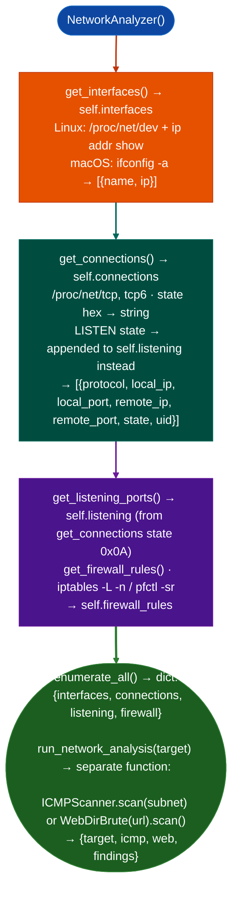

<a id="local-network-inventory"></a>
# Network & Industrial Protocols

Enumerate network interfaces, active connections, listening ports, firewall rules, routing tables, and ARP observations on a compromised host: providing the complete local network topology needed to plan lateral movement: via `modules/network_analyze.py` `NetworkAnalyzer`.

---

## Why this exists

1. **`NetworkAnalyzer` enumerates the host network state without any external tools**, it reads `/proc/net/tcp`, `/proc/net/tcp6`, `/proc/net/udp`, `/proc/net/if_inet6`, and `/proc/net/arp` directly, and on macOS uses `ifconfig`/`netstat` subprocess calls. This provides interface addresses, listening ports, established connections, and the ARP table without requiring `netstat`, `ss`, `ip`, or `nmap` to be installed.

2. `run_network_analysis()` produces a combined analysis result: interfaces with IPs and subnets, all listening TCP/UDP ports with PIDs (if readable from `/proc/<pid>/`), established outbound connections with remote IPs, and `iptables`/`pfctl` firewall rule summary. The subnet list from interface enumeration seeds `icmp_host_discovery()` in `net_sniffer.py` for automatic adjacent subnet scanning.

3. Firewall rule enumeration: `NetworkAnalyzer` reads `iptables -L -n` output (Linux) and `pfctl -sr` (macOS) to extract ACCEPT/REJECT/DROP rules. Overly permissive rules for example `ACCEPT all -- 0.0.0.0/0 → 0.0.0.0/0 in the FORWARD chain indicate a misconfigured host that routes between network segments: a pivot point for reaching otherwise-isolated subnets.

---

## How it works



---

## Usage

```python
from modules.network_analyze import NetworkAnalyzer

analyzer = NetworkAnalyzer()
analysis = analyzer.enumerate_all()

print(f"Interfaces: {[i['name'] for i in analysis['interfaces']]}")

# 'listening' contains LISTEN-state connections; 'connections' contains the rest
# each connection: {protocol, local_ip, local_port, remote_ip, remote_port, state, uid}
for conn in analysis['listening']:
    print(f"  LISTEN {conn['protocol']} {conn['local_ip']}:{conn['local_port']}")

for conn in analysis['connections']:
    if conn['state'] == 'ESTABLISHED':
        print(f"  {conn['local_ip']}:{conn['local_port']} → "
              f"{conn['remote_ip']}:{conn['remote_port']}")
```

### PCAP and live discovery

`PCAPAnalyzer` parses a saved capture and extracts credentials, DNS, and HTTP artifacts. `RawSniffer` and the mDNS/SSDP helpers perform live discovery; raw capture generally requires elevated privileges and should only run on an authorized interface.

```python
from modules.network_analyze import PCAPAnalyzer

pcap = PCAPAnalyzer('/path/to/capture.pcap')
result = pcap.run_all()
print(result)
```

PCAPs and live traffic can contain reusable credentials and private communications. Use test captures where possible, restrict output access, and never sniff a network you do not control or have explicit permission to monitor. Modbus, MQTT, CoAP, SNMP, BACnet, and EtherNet/IP probes must be limited to approved lab or assessment targets.

---

## Example output

The following is a schematic example showing output structure and field names. Values are illustrative.

```
NetworkAnalyzer: localhost

Interfaces:
  eth0:  <ip>/<prefix>   MAC: <mac>
  eth1:  <ip>/<prefix>   MAC: <mac>

Listening ports:
  0.0.0.0:22   (sshd)
  0.0.0.0:80   (nginx)
  127.0.0.1:5432 (postgres)

Established connections: <N>
Subnets: [<subnet-a>, <subnet-b>]
```

---

## False positives

**`iptables -L` requires root**: on hosts without root access, firewall rule enumeration falls back to an empty list rather than an error. Interpret an empty firewall rules list as "could not enumerate" rather than "no rules configured."

**`/proc/net/tcp` port display**: ports are stored in hexadecimal in `/proc/net/tcp`. `NetworkAnalyzer` converts them to decimal; verify that the conversion is correct for port numbers above 32767 on big-endian kernels.

---

## Pipeline position

Run `NetworkAnalyzer` immediately after gaining shell access on a compromised host. The subnet list it produces seeds `icmp_host_discovery()` for network pivot planning; listening ports reveal internal services that may not be externally accessible.

---

## Reading output

`NetworkAnalyzer.enumerate_all()` returns a dict:

| Key | Content |
|:---|:---|
| `interfaces` | `List`: network interfaces enumerated from `/proc/net/dev` |
| `connections` | `List`: established and time-wait TCP connections |
| `listening` | `List`: bound listening services |
| `firewall` | `List[str]`: iptables rule summary lines |

---

## See also

- [Host/Service Discovery](host-service-discovery.md): `ICMPScanner` and banner grabbing for hosts in discovered subnets
- [Raw Packet Capture](raw-packet-capture.md): `RawSniffer` for traffic analysis on the identified interfaces
