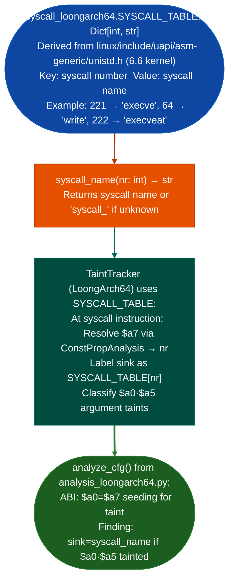

# LoongArch64 Syscall Labeling

Map LoongArch64 Linux syscall numbers to names and argument signatures using the `asm-generic/unistd.h` table. Labels `syscall` instructions in disassembly with the system call name, argument registers (`$a0`–`$a5`), and expected return in `$a0`, for security analysis of LoongArch64 firmware and kernel modules.

---

## Why this exists

1. **LoongArch64 is the primary architecture for new Loongson CPUs used in Chinese domestic server and networking equipment. Ablation's LoongArch64 analysis pipeline requires syscall labeling to identify dangerous syscall patterns such as `execve`, `write` to fixed FDs, and `mmap` with `PROT_EXEC`.** `syscall_loongarch64.py` provides the `$a7 → syscall_name` mapping derived from the Linux `asm-generic/unistd.h` table used by all LoongArch builds.

2. **LoongArch64 does not have a custom syscall table. It uses the Linux `asm-generic` unistd.h directly** kernel 5.x+. This means syscall numbers are the same as ARM64 asm-generic numbers for the overlapping range, making cross-architecture comparisons straightforward. `syscall_loongarch64.py` documents this explicitly as a reliability guarantee for analysts who may assume LoongArch has a custom table.

3. **LoongArch64 syscall ABI:** `$a7` = syscall number, `$a0`–`$a5` = arguments (up to 6), `$a0` = return value (negative = `-errno`). `analyze_cfg()` from `analysis_loongarch64.py` labels `syscall` instructions with the resolved syscall name when `$a7` is a `ConstPropAnalysis`-resolved constant at the `syscall` instruction.

---

## Security classification

The module defines three classification sets used by the taint tracker to decide what to track and at what severity.

**Sources**: syscalls that introduce attacker-controlled data into `$a0` on return. The taint tracker seeds the return register with the source label when it sees one of these resolved at a `syscall` instruction.

| Syscall | Taint label |
|:---|:---|
| `read`, `pread64`, `readv`, `preadv`, `preadv2` | `syscall:read` |
| `recvfrom`, `recvmsg`, `recvmmsg` | `syscall:network` |
| `getdents64`, `getxattr`, `fgetxattr`, `lgetxattr`, `readlinkat`, `getcwd` | `syscall:fs` |
| `getsockopt`, `getpeername`, `getsockname` | `syscall:network` |
| `process_vm_readv` | `syscall:process_mem` |
| `getrandom` | `syscall:rng` |

**Sinks**: syscalls that consume user-controlled data as a dangerous operation. A finding is produced when a tainted register reaches one of these as an argument.

| Syscall | Severity |
|:---|:---|
| `execve`, `execveat` | CRITICAL |
| `ptrace`, `process_vm_writev` | CRITICAL |
| `bpf` | CRITICAL |
| `kexec_load`, `kexec_file_load` | CRITICAL |
| `init_module`, `finit_module` | CRITICAL |
| `write`, `writev`, `pwrite64` | HIGH |
| `sendto`, `sendmsg`, `sendmmsg` | HIGH |
| `mmap`, `mprotect` | HIGH |
| `clone`, `clone3` | HIGH |
| `delete_module` | HIGH |

**Escalation**: syscalls that cross a privilege boundary. Always CRITICAL regardless of taint state. The tracker flags these when the resolved syscall name appears in `SYSCALL_ESCALATION`: `setuid`, `setgid`, `setresuid`, `setresgid`, `setreuid`, `setregid`, `setfsuid`, `setfsgid`, `setgroups`, `capset`, `prctl`.

---

## Kernel module classification

For kernel module analysis, the module defines separate source and sink sets that mirror the userspace classification against kernel memory-copy primitives.

**Kernel sources**: functions that read from user memory into a kernel buffer. The taint tracker seeds with `copy_from_user` and related helpers: `__copy_from_user`, `__copy_from_user_inatomic`, `get_user`, `__get_user`, `strncpy_from_user`, `strnlen_user`, `nla_get_string`, `nla_data`, `nlmsg_data`, `__nlmsg_put`, `skb_get_data`, `skb_pull_data`, `memdup_user`, `__memdup_user`, `vmalloc_user`, `kzalloc_user`.

**Kernel sinks**: functions that consume tainted kernel data dangerously: `copy_to_user`, `__copy_to_user`, `put_user`, `__put_user`, `call_usermodehelper`, `call_usermodehelper_exec`, `kernel_execve`, `sprintf`, `snprintf`, `vsprintf`, `vsnprintf`, `strcpy`, `strcat`, `memcpy`, `kmalloc`, `kzalloc`, `vmalloc`.

**Kernel escalation**: privilege primitives always classified CRITICAL: `commit_creds`, `prepare_kernel_cred`, `set_current_cred`, `override_creds`, `__sys_setuid`, `security_setuid`.

---

## How it works



---

## Usage

```python
from ablation.analyzers.syscall_loongarch64 import (
    SYSCALL_TABLE, syscall_name, classify_syscall,
    syscall_label, syscall_severity,
)

# Direct syscall number lookup
print(syscall_name(221))  # 'execve'
print(syscall_name(64))   # 'write'
print(syscall_name(9999)) # 'syscall_9999' (unknown)

# Three-tier classification: returns (name, kind) or None
result = classify_syscall(221)   # ('execve', 'sink')
result = classify_syscall(0)     # ('io_setup', None) — unclassified
result = classify_syscall(146)   # ('setuid', 'escalation')
result = classify_syscall(63)    # ('read', 'source')

# Taint label for a source syscall (used when seeding return register)
print(syscall_label(63))   # 'syscall:read'
print(syscall_label(207))  # 'syscall:network'  (recvfrom)

# Severity for a sink or escalation syscall
print(syscall_severity(221))  # 'CRITICAL'  (execve)
print(syscall_severity(64))   # 'HIGH'      (write)
print(syscall_severity(146))  # 'CRITICAL'  (setuid — escalation path)

# Use in LoongArch64 analysis
from ablation.analyzers.analysis_loongarch64 import analyze_cfg
from ablation.analyzers.taint_tracker_loongarch64 import State
from ablation.analyzers.insn_loongarch64 import from_loongarch_frames
from ablation.analyzers.loongarch_decoder import LoongArchDecoder

dec = LoongArchDecoder()
frames = list(dec.decode_frames(section_bytes, base_addr))
insns = list(from_loongarch_frames(frames))

init = State()
init.taint_reg("$a0", "user")
result = analyze_cfg(insns, initial=init)

for f in result.findings:
    print(f)  # Finding includes labeled syscall name
```

---

## Example output

The following illustrates labeled syscall output. Actual addresses are binary-specific.

```
Finding at <va>:
  sink: execve  (syscall 221)
  severity: CRITICAL
  tainted args: $a0 (pathname), $a1 (argv)
  sources: ['user']
  $a7 = Const(221) at syscall instruction
```

---

## False positives

**Syscall labeling requires `$a7` to be a compile-time constant at the `syscall` instruction.** When `$a7` is set via a register move from a variable such as a syscall dispatch table, `ConstPropAnalysis` will not resolve it and the syscall will be labeled `syscall_unknown`. In this case, trace `$a7` backward manually to identify the syscall number.

---

## Pipeline position

`syscall_loongarch64.SYSCALL_TABLE` is consumed automatically by the LoongArch64 taint tracker. It is not called directly in the RE workflow. Use it directly only when inspecting raw LoongArch64 disassembly to identify syscall numbers manually.

---

## Reading findings

The LoongArch64 syscall table is a look-up resource, not a finding-producing API. Findings come from the `TaintTracker` that consumes `SYSCALL_TABLE`:

| Field | Content |
|:---|:---|
| `va` | VA of the syscall instruction (`syscall 0`) |
| `sink` | Syscall name resolved from `$a7` constant: `execve`, `write`, `openat` |
| `severity` | `CRITICAL` or `HIGH` from `SYSCALL_SINKS`; always `CRITICAL` for escalation syscalls |
| `tainted_args` | Tainted argument registers at the syscall site: `$a0`, `$a1` |
| `sources` | Taint source labels |
| `taint_path` | Register propagation chain |

---

## See also

- [ARM64 Symbolic Slicing](arm64-symbolic-slicing.md): same `analyze_cfg()` pattern for ARM64 targets
- [RISC-V](risc-v.md): similar syscall labeling for RISC-V targets. RISC-V also uses asm-generic syscall numbers.
- [Persistent Analysis Context](persistent-analysis-context.md): `BinaryContext` that provides disassembly listings for `from_loongarch_frames()`
