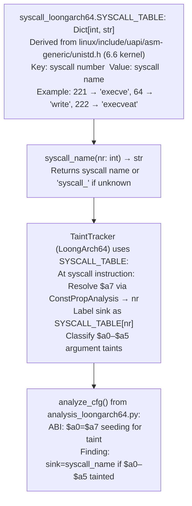

# LoongArch64 Syscall Labeling

Map LoongArch64 Linux syscall numbers to names and argument signatures using the `asm-generic/unistd.h` table — labeling `syscall` instructions in disassembly with the system call name, argument registers (`$a0`–`$a5`), and expected return in `$a0`, for security analysis of LoongArch64 firmware and kernel modules.

---

## Why this exists

1. **LoongArch64 is the primary architecture for new Loongson CPUs used in Chinese domestic server and networking equipment — Ablation's LoongArch64 analysis pipeline requires syscall labeling to identify dangerous syscall patterns (e.g., `execve`, `write` to fixed FDs, `mmap` with `PROT_EXEC`).** `syscall_loongarch64.py` provides the `$a7 → syscall_name` mapping derived from the Linux `asm-generic/unistd.h` table used by all LoongArch builds.

2. **LoongArch64 does not have a custom syscall table — it uses the Linux `asm-generic` unistd.h directly** (kernel 5.x+). This means syscall numbers are the same as ARM64 asm-generic numbers for the overlapping range, making cross-architecture comparisons straightforward. `syscall_loongarch64.py` documents this explicitly as a reliability guarantee for analysts who may assume LoongArch has a custom table.

3. **LoongArch64 syscall ABI:** `$a7` = syscall number, `$a0`–`$a5` = arguments (up to 6), `$a0` = return value (negative = `-errno`). `analyze_cfg()` from `analysis_loongarch64.py` labels `syscall` instructions with the resolved syscall name when `$a7` is a `ConstPropAnalysis`-resolved constant at the `syscall` instruction.

---

## How it works



---

## Usage

```python
from ablation.analyzers.syscall_loongarch64 import SYSCALL_TABLE, syscall_name

# Direct syscall number lookup
print(syscall_name(221))  # 'execve'
print(syscall_name(64))   # 'write'
print(syscall_name(9999)) # 'syscall_9999' (unknown)

# Use in LoongArch64 analysis
from ablation.analyzers.analysis_loongarch64 import analyze_cfg
from ablation.analyzers.taint_tracker_loongarch64 import State
from ablation.analyzers.insn_loongarch64 import from_loongarch_frames
from ablation.analyzers.loongarch_decoder import LoongArchDecoder

dec = LoongArchDecoder()
frames = list(dec.decode_frames(section_bytes, base_addr))
insns = list(from_loongarch_frames(frames))

init = State()
init.taint_reg("$a0", "user")
result = analyze_cfg(insns, initial=init)

for f in result.findings:
    print(f)  # Finding includes labeled syscall name
```

---

## Example output

The following illustrates labeled syscall output. Actual addresses are binary-specific.

```
Finding at <va>:
  sink: execve  (syscall 221)
  tainted args: $a0 (pathname), $a1 (argv)
  sources: ['user']
  $a7 = Const(221) at syscall instruction
```

---

## False positives

**Syscall labeling requires `$a7` to be a compile-time constant at the `syscall` instruction.** When `$a7` is set via a register move from a variable (e.g., in a syscall dispatch table), `ConstPropAnalysis` will not resolve it and the syscall will be labeled `syscall_unknown`. In this case, trace `$a7` backward manually to identify the syscall number.

---

## Pipeline position

`syscall_loongarch64.SYSCALL_TABLE` is consumed automatically by the LoongArch64 taint tracker — it is not called directly in the RE workflow. Use it directly only when inspecting raw LoongArch64 disassembly to identify syscall numbers manually.

---

## Reading findings

The LoongArch64 syscall table is a look-up resource, not a finding-producing API. Findings come from the `TaintTracker` that consumes `SYSCALL_TABLE`:

| Field | Content |
|:---|:---|
| `va` | VA of the syscall instruction (`syscall 0`) |
| `sink` | Syscall name resolved from `$a7` constant (e.g., `execve`, `write`, `openat`) |
| `tainted_args` | Tainted argument registers at the syscall site (e.g., `$a0`, `$a1`) |
| `sources` | Taint source labels |
| `taint_path` | Register propagation chain |

---

## See also

- [ARM64 Symbolic Slicing](arm64-symbolic-slicing.md) — same `analyze_cfg()` pattern for ARM64 targets
- [RISC-V](risc-v.md) — similar syscall labeling for RISC-V targets (RISC-V also uses asm-generic syscall numbers)
- [Persistent Analysis Context](persistent-analysis-context.md) — `BinaryContext` that provides disassembly listings for `from_loongarch_frames()`
