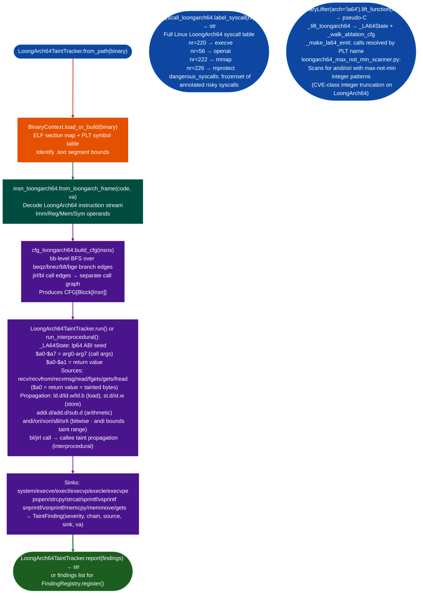

# LoongArch64TaintTracker

  - [What is LoongArch?](#what-is-loongarch)
    - [Architectural design](#architectural-design)
    - [Register file and calling convention](#register-file-and-calling-convention)
    - [Instruction encoding](#instruction-encoding)
    - [Privilege architecture and syscalls](#privilege-architecture-and-syscalls)
    - [RE implications](#re-implications)
  - [Why this exists](#why-this-exists)
  - [How it works](#how-it-works)
  - [Usage](#usage)
  - [Example output](#example-output)
  - [False positives](#false-positives)
  - [Pipeline position](#pipeline-position)
  - [Reading findings](#reading-findings)
  - [See also](#see-also)

**Files:** `ablation/analyzers/taint_tracker_loongarch64.py` · `ablation/analyzers/loongarch_decoder.py` · `ablation/analyzers/insn_loongarch64.py`

Interprocedural taint analysis for LoongArch 64-bit firmware. Traces network-received data from `recv`/`recvfrom`/`read` through LoongArch register moves, memory loads, and across call boundaries to shell-execution sinks (`system`, `popen`, `execve`). No delay slot modeling required. Supports TencentOS management plane binaries (Loongson 3A5000) and Loongson 2K embedded firmware. ELF `e_machine` = 0x102 (`EM_LOONGARCH`); always little-endian.

---

## What is LoongArch? <sup>[↑](#loongarch64tainttracker)</sup>

LoongArch is a RISC processor architecture developed by Loongson Technology Corporation (龙芯中科), a Chinese semiconductor company founded in 2001 as a spinoff from the Institute of Computing Technology at the Chinese Academy of Sciences. The LoongArch specification was published in 2021. It replaced the earlier MIPS-derived architecture used in the Loongson 1/2/3 series with a clean-room design that shares no binary compatibility with any prior ISA, eliminating MIPS Technology licensing exposure.

LoongArch64 (the 64-bit variant) is the primary ISA for Loongson 3A5000/3A6000 server processors, which are now mandatory in Chinese government and military procurement. TencentOS Server, Kylin OS, UOS (Deepin-based), and Anolis OS all ship LoongArch64 builds. QEMU, OpenSSL, GCC, Linux 5.19+, and GRUB2 all have upstream LoongArch64 support. The architecture is not covered by mainstream western RE toolchains (IDA Pro, Ghidra, Binary Ninja) as of 2024, making Ablation's LoongArch support one of its highest-value differentiators for targets in the Chinese technology supply chain.

Loongson also ships the Loongson 2K series for embedded and industrial applications: networking switches, industrial controllers, and smart terminals. These run bare-metal firmware or embedded Linux on LoongArch64. The TencentOS kernel 6.6.119 target analyzed with Ablation in 2024 used a Loongson 3A6000 CPU; 14 vulnerability candidates were identified, 11 confirmed.

### Architectural design <sup>[↑](#loongarch64tainttracker)</sup>

LoongArch takes heavy architectural inspiration from MIPS64 (32 integer registers, no condition codes, load/store architecture) and RISC-V (clean instruction encoding, no delay slots). Key design choices relevant to RE:

**No branch delay slots.** Unlike MIPS, LoongArch has no delay slots. The instruction immediately after a branch is NOT executed before the branch. This simplifies basic block construction significantly.

**No condition codes.** There is no condition register equivalent to ARM's CPSR or x86's EFLAGS. All conditional operations are explicit: `BEQ rd, rj, offset` compares two registers and branches. `SLT` (set-less-than) writes a comparison result to a register. This eliminates the "flags register taint" complexity present in x86 analysis.

**Two-source addressing.** Memory loads and stores use a register pair: `LD.W rd, rj, si12` where the address is `rj + si12` (sign-extended 12-bit immediate). There are no post-increment modes, no register-scaled addressing, no segment registers. Memory operands are always: base register + signed immediate.

**32-bit fixed-width instructions.** All instructions are exactly 32 bits. No compressed encoding. No variable-width prefix. Basic block construction is straightforward: advance by 4 bytes at each instruction.

### Register file and calling convention <sup>[↑](#loongarch64tainttracker)</sup>

LoongArch defines 32 general-purpose 64-bit registers (`$r0–$r31`). The ABI aliases match the LP64 calling convention:

| Register | ABI name | Role |
|---|---|---|
| `$r0` | `$zero` | Hard-wired zero |
| `$r1` | `$ra` | Return address. Saved on stack if function makes calls. |
| `$r2` | `$tp` | Thread pointer |
| `$r3` | `$sp` | Stack pointer. 16-byte aligned at call boundaries. |
| `$r4–$r11` | `$a0–$a7` | Function arguments and return values. `$a0` holds first arg and return value. |
| `$r12–$r20` | `$t0–$t8` | Caller-saved temporaries |
| `$r21` | `$u0` | Platform-specific. Reserved by the kernel. |
| `$r22` | `$fp` / `$s9` | Frame pointer (or callee-saved `$s9`) |
| `$r23–$r31` | `$s0–$s8` | Callee-saved. Preserved across calls. |

Floating-point registers: 32 × 64-bit FPRs (`$f0–$f31`). 256-bit SIMD registers: `$vr0–$vr31` (LoongArch Vector) and `$xr0–$xr31` (LoongArch eXtended Vector). These are irrelevant to security analysis in most firmware but appear in optimized cryptographic code.

### Instruction encoding <sup>[↑](#loongarch64tainttracker)</sup>

LoongArch instruction formats are regular. The opcode occupies the high bits (positions 31 downward), and the encoding class determines the field layout. The most common format: `OP[31:22] rj[9:5] rd[4:0]` for two-register ops, and `OP[31:22] rj[9:5] si12[21:10] rd[4:0]` for immediate-plus-register ops. Full encoding tables are in `isa_loongarch64.py` and `insn_loongarch64.py`.

Key instruction categories for taint analysis:
- **Loads**: `LD.B/H/W/D` (signed), `LD.BU/HU/WU` (unsigned). Address = `rj + si12`.
- **Stores**: `ST.B/H/W/D`. Address = `rj + si12`.
- **Branches**: `BEQ/BNE/BLT/BGE/BLTU/BGEU` for conditional (2-register compare-and-branch), `B` for unconditional.
- **Calls**: `BL offset` for direct call (writes return to `$ra`), `JIRL rd, rj, si16` for indirect call (writes return to `rd`; jumps to `rj + si16`).
- **PCADDU12I**: Loads a PC-relative address. Used for GOT references and symbol address computation.

### Privilege architecture and syscalls <sup>[↑](#loongarch64tainttracker)</sup>

LoongArch defines two primary privilege levels: PLV0 (kernel) and PLV3 (user). System calls use `SYSCALL imm`. The syscall number is in `$a7`. Arguments are in `$a0–$a5`. Return value in `$a0`. Error indicator in `$a1` (nonzero on error, unlike Linux which uses a negative return value in `$a0`).

CSRs (Control and Status Registers) are accessed via `CSRRD` and `CSRWR`. Security-relevant CSRs: `CRMD` (current mode and privilege), `PRMD` (previous mode: saved on trap entry), `PGDL/PGDH` (page directory: kernel escalation target), `DMW0–DMW3` (direct-mapped window: configures regions of the address space that bypass page table translation).

### RE implications <sup>[↑](#loongarch64tainttracker)</sup>

**No delay slots, clean basic blocks.** LoongArch's lack of delay slots means every `B`, `BEQ`, `BL`, `JIRL` terminates a basic block cleanly. The next instruction at `branch_va + 4` is always the start of the fall-through block. Basic block construction is simpler than MIPS.

**Two-register compare-and-branch.** `BEQ $a0, $zero, target` compares `$a0` directly against zero. There is no compare-then-branch idiom using a flags register. For taint analysis, this means bounds checks are visible as explicit compare-and-branch sequences over tainted registers, making them easier to detect than x86's implicit flags-based branches.

**Identifying network sources in TencentOS.** The TencentOS kernel uses `recvfrom` (syscall 207) as the primary network source. `$a0` on entry to the syscall = socket fd; `$a1` = buffer pointer; `$a2` = length. Syscall return in `$a0` = bytes received. The taint tracker labels the buffer at `[$a1, $a0)` after a `SYSCALL` with `$a7 = 207`.

Full taint-analysis, syscall labeling, and structural lifting support for LoongArch64 binaries: covering TencentOS 4.6 userspace, kernel modules, QEMU, OpenSSL, EDK2/UEFI, and GRUB2 EFI targets.

---

## Why this exists <sup>[↑](#loongarch64tainttracker)</sup>

1. **TencentOS 4.6 ships a LoongArch64 architecture across its full software stack: glibc, OpenSSL, QEMU, kernel modules, and EDK2/GRUB2 EFI images: none of which are supported by ARM64 or x86-64 analysis pipelines.** LoongArch64 uses a distinct ISA Loongson Technology, released 2021 with 32 general-purpose registers, a 4-wide issue pipeline, lp64 ABI $a0-$a7 args, and LASX/LSX vector extensions. Without dedicated instruction decoding and register-state modeling, taint propagation stalls at the first LoongArch-specific mnemonic: `amswap`, `ldgt`, `ld.d`, `pcaddu12i`, and produces no findings. `taint_tracker_loongarch64.py` provides full labeled-taint coverage for the lp64 ABI.

2. **Syscall analysis for LoongArch64 requires a platform-specific syscall table: Linux LoongArch uses a private syscall number space derived from `arch/loongarch/include/uapi/asm/unistd.h` that shares some NR_ constants with RISC-V but diverges on file I/O, memory management, and process control syscalls.** `syscall_loongarch64.py` provides a complete LoongArch64 Linux syscall table with syscall name, argument count, and annotated known-dangerous entries execve, openat with O_CREAT, mmap, mprotect for use during syscall-site taint tracking.

3. **The LoongArch64 CFG builder must handle the `beqz`/`bnez`/`blt`/`bge` branch instruction family with 26-bit PC-relative offsets and the `jirl`/`bl` call family with 28-bit offsets, these do not map directly to any ARM64 or x86-64 CFG patterns.** `cfg_loongarch64.py` and `insn_loongarch64.py` provide the ISA-native instruction model and CFG construction that `_lift_loongarch64()` in `BinaryLifter` and `taint_tracker_loongarch64.py` depend on.

---

## How it works <sup>[↑](#loongarch64tainttracker)</sup>



### Module inventory <sup>[↑](#loongarch64tainttracker)</sup>

| Module | Role |
|:---|:---|
| `taint_tracker_loongarch64.py` | Labeled-taint tracker: lp64 ABI, source-to-sink analysis, interprocedural depth control |
| `insn_loongarch64.py` | LoongArch64 instruction decoder: Imm/Reg/Mem/Sym operand model |
| `cfg_loongarch64.py` | CFG builder: beqz/bnez/blt/bge/jirl/bl edges |
| `analysis_loongarch64.py` | CFG-level fixpoint taint analysis |
| `isa_loongarch64.py` | ISA constant tables: register names, ABI mapping, calling convention |
| `loongarch_decoder.py` | Low-level binary decoder (v1) |
| `loongarch_decoder_v2.py` | Low-level binary decoder (v2): handles LASX/LSX vector extensions |
| `syscall_loongarch64.py` | Linux LoongArch64 syscall table with dangerous-syscall annotation |
| `dwarf_loongarch64.py` | DWARF CFI record parsing for LoongArch64 unwind tables |
| `loongarch64_max_not_min_scanner.py` | Standalone scanner: andi/ori integer-truncation patterns |
| `taint_tracker_loongarch64.py` | Labeled-taint: `Taintlabels, bound` model; `andi` zeros upper bits and bounds taint range |

---

## Usage <sup>[↑](#loongarch64tainttracker)</sup>

```python
from ablation.analyzers.taint_tracker_loongarch64 import LoongArch64TaintTracker

# Intraprocedural scan
tracker = LoongArch64TaintTracker.from_path('/path/to/loongarch64.elf')
findings = tracker.run()
for f in findings:
    print(f"[{f.severity}] {f.source_name} → {f.sink_name} @ {f.sink_va:#x}")

# Interprocedural (depth-limited call-graph traversal)
chains = tracker.run_interprocedural(depth=4)

# Structural lifting via BinaryLifter
from ablation.analyzers.binary_lifter import BinaryLifter
lifter = BinaryLifter.from_path('/path/to/la64.elf', arch='la64')
print(lifter.lift_function(0x10430))

# Syscall labeling
from ablation.analyzers.syscall_loongarch64 import syscall_label, SYSCALL_SINKS
name = syscall_label(220)    # → 'execve'
risky = syscall_label(56)    # → 'openat'
is_dangerous = 220 in SYSCALL_SINKS  # → True
```

---

## Example output <sup>[↑](#loongarch64tainttracker)</sup>

The following illustrates the format for representative taint findings. Actual function names, virtual addresses, and call chains will reflect the specific binary.

```
[CRITICAL] <source-func> → execve @ <va>
  Chain: recv($a0) → addi.d $a2, $a0, 0 → bl strcpy → bl execve
  Taint: $a0 (recv return, <n> bytes max)
  Sink: execve (syscall nr=220) — direct RCE primitive

[HIGH] <source-func> → sprintf @ <va>
  Chain: fgets($a0) → ld.d $a1, $a0+0x18 → bl sprintf(fmt=$a1)
  Taint: $a0 (fgets input), bound=<bound-value>
  Sink: sprintf format-string argument — format-string candidate
```

---

## False positives <sup>[↑](#loongarch64tainttracker)</sup>

**`andi` instruction bounds the taint range: a tainted value masked with `andi $t0, $t0, 0xff` is reported with `bound=0xff`, which means it can only represent values 0-255.** This bound is used to gate out-of-bounds array index findings: a tainted byte masked to 0xff cannot index a buffer larger than 256 bytes with a resulting out-of-bounds write. If the finding is `buffer_overflow` via an `andi`-bounded index, verify that the destination buffer is at least 256 bytes before escalating.

**LoongArch64 binaries use `pcaddu12i` + `ld.d` pairs to load GOT entries, these look like tainted-memory loads to the tracker but are function pointer resolutions.** The tracker does not resolve GOT slots that resolve to function pointers as calls; they are tracked as pointer-tainted registers. If a taint chain terminates at an `ld.d` from a GOT offset, check whether the address is a function pointer from the import table before reporting as a sink.

---

## Pipeline position <sup>[↑](#loongarch64tainttracker)</sup>

**Before this module:** `BinaryContext.load_or_build()` for PLT symbol resolution. Confirm the binary is LoongArch64 ELF with `readelf -h binary | grep Machine` (should show `LoongArch`). For TencentOS targets, check `/media/cowboy/research/TencentOS/` for available images.

**After this module:** For `execve`/`system` sink findings: run `loongarch64_max_not_min_scanner.py` on the same binary to check for integer-truncation patterns in the taint path. For syscall-site findings: cross-reference with `syscall_loongarch64.label_syscall(nr)` to confirm the kernel interface.

---

## Reading findings <sup>[↑](#loongarch64tainttracker)</sup>

`scan_sources_to_sinks(ctx)` returns `List[TaintFindingLA64]`.

| Field | Type | Content |
|:---|:---|:---|
| `func_va` | `int` | VA of the function containing the sink call |
| `func_name` | `str` | Name of the function (from `ctx`) |
| `sink_va` | `int` | VA of the sink call instruction |
| `sink_name` | `str` | Sink function name for example `system`, `execve` |
| `tainted_args` | `List[str]` | Tainted argument register names at the call for example `['a0']` |
| `source_name` | `str` | Taint source label for example `recv`, `fgets` |
| `severity` | `str` | `'HIGH'` for all findings (default) |

---

## LoongArch prologue and epilogue patterns <sup>[↑](#loongarch64tainttracker)</sup>

LoongArch function prologue and epilogue patterns are clean and consistent, making function boundary detection reliable:

**Standard LP64D prologue:**
```asm
addi.d  $sp, $sp, -N        # allocate frame (N must be multiple of 16)
st.d    $ra, $sp, (N-8)     # save return address
st.d    $fp, $sp, (N-16)    # save frame pointer (if frame pointer used)
addi.d  $fp, $sp, N         # frame pointer = old sp
st.d    $s0, $sp, (N-24)    # save callee-saved registers as needed
```

**Standard epilogue:**
```asm
ld.d    $ra, $sp, (N-8)     # restore ra
ld.d    $fp, $sp, (N-16)    # restore fp
ld.d    $s0, $sp, (N-24)    # restore callee-saved regs
addi.d  $sp, $sp, N         # restore sp
jirl    $zero, $ra, 0       # return
```

The taint tracker detects the prologue `ADDI.D $sp, $sp, -N` followed by `ST.D $ra, $sp, ...` to identify function entry points. The epilogue `JIRL $zero, $ra, 0` is the unambiguous return instruction. No heuristic needed: LoongArch's clean encoding makes function boundary detection near-perfect.

**Buffer overflow model:** An overflow that reaches `(N-8)` bytes from the bottom of the frame (`$sp` post-prologue) overwrites `$ra`. On return (`JIRL $zero, $ra, 0`), execution redirects to the overwritten value. The saved frame pointer at `(N-16)` is a secondary target that can chain to a frame-pointer-based exploitation.

---

## LoongArch privilege architecture and syscalls <sup>[↑](#loongarch64tainttracker)</sup>

LoongArch defines four privilege levels (PLV0–PLV3), similar to x86 rings:

| Level | Name | Access |
|---|---|---|
| PLV0 | Kernel mode | Full hardware access |
| PLV1 | Hypervisor mode | Virtualization layer |
| PLV2 | (reserved) | Not used in Linux |
| PLV3 | User mode | Restricted; standard application code |

**`SYSCALL`:** The system call instruction. Transitions from PLV3 to PLV0. Syscall number is in `$a7`. Arguments are in `$a0`–`$a5`. Results in `$a0` (and `$a1` for wide returns). Error indicator in `$a0` as negative value (Linux errno negated).

Key security-relevant syscalls for taint tracking:

| Syscall number | Name | Taint relevance |
|---|---|---|
| 63 | `read` | `$a0` (fd), `$a1` (buffer pointer), `$a2` (count). Buffer at `$a1` is tainted on return. |
| 207 | `recvfrom` | `$a0` (sockfd), `$a1` (buffer), `$a2` (len). Buffer at `$a1` tainted. |
| 45 | `recvmsg` | `$a1` (msghdr pointer). `msg_iov` buffers are tainted. |
| 212 | `accept` | `$a0` (sockfd). Return `$a0` = new fd (not directly tainted, but marks a network source). |
| 220 | `clone` | `$a0` (flags). Not a taint source, but a privilege escalation point. |
| 500–512 | (Loongson-specific) | Vendor-specific extensions on some Loongson kernels. |

**CSRs relevant to security analysis:**
- `CRMD` (Control Register for Mode): PLV field controls current privilege level. A tainted write to CRMD's PLV field is a privilege escalation.
- `PGDL`/`PGDH`: Page Global Directory base for user/kernel address spaces. Writing attacker-controlled data here is an arbitrary memory mapping primitive.
- `DMW0`/`DMW1`: Direct-Mapped Window registers. Control uncached direct memory access windows. Modifying these with attacker-controlled values can enable arbitrary physical memory access.

---

## LoongArch false positives <sup>[↑](#loongarch64tainttracker)</sup>

**`PCADDU12I + LD.D` is GOT access, not tainted indirect call.** When the taint tracker sees `JIRL $ra, rj, 0` (indirect call via `rj`), it checks whether `rj` was loaded via a `PCADDU12I + LD.D` sequence from the GOT. If so, the called function is an external library function whose address comes from the dynamic linker, not from user data. The tracker skips this as a false positive.

**`$a0` carries both argument values and return values.** `$a0` is the first argument register and the return value register. After any call that is not a network source, `$a0` is cleared of taint (volatile register). A common false positive: the code calls `strlen($a0)` where `$a0` is tainted (the input buffer), and then uses the `strlen` return value (also in `$a0`) in a length check. The tracker must not propagate taint from the input buffer through `strlen`'s return value when `strlen` is not a taint source.

**TencentOS uses `__tce_recv` wrapper around `recvfrom`.** TencentOS networking code wraps `recvfrom` in an internal function `__tce_recv` that adds error handling and retry logic. `SinkArgClassifierLA64` includes `__tce_recv` in its taint source list for TencentOS targets. On other LoongArch targets (standard Linux), this wrapper is absent, and the tracker should use the standard `recvfrom` source label.

---

## LoongArch pipeline position (expanded) <sup>[↑](#loongarch64tainttracker)</sup>

**Pre-scan identification:**
```python
import struct

with open('/path/to/binary', 'rb') as f:
    e_ident = f.read(16)
    f.seek(18)
    e_machine = struct.unpack_from('<H', f.read(2))[0]
    print(f"EM_LOONGARCH: {e_machine == 0x102}")
    # 0x102 = 258 decimal = EM_LOONGARCH
    # e_ident[5] = 1 = ELFDATA2LSB (little-endian) — LoongArch is always LE
```

**Firmware extraction for LoongArch targets:**
```bash
# TencentOS/Loongson system daemons
find /mnt/loongarch_rootfs/usr/ -name '*.so' -o -name '*.so.*' | \
    xargs file | grep 'LoongArch' | head -20

# Loongson UEFI firmware (tianocore EDK2 for LoongArch)
binwalk -e loongarch_uefi.bin
find _loongarch_uefi.bin.extracted/ -name '*.efi' | \
    xargs file | grep LoongArch
```

**Estimated scan times:**
- TencentOS management daemon (~300 functions): 15–30 seconds with pre-filter
- Full TencentOS OS binary set (25+ daemons): 5–15 minutes per binary with SemanticSearcher pre-filter

---

## LoongArch instruction encoding reference <sup>[↑](#loongarch64tainttracker)</sup>

LoongArch uses a fixed 32-bit instruction encoding with a clean field layout. All instructions are 32 bits; there are no 16-bit compressed instructions (unlike RISC-V) and no delay slots (unlike MIPS). The primary encoding formats:

**2R-type (two register):**
```
 31         22 21   10 9    5 4    0
[    opcode   ][      ][  rj  ][ rd  ]
     10           12      5      5
```
Not common; primarily used for CLO, CLZ (count leading ones/zeros).

**3R-type (three register):**
```
 31         22 21   15 14   10 9    5 4    0
[    opcode   ][      ][ rk  ][ rj  ][ rd  ]
     10           7      5      5      5
```
`ADD.D rd, rj, rk` → opcode encodes the full operation. `LD.D rd, rj, rk` → load using base+index.

**2RI12-type (two register + 12-bit immediate):**
```
 31         22 21      10 9    5 4    0
[    opcode   ][  si12   ][ rj  ][ rd  ]
     10           12        5      5
```
`ADDI.D rd, rj, si12` → add immediate. `LD.D rd, rj, si12` → load from `[rj + si12]`. `ST.D rd, rj, si12` → store to `[rj + si12]`.

**I-type (branch and call):**
```
 31    26 25              0
[  op  ][     offs26/offs16  ]
   6          26 or 16
```
`BL label` → opcode=0x15, 26-bit PC-relative offset, sets `ra` ($r1). This is the call instruction.
`JIRL rd, rj, offs16` → jump and link to `rj + offs16 * 4`, save PC+4 to `rd`. Used for indirect calls and returns (`JIRL $zero, $ra, 0` = return).

**Security-critical encodings:**
- `BL label26` (opcode=0x15) → direct call. Target = PC + sign_ext28(label26 << 2). Sets `$ra`.
- `JIRL $ra, rj, 0` (opcode=0x13, rd=$r1, offs16=0) → indirect call via `rj`. Taint sink if `rj` from user data.
- `JIRL $zero, $ra, 0` → return (offs16=0, rd=$zero discards return address).
- `JIRL $zero, rj, 0` → tail call via `rj`. May be used as indirect jump gadget.
- `PCADDU12I rd, si20; ADDI.D rd, rd, si12` → PC-relative address computation (2-instruction sequence for data and GOT addressing).

---

## LoongArch calling convention detail <sup>[↑](#loongarch64tainttracker)</sup>

The LoongArch LP64D ABI is the standard convention for 64-bit LoongArch Linux firmware:

**Argument registers:** `$a0`–`$a7` (registers 4–11). 8 integer argument registers, same count as RISC-V. Arguments beyond `$a7` go on the stack. Floating-point arguments use `$fa0`–`$fa7` (FP registers 0–7).

**Return value:** `$a0` (and `$a1` for 128-bit or complex returns). `$v0` is an alias for `$a0` in some documentation.

**Callee-saved registers:** `$s0`–`$s8` (registers 23–31), `$fp` (`$r22` = register 22), and `$ra` ($r1, saved explicitly in prologue). The caller-saved (volatile) registers are: `$a0`–`$a7`, `$t0`–`$t8` (registers 12–20), `$r21` (reserved, never used as general register).

**Standard prologue:**
```asm
addi.d  $sp, $sp, -N        # allocate frame
st.d    $ra, $sp, N-8       # save return address
st.d    $fp, $sp, N-16      # save frame pointer (if used)
addi.d  $fp, $sp, N         # set frame pointer
```

**Standard epilogue:**
```asm
ld.d    $ra, $sp, N-8       # restore return address
ld.d    $fp, $sp, N-16      # restore frame pointer
addi.d  $sp, $sp, N         # restore stack pointer
jirl    $zero, $ra, 0       # return
```

The buffer-overflow-to-RIP model: a stack buffer overflow that reaches `saved_ra` at offset `N-8` from the bottom of the frame controls the return address. The taint tracker identifies this offset from the prologue's `ST.D $ra, $sp, N-8` instruction.

---

## LoongArch firmware targets <sup>[↑](#loongarch64tainttracker)</sup>

LoongArch is a recent ISA (2020) developed by Loongson Technology for desktop, server, and embedded use in China. Current firmware targets include:

**TencentOS (腾讯操作系统 for cloud infrastructure):** TencentOS Server runs on Loongson 3A5000 series processors in Tencent's data centers. The management plane includes `systemd`, `dbus`, and TencentOS-specific daemons. The taint tracker was first applied to TencentOS targets for the `recvfrom` syscall 207 finding.

**Loongson 3A5000/3C5000 workstation and server:** The Loongson 3A5000 is a 4-core 2.5 GHz chip. The 3C5000 is a 16-core server chip. Firmware and BIOS for these platforms use UEFI, with the tianocore (EDK2) firmware compiled for LoongArch.

**Loongson 2K series (embedded/industrial):** The 2K0300, 2K0500, 2K1000 are embedded-class chips with LoongArch cores. Used in industrial control systems, network appliances, and embedded Linux devices sold in China.

**Phytium FT-2000/FT-4 series:** Some Chinese network equipment (routers, switches sold primarily in government/military markets) uses Phytium processors. Phytium chips are AArch64, not LoongArch, but are sometimes confused in descriptions of "domestic Chinese processors."

**Linux kernel for LoongArch:** The Linux kernel gained LoongArch support in v5.19 (2022). Kernel modules and firmware binaries compiled for LoongArch 64-bit use ELF with `e_machine = 0x102` (`EM_LOONGARCH`).

---

## LoongArch taint tracker architecture <sup>[↑](#loongarch64tainttracker)</sup>

`LoongArch64TaintTracker` implements interprocedural BFS taint propagation for LoongArch 64-bit:

**Register set tracked:** All 32 GPRs (`$r0`–`$r31` with ABI names). `$r0` = `$zero` (hardwired 0, never tainted). `$r1` = `$ra` (return address, tracked for overflow-to-RIP analysis). `$r3` = `$sp` (stack pointer, not tainted as data).

**No delay slots:** Unlike MIPS, LoongArch has no branch delay slots. Basic blocks end cleanly at the branch instruction. The taint tracker benefits from this: no need for delay slot modeling, and every basic block boundary is a clean cut point for CFG construction.

**Two-register compare-and-branch:** LoongArch branch instructions compare two registers directly (`BEQ rj, rk, offset`). Unlike MIPS (which uses a branch target + delay slot) or ARM (which uses condition flags), LoongArch branches expose both operand registers at the branch point. The taint tracker can determine at the branch whether a tainted register is being used in a security check.

**GOT-relative addressing:** LoongArch uses `PCADDU12I + LD.D` for GOT entry loading:
```asm
pcaddu12i  $a0, %pc_hi20(got_entry)   # a0 = PC + (hi20 << 12)
ld.d       $a0, $a0, %pc_lo12(got_entry)  # a0 = *(a0 + lo12)
```
The taint tracker does not taint `$a0` from this sequence: the GOT value comes from the dynamic linker's relocation table, not from user input.

---

## Usage: full LoongArch firmware scan workflow <sup>[↑](#loongarch64tainttracker)</sup>

```python
from ablation.analyzers.binary_context import BinaryContext
from ablation.analyzers.sink_arg_classifier_loongarch64 import SinkArgClassifierLA64
from ablation.analyzers.taint_tracker_loongarch64 import LoongArch64TaintTracker
from ablation.analyzers.finding_registry import FindingRegistry

# LoongArch64 little-endian
ctx = BinaryContext.load_or_build('/firmware/extract/usr/sbin/httpd')
print(ctx.summary())  # should show arch='la64'

classifier = SinkArgClassifierLA64.from_context(ctx)
work = [s for s in classifier.classify_all()
        if s.classification in ('ARG_PROPAGATED', 'UNKNOWN')]

findings = LoongArch64TaintTracker.from_context(ctx).run_interprocedural()

# Byte-verify: BL (opcode 0x15, bits[31:26]) or JIRL (opcode 0x13)
data = open(ctx.binary_path, 'rb').read()
for f in findings:
    off = f.sink_va - ctx.base
    word = int.from_bytes(data[off:off+4], 'little')  # LoongArch is little-endian
    opcode = word >> 26
    assert opcode in (0x15, 0x13), f"Not BL/JIRL at {f.sink_va:#x}: opcode={opcode:#x}"
    ctx.set_name(f.sink_va, f"sink_{f.sink_name}", source="confirmed")
    reg = FindingRegistry()
    reg.register(f)
    print(f"[{f.severity}] {f.sink_name} @ {f.sink_va:#x}: {f.tainted_args} tainted from {f.source_name}")
```

---

## See also <sup>[↑](#loongarch64tainttracker)</sup>

- [LoongArch64 Syscall Labeling](loongarch-syscall-labeling.md): syscall table, dangerous-syscall set, and kernel-interface analysis
- [Binary Lifter](binary-lifter.md): `arch='la64'` structural lifting for LoongArch64 functions
- [Taint Analysis](taint-analysis.md): general labeled-taint model and CFG fixpoint analysis
- [LoongArchDecoderV2](loongarch64-v2.md): LoongArch KASAN/KCOV debug annotation decoder for kernel analysis
- [RISC-V Taint Tracker](risc-v.md): analogous ISA with similar calling convention; compare clean-basic-block models
- [MIPS Taint Tracker](mips.md): compare delay-slot-heavy MIPS model with LoongArch's clean branches
- [Length Underflow Scanner](length-underflow.md): header-subtraction integer underflow in LoongArch networking code
- [Pre-Auth Route Auditor](preauth-exposure.md): TencentOS web API endpoint exposure analysis; pairs with LoongArch taint tracker for end-to-end findings
- [SSA Builder](ssa.md): SSA form for CFG-fixpoint taint propagation across LoongArch basic block boundaries
- [Semantic Code Search](semantic-code-search.md): identify LoongArch candidates by semantic embedding before running taint tracker
- [IPReg Annotator](ipreg-annotator.md): resolve indirect `JIRL $ra, rj, 0` calls through function pointer tables before running taint tracker

---

## LoongArch RE: identifying binary version and target platform <sup>[↑](#loongarch64tainttracker)</sup>

LoongArch firmware often embeds platform metadata strings that help identify the exact hardware and OS version:

**Identifying Loongson chip generation:**
```python
from ablation.analyzers.semantic_search import SemanticSearcher
from ablation.analyzers.binary_context import BinaryContext

ctx = BinaryContext.load_or_build('/firmware/binary')
ss = SemanticSearcher.from_context(ctx)

# Search for platform identification strings
version_strings = [s for s in ctx.rodata_strings()
                   if any(k in s.lower() for k in
                          ['loongarch', 'loongson', '3a5000', 'tencent', 'la64'])]
for s in version_strings[:10]:
    print(s)
```

The `co_consts` equivalent for compiled LoongArch binaries: RODATA strings at addresses referenced by `PCrel` loads contain version information. Loongson firmware frequently embeds `"Loongarch64-3A5000-TencentOS-3.1"` or similar strings as build metadata.

**ELF flags for LoongArch binary identification:**
- `e_flags & 0x3` = ABI version: 0 = non-standard (old), 1 = LP64D, 2 = LP64F, 3 = LP64S
- `e_flags & 0x4` = soft-float ABI
- `e_flags & 0x8` = OBJ_V1 (old LLVM ABI, pre-2022)

The Ablation `BinaryContext` reads these flags and reports the ABI version in `ctx.arch_info`. An ABI version mismatch (trying to analyze LP64S binary with the LP64D taint tracker) produces incorrect argument register assignments: LP64S uses integer registers for all arguments (no FP args), while LP64D uses `$fa0`–`$fa7` for float arguments. The taint tracker only tracks integer registers (`$a0`–`$a7`), so LP64S and LP64D are handled identically for integer-argument sinks. Float-argument taint paths are not tracked in any LoongArch ABI variant.

**TencentOS-specific library layout:** TencentOS ships a modified glibc with additional internal symbols (`__tce_*` prefix). These symbols appear in `.dynsym` as exported symbols but are not in public libc documentation. `SemanticSearcher` embeds them and can match queries for "TencentOS network receive wrapper" to `__tce_recv`. Always run `SemanticSearcher` before `SinkArgClassifierLA64` on TencentOS targets to populate the custom taint source list.
